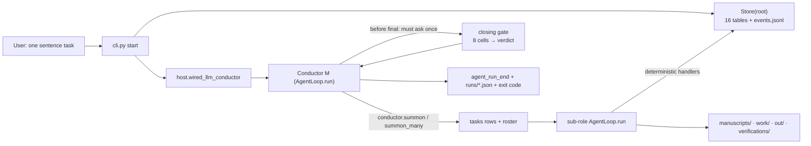

# Incubator

> **Repository: `Incubator`** (this git repository, `D:\Incubator`).
> **Product: `agentflow`** (the Python package, CLI and web app that live inside it).
> The two names are not interchangeable: "this repository" is always **Incubator**;
> "this product / package / command" is always **agentflow**.

[](agentflow/pyproject.toml)
[](agentflow/pyproject.toml)
[](#project-status-and-limitations)
[](agentflow/DEVELOPMENT.md)
[](#license-and-citation)

**Incubator is the repository of a research project; its product is `agentflow`, an autonomous
multi-agent framework for mathematical research.** A conductor dispatches specialist roles —
retrieval, statement registration, relation analysis, research loops, numerical experiments,
attack steps, manuscript writing, review, proof verification and Lean formalization — and every
claim lands on an append-only ledger with evidence, cost and an audit trail you can re-derive.

**Current status (honest):** working and judge-backed, **not feature-frozen**, and **not
production-ready**. The real-machine acceptance target ("8/8 closing-gate cells on a real run")
**has been reached twice**, and both runs are exported under [`demo/`](demo/README.md) — see
[Project status and limitations](#project-status-and-limitations) for the readings and the caveats
that go with them.

## Table of contents

- [Naming: repository vs product](#naming-repository-vs-product)
- [What it is](#what-it-is)
- [Why it exists](#why-it-exists)
- [Key ideas](#key-ideas)
  - [The eight-cell closing gate](#the-eight-cell-closing-gate)
  - [Evidence and the signature chain](#evidence-and-the-signature-chain)
  - [The ledger and write authority](#the-ledger-and-write-authority)
  - [A declarative role surface](#a-declarative-role-surface)
- [Architecture](#architecture)
- [Requirements](#requirements)
- [Installation](#installation)
- [Quick start](#quick-start)
- [Going deeper](#going-deeper)
- [Repository layout](#repository-layout)
- [Documentation](#documentation)
- [Latest updates](#latest-updates)
- [Project status and limitations](#project-status-and-limitations)
- [Contributing](#contributing)
- [License and citation](#license-and-citation)
- [Acknowledgements](#acknowledgements)
- [Repository facts](#repository-facts读数判据在守)

## Naming: repository vs product

Two roots, on purpose. The git root is this directory (`D:\Incubator`, GitHub
`yujake/Incubator`); the product root is [`agentflow/`](agentflow/README-PRODUCT.md), where
`pyproject.toml` lives.

| Layer | Name | Where it appears |
|---|---|---|
| [`agentflow/docs/README.md`](agentflow/docs/README.md) | **the order to read in**: newcomer / run it / change code / design / limits / glossary — one hop from here |
| Repository | **Incubator** | git root, GitHub repo name, `.git`, `git clone https://github.com/yujake/Incubator.git`, `README.md`, `AGENTS.md` |
| Product / Python package / CLI | **agentflow** | `agentflow/`, `pyproject.toml` (`name = "agentflow"`), `python -m agentflow`, `pip install -e agentflow`, `agentflow --help` |
| Python import | `agentflow` | `import agentflow`, `from agentflow import cli` |
| Web app | agentflow web UI | `python -m agentflow web`, served from `agentflow/src/agentflow/web/static/` |

Rules of thumb: if the sentence is about **the checkout, the repo, git or this file**, write
**Incubator**; if it is about **the package, a command, a module or an import**, write
**agentflow**. "Incubator" is never an import name, and "agentflow" never names the repository.
Commands below that say "run in `agentflow/`" mean that product directory.

The documents and the prompts use Chinese for many domain terms; this README keeps the English
name and gives the Chinese one so the two vocabularies can be matched:

| English (used here) | Chinese (used in docs and prompts) |
|---|---|
| ledger | 台账 |
| closing gate | 收工门（八格） |
| evidence grade / evidence kind | 证据等级 / 证据档位 |
| signature | 签 |
| summon / dispatch | 派活 |
| statement | 命题 |
| pending candidate | 待入库候选 |
| protected zone (FC-27) | 禁改区 |
| tri-state (0 / 1 / 2) | 三态 |
| local dev gate | 本机开发门 |

## What it is

`agentflow` turns one sentence of research intent into a traceable research record. Rather than
letting a single model answer in one pass, it assigns the work to fixed roles with **disjoint
authority** and makes every step land on an append-only ledger.

- **Eleven roles.** Ten specialists plus a conductor: **A** literature retrieval, **B** statement
  ledger, **C** relation analysis (read-only), **D** research loop, **E** numerical experiments,
  **F** multi-round attack, **G** manuscript writing, **H** review (read-only), **V** proof
  verification (read-only), **L** Lean formalization, and **M**, the conductor. **67 actions**
  are declared across them, **56** of which are summonable.
- **Sixteen ledger tables.** Statements, concepts and relations, literature and pending
  candidates, conjectures, research questions, attack plans, experiments, manuscripts,
  dependencies, review findings, analysis reports, requests, tasks and usage —
  each a JSON snapshot, plus one append-only `data/events.jsonl` from which every snapshot can be
  rebuilt. A seventeenth table, `eval_results`, was retired on 2026-11-22 — it never
  had a writer.
- **A hard closing gate.** Eight cells are computed from the ledger (never typed by hand); each
  reports `pass` / `fail` / `unknown` / `na`, and the gate reduces them to a tri-state verdict
  (`pass` / `fail` / `unknown`) with exit codes `0` / `1` / `2`.
- **Evidence, not adjectives.** A five-bit model (`numeric`, `proof`, `reviewed`, `formal`,
  `audited`) mechanically derives each statement's grade; a row that says "theorem" must be
  readable in the table that owns proofs.
- **A persistent workspace.** A workspace is a plain directory: tables, event log, sessions,
  manuscripts, artifacts and signatures survive across runs, processes and instances.
- **A read-only web surface.** `python -m agentflow web` serves a local dashboard over the same
  ledger. Its built frontend is committed, so Node is not needed to view it.

It can also drive a single role as a chat-like loop, but its main strength is research mode: a
persistent workspace where many roles work across many turns and sessions while keeping a record
of what was claimed, what was checked, what was refused, and what it cost.

### Five ways to run it

| Form | Command (run in `agentflow/`) | Roles | Typical use |
|---|---|---|---|
| Multi-role research | `python -m agentflow --root <ws> start --task "…"` (`--mode research`, or `auto`) | conductor **M**, who summons A/B/C/D/E/G/H; V and L are summoned by B/E/F | the main path: long research, cross-session |
| Single-role loop | `python -m agentflow --root <ws> start --mode role --role B --task "…"` | exactly one role | debugging a role, re-running one step |
| Topic pipeline | `python -m agentflow --root <ws> start --mode topic --task "…"` | retrieval → extraction → topic run (`runflow.run_topic`) | a small one-shot job |
| Read-only web | `python -m agentflow --root <ws> start --watch` | none (no model calls) | watch sessions, ledger and board |
| Offline self-check | `python -m agentflow --root <ws> doctor` (or `init` → `submit` → `run-a --provider fixture`) | none | check this machine and the record path without a model |

> The old offline demo is **retired**（已退场）: `agentflow demo`, the library entry point
> `agentflow.demo`, its artifacts and fixtures were removed wholesale on 2026-11-22
> (owner ruling DEMORETIRE). `cli demo` is the **old path**（旧路径）: the name remains
> parseable, but it exits `2` with a pointer and the library has no replacement implementation.
> See [Project status and limitations](#project-status-and-limitations).

## Why it exists

A single model answering a research question in one pass has three problems this project refuses
to paper over:

1. **No separation of authority.** The same model that retrieves a paper also decides whether it
   supports a claim, writes the manuscript, and declares the work done. Mistakes have no place to
   show up.
2. **No auditable evidence.** "Proved" in prose is indistinguishable from "plausible". A claim
   that is not tied to a checker's verbatim output, a quote from the source, or a reviewer's
   signed verdict cannot be re-derived later.
3. **No honest reading of "done".** Most agents stop when they run out of ideas and call it
   completion. Here "done" is a mechanical verdict: eight cells, computed from the ledger, with a
   separate "could not check" state so that "not checked" never reads as "passed".

The design answers are, in order: **disjoint role authority**, an **evidence and signature
chain**, and a **closing gate** whose cells are computed rather than asserted.

## Key ideas

### The eight-cell closing gate

"Can this be delivered?" is not a judgement call. `closing.DEFAULT_CHECKS` defines eight cells;
each is computed from the ledger and reports one of four states — `pass`, `fail`, `unknown`,
`na` — and `na` is **not** a pass (it is not in the pass count, nor in the denominator).

| # | Cell | What it asks |
|---:|---|---|
| 1 | `contradictions` | no unresolved contradiction (disputed/refuted dependencies, disputed statements, unresolved reviews) |
| 2 | `load_bearing` | every load-bearing claim is backed, or has been honestly downgraded |
| 3 | `report_shape` | the report has the three attachments (sources / basis / version sha) and the declared form |
| 4 | `user_pending` | no question is still waiting on a human answer |
| 5 | `substance` | at least one substantive table is non-empty (tasks and usage do not count) |
| 6 | `acceptance` | every machine-checkable row of `out/package/ACCEPTANCE-CHECKS.json` holds |
| 7 | `artifact_ledger` | `ARTIFACTS.jsonl` agrees with what is on disk |
| 8 | `literature_pending` | the pending-literature table has no `pending` rows and was cleared |

The verdict is one function (`closing.closing_verdict`): `pass` means no `fail` and no `unknown`
cell, at least one `pass`, the conductor says done, retirement is complete, programs are stopped,
and there is no blocker. Exit code `0` = deliverable, `1` = blocked, `2` = **could not check**.
The `2` is the important one: it is not a soft `0`.

### Evidence and the signature chain

Strength is a grade, not a slogan. Each statement carries five bits; the grade is derived
mechanically and may not be self-reported:

```text
conjecture        no evidence
strong_conjecture backed by an ordinary numerical experiment
pre_theorem       a V signature, but not machine-checkable
theorem           a V signature AND machine-checkable (Lean formalization or an exhaustion certificate — same tier)
```

The chain from a sentence in a manuscript back to an object on disk is:

```text
claim (documents.claims)
  → dependency rows (statements / experiments / literature, with page_range and quote)
  → evidence rows (proof_text, result + code_hash + exit_code)
  → quote verification (quote_verified / quote_span; three-state, not a boolean)
  → V signature (verifications/… + out/vsigns/<sha>.json; F/B need 3/3 consecutive passes, E's exhaustion path 1/1)
  → manuscript sign block (nine cells; its sha must equal the current body's sha)
  → closing gate (eight computed cells)
  → acceptance table (ACCEPTANCE-CHECKS.json, row by row)
```

Every link points at a real object. Break one, and the downstream "theorem" stops being true —
the framework has named refusals for exactly those breaks (`proof_without_v_sign`,
`quote_not_found`, `sign_count_short`).

Experiments are the numeric end of the same chain. Role E runs them through one entry point with
four methods (`numeric`, `symbolic`, `exhaustive_search`, `formal`); each run records its method,
its result (`supports` / `refutes` / `inconclusive`), its code path and hash, the checker's real
output and its real exit code. A `formal` run needs a Lean source file and may claim `proof` only
when the checker says so; a refutation is a first-class result, not a failure.

### The ledger and write authority

Every table is a JSON snapshot `{"schema_version": 2, "rows": [...]}`; every write also appends
to `data/events.jsonl`. Writes are transactional and take a per-table file lock, so concurrent
roles cannot interleave a partial row. `Store.rebuild()` replays the event log into the
snapshots, which is why a damaged snapshot is recoverable and an audit can be re-run.

Every step is also an event in `sessions/<sid>.jsonl`. Two things follow: a run can be
**continued** from its checkpoint — or rebuilt from the transcript when a killed run wrote no
checkpoint — and a finished run can be **inspected** after the fact (which role did what, with
which arguments, and what came back). A human can interject mid-run; interjections are delivered
at the next step boundary and recorded as events, so "was it received" is a readable fact.

Authority is enforced in three places, not one:

- **Generic write path.** `store.direct_write_refusal` refuses ordinary `table.create/update`
  on `statements`, `dependencies`, `conjectures`, `documents` and `lit_candidates`; their legal
  writers are code paths (B's registration, E/F/B's conjecture ledger, G/H's manuscripts, A's
  candidate desk).
- **Tool surface.** Read-only roles (C, H, V) structurally receive no write tools; the few
  ledger-writing proxies they do have are registered one by one with a written reason
  (`tools/base.py`'s `READONLY_CALL_EXCEPTIONS`).
- **Declaration.** The action table, its edges and its write sets are all derived from one
  per-role declaration (next section).

### A declarative role surface

A role is declared once in `src/agentflow/specs/<role>.py`: its actions, its edges (who may
summon it, whom it may summon), its write sets, and its notes. From that single declaration the
framework derives the capability table, the allowed-edge matrix, the write sets, and the
non-summonable set — so "who may do what" has exactly one definition. `capabilities.py` holds
the authoritative tables; `assert_capabilities()` cross-checks the two layers with eight
assertions.

Structural facts that follow, and that the judges pin:

- **M cannot be summoned.**
- **C and V have no outgoing edges** — a read-only conclusion cannot issue requests.
- **B is the only hub** (five inbound, five outbound edges).
- **L exists only when Lean is enabled**, and only B may summon it.

## Architecture

Eight layers, each with a real implementation and its own judges: **data** (`schema.py`,
`store.py`, `data/`) · **declaration** (`specs/*.py`, `capabilities.py`, `agentspec.py`) ·
**tools** (`tools/*.py`, `tools/base.py`) · **roles** (`agent_a` … `agent_v`) · **loop**
(`agent_loop.py`, `llmseam.py`, `modelgw.py`) · **orchestration** (`conductor.py`, `host.py`,
`cli.py`, `runflow.py`) · **quality** (`closing.py`, `verify.py`, `wellformed/`, `scripts/`) ·
**user-facing** (`cli.py`, `src/agentflow/webui/`, `ui/`).

The main trunk, in one picture:



The full, implementation-linked architecture — every layer, all eleven role cards, all
sixteen tables, the run lifecycle, the gate's four states, and the evidence/signature chain —
is in **[`agentflow/docs/SYSTEM-INTRO.md`](agentflow/docs/SYSTEM-INTRO.md)**. It is a map, not a
spec: code and judges outrank it.

**Authority order** (highest first): code and judges → `agentflow/docs/INDEX.md` → the specs it
lists → design rationale → history.

## Requirements

| Requirement | Detail |
|---|---|
| **Python** | **3.11 or newer** (`requires-python = ">=3.11"`; the code uses `X \| None` annotations and dataclass features) |
| **OS** | Windows 10/11 is the reference platform (this repository was developed and measured there). The core is standard-library Python and is expected to work on Linux/macOS, but only Windows is exercised by the shipped gates |
| **Runtime packages** | exactly two: `filelock>=3.12` and `PyYAML>=6.0` (see [`requirements.txt`](requirements.txt)) |
| **Model provider** | required only for live model calls. Offline paths (`init`, `doctor`, `status`, `verify`, `--dry-run`, fixture retrieval) need none. With no key configured, a model run exits `2` and says so |
| **Node.js** | **only to rebuild the frontend** (`pnpm -C agentflow/ui build`). Not needed to run `python -m agentflow web`: the built artifacts are committed |
| **Lean 4** | **optional**, for formal verification only. Default off; when absent, formal conclusions are `unknown` and no row may claim `proof` |
| **Disk / network** | no database server and no web framework; the ledger is JSON plus an append-only event log |

`requirements.txt` is a mirror of `pyproject.toml`'s runtime dependencies; `requirements-dev.txt`
adds the test runner. See [Installation](#installation) and [Repository facts](#repository-facts读数判据在守)
for the commands that re-derive these numbers.

## Installation

Two supported ways. Both are run from the **repository root** (`D:\Incubator`).

### A. Editable install (recommended)

```powershell
python -m pip install -U pip setuptools wheel
python -m pip install -r requirements.txt
python -m pip install -e agentflow
```

`pip install -e agentflow` also installs `filelock` and `PyYAML` from
`agentflow/pyproject.toml`, so the `-r requirements.txt` line is a convenience for tooling that
expects it, not a second source of truth. It registers the console script `agentflow`, which is
the same entry as `python -m agentflow`.

Verify:

```powershell
agentflow --version        # agentflow 1.0.0
agentflow --help           # four verb groups + the legacy note
```

### B. Source tree, no install

```powershell
$env:PYTHONPATH = "agentflow/src"
python -m agentflow --version
```

This is the same code path; only the console-script shim is missing. Use it in CI or when you
cannot install into the environment.

### Optional extras and the dev gate

```powershell
python -m pip install -r requirements-dev.txt     # pytest for the local dev gate
python -m pip install -e "agentflow[pdf]"         # PDF text extraction (role A/B paths)
python -m pip install -e "agentflow[ocr]"         # scanned PDFs; pulls torch (heavy)
python -m pip install -e "agentflow[browser]"     # Playwright, only for browser end-to-end tests
```

The frontend build is independent of pip: `pnpm -C agentflow/ui install && pnpm -C agentflow/ui build`.

## Quick start

Every command below was executed on this checkout on 2026-11-22, except the real (non-dry-run)
`start` in step 3, which needs a model budget — its `--dry-run` form was executed. Exit codes and
key output are listed with each step. A **workspace is any directory** — use a scratch one, not
the repository. `--root` is the global switch that names it and must come **before** the
subcommand; omitted, it is the current directory.

### 1. Initialize a workspace

```powershell
python -m agentflow --root D:\scratch\ws init
```

`[init] 已初始化: D:\scratch\ws\data` · exit `0`. Creates `data/` with one empty JSON snapshot per
table plus `events.jsonl`; nothing else is required to start.

### 2. Preview what a run would do

```powershell
python -m agentflow --root D:\scratch\ws start --task "研究一个有限群的问题" --dry-run
```

exit `0`. Prints the plan (mode, model, budget, Lean switch, what would be summoned and written)
and **creates no directory, writes no byte, calls no model** — verified: the `projects/project1`
path it named was not created.

### 3. Start the run for real

Drop `--dry-run` from the same command; it initializes the workspace on the way if needed and
spends against `--budget-usd`:

```powershell
python -m agentflow --root D:\scratch\ws start --task "研究一个有限群的问题" --budget-usd 5
```

This needs a configured model provider. It is the unified entry point; see
[Going deeper](#going-deeper) for its four questions (what / where / how much / Lean).

### 4. Start a research run

The one-role-loop spelling of the same research path. Run it **from inside the workspace**
(`cd D:\scratch\ws`); a bare run uses the current directory as its root:

```powershell
python -m agentflow run-agent M `
  --task "研究这个问题：<your research question>。交付研究手稿与说明。" `
  --budget-usd 5 `
  --provider crossref,doaj,europepmc,openalex
```

That is the same execution body as `start` (the four older entry names are aliases of it, with
their flags and defaults unchanged). It needs a model key; with none configured it exits `2` and
prints a plain "no model is wired" message — not a traceback, and not `0`. Exit codes are part of
the contract: `0` final, `1` abnormal, `2` never started or usage error, `3` waiting for a user,
`4` stopped normally mid-way, `5` stopped normally without a final.

### 5. Read the record

```powershell
python -m agentflow --root D:\scratch\ws status     # table row counts          → exit 0
python -m agentflow --root D:\scratch\ws verify     # invariant audit           → exit 0, "错误 0 / 警告 0"
python -m agentflow --root D:\scratch\ws closing --no-index   # closing gate   → exit 2 on an empty workspace
```

`closing` exits `2` on an empty workspace on purpose: eight cells have nothing to judge, so the
reading is "could not check", not "passed". A populated workspace returns `0` (deliverable),
`1` (blocked) or `2` (not checked). `--no-index` keeps the check read-only.

### 6. Open the web UI

```powershell
python -m agentflow web                     # read-only; prints a URL, Ctrl-C to stop
python -m agentflow web --allow-writes      # enables the POST write surface
python -m agentflow web --port 8765 --json  # one JSON line: {"url": ..., "root": ...}
```

Verified: with `--port 8765 --json` the server printed
`{"url": "http://127.0.0.1:8765/", "root": …}` and `GET /` returned HTTP `200`. Read-only is the
default; write endpoints return `403` unless `--allow-writes` is given. Without an explicit
`--root`, this mode serves the nearest initialized workspace it finds from the current directory;
passing `--root` pins it.

## Going deeper

- **CLI manual** — [`agentflow/docs/USER-GUIDE-CLI.md`](agentflow/docs/USER-GUIDE-CLI.md):
  install, `init`, the four `start` modes, `--dry-run` / `--json`, progress (`status`,
  `stats gates`, `closing`), interjection / answering / stopping, resuming, common errors and the
  tri-state readings. Every command in it was actually run.
- **Web manual** — [`agentflow/docs/USER-GUIDE-WEB.md`](agentflow/docs/USER-GUIDE-WEB.md):
  read-only vs `--allow-writes`, ports and the `--root` trap, the ten pages and what each shows,
  the POST endpoints and CSRF, and the 403/400/409/404 `kind` values with fixes.
- **`start` in one place** — what to do / where / how much / Lean on or off, including
  `--mode auto|research|role|topic|project|cold|warm`, `--lean on|off|auto`,
  `--allow-foreign-entries`, and the `--json` plan keys. Start at
  [`agentflow/docs/USER-GUIDE-CLI.md`](agentflow/docs/USER-GUIDE-CLI.md) §2.
- **Budget, stop and resume** — `--budget-usd` caps a run and charges every model call to the
  usage ledger; `stop` is graceful, `stop --force` kills the registered process tree,
  `stop --status` reports the switch and live processes, and `--resume` continues a run from its
  checkpoint (or from the session transcript when no checkpoint was written). See
  [`agentflow/docs/USER-GUIDE-CLI.md`](agentflow/docs/USER-GUIDE-CLI.md) §4–§5.
- **Lean matrix** — [`agentflow/docs/LEAN-MODES.md`](agentflow/docs/LEAN-MODES.md): what each
  role may do in each Lean mode, what is refused, and the evidence ceiling without a checker.
- **The authoritative table of command names** — `python -m agentflow --help` (four verb groups)
  and `python -m agentflow --help-legacy` (the full old-name mapping).

### Workspace layout

A workspace is a plain directory; paths inside it are relative to its root and the framework
does not write outside it.

```text
<ws>/
  data/          ledger snapshots (one JSON per table) + events.jsonl
  source/        inputs (papers, drafts) — read only
  reference/     user-supplied references and the seed drop zone (not the shelf)
  code/          experiment scripts and Lean sources produced by the roles
  library/       the registered shelf — flat files, only what `literature` rows point at
  manuscripts/   manuscript bodies, one directory per role: <role>/<kind>-<no>.md
  work/          drafts, one directory per role: <role>/<kind>-<no>.md
                 plus handoffs.jsonl — the handoff ledger (not a manuscript)
  verifications/ V's ledgers (in-register and pending)
  out/           package/, report/, exp-logs/, vsigns/, roster/, sysguard/
  runs/          per-run params/results, checkpoints, stop switch
  sessions/      one append-only event log per session
  notes/         per-role notes (not handed off)
```

`source/` is **input** (never modified), `out/` is **output**, `data/` is the **record**,
`sessions/` is the **trace**, and `runs/` is the **control plane** (pid registrations, the stop
switch, stop history). `python -m agentflow --root <ws> status` is the cheapest way to see it.

Layouts written before 2026-11-22 are **no longer read**: `reports/`, `documents/`,
`manuscripts/handoffs.jsonl`, `out/paper` / `out/review` / `out/experiments`, and the
old `library/<id>/` subdirectory form now report "old layout (unsupported)" instead of
being silently accepted. Read such a workspace with the code of its era — the current
code refuses it, and it does not migrate it.

### Troubleshooting

- **`lean_disabled` on a machine that has Lean** — the setting and the CLI flag are separate;
  set `toolchain.lean_enabled` in settings or `AGENTFLOW_LEAN_ENABLED=1`.
- **A run exits at once** — check `stop --status`; a leftover stop switch makes every new run
  finish at step zero (`stop --clear` removes it).
- **`--resume` cannot find a checkpoint** — it falls back to the session transcript; if that is
  empty too, the run never produced a step.
- **`verify` exits non-zero** — the message names the table and the row; most findings are
  dangling references or a claim whose evidence is stronger than its backing.
- **A role cannot call a tool it "should" have** — the call-time authority check is
  authoritative; `tools --role <R>` prints the surface that role actually receives.
- More: [`agentflow/docs/USER-GUIDE-CLI.md`](agentflow/docs/USER-GUIDE-CLI.md) §6 (common
  errors and the tri-state readings).

### CLI at a glance

The parser exposes **29 subcommands**; `build_parser()` is the source of truth. The top-level
help prints four verb groups (`incubate` / `inspect` / `run` / `serve`) plus a short "old names
still work" note, and `agentflow --help-legacy` prints the full 29-row mapping.

```text
incubate   init start stop status answer inbox submit interject
inspect    status-report stats evidence artifacts analyze tools cache budget doctor verify
run        topic pipeline run-a run-b run-agent repair rebuild project closing
serve      web demo
```

The group names are not subcommands: `agentflow inspect stats` is folded back to
`agentflow stats` before parsing, so every old name keeps its flags, defaults, output and exit
code. `repair`, `rebuild`, `demo` and `evidence migrate` are **controlled retirements**: still
parseable, but they exit `2` with a replacement pointer — not silence, and not `0`. The library
implementations that remain (`Store.rebuild()`) are untouched; the offline demo was removed
outright on 2026-11-22.

## Repository layout

```text
Incubator/                        # git root — this repository
├── README.md                     # this file (the authoritative user-facing README)
├── AGENTS.md                     # how coding agents work here (R1–R4)
├── requirements.txt              # runtime deps, mirrored from pyproject
├── requirements-dev.txt          # dev-only deps (pytest); local dev gate
├── agentflow/                    # the product root (pyproject.toml lives here)
│   ├── src/agentflow/            # the package
│   │   ├── schema.py store.py    # data layer: table contracts, transactions, events, locks
│   │   ├── specs/                # one declaration per role (actions / edges / write sets)
│   │   ├── tools/                # the model-visible tool surface
│   │   ├── tools/*_tools.py      # **19** 个 `*_tools.py`（工具层按角色装配，见 `python -m agentflow tools`）
│   │   ├── agent_a … agent_v/    # per-role deterministic implementations
│   │   ├── agent_loop.py         # the ReAct loop; llmseam / modelgw / modelclient
│   │   ├── conductor.py host.py  # orchestration, roster, dispatch
│   │   ├── closing.py verify.py  # the closing gate and the invariant audit
│   │   ├── wellformed/           # malformed-artifact judges (13 kinds)
│   │   ├── web/                  # web server + committed `static/` frontend build
│   │   └── .noai-paths           # FC-27 protected zones (see agentflow/AGENTS.md)
│   ├── docs/                     # specs, rationale, history — mapped by docs/INDEX.md
│   ├── scripts/                  # long-lived gates: noai_gate, lint_rules, release_check…
│   ├── tools/                    # release orchestration and one-off probes
│   ├── tests/                    # LOCAL DEV GATE — not shipped with the repository
│   ├── seed/                     # literature seed package (files only; never writes the ledger)
│   ├── ui/                       # Preact + Vite frontend project (Node/pnpm, build-time only)
│   └── data/                     # empty default-workspace ledger (committed)
├── draft/                        # owner rulings and work orders — LOCAL, not committed
├── projects/                     # real-machine run data — LOCAL, not committed
├── test/ · temp/ · _env/         # local test inputs, scratch probes, optional Lean toolchain
└── .gitattributes .gitignore
```

`draft/`, `projects/`, `test/`, `temp/` and `_env/` are git-ignored: a fresh clone will not have
them. If you cite them, say "local, not committed". `agentflow/tests/` is likewise a **local dev
gate**: it is not part of the delivery surface (owner ruling 2026-11-21), so a clean clone has no
`tests/` and a clean clone cannot reproduce the judge claims — the shipped gates (closing,
`verify`, lint, FC-27 gate) still run.

## Documentation

`agentflow/docs/INDEX.md` is the authoritative map: which document is the current spec, which is
history, and which is design rationale. Code and judges outrank all of them. Start with these
nine, in this order:

| Document | Read it for |
|---|---|
| [`agentflow/docs/SYSTEM-INTRO.md`](agentflow/docs/SYSTEM-INTRO.md) | the system overview: eight layers, all eleven roles, sixteen tables, one run's lifecycle, the gate and evidence chains, current boundaries — every number with its recompute command |
| [`agentflow/docs/INDEX.md`](agentflow/docs/INDEX.md) | which document is current / historical / rationale, and how to recompute the readings |
| [`agentflow/docs/USER-GUIDE-CLI.md`](agentflow/docs/USER-GUIDE-CLI.md) | the CLI manual, from install to resuming, with real exit codes |
| [`agentflow/docs/USER-GUIDE-WEB.md`](agentflow/docs/USER-GUIDE-WEB.md) | the web manual: pages, endpoints, CSRF, status codes |
| [`agentflow/docs/ROLE-SPECS.md`](agentflow/docs/ROLE-SPECS.md) | the eleven roles' normative surface: duties, actions, edges, write sets |
| [`agentflow/docs/LEAN-MODES.md`](agentflow/docs/LEAN-MODES.md) | the full Lean-on / Lean-off matrix and the evidence ceiling |
| [`agentflow/docs/DESIGN-BASELINE.md`](agentflow/docs/DESIGN-BASELINE.md) | the current design baseline (B01–B51) and the authority order |
| [`agentflow/docs/DEVELOPMENT-SPEC.md`](agentflow/docs/DEVELOPMENT-SPEC.md) | how to change code and how to verify it; the six hard rules and the forbidden-pattern list |

## Latest updates

- **2026-11-22 — DEMORETIRE.** The offline demo was removed wholesale: `agentflow.demo`, the
  CLI implementation, `demo/run/` artifacts and `demo/sources/` + `demo/fixtures/` fixtures.
  `agentflow demo` still parses but exits `2` with a pointer. Offline retrieval (`--provider
  fixture`) survives.
- **2026-11-21 — Seed corpus and strict prompt alignment.** Verified historical real-machine
  downloads are exported as a seed package (`agentflow/seed/`); injecting them writes no ledger
  row and A still has to admit each one. The owner's strict prompt-alignment phase began: prompts
  must match the tool surface, the judges, the role's duty and the other roles.
- **2026-11-20 — A4 retirements and a guard-fault split.** `rebuild`, `demo`, `repair` and
  `evidence migrate` became controlled retirements (exit `2` + pointer) while their library
  implementations were kept; `tools/attack_tools.py`'s `_guard` now separates "framework bug"
  from "your submission was invalid".

## Project status and limitations

**Working, judge-backed, and not feature-frozen.** The research loop runs end to end on a real
machine, and the local suite is judge-style — it asserts what the framework refuses, not only
what it produces. The following are stated rather than hidden:

- **The real-machine acceptance target has been reached twice (readings, 2026-11-25).**
  Both runs finished with **8/8 closing-gate cells, `can_close=true`, exit 0**, and both are
  exported file by file under [`demo/`](demo/README.md):

  | run | closing gate | spend / wall clock | paper | ledger |
  |---|---|---|---|---|
  | `demo/sylow-4` | 8/8 · can_close · exit 0 | $1.93 of $3 · 114 min | `out/package/main.pdf`, 7 pages | 4 statements · 4 literature |
  | `demo/lp-ball-22` | 8/8 · can_close · exit 0 | $7.17 of $10 · 10 h 0 min | `out/package/main.pdf`, 10 pages · `MAPPING.json` 4 rows | 144 statements · 24 experiments · 107 relations · 25 literature |

  Re-derive the gate with
  `python -m agentflow --root demo/<run> closing --project-dir demo/<run> --report demo/<run>/out/report/REPORT.md --sid <sid> --cap-usd <cap>`;
  the export carries `data/`, `sessions/`, `verifications/` and `out/` so every number above is
  recomputable from the directory itself. **Caveats that do not go away:** Lean was off, so no
  proof is machine-checked (the top tier is a V line-by-line signature); the lp-ball piecewise-max
  claim is numerically supported (a stated strong conjecture) except the four signed theorems; and
  ten statements remain unsigned with one manuscript unrepaired — recorded in the export, and not
  a blocker of the gate.
- **Lean is off by default.** Without a usable toolchain, formal experiments are refused in a
  controlled way (`lean_disabled` and `no_backend` are different fixes), and no row may claim
  `proof`; text proofs top out at `pre_theorem` (a V line-by-line signature). An exhaustion
  certificate is the same tier as Lean, so Lean being off does not block that path.
- **`tests/` is not shipped.** It is a local development gate. A fresh clone has no `tests/`;
  `import agentflow`, `agentflow --version` and product runs do not need it. Release-gate steps
  that need it record `unknown` with a reason — never `pass`.
- **The offline demo is retired.** `agentflow demo`, `agentflow.demo`, its artifacts and its
  fixtures were removed on 2026-11-22 (DEMORETIRE). The command name remains but exits `2` with a
  pointer. Offline retrieval still works via `--provider fixture`, with the candidate list at
  `<workspace>/fixtures/candidates.json` (the repository no longer ships one).
- **Two defaults that bite.** `--root` defaults to the **current working directory** (so a bare
  `agentflow status` in an empty directory creates and reads *that* directory, and `--help` prints
  the absolute default). `--projects-dir` is a separate axis whose default is the
  repository-level `projects/` directory, **not** `<root>/projects` — that only applies when you
  pass `--root`.
- **Retired commands are controlled retirements.** `rebuild`, `repair` (except
  `--backfill-grades`) and `demo` stay in the parser but exit `2` with a replacement pointer —
  not silence, and not `0`.
- **`cache_tools` is not wired** into the conductor's tool surface (`cache.status` / `cache.warm`
  are CLI and web only); `agentflow/docs/KNOWN-UNWIRED.md` is the single register.
- **A number in prose is a reading, not a spec.** Re-derive it with the commands in
  [Repository facts](#repository-facts读数判据在守) before trusting it.

## Contributing

This repository is a research project with a strict change discipline; read the rules before
touching anything.

- **[`AGENTS.md`](AGENTS.md) — how a coding agent works here (R1–R4).** Evidence before repair;
  probes and one-off scripts go under `temp/`; one topic per commit; gates are the floor, not the
  goal. Rule R1 is the important one: for a real run, a full test suite, or any unexpected
  behaviour, gather **on-disk evidence first** (event stream, run params/results, task ledger,
  table snapshots with hashes), locate the incident, then fix. Do not start from a hypothesis.
- **[`agentflow/AGENTS.md`](agentflow/AGENTS.md) — FC-27 protected zones (its only subject).**
  Some paths are human-only because their failure is irreversible even when every test is green
  (permissions/audit, evaluation semantics, provenance keys, schema migration, release scripts,
  the verifier bridge). A change there must be **written by a human, or line-by-line reviewed by
  a human, and approved by 2 reviewers** (`scripts/noai_gate.py` enforces the gate and exits
  `1` on a hit; `0` clean, `2` could not check). The manifest is duplicated in `agentflow/.noai-paths`
  and the two copies must stay identical.
- **[`agentflow/DEVELOPMENT.md`](agentflow/DEVELOPMENT.md)** — the entry pointer: read
  `DEVELOPMENT-SPEC.md` §5 (six hard rules), §8 (forbidden patterns P1–P18) and §6 (Definition of
  Done) before changing code.
- **Local gates** (on a checkout that keeps `tests/`):
  `python -m pytest -q`, `python agentflow/scripts/lint_rules.py`,
  `python agentflow/scripts/noai_gate.py --git --since <ref>`,
  `python agentflow/tools/repo_survey.py --root .`.
  The repository-size guard may go down but never up (baseline 72 / 95 / 2).

Pull requests should say which judge pins the change, and whether it touched an FC-27 zone. If it
did, list the two reviewers. Do not commit with `git add -A`; stage only what the topic owns.

## License and citation

**License: Proprietary — all rights reserved.** The full terms are in the repository's
[`LICENSE`](LICENSE) file (owner's choice; no open-source license is granted). The package
metadata says `license = { text = "Proprietary" }` (`agentflow/pyproject.toml`), and the
`demo/` exports are covered by the same terms. Do not copy, modify, redistribute or use the
code without the copyright holder's written permission.

**Citation:** no `CITATION.cff` exists yet. If you need to cite this work, cite the repository
(`Incubator`, `https://github.com/yujake/Incubator`) and name the release/commit you used, and
say which `PROMPT_VERSION` the run used when reporting research output.

## Acknowledgements

This project builds on ideas from evidence-graded claim ledgers, append-only event sourcing,
three-state exit-code discipline, and the Lean theorem prover. It uses
[`filelock`](https://pypi.org/project/filelock/) and [`PyYAML`](https://pypi.org/project/PyYAML/)
at runtime; the optional extras credit PyMuPDF, pdfminer.six, PyPDF2, easyocr and Playwright. The
frontend is Preact + Vite. None of these projects endorse this one.

## Repository facts（读数，判据在守）

This section is the set of readings a machine checks. Every number here has a judge behind it;
change a number without changing the source and a test goes red. **Readings, not specifications.**

```text
agentflow/.noai-paths            禁改区清单（**71** 条 glob / **68** 条唯一路径，**7** 个分组；2026-11-21 tests/golden 四条随 tests 不入 git 一并摘除）
agentflow/src/agentflow/tools/   **19** 个 `*_tools.py`（工具层按角色装配，见 `python -m agentflow tools`）
```

- **16 tables** — `len(schema.TABLES)`; a seventeenth, `eval_results`, is retired (`schema.RETIRED_TABLES`, no writer).
- **11 roles** = ten specialists (A–H, V, L) + conductor M — `len(schema.ROLES)`, `schema.CONDUCTOR_ROLE`.
- **67 actions / 56 summonable** — `sum(len(v) for v in capabilities.CAPABILITIES.values())` and
  `sum(len(capabilities.actions_for(r)) for r in capabilities.ALLOWED_EDGES["M"])`.
- **8 closing-gate cells** — `len(closing.DEFAULT_CHECKS)`. The four states are `pass` / `fail` /
  `unknown` / `na`, and `na` is not a pass.
- **29 subcommands** — `len(next(a for a in build_parser()._actions if getattr(a, "choices", None)).choices)`.
- **123 / 126 tool items** — the union of the per-role faces with Lean off (123; `formal.*` and L
  are absent) and the full declared count with Lean on (126).
- **12 lint rules, `R001–R012`** — `scripts/lint_rules.py` (`R004`/`R006` are retired and
  registered in `RETIRED_RULES`). The three `--json` writers (`scripts/lint_rules.py`,
  `tools/release_all.py`, `tools/run_each_test_file.py`) all write with `newline=""`, so their
  output is pure LF on this platform: **CR=0**, platform-independent.
- **Repository-size guard 72 / 95 / 2** — files over 800 lines / source functions over 200 lines
  / duplicate docstring segments, from `python tools/repo_survey.py --root .`. Baseline is
  72 / 95 / 2: it may go down, never up.
- **Version 1.0.0 / `PROMPT_VERSION` p315** — `agentflow/pyproject.toml` and
  `agentflow.agent_prompts.PROMPT_VERSION`. Prompt digests and `PROMPT_VERSION` move together.

Recompute (from `agentflow/`, with `$env:PYTHONPATH = "src"` or after an editable install):

```powershell
python -c "import sys;sys.path.insert(0,'src');from agentflow import schema as s;print(len(s.ROLES),len(s.TABLES))"
python -c "import sys;sys.path.insert(0,'src');from agentflow import capabilities as c;print(sum(len(v) for v in c.CAPABILITIES.values()),sum(len(c.actions_for(r)) for r in c.ALLOWED_EDGES['M']))"
python -c "import sys;sys.path.insert(0,'src');from agentflow import closing as C;print(len(C.DEFAULT_CHECKS))"
python -c "import sys;sys.path.insert(0,'src');from agentflow import agent_prompts as A;print(A.PROMPT_VERSION)"
python -m agentflow --help
python tools/repo_survey.py --root .
python scripts/lint_rules.py
```
