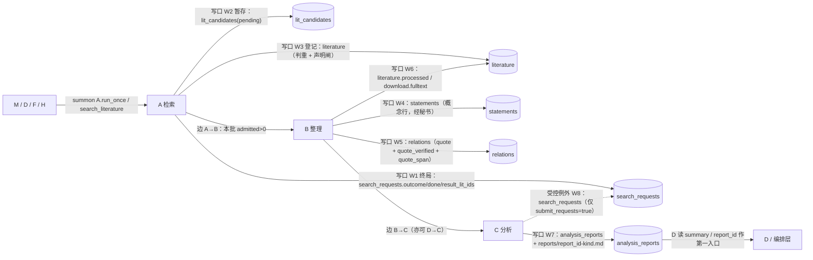

# CHAIN-A-B-C：文献 → 证据 → 命题 → 分析报告

> 基线：2026-11-22。角色声明真身 `src/agentflow/specs/{a,b,c}.py`；权限表 `src/agentflow/capabilities.py`。
> 本文数字都是现算读数；命令在文末。真机证据只读 `projects/lp-ball-15`（已收工）与 `projects/lp-ball-16`（取数时仍在跑）。

## 1. 完整链路



判据落在每一段的两侧，不在链尾补：

| 段 | 写口 | 写之前 / 写之后必须过的判据 |
|---|---|---|
| A 认领与检索 | `search_requests` | 租约与 `attempts`（`src/agentflow/agent_a/core.py::_Core._claim`）；逐源三态（`agent_a/core.py::_Core._search_along_wiring`）；`no_results` 与 `search_failed` 分开（`agent_a/run_once.py::_RunOnce.run_once`） |
| A 暂存候选 | `lit_candidates` | 配额 / 重叠 / `require_judged` / `require_readback`（`agent_a/run_once.py::_RunOnce.run_once`、`src/agentflow/litstage.py::admission_plan`） |
| A 登记文献 | `literature` | 判重键（`src/agentflow/agent_a/run_once.py::_RunOnce.run_once`）；用户声明闸（`src/agentflow/agent_a/run_once.py::_RunOnce.run_once`） |
| B 抽取 | `statements` / `relations` | 概念同一性（`agent_b/run_once.py::_RunOnce.run_once`）、判重（`agent_b/run_once.py::_RunOnce.run_once`）、I6 冲突（`agent_b/run_once.py::_RunOnce.run_once`）、逐字回验（`agent_b/run_once.py::_RunOnce.run_once`） |
| B 登记命题 | `statements` / `dependencies` | 秘书的 `record_statement`（`src/agentflow/secretary_statement_tx.py::StatementTxMixin._record_statement_tx`）；V 签（`src/agentflow/specs/b.py::SPEC.brief.policy`） |
| B 二阶段 | `reports/b-proof-*.md` + `statements` | 冻结闸（`src/agentflow/manuscriptfreeze.py::MANUSCRIPT_FROZEN`）；`stage_two.unwashed`（`agent_b/stage_two.py::_StageTwoSelfDrive._stage_two_self_drive`） |
| C 分析 | `analysis_reports` | `kind ∈ REPORT_KINDS`、`summary`/`markdown` 非空（`agent_c/_support.py::AnalysisReport.persist`） |
| C 缺口 | `search_requests` | veto + `max_gap_requests_per_run` + 在途上限（`agent_c/core.py::_Core._submit_gap_requests`） |

## 2. 步骤 · 谁做 · 写哪张表 · 谁来验 · 失败时的受控理由码

| # | 步骤 | 谁做 | 写哪张表 / 文件 | 谁来验（file:line） | 失败时的受控理由码 |
|---|---|---|---|---|---|
| 1 | 认领检索请求 | A | `search_requests`（`claimed_by` / `lease_until` / `attempts`） | A 自己的 `_claim`（`agent_a/core.py::_Core._claim`）；收工门第八格（`closing.py::_check_substance`） | `skipped_reason`（`no_pending_request` / `pending_requests_all_leased` / `pending_requests_all_in_backoff`）；`search_failed` / `gave_up` |
| 2 | 暂存与判收候选 | A | `lit_candidates` | `admission_plan`（`litstage.py::admission_plan`）；A 的 `lit.admit` / `lit.stage_reject` | `missing_relevance`（`litstage.py::admission_plan`）；`no_readback`（`litstage.py::_read_evidence_gate`） |
| 3 | 登记文献行 | A | `literature` | 判重（`agent_a/run_once.py::_RunOnce.run_once`）、声明闸（`agent_a/run_once.py::_RunOnce.run_once`） | `not_declared_reference` / `declaration_unreadable`（`agent_a/run_once.py::_auto_intake_declaration_refusal`）；`literature_dedup_key_missing`（`agent_a/run_once.py::_RunOnce.run_once`） |
| 4 | 把文献交给 B | A → B | 同 `literature` 行（`processed=false`） | B 的 `_claim`（`agent_b/core.py::_Core._claim`）；收工门 `acceptance` 的 `literature_unprocessed` | `no_unprocessed_literature` / `pending_literature_all_leased`（`agent_b/core.py::_Core._claim`） |
| 5 | 抽概念/关系 | B | `statements`（`kind=concept`）+ `relations` | `check_quote`（`agent_b/run_once.py::check_quote`）、`decide_relation`（`agent_b/run_once.py::check_quote`）、I6（`agent_b/run_once.py::check_quote`） | `concept_identity_unjudged`（`agent_b/run_once.py::_RunOnce.run_once`）；关系落 `suspect`（不拒、不丢） |
| 6 | 登记命题/证明/依赖 | B | `statements` + `dependencies` + `conjectures` | 秘书 `record_statement`（`secretary_statement_tx.py::StatementTxMixin._record_statement_tx`）；V 签（`src/agentflow/specs/b.py::SPEC.brief.policy`） | `missing_quote_reason` / `proposition_form_refused` / `concept_origin_refused`（`agent_b/register_statement.py::_RegisterStatement._register_statement_impl`）/ `citation_below_proof_review`（`depsection.py::REFUSED_LEVEL_TOO_LOW`）/ `dependency_section_missing`（`src/agentflow/depsection.py::REFUSED_SECTION_MISSING`） |
| 7 | 二阶段洗稿与替换 | B | `reports/b-proof-<B稿号>.md` + `statements` | V 签 + 冻结闸（`manuscriptfreeze.py::MANUSCRIPT_FROZEN`）；`stage_two.unwashed`（`agent_b/stage_two.py::_StageTwoSelfDrive._stage_two_self_drive`） | `manuscript_frozen` / `stale_target`（`agent_b/land_manuscript.py::_LandManuscript.land_manuscript`）/ `no_source_draft`（`agent_b/open_polish_copy.py::_OpenPolishCopy._polish_source`） |
| 8 | 图分析 | C | `analysis_reports` + `reports/report_id-kind.md` | `persist` 闸（`agent_c/_support.py::AnalysisReport.persist`）；收工读数 `c_products_in_delivery`（`closing.py::c_products_in_delivery`） | `kind=unknown` 不落盘；关系表为空 ⇒ `ok=False`（`agent_c/gaps.py::_Gaps.gaps`） |
| 9 | 缺口直连检索（条件性） | C | `search_requests` | veto + 每轮上限 + 在途上限（`agent_c/core.py::_Core._submit_gap_requests`） | `rejected_requests[]` 逐条理由：空 topic / 重复主题 / 超每轮上限 / 超在途上限（`agent_c/core.py::_Core._submit_gap_requests`–`agent_c/core.py::_Core._submit_gap_requests`） |
| 10 | 收工判收 | M | —（只读八格） | `closing.DEFAULT_CHECKS`（`closing.py::DEFAULT_CHECKS`） | `literature_pending` 的 `undecided_candidates` / `delegation_not_cleared`（`closing.py::_check_substance`）；`acceptance` 的 `unknown` |

## 3. 这条链上承重的是哪一格

**承重的是 B 写进 `relations` 的 `quote_verified`（同一行的 `quote_span` 是它的定位证据）**，不是 `analysis_reports` 那一行，也不是 `literature.path`：

- **只有这一格在回答「这条边有没有原文」**：B 的逐字回验把 `check_quote` 的三态写进 `relations.quote_verified`（`src/agentflow/agent_b/run_once.py::check_quote`），`quote_span` 同时落区间（`src/agentflow/agent_b/run_once.py::check_quote`）；B 的声明把这件事说成「下游唯一能拿原文比一比的东西」（`src/agentflow/specs/b.py::SPEC.brief.policy`）。
- **C 的「有缺口」直接由它一票否决**：相关关系的 `quote_verified` 全为 `False` ⇒ 候选直接出局（`src/agentflow/agent_c/core.py::_Core._evaluate_gap`–`src/agentflow/agent_c/core.py::_Core._evaluate_gap`）。没有这一格，C 会把「共同邻居多」当成「值得研究」，而报告看上去完全正常。
- **收工门也读它**：`quote_verified_rows` 把 `statements` 与 `relations` 合起来按 `evidencebits.quote_state` 计数（`src/agentflow/closing.py::_leg_reading`–`src/agentflow/closing.py::_leg_reading`）；命题侧还有一条独立的「一条都没核到不算交付」（`closing.py::content_leg_unmet`–`closing.py::artifact_ledger_reading`）。
- **为什么不是另外几格**：`literature.path` 是**前置条件**（没有全文时 B 会如实标 `processed` + `unreadable_reason`，链在这里就停，C 不会误判）；`statements` 是命题正文，但 C 的缺口否决读的是 `relations`；`analysis_reports` 是**产物**，它只能证明 C 跑过，不能证明 C 的依据是真的。

一句话：**A 决定「有没有这篇」，B 的 `relations.quote_verified` 决定「这条边算不算证据」，C 只在前一格为真时才可能产出承重的报告。**

## 4. 真机证据（只读 lp-ball-15 / lp-ball-16）

### 4.1 盘上读数

| 读数 | lp-ball-15（已收工） | lp-ball-16（13:37 快照，仍在跑） | 说明 |
|---|---|---|---|
| `literature` 行数 | 19 | 6 | A 的产出；16 的 6 条全部 `processed=true` |
| `search_requests` | 8（6 `ok` / 2 `no_results`） | 1（`ok`） | 委托入口 |
| `lit_candidates` | 61（19 admitted / 42 rejected；51 行有 `cleared_at`） | 8（6 admitted / 2 rejected；8 行都有 `cleared_at`） | 15 的 10 行没清表（`r-000003` 2/5、`r-000004` 3/5、`r-000008` 1/6） |
| `statements` | 190（177 concept / 13 theorem） | 30（30 concept） | B 的命题/概念面 |
| `relations` | 198（197 `quote_verified=true` / 1 `None`；193 active / 5 suspect） | 19（19 `quote_verified=true`） | 承重格在这里 |
| 有 `proof_text` 的命题 | 13（3 条 `pre_theorem` + `bits.reviewed=true`） | 0 | 二阶段还没有开稿（`open_polish_copy` 0 次） |
| `analysis_reports` | **0** | **0** | C 没被派过 |
| `tasks` 里 `role=C` | **0** | **0** | 链断在最后一跳 |

### 4.2 链路断点（同一张表）

| 链段 | lp-ball-15 | lp-ball-16 | 判定 |
|---|---|---|---|
| A → `literature` | 通：19 行；`r-000006/7` 是 `no_results`，`r-000008` 最终 `ok` | 通：6 行 | A 的「换规范术语再查」在 15 的 `r-000007 → r-000008` 上留了痕 |
| A → B | 通：B 10 趟、`own.run_once` 23 次、`own.register_statement` 49 次 | 正在走：`t-000007` 的 `called_by=A`、`parent=t-000002`（13:36:26 事件） | `A → B` 是真机走过的边（`agent_a/run_once.py::_RunOnce.run_once` 之后 A 派 B） |
| B → 证据 | 通：190 statements / 198 relations；197 条 `quote_verified=true` | 通：30 / 19，19 条全 true | 承重格在盘上非空 |
| B → 二阶段 | **没走完**：13 条有证明正文，只有 3 条 `pre_theorem`；10 趟 B run 里 `own.open_polish_copy` **0 次** | 未开始 | 二阶段欠账落在 `stage_two.unwashed`，不是收工门 blocker |
| B → C | **没走**：C 任务 0、`analysis_reports` 0 | **没走**：C 任务 0、`analysis_reports` 0 | 最后一跳缺失；输入其实在盘上（15 有 198 条 relations） |
| C → D | 无 | 无 | `c_products_in_delivery` 的 `analysis_reports=0` 会如实报 |

### 4.3 历史对照（证明这条链不是画出来的）

`projects/lp-ball-12`：`tasks` 里 C 1 行，`analysis_reports` 3 行（`hottest` 1 + `gaps` 2，`reports/000000-hottest.md` 等）；`lp-ball-6` 4 行、`lp-ball-7` 3 行。也就是说：**C 的产出只在 C 真被派到时才出现**，而 15/16 都在「B 交完、C 没被派」这一档。

## 5. 取数命令

```powershell
cd D:\Incubator\agentflow
# 单个项目的链上读数（把 lp-ball-15 换成 lp-ball-16 再跑一次）
python -c "import json,collections;d=r'D:\Incubator\projects\lp-ball-15\data';L=json.load(open(d+r'\literature.json',encoding='utf-8'))['rows'];S=json.load(open(d+r'\statements.json',encoding='utf-8'))['rows'];R=json.load(open(d+r'\relations.json',encoding='utf-8'))['rows'];T=json.load(open(d+r'\tasks.json',encoding='utf-8'))['rows'];A=json.load(open(d+r'\analysis_reports.json',encoding='utf-8'))['rows'];print('lit',len(L),'stmt',len(S),'rel',len(R),'C_tasks',sum(1 for r in T if r.get('role')=='C'),'reports',len(A),'qv',dict(collections.Counter(str(r.get('quote_verified')) for r in R)))"
# lp-ball-15 的候选清表分布（委托 -> [总行数, 已有 cleared_at 的行数]）
python -c "import json;rows=json.load(open(r'D:\Incubator\projects\lp-ball-15\data\lit_candidates.json',encoding='utf-8'))['rows'];ks=sorted({r.get('request_id') for r in rows});print({k:(sum(1 for r in rows if r.get('request_id')==k),sum(1 for r in rows if r.get('request_id')==k and str(r.get('cleared_at') or '').strip())) for k in ks})"
# lp-ball-16 的 A→B 活边（tasks 里 called_by=A 的 B 行）
python -c "import json;rows=json.load(open(r'D:\Incubator\projects\lp-ball-16\data\tasks.json',encoding='utf-8'))['rows'];print([(r['task_id'],r['role'],r.get('called_by'),r.get('parent_task_id'),r.get('status')) for r in rows if r.get('role')=='B'])"
```
