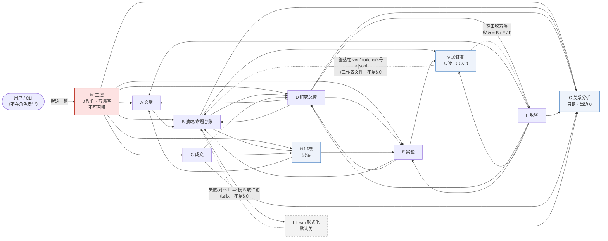
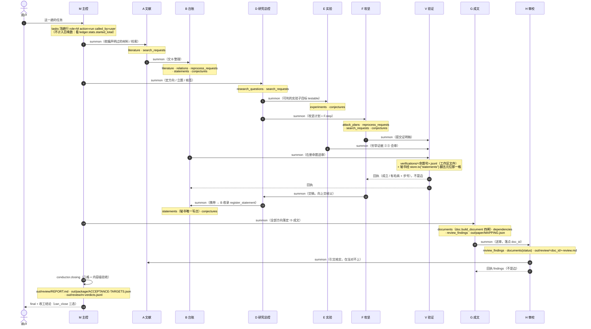

# 十一角色的协作链（总图 · 边表 · 典型流水 · 三条硬边界）

> ROLEDOC-4。真身只有一处：`src/agentflow/specs/<角色>.py` 的 `SPEC.edges`，
> `capabilities.ALLOWED_EDGES` 是它的派生（`src/agentflow/capabilities.py::ALLOWED_EDGES`；
> 派生函数 `src/agentflow/specs/__init__.py::edges`）。
> 本文的数字全部现算，脚本与输出在 `temp/roledoc4/`（`compute_facts.py` / `FACTS.txt`）：
> **11 个角色 · 32 条出边 · 10 个可召唤 · 1 个不可召唤（M）**。

---

## 1. 总图（11 角色 × 32 条边）

实线 = `ALLOWED_EDGES` 里的派活边（全部是 `conductor.summon` 那一条实现）；
虚线 = **不是边**的回报路径（签、汇报、回执）—— 画出来是因为它们最容易被误当成边。

读法：

| 标记 | 含义 | 机器读数 |
|---|---|---|
| 红框 | **不可召唤**（没有任何"召唤 M"这件事） | `NON_SUMMONABLE`（`src/agentflow/specs/m.py::SPEC.summonable`、`src/agentflow/capabilities.py::NON_SUMMONABLE`） |
| 蓝框 | **只读角色**（工具面结构性剥掉写工具；写集只含已登记例外） | `src/agentflow/tools/__init__.py::READ_ONLY_ROLES`、`src/agentflow/capabilities.py::READ_ONLY_WRITE_EXCEPTIONS` |
| 灰虚线框 | **默认不存在的角色**（Lean 开关 off 时 `is_hidden`；关着时它的两条边都判 `forbidden_edge` + `lean_off`） | `src/agentflow/leanscope.py::LEAN_ONLY_ROLES`、`src/agentflow/leanscope.py::is_hidden`、`src/agentflow/policy.py::check` |
| 出边 0 | `C` / `V`：**没有任何**"下一步"边；它们的产出走返回值 / 工作区文件 / 回执 | `src/agentflow/specs/c.py::SPEC.edges`、`src/agentflow/specs/v.py::SPEC.edges` |

---

## 2. 边表（32 条逐条）

> "边类型"这一栏是**语义分类**；结构上 32 条全是 `ALLOWED_EDGES` 里的派活边，
> 判定入口只有 `policy.check`（`src/agentflow/policy.py::check`），执行入口只有 `summon_begin`
> （`src/agentflow/conductor.py::Conductor._summon_preflight`；`Conductor.summon`（`src/agentflow/conductor.py::Conductor.summon`）是它的阻塞拼法，
> `summon_many` 走 `run_plan`（`src/agentflow/conductor.py::Conductor.cancel`）但前半段是同一个 `summon_begin`）。
> "定义处"给的是**真身**（`specs/<角色>.py` 的 `edges=`），派生行在 `capabilities.py::ALLOWED_EDGES`。

### M（7 条：主派活；不直连 F / V / L）

| 从 → 到 | 边类型 | 用来传什么 | 定义处 |
|---|---|---|---|
| M → A | 主派活 | 收编用户**点名**的本地材料（分批、逐字点名）、检索请求认领 | `src/agentflow/specs/m.py::SPEC.edges` |
| M → B | 主派活 | 抽取整理、命题登记、二阶段洗稿、用户指定后的形式化转交 | 同上 |
| M → C | 主派活 | 关系读数（hottest / gaps / contradictions）；产物即返回值 | 同上 |
| M → D | 主派活 | 研究侧执行的总入口：立题、派 F、补料、核签 | 同上 |
| M → E | 主派活（受限用法） | M 写的核验脚本、G8 复跑；**研究执行归 D**，M 不主动派 E 做实验 | 同上 |
| M → G | 主派活（成文阶段） | 全部方向落定后统一成文；论文正文由 G 自己写 | 同上 |
| M → H | 主派活 | 审校：审哪份稿、落点 `doc_id` | 同上 |

### A（1 条）

| 从 → 到 | 边类型 | 用来传什么 | 定义处 |
|---|---|---|---|
| A → B | 收编 / 交接 | 收到 `literature` 的文献交 B 整理（抽概念、建关系、落命题线索） | `src/agentflow/specs/a.py::SPEC.edges` |

### B（5 条）

| 从 → 到 | 边类型 | 用来传什么 | 定义处 |
|---|---|---|---|
| B → C | 关系分析 | 关系读数（确定性、只读、不落台账） | `src/agentflow/specs/b.py::SPEC.edges` |
| B → D | 上行（升级） | 证明缺陷严重时通知 D 开展研究（裁定给 D 的位置） | 同上 |
| B → H | 审校 | 命题台账 + 逐字出处交 H 判稿 | 同上 |
| B → L | **形式化唯一入口** | 用户指定后逐条安排形式化（B 判"值不值得付检查器成本"） | 同上 |
| B → V | 送审 | 命题/证明送 V 逐行走查并签 | 同上 |

### D（5 条）

| 从 → 到 | 边类型 | 用来传什么 | 定义处 |
|---|---|---|---|
| D → A | 回补 | 补检索（缺口 → 交给 A 去查） | `src/agentflow/specs/d.py::SPEC.edges` |
| D → B | 回补 | 补登记 / 补出处对齐 | 同上 |
| D → C | 回补 | 要关系读数（C 不做结论，只给确定性读数） | 同上 |
| D → E | 派活 | 实验子目标（带 `testable`） | 同上 |
| D → F | 派活 | 攻坚计划与推进（**F 只有 D 这一个入口**） | 同上 |

### E（3 条）

| 从 → 到 | 边类型 | 用来传什么 | 定义处 |
|---|---|---|---|
| E → B | 交接 | 实验落行后的命题 / 出处交 B | `src/agentflow/specs/e.py::SPEC.edges` |
| E → D | 上行 | 实验结论与阻碍交回父（D） | 同上 |
| E → V | 送审（特例） | 穷举证据的 ②③ 交 V 会审（作者是 E，判定是 V） | 同上（理由串 `src/agentflow/specs/e.py::SPEC.edges`） |

### F（5 条）

| 从 → 到 | 边类型 | 用来传什么 | 定义处 |
|---|---|---|---|
| F → A | 回补 | 攻坚缺的检索 | `src/agentflow/specs/f.py::SPEC.edges` |
| F → C | 回补 | 证明链 / 关系缺口读数 | 同上 |
| F → D | **上行交稿** | 手稿交父（D 携带 → B 收录）：`F→D` 是"向上交给父代理"那条边 | 同上（理由串 `src/agentflow/specs/f.py::SPEC.edges`） |
| F → E | 派活 | 把一条能判的子目标交给 E 去跑 | 同上 |
| F → V | 送审 | 提交证明、V 退回并指到要补的步骤 | 同上（理由串 `src/agentflow/specs/f.py::SPEC.edges`） |

### G（3 条）

| 从 → 到 | 边类型 | 用来传什么 | 定义处 |
|---|---|---|---|
| G → C | 回补 | 成文时重算关系读数 | `src/agentflow/specs/g.py::SPEC.edges` |
| G → D | 回补 | G 想补内容**都走 D**（G 不直接调 A/E/F） | 同上（理由串 `src/agentflow/specs/g.py::SPEC.edges`） |
| G → H | 送审 | 改完稿由 G 自己送回 H（H 不反过来召唤 G） | 同上 |

### H（2 条）

| 从 → 到 | 边类型 | 用来传什么 | 定义处 |
|---|---|---|---|
| H → A | 核实 | 引文对不上 ⇒ 找 A 核实原文 | `src/agentflow/specs/h.py::SPEC.edges` |
| H → E | 核实 | 断言能不能形式化 / 数值是否站得住 ⇒ 找 E | 同上（理由串 `src/agentflow/specs/h.py::SPEC.edges`） |

### L（1 条） · C / V（0 条）

| 从 → 到 | 边类型 | 用来传什么 | 定义处 |
|---|---|---|---|
| L → C | 梳理证明链 | 把 B 登记的证明摆成依赖链（哪步依赖哪步 / 旁挂 / 跳变 / 缺口） | `src/agentflow/specs/l.py::SPEC.edges` |
| C → （无） | — | C 一旦能发起动作就是"绕过 B 引文回验"的写入路径 | `src/agentflow/specs/c.py::SPEC.edges`；理由 `src/agentflow/capabilities.py::ALLOWED_EDGES` |
| V → （无） | — | V 的"退回"走回执，不是唤起 | `src/agentflow/specs/v.py::SPEC.edges`；理由 `src/agentflow/specs/e.py::SPEC.edges` |

### 入边表（谁派得动谁）

| 角色 | 入边（谁能派它） | 条数 |
|---|---|---|
| A | D / F / H / M | 4 |
| B | A / D / E / M | 4 |
| C | B / D / F / G / L / M | 6 |
| D | B / E / F / G / M | 5 |
| E | D / F / H / M | 4 |
| **F** | **D**（仅此一条） | 1 |
| **G** | **M**（仅此一条） | 1 |
| H | B / G / M | 3 |
| **L** | **B**（仅此一条；且 Lean 开着） | 1 |
| V | B / E / F | 3 |
| **M** | **无**（`NON_SUMMONABLE`） | 0 |

合计 32 —— 与出边表逐条对得上（核法：`temp/roledoc4/FACTS.txt` 的逐角色出度）。

### 五条最容易被画错的边

| 容易画成 | 实际 | 证据 |
|---|---|---|
| V → G（"V 签完交给 G 写论文"） | **不存在**。V 没有出边；签落在 `verifications/<号>.jsonl`，G 从台账读。G 的入边只有 M | `src/agentflow/specs/v.py::SPEC.edges`、`src/agentflow/specs/g.py::SPEC.edges` |
| M → F（"M 直接让 F 攻坚"） | **不存在**。走 `M→D→F`；点名 F 会被判 `forbidden_edge`，拒信让改派 D | `src/agentflow/specs/m.py::SPEC.brief.policy` |
| M → V（"M 去催签"） | **不存在**（2026-10-20 撤掉）。签在 V 侧颁发、由收方（F/E/B）落；M 的动作只有"转 D" | `src/agentflow/specs/m.py::SPEC.brief.policy` |
| B → G / D → G（"B/D 把稿交给 G"） | **不存在**。G 的入边只有 M；D 的稿走 `D→G` 之外的路（G 派 D 补、再去台账读） | `src/agentflow/specs/g.py::SPEC.edges` |
| F → B（"F 直接把命题交给 B 登记"） | **不存在**（已删）。交稿链路是 F 落手稿 → 派 D 携带 → D 派 B 收录（V 签之后按 sha 认领） | `src/agentflow/specs/f.py::SPEC.edges` |

---

## 3. 一次研究的典型流水

**每一步写哪张表**（与上图逐段对应，写集真身 `src/agentflow/capabilities.py::WRITE_SETS`）：

| 阶段 | 谁写 | 落到哪 | 真身 |
|---|---|---|---|
| 起趟 | 框架 | `tasks` 顶趟行 | `src/agentflow/tools/conductor_tools.py::conductor_ledger` |
| 每次 summon | 框架 | `tasks` 一行（running → 终态） | `src/agentflow/conductor.py::Conductor.summon_preemptible` |
| 检索 / 收编 | A | `literature`、`search_requests`、`lit_candidates` | `src/agentflow/specs/a.py::SPEC.write_set` |
| 抽取 / 登记 | B | `literature`、`relations`、`reprocess_requests`、`statements`、`conjectures`、`dependencies` | `src/agentflow/specs/b.py::SPEC.write_set` |
| 关系读数 | C | **不落表**（产物即返回值） | `src/agentflow/specs/c.py::SPEC.write_set`；口径 `src/agentflow/specs/m.py::SPEC.brief.policy` |
| 立题 / 缺口 | D | `research_questions`、`search_requests` | `src/agentflow/specs/d.py::SPEC.write_set` |
| 实验 | E | `experiments`、`conjectures` | `src/agentflow/specs/e.py::SPEC.write_set` |
| 攻坚 | F | `attack_plans`、`reprocess_requests`、`search_requests`、`conjectures` | `src/agentflow/specs/f.py::SPEC.write_set` |
| 签 | V → 秘书 | `verifications/<号>.jsonl`（工作区文件）+ `statements` 五元位第 3 位 | `src/agentflow/capabilities.py::READ_ONLY_WRITE_EXCEPTIONS` |
| 成文 | G | `documents`（唯一写点 `doc.build_document`）、`dependencies`、`review_findings` | `src/agentflow/specs/g.py::SPEC.write_set`、`src/agentflow/store.py::direct_write_refusal` |
| 审校 | H | `review_findings`、`documents`（仅 status） | `src/agentflow/specs/h.py::SPEC.write_set`、`src/agentflow/capabilities.py::READ_ONLY_WRITE_EXCEPTIONS` |
| 形式化（可选） | L | `experiments`（`method="formal"`） | `src/agentflow/specs/l.py::SPEC.write_set` |
| 收工 | M | `out/review/REPORT.md`、验收表、`out/review/m-verdicts.jsonl` | `src/agentflow/specs/m.py::SPEC.brief.deliverable` |

---

## 4. 三条"谁都不能绕"的硬边界

### 边界 ①：写权限面 —— 谁能写哪张表，不由模型决定

| 层 | 机制 | 真身 |
|---|---|---|
| 声明 | `WRITE_SETS`（角色 → 可能写的表）与 `READ_ONLY_WRITE_EXCEPTIONS`（只读角色的受控例外，C=2 张 / H=2 张 / V=空集） | `src/agentflow/capabilities.py::WRITE_SETS`、`src/agentflow/capabilities.py::READ_ONLY_WRITE_EXCEPTIONS` |
| 工具面（结构性） | 只读角色拿不到写工具：`ToolRegistry.for_role` 按 `SIDE_EFFECTS_WRITE` 剥离；调用期 `call` 再判一次 | `src/agentflow/tools/base.py::ToolRegistry.for_role`、`src/agentflow/tools/base.py::ToolRegistry._role_surface`、`src/agentflow/tools/base.py::ToolRegistry._callable_for`、`src/agentflow/tools/base.py::ToolRegistry.call`、`src/agentflow/tools/__init__.py::READ_ONLY_ROLES`、`src/agentflow/tools/__init__.py::SIDE_EFFECTS_WRITE` |
| 表级唯一写点 | `statements`/`dependencies`/`conjectures`/`documents`/`lit_candidates` 拒通用写口；工具层先拒、`Store.tx` 提交块再拒 | `src/agentflow/store.py::direct_write_refusal`、`src/agentflow/store.py::CONJECTURE_WRITE_TABLES`、`src/agentflow/tools/table_tools.py::_direct_write_disposal`、`src/agentflow/store.py::Store._append_events` |
| 行级可见面 | 非 M 只看到自己、直接下级与自己的父（`_TASKS_VISIBLE_CHILD_DEPTH = 1`） | `src/agentflow/tools/table_tools.py::TASKS_POSTED_BY_THEIR_OWNER`、`src/agentflow/tools/table_tools.py::_visible_tasks` |
| 导入期断言 | 只读角色写集非空而没登记 ⇒ 当场抛 | `src/agentflow/capabilities.py::assert_capabilities`（第 [4]/[5c] 条） |

一句话：**写权限面的真身是"四张表 + 两个位置（工具层 / 事务层）"，不是任何一份提示词。**

### 边界 ②：声明闸 —— 没声明过的 (角色, 动作, 边)，运行时一步都走不了

三处接力，缺一条就漏：

| 层 | 判什么 | 真身 |
|---|---|---|
| 声明层 | 动作表 / 边 / 写集 / 可召唤性 | `src/agentflow/specs/<角色>.py`（`_ORDER` = `schema.ROLES` + 主控，`src/agentflow/specs/__init__.py::_ORDER`） |
| 导入期 | 8 组断言：键集 == `schema.ROLES`、`handler_name` 真的可调用、`(role, action)` 不重、只读例外已登记、两层声明对账、参数门 = 声明 ∩ 实现签名、**M 够得到每一个角色** | `src/agentflow/capabilities.py::assert_capabilities`（断言清单 `src/agentflow/capabilities.py::assert_capabilities`；M 可达性 `src/agentflow/capabilities.py::assert_capabilities`） |
| 派活期 | `policy.check` 的判定顺序：不可召唤 → 角色存在性 → 边 → 链长 → 循环 → 扇出 → 并发 → 总量 → 预算 → 墙钟 | `src/agentflow/policy.py::check`（顺序说明 `src/agentflow/policy.py::check_edge`）；调用点 `src/agentflow/conductor.py::Conductor._summon_preflight` |

`forbidden_edge` 不是故障，是"这条边不存在"（`src/agentflow/policy.py::check`），
而且拒信**现算"谁能替我派它"**（`src/agentflow/policy.py::check`）—— 模型照它改路，不许重试同一条边。

### 边界 ③：签 —— 命题升档只认 V 的那一签

| 机制 | 判什么 | 真身 |
|---|---|---|
| 边 | V 的入边只有 B / E / F 三条；V 自己 0 出边；M→V 已撤 | `src/agentflow/specs/b.py::SPEC.edges`、`src/agentflow/specs/e.py::SPEC.edges`、`src/agentflow/specs/f.py::SPEC.edges`、`src/agentflow/specs/v.py::SPEC.edges`、`src/agentflow/specs/m.py::SPEC.brief.policy` |
| 写口 | 通用写口拒 `statements`；秘书只认 `role="B"` | `src/agentflow/store.py::direct_write_refusal`、`src/agentflow/secretary_statement.py::StatementMixin._record_statement_impl`、`src/agentflow/secretary_statement.py::STATEMENT_WRITER_ROLES` |
| 写入期闸 | `proof_review` 必须有"成立"那一签且 `proof_sha256` 相符，否则**整笔事务一行都不写**（`proof_review_without_evidence`） | `src/agentflow/store.py::_refuse_fake_proof_review`；判据本体 `verifications.proof_review_gap`（`src/agentflow/store.py::_refuse_fake_proof_review`） |
| 收工期 | `statements_unsigned` / `unsigned_manuscripts` 是**读数不是 blocker**，但处置只有"重送"或"明确放弃"两条 | `src/agentflow/specs/m.py::SPEC.brief.policy` |
| 形式化 | L 的写集只有 `experiments`；"形式化 ≠ 审过"写进动作声明 | `src/agentflow/specs/l.py::SPEC.write_set`、`src/agentflow/specs/l.py` 的模块 docstring「动作：三格（`check_formal` / `formalize` / `record`）」一节 |

一句话：**签不是一封消息，是 `verifications/<号>.jsonl` 里那一行 + 写入期那道按凭据拒收的闸。**

---

## 5. 三条边界之外：它们各自**不管**什么

- 写权限面**不管**"写得对不对"：`documents` 的内容级判据在成文门（`doc.build_document` 四闸），
  不是 `WRITE_SETS`；
- 声明闸**不管**动作内部对不对：`handler_name` 只核"这个方法存在且可调用"
  （`src/agentflow/capabilities.py::assert_capabilities`），不核它做的事；
- 签**不管**命题本身假不假：V 核的是"这一份正文是不是按这条路推下来的"，
  命题真假由 E/F/D 的证据与反例说话（`src/agentflow/specs/m.py::SPEC.brief.policy` 的三问）。

---

## 6. 指针

- M 侧（怎么派活 / 常见失败）：`docs/ROLE-M.md`
- L 侧（默认关 / 三格动作 / 四层签闸）：`docs/ROLE-L.md`
- 声明层的读法：`docs/ROLE-SPECS.md`、`src/agentflow/specs/__init__.py`
- 禁改区：`AGENTS.md` 的 `[category: auth-audit]` 那几行与 `.noai-paths`
