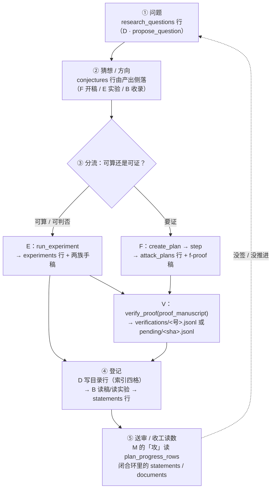

# CHAIN-D-E-F —— 研究侧的三岗协作链（问题 → 猜想 → 证明/实验 → 登记 → 送审）

> 本文件只讲**三岗之间那条链**：谁把什么交给谁、在哪一格被机器判据挡住、判据的真身在哪个 `file:line`。
> 每一条 `file:line` 于 2026-11-22 13:3x 核过；**路径相对 `src/agentflow/`**（例如 `numericproof.py::index_problems` = `src/agentflow/numericproof.py::index_problems`）。真机读数取自 `projects/lp-ball-15`（只读，未动 `projects/**`）。
> 单岗的职责/动作面见 [ROLE-D.md](ROLE-D.md)、[ROLE-E.md](ROLE-E.md)、[ROLE-F.md](ROLE-F.md)。

---

## 1 主干（一条链，五个交接点）



链上**五个交接点**各有自己的机器判据，任何一处"没查成"都不许折成"通过"：

| # | 交接 | 判据（真身） |
|---|---|---|
| ①→② | D 给方向、**不点猜想号** | `dispatchpolicy.py::dispatch_text_problems` |
| ②→③ | 猜想落行由产出侧写、D 只读 | `secretary_statement.py::STATEMENT_WRITER_ROLES`（`STATEMENT_WRITER_ROLES = ("B",)`） |
| ③→④ | E 的实验要抬档必须凭据齐 | `schema.py::Experiment.validate`、`numericproof.py::exhaustion_problems` |
| ③→④ | F 的稿要过形态闸 + 在册引用 | `manuscriptform.py::formal_shape_problem`、`specs/f.py::SPEC.brief.policy` |
| ④→⑤ | V 的签 + B 的收录 | `v_ledger_write.py::record_verification`、`numericproof.py::filing_problems` |

---

## 2 D 的证明 / 推演怎样变成 **V 能逐行审**的形态

**关键事实：D 不写证明。** D 能给的是"证明思路 + 依赖面参考"（哪些引理、按什么顺序、引哪条 `stmt:`），落稿与拿签都是 F 的活（`specs/d.py::SPEC.brief.policy`）。所以"变成可审形态"这条路上，**字节由框架渲染，D 只提供 inputs**。

| 环节 | 具体形态 | 真身 file:line |
|---|---|---|
| D 给想法 | 写进派活文本或 `F.create_plan` 的 `problem` / `subgoals`（每个 `{sid,text,owner}`） | `specs/d.py::SPEC.brief.policy` |
| 落稿 | 框架渲染 `reports/f-proof-<稿号>.md`，**三节顺序固定**：`## 命题` / `## 证明` / `## 依赖` | `manuscriptform.py::render_proof_manuscript`（节序见 `manuscriptform.py::render_proof_manuscript`）、`agent_f/manuscript.py` 的模块 docstring「命题」一节、`agent_f/manuscript.py` 的模块 docstring「证明」一节、`agent_f/manuscript.py` 的模块 docstring「依赖」一节 |
| 形态闸（写盘前） | `## 命题` 恰好一节、`## 证明` 恰好一节且非空；`## 依赖` 缺节而正文引了在册号 ⇒ 整份退回 | `manuscriptform.py::formal_shape_problem`、`manuscriptform.py::dependency_section_problem` |
| 三个节名逐字 | `## 命题` / `## 证明` / `## 依赖` | `depsection.py::SECTION_STATEMENT`、`depsection.py::SECTION_PROOF`、`depsection.py::SECTION_HEADING` |
| V 读哪几节 | V **只审手稿**：命题正文读 `## 命题`、证明全文读 `## 证明`、依赖面读 `## 依赖` | `v_prompt.py::cold_start_prompt` |
| "依据"怎么落 | 每一步一行、写清依据；依赖按三列（引用原话 / `stmt:号` / 用在哪一步），第四列（路径号）由 B 收录时分配 | `specs/f.py::SPEC.brief.policy`、`depsection.py::SECTION_HEADING` |
| B 怎么读回来 | 节名→字段的唯一映射：`## 命题`→`statement_full`、`## 证明`→`proof_text`、`## 依赖`→依赖行 | `manuscriptintake.py::SECTION_BY_CELL` |
| V 的逐行审 | 它核的是 ①正文每个 `stmt:` 在册 ②等级 ≥ `pre_theorem` ③表里每个号同样满足①② ④表与正文引用集合一致 ⑤"用在哪一步"对得上（另两条不归它：引用强度、引文错配） | `depsection.py::dependency_review` |
| 签落哪 | `verifications/<命题号>.jsonl`；还没号时落 `verifications/pending/<正文 sha>.jsonl`，B 登记后按 sha 认领 | `v_ledger_write.py::record_verification`、`vsigns.py::issue`、`v_unverified.py::unverified_statement_refs` |
| D 把它变成可入库的目录 | 报告里一行"目录行" = 新成果 + **索引四格**（`evidence_kind` / `evidence_path` / `evidence_sha256` / `v_signature`） | `specs/d.py::SPEC.brief.policy`、`numericproof.py::INDEX_KIND_FIELD` |
| 四格怎么核 | 顺索引取对象、算字节 sha256、与索引和签两份 sha 各比一次 | `numericproof.py::index_problems`、`numericproof.py::resolve_index` |

**一句话**：D 的"推演"能不能被 V 逐行审，取决于三件事有没有同时成立 —— 稿是框架渲染的三节手稿（不是章节稿）、每一步的 `cites` 都指到在册 `stmt:`、V 拿的是**稿路径**（`proof_manuscript`）而不是命题号（`specs/f.py::SPEC.brief.policy`）。

---

## 3 E 的实验怎样进 `experiments` 表、又怎样回填 `statements`

### 3.1 进表

`run_experiment` 一次调用同时落四样：`experiments` 行（`result` / `exit_code` / `code_hash` / `observations`）、`out/experiments/<号>.log`、按档落一份手稿、以及同事务里的 `conjectures` 行（`specs/e.py::ACTIONS`、`specs/e.py::SPEC.write_set`；实现在 `agent_e/run_experiment.py::_RunExperiment.run_experiment`）。

### 3.2 三档结果各自的后果（这是链上最容易被写错的一格）

| `result` | 落行时的证据档 | 对 `statements` 的后果 | 谁写这一格 | file:line |
|---|---|---|---|---|
| `supports` | 有协议行（`REPRO_RESULT:`）⇒ `cross_check`（历史列名 = `strong_conjecture`） | 第 1 位 `numeric` 可 verified ⇒ 最多抬到 **`strong_conjecture`**；若同时有证明位 + V 签 ⇒ `pre_theorem` | E 落实验行；B 落命题行 | `specs/e.py::SPEC.brief.policy`、`numericproof.py::SUPPORTED_ONLY_KIND`、`evidencebits.py::formal_row_bound_to`、`evidencebits.py::kind_from_grade` |
| `refutes` | 必须带非空 `counterexample`，否则**当场拒收、一行不落** | 反例是**否决项**：那一行读「错误」（`GRADE_ERROR`），走 `voided_by.kind ∈ {numeric_counterexample, construction, defect_ref}`；也可作为"明确放弃"的凭据 `abandon_kind=counterexample` | 拒收在 E/schema 层；作废由 `statementrefute` / B 的 `table.update` 落 | `schema.py::Experiment.to_dict`、`evidencebits.py::REFUTATION_EVIDENCE_KINDS`、`evidencebits.py::derive_grade`、`statementrefute.py::refute_statement`、`specs/d.py::SPEC.brief.policy` |
| `inconclusive` | `heuristic` | **不抬任何档**：第 1 位不 verified ⇒ 等级仍是最弱的 `conjecture`（除非另有证明/签） | E 落行；读数只算"跑过、没结论" | `specs/e.py::SPEC.brief.policy`、`evidencebits.py::kind_from_grade` |

> 反例这一档的分界是业主点名的：**不完全的实验只能记"有数值实验支持"**，不许写成"已证明"或"定理"（`specs/e.py::SPEC.brief.policy`）。穷举那一档才可能到 `theorem`，它要 `numericproof.exhaustion_problems` 的四件（搜索空间 / 布尔 `exhaustive` / 覆盖说明 / 程序相对路径）+ V 的会审签（`schema.py::Experiment.validate`、`numericproof.py::exhaustion_problems`）。

### 3.3 回填 `statements` 的两条路

1. **E 的报告 → D 的目录行 → B**：D 在报告里写索引四格（`evidence_kind=report` / `evidence_path=out/experiments/<号>/exhaustion.md` / 字节 sha256 / `v_signature`），B 顺索引取对象核 sha 与签（`specs/d.py::SPEC.brief.policy`、`numericproof.py::resolve_index`、`numericproof.py::filing_problems`）。
2. **E 的普通数值手稿 → D 提交强猜想 → B**：`reports/e-num-<号>.md` 带 `## 命题`，B 从那份稿取命题、从实验行取程序，等级 `strong_conjecture`、`proof_text` 空、**不过 V**（`specs/d.py::SPEC.brief.policy`、`specs/e.py::SPEC.brief.policy`）。

两条路都要求"命题行只经 B 的收录口写"（`secretary_statement.py::STATEMENT_WRITER_ROLES`，第二道防线 `store.py::direct_write_refusal`）；F 的稿与 E 的稿都不许自己进表。

---

## 4 F 的攻击计划怎么被 **M** 与 **D** 消费

| 消费者 | 读什么 | 用来做什么 | file:line |
|---|---|---|---|
| D | `attack.status` / `attack.list_plans`（计划视图 + `delivery` 逐条交差读数） | 决定继续攻坚还是改猜想；**plan 由 F 自己定**，D 只查、只提建议 | `specs/d.py::SPEC.brief.policy` |
| D | `F.step` 返回的 `manuscript_path` | 携带给 B（不转章节稿） | `specs/d.py::SPEC.brief.policy` |
| M | `plan_progress_rows`（收工验收的"攻"那一格） | 判"攻坚真的推进了吗" | `closing.py::_leg_reading`、`closing.py::research_chain_gaps`（"攻"那一组成员见 `closing.py::research_chain_gaps`）、`specs/m.py::SPEC.brief.policy` |
| M | `attack_plans.history` 里的 `statement_id` | 反查"F 交了论证、有没有人签" | `v_unverified.py::unverified_statement_refs`、`agent_f/step.py::_Step.step` |
| 收工门 | `plan_progress_rows` 的四档 + 两条计划级通路 | 通过**只**由这一档决定 | `closing.py::LEG_CHECK_KINDS`、`closing.py::_round_advanced_by`、`closing.py::_signed_manuscripts_of`、`closing.py::_plan_proof_advance` |

### 4.1 今天真机 `lp-ball-15` 里 `attack_plan_rows` 是 `na` 的真实原因

先把三件事分开，它们是三个不同的读数：

**（a）`na` 在 lp-ball-15 里是 C5，不是 `attack_plan_rows`。**
`projects/lp-ball-15/out/paper/ACCEPTANCE-CHECKS.json:7` 的 C5 是 `"kind": "c_analysis_runs", "na": true`（理由是"本趟未派 C"）。收工读数的 `na_groups` 里，只有 `看（关系分析）: ["c_analysis_runs"]`，`攻（攻坚推进）: []`。

**（b）`attack_plan_rows` 在 lp-ball-15 里根本没有被写进验收表 —— 不是被读成 `na`。**
`ACCEPTANCE-CHECKS.json` 里有 9 条 check（C1–C9；文件 13 行），"攻"那一行是 `"kind": "plan_progress_rows"`（`projects/lp-ball-15/out/paper/ACCEPTANCE-CHECKS.json:8`）。收工读数里 `"kind": "attack_plan_rows"` 出现 **0** 次（现算命令见 §6）。
这不是笔误，是框架口径要求的：`attack_plan_rows` 属于 `INFORMATIONAL_KINDS`（`closing.py::INFORMATIONAL_KINDS`）——它**只报立项数、不判 pass/fail、也不进研究链覆盖面**（`closing.py::INFORMATIONAL_KINDS`）。写它进表只会得到 `state=informational`；"攻"那一环的通过**只由 `plan_progress_rows` 决定**（`specs/m.py::SPEC.brief.policy`）。

**（c）"攻"那一行真正的麻烦是 `unknown`，而它的根因是一条 `external_lit` 命题。**
收工读数里 C6 = `plan_progress_rows`、`got=3`、`ok=false`、`state=unknown`，理由逐字：
> 攻坚计划的 `history` 里点名了 1 条命题（plan 000000 第 6 轮 ⇒ stmt:000125），而 `verifications` 的两路都**没有认领给它们的、签得住的行** ⇒ 这一行记 `unknown`、不记 `pass`。

这条判据的实现在 `closing.py::_check_acceptance`，它调的读口是 `v_unverified.py::unverified_statement_refs` —— 那个函数**只按 `attack_plans.history` 里的 `statement_id` 去查签**，不区分这条命题是"我方命题"还是"文献引来的定理"。

而盘上 `stmt:000125` 是：

| 字段 | 值 |
|---|---|
| `origin` | `external_lit` |
| `kind` | `theorem` |
| `bits.reviewed` | `false` |
| `bits.evidence.reviewed_by` | `{"evidence": "lit:000005"}`（凭据是**引文**，不是 V 签） |
| `proof_text` | 文献原句（`Theorem 2. For n = 2, 3, …`） |

**判定**：`attack_plan_rows` 与 `na` 无关。今天 lp-ball-15 的真实链条是：
① "攻"那环按规定只能写 `plan_progress_rows`，`attack_plan_rows` 是 informational、写不写都不影响红绿；
② 真正的红/灰来自 `plan_progress_rows` 的 `unknown`，因为 F 计划第 6 轮把一个**文献定理号**填进了 `history.statement_id`；
③ `v_unverified` 不区分 `origin`，于是"引来的定理"被当成"F 交了论证没人签"。
把 ① 说成"`attack_plan_rows` 是 na"是**把三件事折成了一件**：`na` 是 C5 的、informational 是 `attack_plan_rows` 的、`unknown` 是 `plan_progress_rows` 的。

> 这不是"该放宽门"的结论：`unknown` 本身是对的（"没人签"不许读成"审过了"，`closing.py::_check_acceptance`）。可疑的是**读口没有区分 origin** —— 引文类命题的凭据在 `quote_verified` 与 V 的逐行走查，不在 `verifications/<号>.jsonl`（`schema.py::Statement.validate`、`numericproof.py::filing_problems`）。修它属于判据面改动，不在本文件的权限内，只登记。

---

## 5 链上的三处"三态不折平"（读的时候别折）

| 位置 | 三态 | 折平了会怎样 | file:line |
|---|---|---|---|
| E 的实验 `result` | `supports` / `refutes` / `inconclusive` | 把 `inconclusive` 读成 `supports` ⇒ 弱证据抬档 | `schema.py::EXPERIMENT_RESULTS`、`specs/e.py::SPEC.brief.stance` |
| F 的交付 | 已签 / 待签 / 未通过 / 没查成 | "一条签了"被读成"交差完成" | `specs/f.py::SPEC.brief.policy` |
| V 的台账读取 | 在册 / 已认领的 pending / 没查成 | "读不到"被读成"一条都不缺" | `v_unverified.py::unverified_statement_refs` |

---

## 6 复核命令（本文件所有数字都能复算）

```powershell
cd agentflow
# ① 边表 / 写集 / 动作数
python -c "import sys;sys.path.insert(0,'src');import agentflow.capabilities as c;print({r:(sorted(c.ALLOWED_EDGES[r]),sorted(c.WRITE_SETS[r])) for r in ('D','E','F')})"
# ② attack_plan_rows 在 lp-ball-15 的收工读数里出现 0 次；唯一 na 是 c_analysis_runs
python temp/roledoc2/p7_closing_rows.py
# ③ attack_plans 3 行、16 轮 progress
python -c "import json,io,collections;d=json.load(io.open(r'D:\Incubator\projects\lp-ball-15\data\attack_plans.json',encoding='utf-8'));print(len(d['rows']),sum(collections.Counter(h['outcome'] for x in d['rows'] for h in x['history'])['progress'] for _ in [0]))"
# ④ stmt:000125 的 origin 与签状
python -c "import json,io;d=json.load(io.open(r'D:\Incubator\projects\lp-ball-15\data\statements.json',encoding='utf-8'));r=[x for x in d['rows'] if x['stmt_id']=='000125'][0];print(r['origin'],r['kind'],r['bits'].get('reviewed'),r['bits'].get('evidence',{}).get('reviewed_by'))"
# ⑤ experiments 三档 / statements 现算等级
python -c "import json,io,collections;d=json.load(io.open(r'D:\Incubator\projects\lp-ball-15\data\experiments.json',encoding='utf-8'));print(collections.Counter((x['method'],x['result'],x['evidence_kind']) for x in d['rows']))"
```

---

## 7 一处被核过的不一致（登记，不修）

| 现象 | 读数 | 判定 |
|---|---|---|
| 文献定理被计入"有稿无签" | `stmt:000125`：`origin=external_lit`、`bits.reviewed=false`、凭据 `{"evidence":"lit:000005"}`；收工读数 C6 因此 `unknown` | 读口 `v_unverified.py::unverified_statement_refs` 只按 `statement_id` 查 `verifications`，不区分 `origin`；引文类命题的凭据按设计在 `quote_verified` + V 的逐行走查（`schema.py::Statement.validate`），不在 `verifications/<号>.jsonl`。**登记为判据面待定，不在本文件权限内改** |
| `attack_plan_rows` 被说成 `na` | 全项目 0 处 `"kind": "attack_plan_rows"`；`na` 只有 C5 | 三件事被折成一件（见 §4.1） |
| 验收表 C6 的 `got` 与台账现算不等 | C6 `got=3`；同一份读数里 `progress_outcome_rounds=15`；按 `attack_plans.json` 逐轮数 `outcome=progress` 是 **16**（6+6+4） | 两个数的口径不同（`got` 数"被推进过的计划"、`progress_outcome_rounds` 数是"progress 轮"），但 15≠16 说明至少有一轮没被计进那个字段；**登记为读数待核，不下结论** |
