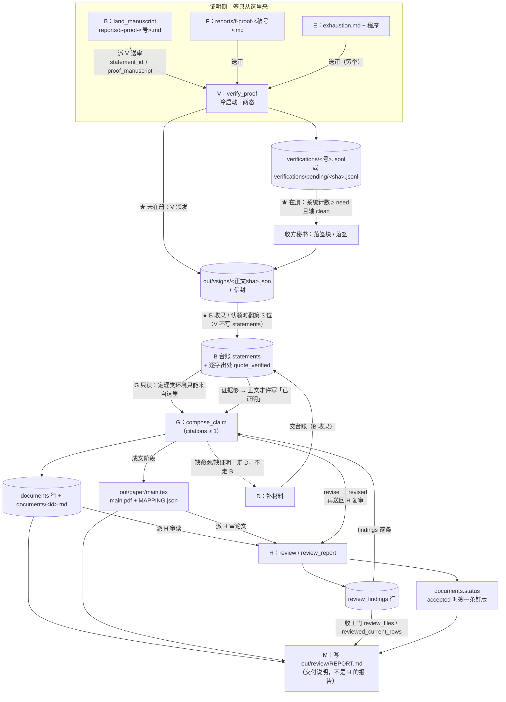

# CHAIN-G-H-V · 手稿 → 审读 → 送审 → 判 → 交付说明

> **一句话**：这条链是「可信」的关键 —— 一条结论从「有人写了一句话」到「盘上有一个可核的等级」，
> 要经过三种互不替代的看：**G 看证据够不够写成断言、H 看稿子有没有把自己说清楚、V 看证明站不站得住**。
> 三者产出三张不同的账（`documents` / `review_findings` / `verifications` + `out/vsigns`）；任何一段缺席，
> 等级就只能停在 `conjecture` —— **停在 conjecture 不是失败，冒充 proof 级才是**。
>
> 本文件所有真机读数取自 `projects/lp-ball-15`（历史）与 `projects/lp-ball-16`（在跑），
> **读数时刻 2026-11-22T13:40:26+08:00**，取法 = `python agentflow/temp/roledoc3/readings.py`（只读，不写 `projects/**`）。
> 16 在跑：数字会漂，引用时连同时刻一起引。

---

## 1. 全链图（★ = 签闸：这一格没有「盖住现行正文的签」就不许往 proof 级标）

**图上四个 ★ 与「没有签就停在 conjecture」的对应关系**：

| ★ | 位置 | 没有签会怎样 | 判据 |
|---|---|---|---|
| ★1 | 未在册签发 | 这条正文只有「看过、没签」的读数（`checked=false` 或 `signed_bit3=false`）；不进 `out/vsigns/` | `specs/v.py::SPEC.brief.policy`、`vsigns.py::issue` |
| ★2 | 在册发签 | 三转只落台账行，不发签；`streak < need` | `secretary_sign.py::SignMixin.decide_sign_issuance`、`sign_counting.py::count_rows` |
| ★3 | B 收录 / 认领 | 签文件在盘上、但 `bits.reviewed=false` ⇒ 等级不动（真机 `000003` 就是这样） | `v_sign.py::land_sign_without_ledger`、`vsigns.py::bits_with_review` |
| ★4 | H 采信 | 没有 `pre_theorem` 或 `theorem` 的凭据 ⇒「这条我采信不了」，不许自己读一遍就判对 | `specs/h.py::SPEC.brief.boundary` |

---

## 2. 三段职责对照

| 段 | 角色 | 对象 | 判什么 | 产物 | 明确不做 |
|---|---|---|---|---|---|
| 落笔 | **G** | `documents` 行 / `main.tex` | 证据够不够写成**这条强度**的断言；结构是否照台账 | `documents` 行 + markdown + `MAPPING.json` | 不判真假、不自报等级、不发签、不判稿件合格 |
| 审读 | **H** | 稿件（`doc_id` 或 `main.tex`） | 有没有把自己说清楚（体例 / 禁令 / 依赖 / 采信规则） | `review_findings` + `documents.status` + `<doc_id>-review.md` | 不判数学对错、不改稿、不召唤 G |
| 判 | **V** | 一份证明稿 | 这份证明**站不站得住**（两态 + 步号） | `verifications` 一行 + 未在册签发信封 | 不改证明、不判方向、不判稿件、不落签 |

---

## 3. G → H：手稿怎么被审读

1. **G 落稿**：`doc.compose_claim`（`citations` 至少 1 项）→ `doc.build_document` 落一行 `documents` 并渲染
   `documents/<doc_id>.md`（`specs/g.py::ACTIONS`）。这一行是 H 的**唯一审校对象**：没有它，`doc.paper_compile`
   会受控拒 `paper_not_registered`（`specs/g.py::SPEC.brief.policy`）。
2. **H 审什么由派活说**：`doc_id` 或论文落点（通常 `out/paper/main.tex` / `main.pdf`）；H 用 `fs.read` 读，
   用 `review.scan(kinds=[…])` 一次拿七类机械读数（`specs/h.py::SPEC.brief.boundary`、`specs/h.py::SPEC.brief.policy`）。
3. **H 判什么**：四条审稿清单 + 六项正文禁令 + 骨架与证明粒度（`specs/h.py::SPEC.brief.policy`）；每条问题都要
   **指得到行**（行号或逐字引文），读不到就如实落「没查成什么」（`specs/h.py::SPEC.brief.policy`）。
4. **采信规则（H 与 V 的接缝）**：H 采信一条命题只有两条 —— 正文与台账**逐字一致**（`quote_verified`）、
   等级到 `theorem`（凭据 = `experiments` 行 + V 签）；形式化关掉时文字证明采信 `pre_theorem`，凭据是
   V 逐行走查的**三票齐签行**（`specs/h.py::SPEC.brief.boundary`）。**H 不自己判证明**。
5. **裁决四档**：有 error ⇒ `rejected`；依赖没查 ⇒ `unverified`（不许通过）；只有 warning ⇒
   `accepted_with_warnings`；都没有 ⇒ `accepted` —— `accepted` 时框架**签一条**并钉住那一版内容哈希，
   钉不上就受控拒 `CODE_ACCEPT_WITHOUT_PIN`（`specs/h.py::SPEC.brief.boundary`、`tools/review_tools.py::CODE_ACCEPT_WITHOUT_PIN`）。
6. **改完必须复审**：G 的 `revise` 把稿推成 `revised`，签名仍钉着改前那一版；G 派 `H.verify_fixes`
   （按 `round_no` 复核这一版）或 `H.review`，让签名钉到现行版（`specs/g.py::SPEC.brief.policy`）。
   收工门 `reviewed_current_rows` 数的是「现行版本被审校记录钉住的稿件份数」（`closing.py::LEG_CHECK_KINDS`）。

**这一段的三态读数**：`documents.status` ∈ `draft / in_review / revised / accepted / rejected / unresolved_review`
（`schema.py::DOC_STATUSES`）；「审过」与「通过」是两件事（`specs/h.py::SPEC.brief.boundary`）。

---

## 4. B 送审 → V 判：证明侧的签怎么来

### 4.1 在册路（B 自己产出的证明）

`own.land_manuscript` 把正文落成 `reports/b-proof-<命题号>.md`（三节：`## 命题` / `## 证明` / `## 依赖`；
只写文件、幂等）→ 派 V 审这一份手稿（`V.verify_proof`，带 `statement_id` + `proof_manuscript`）→
签到位后签块由收方秘书 `secretary:B` 落回稿里 → 最后 `own.ingest_manuscript` 按 `target_stmt_id` +
`cells=["proof_text"]` 收录（第 3 位翻真）（`specs/b.py::ACTIONS`、`specs/b_sign_policy.py::SIGN_SUBMIT_POLICY`）。

第二阶段（逐个优化）的顺序**不许颠倒**：洗稿 → 重新拿 V 签 → 精准替换；没有盖上这一版的签 ⇒ 替换被拒
（`optimized_blocked` 给 `no_sign` / `sha_mismatch`）（`specs/b_sign_policy.py::SIGN_SUBMIT_POLICY`）。

送审之后这一趟**不能收工**：`b-proof` 稿没有现行 V 签、且那条命题没被放弃 ⇒ 收工受控拒；
「交稿也是 B 的义务」（`via=ingested_to_ledger` 才算已提交）（`specs/b_sign_policy.py::SIGN_SUBMIT_POLICY`）。

### 4.2 未在册路（F / E 的稿，命题还没登记）

F / E 的稿在被收方接手之前就要签，强行要求「秘书判发不发」会把这一档变成死路 ⇒ **明文例外**：
散文支按 `need` 转 clean、穷举支按 `EXHAUSTION_SIGN_STREAK_NEED` 次机械会审 clean，即由 V 颁发
（`vsigns.issue` 写 `out/vsigns/<正文 sha>.json`、把信封交给收方）；手稿签块仍由收方秘书落
（`Secretary.land_unregistered_sign`）；这一档**不调** `decide_sign_issuance`（`specs/v.py` 的模块 docstring「发签权的边界（明文例外）」一节）。

### 4.3 一份签的三条腿

| 腿 | 落点 | 谁写 | 读到什么 |
|---|---|---|---|
| 签的**证据** | `out/vsigns/<正文 sha>.json` | 未在册：V（`vsigns.issue`）；在册：收方秘书经 `v_sign.land_sign_without_ledger`（`v_sign.py::land_sign_without_ledger`） | `artifact_sha` / `passes[]` / `streak` / `need` / `counted_by` / `envelope` |
| 签的**背书** | `verifications/<命题号>.jsonl` 或 `verifications/pending/<对象 sha>.jsonl` | V 的 `record_verification` / `record_pending_sign` | 一行一转：`review_call` / `review_pass` / `verdict` / `secretary_judge` |
| 签的**载体** | 手稿上的 `- V 签：…` 九格块 | **收方秘书**（`vsigns.land` / `land_unregistered_sign`） | 已签 / 判词 / 连续 / 正文 sha / 时间 / 签名者 / 台账锚点 |

### 4.4 第 3 位由谁翻

**不是 V。** 2026-11-08 起 V 只对手稿负责：`land_sign_without_ledger` 不开 `store.tx("statements")`，
不翻第 3 位、不写 `kind` / `grade` / `reviewed_by_proof` —— 那些是 **B 收录时**的活（`v_sign.py::land_sign_without_ledger`）。
未在册那一档则由 B 按正文 sha **认领 pending 签**时翻（`vsigns.py::bits_with_review`、`vsigns.py::_claim_pending_sign`）。
真机证据：`000003` 的签文件与 7 行台账都在，但 `000003` 行 `bits.reviewed=false` ⇒ 等级仍是
`not_applicable`（见 §7）。

---

## 5. V 的三转与发签判定

### 5.1 三转是什么（先纠一个名字）

**代码里没有「申述 / 复核 / 结论」这三个名字**（在 `src/agentflow` 下 grep `申述` = 0 命中）。真实机制是：
**一次 `verify_proof` 调用 = 同一份正文、同一个 `review_call` 内连判 `need` 轮**；每一轮都是同一条冷启动读法
（整篇重读 + 六条角度 + 硬禁令），逐轮落一行台账（`review_pass=1..need`），轮与轮之间没有角色差异 ——
**差异只在轮号、以及轮到第 `need` 轮时门槛是否达到**。

- 上界 = 门槛现读：`review_pass_bound()` 返回 `verifications.SIGN_STREAK_NEED`（`agent_v/core.py::review_pass_bound`）；
- 任一转判 `fault` ⇒ 立刻终止，那一转就是终局，不接着判后面的轮次（`agent_v/core.py` 的模块 docstring、
  `specs/v.py::SPEC.brief.policy`）；
- 跨两次送审**绝不累计**：上一趟判过的不算（`v_vocab.py::SIGN_STREAK_NEED`）。

### 5.2 系统计数：`sign_counting` 的真身

谁数、数什么、不数什么，全在这一层（`sign_counting.py` 的模块 docstring）：

| 真身 | 行 | 数什么 |
|---|---|---|
| `count_rows` | `sign_counting.py::count_rows` | 同一 `review_call` + 同一 `proof_sha256`，轮号恰好 `1..need` 连续 clean；缺号 ⇒ `missing_pass`；中途 `fault` ⇒ 终止；同号重放不增加（`replayed` 只作读数）；**机械会审整组只算 1 轮** |
| `count_registered` | `sign_counting.py::count_registered` | 在册台账 `verifications/<号>.jsonl`，按 `proof_no` 分组；锚点 = 最后一行或调用方给的 `review_call` |
| `count_ledger_file` | `sign_counting.py::count_ledger_file` | `vsigns.issue` 的**唯一门槛来源**：按锚点那一行分三条路（`review_call` ⇒ `count_rows`；`single_round` ⇒ legacy 单轮；无 call ⇒ legacy 尾部），`counted_by` 逐档写明 |
| `real_judgment` | `sign_counting.py::real_judgment` | 机械会审判词（`review_scope=single_round` / `source=exhaustion_report`）整组只算 1 轮 |
| `ticket` | `sign_counting.py::ticket` | 把一行翻成签文件 `passes` 里的一张票（`verification_id` / `at` / `proof_sha256` + `review_call` / `review_pass` / `object_sha256`） |

**三态纪律**：台账读不出来 ⇒ `checked=false` 且 **不放签**（不是「0 次」，也不是「够」）；
老行（无 `review_call`）⇒ `legacy:ledger_tail`，显式标注、不许静默等价成新签（`sign_counting.py` 的模块 docstring「老数据：显式 legacy，不许静默等价」一节、`sign_counting.py::_out`）。

### 5.3 发签判定：`decide_sign_issuance` 的真身

入口 `secretary_sign.py::SignMixin.decide_sign_issuance`。判据只有一层：**同一趟送审内的连续 clean 达到门槛**。逐段读：

| 段 | 行 | 做什么 |
|---|---|---|
| 初值 | `secretary_sign.py::SignMixin.decide_sign_issuance` | `checked=false` / `issue=false` / `need=SIGN_STREAK_NEED(3)`；`within_call` 只进读数 |
| 台账读数（历史回放） | `secretary_sign.py::SignMixin.decide_sign_issuance` | `verifications.review_standing` 现算 `streak` / `state` / `same_sha` —— **只作历史读数** |
| **候选这一签的资格** | `secretary_sign.py::SignMixin.decide_sign_issuance` | 只看**秘书给的轴**（`ledger_axis` / `secretary_judge`），不看 V 的 `verdict` 字面；老调用点没有轴 ⇒ 判不了（`candidate_ok=false`） |
| **系统计数** | `secretary_sign.py::SignMixin.decide_sign_issuance` | 有 `within_call` 或行上带 `review_call` ⇒ 调 `sign_counting.count_registered`；`need` 取计数层给的那个数（E=1 / F,B=3）；计数没查成 ⇒ `checked=false` + 不放签 |
| 旧直调兼容 | `secretary_sign.py::SignMixin.decide_sign_issuance` | 没给 `within_call` 的老路径：`projected = streak(+1)`，仍要求秘书有判断面（装配纪律） |
| **地板没过** | `secretary_sign.py::SignMixin.decide_sign_issuance` | `checked=true` + `issue=false` + `decision=不签发` + 计数读数（**不问模型**） |
| **地板过了 ⇒ 自动发签** | `secretary_sign.py::SignMixin.decide_sign_issuance` | `checked=true` + `issue=true` + `decision=签发` + `auto_issue:floor_passed`；调 `_land_sign_issuance` 落签；**这一支没有任何模型调用** |
| 落签 | `secretary_sign.py::SignMixin._land_sign_issuance` | `land_sign_without_ledger`：写签文件 + 收方秘书落签块；失败如实报、不改变「决定」 |

**关于「`within_call >= need` 自动发签」这句话**：**它不准确**。`within_call` 在今天的代码里**只作读数**
（`secretary_sign.py::SignMixin.decide_sign_issuance` 原文：「`within_call` 那一个数只作读数：它多一轮 / 少一轮都不改变发不发签」），
真正的门槛是 `sign_counting` 从台账**现数**的 `count`（`secretary_sign.py::SignMixin.decide_sign_issuance`）。同一句话在
`secretary_sign.py::SignMixin.decide_sign_issuance` 的 docstring 里还写着旧口径（「真正的地板是 `within_call`」）—— 那是**过期注释**，
见 §10 第 1 条。

### 5.4 need 的分档（E=1，F / B=3）

| 档 | need | 常量（真身） | 谁用它 | 达标形态 |
|---|---|---|---|---|
| F（证明）/ B（自产结果） | **3** | `v_vocab.py::EXHAUSTION_SIGN_STREAK_NEED` `SIGN_STREAK_NEED = 3` | `decide_sign_issuance` 初值（`secretary_sign.py::SignMixin.decide_sign_issuance`）、`count_registered` 的调用方传参 | 同一 `review_call` 内 `review_pass=1,2,3` 连续 clean（机械会审永远不够） |
| E（穷举证据） | **1** | `v_vocab.py::SECRETARY_JUDGE_KEY` `EXHAUSTION_SIGN_STREAK_NEED = 1` | `count_registered` / `count_ledger_file` 的 `single_round` 支（`sign_counting.py::count_ledger_file`）；V 的穷举支（`agent_v/core.py::AgentV._review_unregistered_exhaustion`） | 一次机械会审 clean（七项确定性核对；同一份判词复制多份仍只算 1 轮） |

「实验侧报告不承重（承重的是程序）」是业主 2026-11-17 的原话，`v_vocab.py::EXHAUSTION_SIGN_STREAK_NEED` 逐字记着。
三个数不许混写：`3` / `1` / 显式 `single_round`（后者是登记形态，不是第三个门槛数）。

### 5.5 为什么不问模型

2026-11-16 裁定 ③ 删掉了「问模型签发 / 不签发」那一次调用：地板过了 ⇒ 系统自动发签，地板没过 ⇒
不签发，两条都不问模型（`secretary_sign.py::SignMixin.decide_sign_issuance`）。今天 `decide_sign_issuance` 只在
**旧直调**（没给 `within_call`）那一档还保留「秘书必须有判断面」的装配纪律 —— 那不是模型判定，也不改变
「地板过了即发」的规则（`secretary_sign.py::SignMixin.decide_sign_issuance`）。

### 5.6 未在册档的例外（再看一次是因为它改判定的形状）

未在册两支**不调** `decide_sign_issuance`：V 自己颁发（`vsigns.issue`），门槛仍由 `count_ledger_file` 现数
（`vsigns.py::SIGN_COUNT_SHORT`）。判据 `test_unregistered_issuance_is_an_explicit_exception` 同时钉三件事：
「这段在」/「未在册两支不调发签判定」/ 正控「散文支必须问秘书要轴、穷举支必须不问」（`specs/v.py` 的模块 docstring「发签权的边界（明文例外）」一节）。

---

## 6. 签文件在哪里：两种形态与字段差异

### 6.1 三个落点（别混）

| 落点 | 是什么 | 谁写 |
|---|---|---|
| `out/vsigns/<正文 sha>.json` | **签的证据**（一稿一签；`artifact_sha` = `proofregistry.proof_sha(proof_text)`，**不是** `.md` 的字节 sha） | 未在册：V；在册：收方秘书经 `land_sign_without_ledger` |
| `out/vsigns/issued.json` | **派生归档**（「我发过哪些签」的一眼清单；权威仍是逐份签文件） | `vsigns.archive`（派生，可重建） |
| `verifications/<号>.jsonl` / `verifications/pending/<对象 sha>.jsonl` | **签的背书**（一行一转，追加式） | V 的 `record_verification`（`v_ledger_write.py::record_verification`）/ `record_pending_sign`（`v_pending_write.py::record_pending_sign`） |

目录常量：`vsigns.py::SIGNS_DIR`（`out/vsigns`）、`v_vocab.py::VERIFICATIONS_DIR`（`verifications`）、`v_vocab.py::PENDING_DIR_NAME`（`pending`）、`v_vocab.py::PENDING_PREFIX`（`u-` 前缀）。
pending 台账的文件名是 **64 位 hex 的对象内容 sha**（正文 sha 或报告字节 sha）——`pending_ledger_path` 会受控拒
非 hex 的键（`v_pending_read.py::pending_ledger_path`）；锚点形状 `verifications/pending/<sha>.jsonl#u-<号>`（`vsigns.py::_PENDING_ANCHOR_RE`）。

### 6.2 签文件 `out/vsigns/<sha>.json` 的字段（真机实测 19 格）

`schema` · `artifact_sha` · `artifact_path` · `artifact_sha_rule` · `ledger` · `statement_id` · `verdict` ·
`streak` · `need` · `counted_by` · `count` · `legacy` · `passes[]` · `objections[]` · `source_note` · `at` ·
`written_by` · `envelope` ·（条件）`manuscript_write` ·（仅旧多证明）`proof_no`
（见 `vsigns.py::_sign_document` 的 `_sign_document`；真机样本 `projects/lp-ball-15/out/vsigns/2f77e321….json`）

`passes[]` 每一票六格身份：`verification_id` / `at` / `proof_sha256` / `review_call` / `review_pass` /
`object_sha256`（+ `object_path` / `round` / `verdict` / `axis`）—— `sign_counting.ticket`（`sign_counting.py::ticket`）。
**两个 sha 不是同一把尺**：`proof_sha256` = 正文 sha，`object_sha256` = 被审对象（稿 / 报告）的字节 sha；
`object_sha256` 空 ⇒ 写侧受控拒 `malformed_sign_file`（`vsigns.py::MALFORMED_SIGN_FILE`、`vsigns.py::sign_file_problems`）。

### 6.3 两种形态的对照：在册 vs 未在册

| 项 | 在册形态（有命题号） | 未在册形态（命题还没登记） |
|---|---|---|
| 签文件 | `out/vsigns/<正文 sha>.json` | 同左 |
| `statement_id` | 命题号（4–6 位） | **空串**（这是定义，不是缺字段） |
| `ledger` 锚点 | `verifications/<号>.jsonl#v-<号>` | `verifications/pending/<对象 sha>.jsonl#u-<号>` |
| 台账写入 | `record_verification`（`v_ledger_write.py::record_verification`） | `record_pending_sign`（`v_pending_write.py::record_pending_sign`） |
| 谁颁发 | 收方秘书经 `land_sign_without_ledger`（`v_sign.py::land_sign_without_ledger`），前提是 `decide_sign_issuance` 判了 `issue=true` | V 自己 `vsigns.issue`（`vsigns.py::issue`），**不经**发签判定 |
| 门槛 | `sign_counting.count_registered`（E 档 1 / F、B 档 3） | `count_ledger_file` 现数（同一套计数的另一入口） |
| 手稿签块 | 收方秘书 | 收方秘书（V 一处签写口都没有） |
| 第 3 位 | B 收录（`ingest_manuscript`）时翻 | B 按正文 sha **认领** pending 行时翻 |
| 签文件 `written_by` | `secretary:F` / `secretary:B` / `secretary:E` | 同左（收方）；`envelope.to` 记收方 |
| 真机样本 | `2f77e321….json`（`statement_id=000003`） | `60d45acd….json` / `f4dd17cc….json` / `499c340a….json`（`statement_id=""`） |

### 6.4 台账行的字段差异（真机实测：22 格共有）

| 只出现在**在册**行 | 只出现在 **pending** 行 | 两处都有（22 格） |
|---|---|---|
| `manuscript`（在册行的载体路径） | `object_sha256` / `object_path`（认领与对账按它们找） | `verification_id` · `statement_id` · `stmt_id` · `verifier` · `verdict` · `defect_step` · `quote` · `why` · `findings` · `unresolved_errors` · `citation_checks` · `proof_sha256` · `proof_chars` · `round` · `used_faces` · `submission_id` · `producer_role` · `producer_code` · `review_call` · `review_pass` · `at` · `secretary_judge` |
| — | `landed` / `path_group` | — |
| — | `claimed_at`（**认领之后**才有；B 回写 `statement_id` 时落） | — |

`review_call` / `review_pass` / `at` 是 2026-11-17 才成对进两边的（`v_pending_write.py` 的 docstring 逐字记着
「要让系统计数数得出来，每一行必须自己说清我是哪一趟送审的第几轮」）；不给这三格的老行 ⇒ 读侧按 `legacy` 读。

---

## 7. 真机读数（只读，时刻 2026-11-22T13:40:26+08:00）

### 7.1 签份数

| 读数 | `lp-ball-15`（历史） | `lp-ball-16`（在跑） |
|---|---|---|
| `out/vsigns/*.json`（不含 `issued.json`） | **4** | **0** |
| `out/vsigns/issued.json` | 4 条归档 | 无目录 |
| 在册台账行（`verifications/<号>.jsonl`） | **7**（全部「成立」） | 0 |
| pending 台账行（`verifications/pending/`） | **19**（成立 10 / 有毛病 9） | 0 |
| V 稿（`verifications/reviews/v-review-*.md`） | **9** | 0 |
| 4 份签的形态 | 3 份未在册（`statement_id=""`）+ 1 份在册（`000003`） | — |
| 4 份签的 `streak` / `counted_by` | 全 **3/3** / 全 `sign_counting` | — |
| 格式不合格的签 | **1**（`2f77e321`：三票 `object_sha256` 全空） | — |

### 7.2 grade 分布（读 `bits.grade`，不是 `evidence_kind`）

| `bits.grade` | `lp-ball-15` | `lp-ball-16` |
|---|---|---|
| `not_applicable`（concept 行） | **177** | **33** |
| `conjecture` | **10** | 0 |
| `strong_conjecture` | 0 | 0 |
| `pre_theorem` | **3** | 0 |
| `theorem` | **0** | 0 |
| `错误` | 0 | 0 |
| 合计 statements | **190**（concept 177 + theorem 13） | **33**（全 concept） |

口径：等级只由五元位现算（`evidencebits.py::derive_grade`；映射 `evidencebits.py` 的模块 docstring「等级机械派生（不许任何角色自报等级）」一节）；`evidence_kind` 是历史列，
只由等级反算（`evidencebits.py::kind_from_bits`）。15 的 13 条 `theorem` 类里 10 条 `conjecture`（外引文献命题）、
3 条 `pre_theorem`（自有结果）；**一条 `theorem` 都没有** —— 与 `out/review/REPORT.md` 第四节的自述一致。

### 7.3 三条红/绿（定义先写清）

**口径**：对每条 `origin="own_result"` 的定理行，记 **绿** 当且仅当
① `bits.grade ∈ {pre_theorem, theorem}`；② `out/vsigns/<该行 proof_sha256>.json` 存在；③ 签的 `streak ≥ need`。
其余（含「这条还没产生」）记 **红**。复算：`temp/roledoc3/readings.py` 打印每个 `own` 行的 `grade / reviewed / sign / streak`。

| 三条 | 命题（`label`） | 现行正文 sha（前 12） | `bits.grade` | 第 3 位 | 签文件 | streak | 红/绿 |
|---|---|---|---|---|---|---|---|
| `000187` | B_p^2 的二维 Lebesgue 面积性质 | `60d45acd05b2` | `pre_theorem` | true | 有 | 3/3 | **绿** |
| `000188` | B_p^2 的最大弦长 M_p(2) 公式与等号方向 | `f4dd17cce73b` | `pre_theorem` | true | 有 | 3/3 | **绿** |
| `000189` | B_p^3 中心截面面积 A_p(3,u) 与 B_p^2 面积 V_p(2) 的关系 | `499c340a5878` | `pre_theorem` | true | 有 | 3/3 | **绿** |

- `lp-ball-15`：**三条全绿** —— 三条都靠 `verifications/pending/<对象 sha>.jsonl` 的三行「成立」
  各三行（`u-000003…005` / `u-000009…011` / `u-000016…018`）背书，B 按正文 sha 认领后翻第 3 位、等级现算为 `pre_theorem`。
- `lp-ball-16`：**三条全红（尚未产生）** —— `own_result` 0 条、theorem 类 0 条；此刻只有 33 条 concept
  （A 的检索/抽读阶段）。这不是「失败」，是「链还没走到那一格」。

### 7.4 全链在这一趟上的横截面（`lp-ball-15`）

| 格 | 读数 | 说明 |
|---|---|---|
| 任务数 / 角色分布 | 179（M29 / A32 / B14 / D23 / E2 / F63 / **V15** / **G1** / **H0**） | **H = 0**：审读这一段没发生 |
| G 的产出 | `documents` 1 行（`kind=note`、4 条 claim 全 `cross_check`、`status=draft`） | 手稿存在；未冒 proof 级（对） |
| H 的产出 | `review_findings` 0 行；`out/review/` 里只有 M 的 `REPORT.md` / `STATUS-*` / `m-verdicts.jsonl`，**没有任何 `*-review.md`** | `review_files` 这一档为 0 |
| V 的产出 | 4 份签 / 7 行在册 + 19 行 pending / 9 份 V 稿 | 见 §7.1 |
| 证明稿 | `f-proof-*.md` 4 份（4 份有签）；`b-proof-*.md` 12 份（**0 份有签**） | B 族稿的签义务未清 |
| 交付说明 | `out/review/REPORT.md`（M 写）第四节自述：「没有任何一条命题到达 theorem 级」 | 与 grade 分布一致 |

---

## 8. 哪一步没有签就不许标 proof 级

「proof 级」在这条链上有两个意思，各有各的闸：

- **等级 `pre_theorem`**（文字证明、人逐行审过）：需要 `has_proof ∧ reviewed` —— 第 2 位 + 第 3 位
  （`evidencebits.py::kind_from_grade`）。**没有签 ⇒ 第 3 位假 ⇒ 停在 `conjecture`**。
- **等级 `theorem`**（正式定理）：需要第 2 位 + 机器可核凭据（第 4 位形式化 `verified`，或第 1 位穷举证书
  `verified` —— 而穷举证书本身也要 V 签）（`evidencebits.py::kind_from_grade`、`evidencebits.py::_numeric_is_certificate`）。

| 环节 | 没有「盖住现行正文的签」时会发生什么 | 判据（file:line） |
|---|---|---|
| G 写断言 | `evidence_kind=proof` 的断言不许写「机器验证」；文字证明签完这一格的等级是 `pre_theorem`，不是 `theorem` | `specs/g.py::SPEC.brief.policy`、`specs/g.py::SPEC.brief.boundary` |
| G 写数值定理的证明栏 | 证明栏三块由 E 写；E 没给两块时正文不许写「定理 / 已证明」，只能写「有数值实验支持」 | `specs/g.py::SPEC.brief.policy` |
| 等级派生 | `has_proof ∧ reviewed ⇒ pre_theorem`；否则 `numeric` 未 verified ⇒ `conjecture` | `evidencebits.py::kind_from_grade` |
| B 收录 / 认领 | 没有签 ⇒ 不翻第 3 位；第二阶段「精准替换」被拒 `optimized_blocked` | `v_sign.py::land_sign_without_ledger`、`specs/b_sign_policy.py::SIGN_SUBMIT_POLICY` |
| H 采信 | 等级没到 `theorem`、也没有 `pre_theorem` + 三票签行 ⇒「这条我采信不了」 | `specs/h.py::SPEC.brief.boundary` |
| 收工门 | `statements_unsigned` 逐条点名「既无 V 签也未放弃」；`unsigned_manuscripts` 单列 | `closing.py::statements_unsigned_reading`、`closing.py::check_closing` |
| M 的交付说明 | 只能把未签的写成「未清偿的义务」，不许标 theorem 级 | `projects/lp-ball-15/out/review/REPORT.md` 第四节 |

**真机反例（这条闸真的拦住了东西）**：`lp-ball-15` 的 10 条外引命题与 3 条自有命题里，只有 3 条拿到
`pre_theorem`；16 份证明手稿（`f-proof` 4 + `b-proof` 12；f 的 4 份全有签、b 的 12 份全无签）里 12 份 B 族稿
没有签，`REPORT.md` 因此写「没有任何一条命题到达 theorem 级」并把 12 份 B 族稿列成未清偿义务 ——
**口径与盘上读数一致**。

---

## 9. 常见失败（全链视角）

| 失败形态 | 出现在哪一段 | 读数（怎么看出来） | 判据 |
|---|---|---|---|
| 手稿写了、从没被审 | G→H | `review_findings=0`、无 `*-review.md`、`documents.status=draft` | `specs/h.py::SPEC.brief.boundary`、`closing.py::_leg_reading` |
| 审了但判「通过」而依赖没查 | H | `dep_check.checked=false` + `verdict=unverified` | `specs/h.py::SPEC.brief.boundary` |
| 研究报告体被判 `accepted` | H | 只能 error（`rejected`）或 `accepted_with_warnings` | `specs/h.py::SPEC.brief.policy` |
| 只给 `doc_id` 派 `review_report` | H | 派活那一刻参数门拒（缺 `own_errors`） | `specs/h.py::ACTIONS` |
| 递章节稿给 V | V | `checked=false` + `reason=bad_manuscript_path`（真机 dct-min 7 次、dct-min3 4 次） | `specs/v.py::SPEC.brief.policy` |
| 在册档只给内联正文 | V | `proof_text_needs_a_manuscript` | `specs/v.py::SPEC.brief.policy` |
| `proof_text` 与 `## 证明` 差一个换行 | V | 另一份 sha ⇒ 签落不到这一版 | `specs/v.py::SPEC.brief.policy` |
| 「判不了」当结论 | V | 不是结论 = 没做完审；秘书按 fault | `specs/v.py::SPEC.brief.policy` |
| 机械判词复制三份冒充三转 | V / 计数 | 整组只算 1 轮（E 够；F、B 永远不够） | `sign_counting.py::count_rows` |
| 跨送审凑票 | 计数 | `review_call` 不同 ⇒ 另一组 | `sign_counting.py::count_rows` |
| 门槛没到就落签 | 发签 | `count < need` ⇒ `不签发`（不问模型） | `secretary_sign.py::SignMixin.decide_sign_issuance` |
| 先签后补票（锚点不是最后一轮） | 发签 | `sign_count_anchor_not_last` | `vsigns.py::SIGN_COUNT_SHORT`、`vsigns.py::_system_count_update` |
| 签文件字段坏（`object_sha256` 空） | 发签 | `malformed_sign_file` + 改法；零字节 | `vsigns.py::MALFORMED_SIGN_FILE`、`vsigns.py::sign_file_problems` |
| 签落了、第 3 位没翻 | B 收录 | 签文件在、`bits.reviewed=false` ⇒ 等级不动 | `v_sign.py::land_sign_without_ledger` |
| 签挂在 concept 行上 | 送审 / 收录 | 签 `statement_id` 指的 `kind=concept`、`grade=not_applicable` | `evidencebits.py::derive_grade` |
| 已签正文事后发现缺陷 | V | 框架按「同 sha 已有签块」拒重审 ⇒ 缺陷进不了台账（没查成 ≠ 没有缺陷） | `agent_v/core.py` 早退档 |

---

## 10. 发现的不一致（每条都带可复算的证据）

1. **~~`decide_sign_issuance` 的 docstring 与代码打架~~ → 2026-11-22 已销账**：本轮把 docstring 改成与代码同一口径 ——
   `secretary_sign.py::SignMixin.decide_sign_issuance` 现在写「门槛 = `sign_counting` 现数，`within_call` 只是调用方自报的读数」，
   与 `secretary_sign.py::SignMixin.decide_sign_issuance` 的实现（`sign_counting.count_registered` 从台账现数）一致；
   连带 `v_vocab.py::SIGN_STREAK_NEED` 与 `agent_v/core.py` 的模块 docstring 也已是同一口径（「发签地板只看这一趟轮数」的旧说法不在了）。
2. **「三转 = 申述 / 复核 / 结论」在代码里没有对应物**：在 `src/agentflow` 下 grep `申述` 0 命中；三转是同一条读法的
   1..need 轮，轮与轮之间没有语义分层（`agent_v/core.py` 的模块 docstring、`agent_v/core.py::review_pass_bound`）。
3. **brief 里的「`within_call >= need` 自动发签」不成立**：真正的门槛是 `sign_counting` 的 `count >= need`
   （`secretary_sign.py::SignMixin.decide_sign_issuance`）。`within_call` 不参与判定。
4. **`lp-ball-15` 的在册签指向一条 concept**：`out/vsigns/2f77e321….json` 的 `statement_id=000003`，
   而 `000003` 是 `support function`（`kind=concept`、`grade=not_applicable`）；被签的
   `reports/f-proof-000003.md` 说的是 `c(p)` 的单调性。签指向的对象与正文不是同一条命题。
5. **同一份在册签落了盘，却没换到第 3 位**：`000003` 行 `bits.reviewed=false`、`proof=false`、
   `proof_text=""`，而签文件 + 7 行台账都在。原因在口径里：2026-11-08 起 V 不写 `statements`，翻位是
   B 收录时的活（`v_sign.py::land_sign_without_ledger`），而 B 没收录这一条。
6. **一份签格式不合格**：`2f77e321` 三票的 `object_sha256` 全空；写侧闸 `malformed_sign_file` 是
   2026-11-21（SIGNMAL）之后才补的，这一份签在补之前落的盘（`vsigns.py::MALFORMED_SIGN_FILE`、`vsigns.py::sign_file_problems`）。
7. **`lp-ball-15` 的 H 任务为 0**：179 个任务里没有一个 `role=H`；`review_findings=0`、`out/review/` 无
   `*-review.md`、`documents.status=draft`。G→H 这一段在盘上没有发生。
8. **`out/review/REPORT.md` 的两个数字与盘上对不上**：第二节读数表写「statements 12 行」
   （`projects/lp-ball-15/out/review/REPORT.md:21`），`data/statements.json` 实测 190 行（177 concept + 13 theorem）；
   第四节写「B 族稿仍有 14 份（`b-proof-000000.md` … `b-proof-000011.md`）」（`projects/lp-ball-15/out/review/REPORT.md:36`），
   盘上 `reports/b-proof-*.md` 实测 **12 份**（编号范围只到 `000011`）—— 差 2 份，报告没点名另外 2 份是什么。
9. **一趟 3 转 clean 没落签**：`verifications/000003.jsonl` 里 `review_call=4fe1fcef3925` 有
   `review_pass=1,2,3` 三行全「成立」（16:49:55 / 16:52:25 / 16:54:09），却没有对应签文件；同一 sha 的
   另一趟 `63d3444b63bb` 在 16:58:56 落了签。`runs/` 里 13 份 `V-*.json` 的 `end_ts` 分钟表是
   15:54 / 16:05 / 16:05 / 16:10 / 16:18 / 16:21 / 16:25 / 16:32 / 16:38 / 16:43 / 16:45 / 16:46 / 16:59
   —— 16:46–16:59 之间没有一趟 V 收尾 ⇒ **查不到那一趟的收尾读数**（缺 `runs/V-*.json` 的 `final`），
   按 R1 记「查不到」，不推断。
10. **两处计数入口**：`sign_counting.py` 的模块 docstring「这一层是谁数、数什么、不数什么」一节 说「谁决定：`vsigns.issue` 只认这里的 `ok`」，而
    `vsigns.issue` 自己又调 `count_ledger_file` 再数一遍（`vsigns.py::issue`）。两处都收敛到
    `count_rows`（`count_ledger_file` 的 docstring 写明了三种形态），但「同一签被判两次计数」这件事
    没有任何一处一句话说明。
11. **`lp-ball-16` 的读数是移动靶**：首次快照（13:3x）30 条 statement，13:40:26 快照 33 条（A 在跑）。
    任何引用都必须带读数时刻；本文件 §7 的数只在 `2026-11-22T13:40:26+08:00` 成立。
12. **「第 3 位由谁翻」还有一处过期注释**：`tools/base.py::READONLY_CALL_EXCEPTIONS` 写「命题行上第 3 位那一格由 V 的秘书按台账翻」，
    而 2026-11-08 起 V 不写 `statements`、翻位是 **B 收录**时的活（`v_sign.py::land_sign_without_ledger`）；未在册那一档是 B
    按正文 sha 认领时翻（`vsigns.py::bits_with_review`）。这一句与 `specs/v.py` 的模块 docstring「权限面：只读 + 自己维护的那张台账」一节 的口径也对不上。

---

## 11. 一句结论

**这条链的可信度不取决于任何一个角色多聪明，而取决于「签」这条证据链有没有闭合**：
G 写了 1 份稿、V 落了 4 份签、其中 3 份把 3 条自有命题稳稳抬到 `pre_theorem` —— 这半边是闭合的；
但 H 一趟没被派、12 份 B 族稿一份签没有、一条在册签还挂在 concept 上并停在 `reviewed=false` ——
**「稿子被独立审过」这半边在盘上没有证据**。所以本链的现状应读作：
*证明侧已有可核的签，稿件侧尚未进入审读，任何「已交付」的说法现在都只能标到
`pre_theorem`（三条）或 `conjecture`（其余），不能标 `theorem`。*
