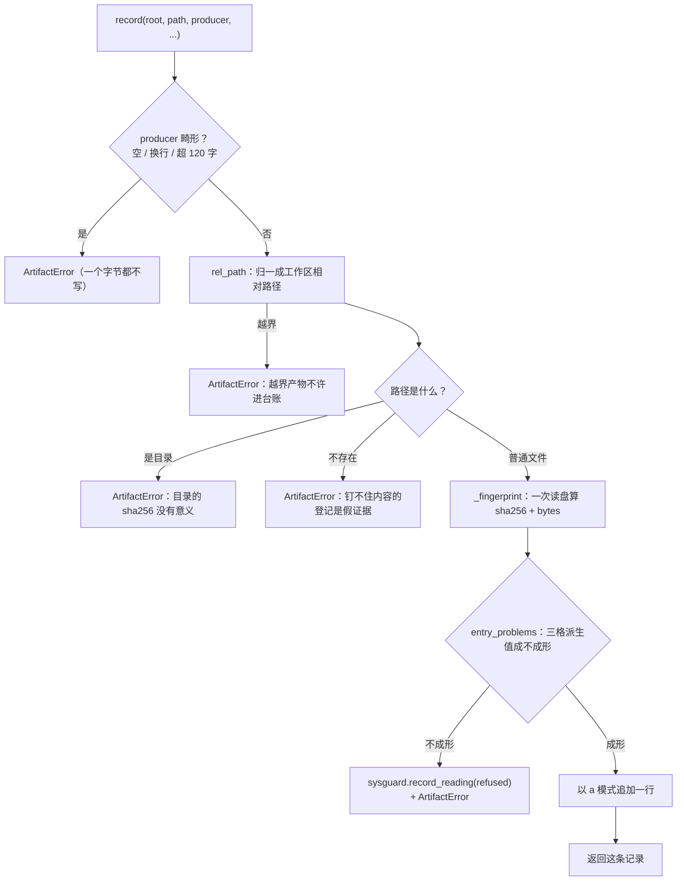

# 产物台账（PART · `ARTIFACTS.jsonl`）

> **这份文档管什么**：`<工作区根>/ARTIFACTS.jsonl` 这一层 —— 一条记录长什么样、写侧拒什么、
> 读侧的五种状态、"这个路径归谁"这个问题的唯一判断，以及它与 `tasks.artifacts` /
> `documents.markdown_path` 的分工。
>
> **不管什么**：16 张领域表（另有 1 张退役表 `eval_results`，见 `schema.RETIRED_TABLES`）与事务
> （见 `PART-LEDGER-AND-STORE.md`）；签台账与手稿签块
> （见 `verifications` / `DOC-SIGNATURES.jsonl`）。
>
> **核实口径**：路径相对 `agentflow/`；行号在 2026-11-22 逐条核过；读数是
> `projects/lp-ball-15` 现算的，命令随文给出。

---

## 1. 它为什么不是那 16 张表里的一张

| 面 | 16 张领域表（+ 1 张已退役 `eval_results`） | `ARTIFACTS.jsonl` |
|---|---|---|
| 真身 | `schema.TABLES`（`src/agentflow/schema.py::TABLES`） | 一个工作区根下的 JSONL 文件（`src/agentflow/artifacts.py::LEDGER_NAME`） |
| 谁写 | `store.tx` 的提交块 | `artifacts.record` 直接追加（`src/agentflow/artifacts.py::record`） |
| 锁 | `LOCK_ORDER` 表锁 + 写者锁 | **没有锁**（只追加，一行一条） |
| 事件 | 每次写落一条 `events.jsonl` 事件 | **不进事件流**，因此 `rebuild` 不会重建它 |
| 版本 | `schema_version` + 读期 fail-closed | 没有版本号；读侧容忍缺字段 |
| 重建 | 可从事件流整表重建 | **不可重建**；它在盘上就是唯一真相 |

这个落位是**刻意**的：新表要人裁（`schema.py` 在 FC-27 内），而这一层要的只是
"工作区级台账"，与 `DOC-SIGNATURES.jsonl`、`sessions/*.jsonl` 同一形态
（理由逐字写在 `src/agentflow/artifacts.py` 的模块 docstring「这一层补的是什么」一节）。

代价也要说清：**它不在 `rebuild` 的保护伞下**。表文件被 `rebuild` 覆盖时，一份错的台账不会
被纠正；反过来，台账丢了也没有重建手段 —— 只能靠 `unowned()` 把"盘上有、台账里没有"的路径
重新点出来。

---

## 2. 一条记录

一条记录 = 一个 JSON 对象 = 一行（`src/agentflow/artifacts.py::FIELDS` 的 `FIELDS`）：

| 字段 | 谁填 | 含义 | 出处 |
|---|---|---|---|
| `at` | 框架现算 | 产出时刻（带本地时区偏移的 ISO） | `src/agentflow/artifacts.py::ledger_path`、`src/agentflow/artifacts.py::record` |
| `path` | 调用方给，框架归一 | **工作区相对**路径（posix 分隔符）；绝对路径/越界一律拒 | `src/agentflow/artifacts.py::rel_path` |
| `sha256` | 框架现算 | 产出时磁盘内容的 sha256（字节级，不做归一化） | `src/agentflow/artifacts.py::_fingerprint` |
| `bytes` | 框架现算 | 字节数，与 `sha256` **同一次读盘**得出 | `src/agentflow/artifacts.py::rel_path` |
| `producer` | 调用方给 | 生产者：角色名 / 实例级 actor / `M` / `tool:<名>` / 外部脚本名 | `src/agentflow/artifacts.py::producer_problem` |
| `kind` | 调用方给 | 产物类别（自由文本：`task-result` / `f-proof-manuscript` / …） | `src/agentflow/artifacts.py::record` |
| `task_id` | 调用方给 | 属于哪一次召唤（可空） | `src/agentflow/artifacts.py::record` |
| `exit_code` | 调用方给 | 产生它的那次执行的退出码；"没跑过"不许填 0 | `src/agentflow/artifacts.py::FIELDS`、`src/agentflow/artifacts.py::record` |
| `note` | 调用方给 | 人读的补充 | `src/agentflow/artifacts.py::record` |
| `instance` | 调用方给 | 实例标签（K1/K2）：同一角色两个实例各产一件时按它分开 | `src/agentflow/artifacts.py::record` |
| `identity_conflict` | 调用方给 | 非空 = 这一笔**没归因成功**（写的人要在读数里看见它） | `src/agentflow/artifacts.py::record` |
| `family` | 调用方给 | 稿的族（`f-proof`/`b-proof`/`e-proof`/`e-num`）；非稿产物是空串 | `src/agentflow/artifacts.py::record` |

`sha256` 与 `bytes` 必须同一次读盘：分两次取（先 sha 再 `stat`）时，中间被换掉的文件会让两格
各描述一版，而读侧按 `sha256` 对拍**永远看不出** `bytes` 已经不对（`src/agentflow/artifacts.py::_fingerprint`）。

---

## 3. 写侧：先核文件，再写台账



五道拒收（都在 `src/agentflow/artifacts.py::kind_state`）：

| 拒收 | 判据 | 为什么拒而不是降级 |
|---|---|---|
| `producer` 畸形 | 空 / 含换行 / 超 `PRODUCER_MAX_CHARS=120`（`src/agentflow/artifacts.py::PRODUCER_MAX_CHARS`） | 台账一行一条，换行会把一行拆成两条；"未登记"**不**在这里拒（见下） |
| 路径越界 | `rel_path` 的 `relative_to` 失败（`src/agentflow/artifacts.py::rel_path`） | 登记越界路径会让读者以为它在我们能看住的范围内 |
| 是目录 | `full.is_dir()`（`src/agentflow/artifacts.py::record`） | 目录的 sha256 没有意义 |
| 文件不存在 | `not full.is_file()`（`src/agentflow/artifacts.py::record`） | "先记账后产出"会让台账变成愿望清单 |
| 派生格不成形 | `entry_problems`（`src/agentflow/artifacts.py::entry_problems`）：sha 不是 64 位小写十六进制 / `bytes` 不是非负整数 / `path` 空或带 `..` / `at` 不可解析 | 这三格都是框架自己算的 ⇒ 坏了就是框架坏了；留一条 `sysguard` 读数再拒（`src/agentflow/artifacts.py::record`） |

**`producer` 的"未登记"是可见，不是否决**（`src/agentflow/artifacts.py::entry_problems`）：
外部脚本（例如 `paper-generator`）的产出不许因为"框架没登记这个名字"就消失 ——
台账少一行是不可逆的信息损失。所以写入期只拦畸形输入，`producer_is_known()`
（`src/agentflow/artifacts.py::producer_is_known`）与 `summarize()["unregistered"]` 负责把"出现了一个没登记的生产者"报出来。

**调用方该用哪个入口**：

| 入口 | 登记失败时 | 用在 |
|---|---|---|
| `record`（`src/agentflow/artifacts.py::record`） | 抛 `ArtifactError` | 失败必须让这一笔整体失败的地方 |
| `record_or_problem`（`src/agentflow/artifacts.py::record_or_problem`） | 返回 `({}, 一句问题)` | "产物已经落盘之后补记归属"的调用点：把失败收成读数，**不许**读成"产物没写成" |

---

## 4. 读侧：五种状态，三种"为什么变了"

`verify_entries`（`src/agentflow/artifacts.py::verify_entries`）逐条把台账钉的 `sha256` 与盘上现版对拍：

| `status` | 判据 | 处置 |
|---|---|---|
| `ok` | 盘上 sha == 台账 sha | —— |
| `changed` | 文件在、读得出来，但 sha 不同 | 看 `reason`（下表），只有第三档要人看 |
| `missing` | 文件不在了（`src/agentflow/artifacts.py::verify_entries`） | 产物被删/搬走 |
| `not_a_file` | 路径现在是个目录（`src/agentflow/artifacts.py::verify_entries`） | 形态变了 |
| `unreadable` | 读文件本身失败（`OSError`，`src/agentflow/artifacts.py::verify_entries`） | **没查成**，不是"不在了" |

`changed` 再分三档（`CHANGE_REASONS`，`src/agentflow/artifacts.py::CHANGE_REASONS`、`src/agentflow/artifacts.py::_sign_block_at`）：

| `reason` | 出现条件 | `explained` | 处置 |
|---|---|---|---|
| `superseded_by_later_registration` | 台账里后面还有一条同路径登记，且它钉的就是盘上现版 | `True` | 正常的追加登记，不用管 |
| `signed_after_registration` | 登记之后这份稿被盖了签块（签块改了文件字节） | `True` | 不用管 |
| `rewritten_after_registration` | 分不出上面两档 | `False` | **保守侧**：登记之后有人改了内容，要人看 |

`explained=False` 的语义是"**没找到解释**"，不是"确认被改" —— 三态不折平
（`src/agentflow/artifacts.py::CHANGE_REASONS`）。

**唯一的判断是 `unowned()`**（`src/agentflow/artifacts.py::unowned`）：给一组路径，
答"哪些没有归属登记"。本模块只登记与核对，不回答"这个产物该不该存在"（`src/agentflow/artifacts.py` 的模块 docstring「它不是判据的执行者」一节）。

---

## 5. 现算读数（`projects/lp-ball-15`，2026-11-22）

```powershell
python -B -c "import sys;from collections import Counter;sys.path.insert(0,'agentflow/src');from agentflow import artifacts as A;ws='projects/lp-ball-15';recs,bad=A.read_ledger(ws);ver=A.verify_entries(ws,recs);print('records',len(recs),'bad',len(bad));print('status',dict(sorted(Counter(v['status'] for v in ver).items())));print('reason',dict(sorted(Counter(v.get('reason','') for v in ver if v['status']=='changed').items())));print('producer',dict(sorted(Counter(r['producer'] for r in recs).items())))"
```

```text
records 130 bad 0
status {'changed': 51, 'ok': 79}
reason {'signed_after_registration': 21, 'superseded_by_later_registration': 30}
producer {'A': 12, 'B': 34, 'D': 4, 'D-dir2': 1, 'D-dir3': 1, 'E': 20, 'F': 7, 'G': 2, 'M': 2,
          'V': 11, 'agent-B-b-batch4-1': 1, 'agent-D-dir1': 1, 'agent-D-dir2': 4, 'agent-E-E1': 4,
          'agent-E-e-sec3d': 5, 'agent-F-F1': 13, 'agent-F-f-sec3d': 8}
```

读数怎么读：

- **0 条 `missing` / 0 条 `unreadable` / 0 行坏**：这一趟没有产物被删、没有读不出来的文件。
  "没有坏读数"要先证明查过 —— `verify_entries` 的每一条都带 `sha256_now`。
- **51 条 `changed` 全部可解释**（30 条被后一条登记顶替、21 条登记后被盖章）：
  手稿族的正常形态（先落稿登记、后盖章）。**0 条** `rewritten_after_registration`。
- **两个未登记的生产者** `D-dir2` / `D-dir3`（`summarize()["unregistered"]` 会点名）：
  它们既不是角色名、也不是 `agent-<角色>` 形态 ⇒ 写入期放行（那是设计），读侧如实报出。
- `kind` 分布：`task-result` 43、`b-proof-manuscript` 24、`f-proof-manuscript` 21、
  `e-num-manuscript` 18、`note` 10、`experiment-log` 9、`research-report` 2、
  `document-note`/`status-report`/`status-report-readout` 各 1。

---

## 6. 与另外两个"产出面"的分工

| 问题 | 谁回答 | 出处 |
|---|---|---|
| "这次召唤产出了哪些引用？" | `tasks.artifacts`（`table:id` 或 `file:<相对路径>`） | `src/agentflow/schema.py::child_ending`、`src/agentflow/artifacts.py` 的模块 docstring「这一层补的是什么」一节 |
| "G 渲染的那份稿在哪？" | `documents.markdown_path` | `src/agentflow/artifacts.py` 的模块 docstring「这一层补的是什么」一节 |
| "**这个路径归谁**？有没有人登记过它？" | `ARTIFACTS.jsonl` + `unowned()` | `src/agentflow/artifacts.py` 的模块 docstring「这一层补的是什么」一节、`src/agentflow/artifacts.py::owners_of` |
| "这份稿的内容被改过吗？" | `documents.content_sha256`（G 侧）+ 签台账 | `src/agentflow/signatures.py` 的模块 docstring「为什么需要它」一节 |
| "盘上这份字节和登记时一样吗？" | `ARTIFACTS.jsonl` 的 `sha256` 对拍 | `src/agentflow/artifacts.py::changed_reason` |

前两个都只回答**单个对象自己**的产出面；"同一个路径可能被两个角色产出"这件事它们答不了 ——
那正是这一层补的（`src/agentflow/artifacts.py` 的模块 docstring「这一层补的是什么」一节）。

---

## 7. 常见故障与读数

| 现象 | 看哪个读数 | 怎么修 |
|---|---|---|
| 报 `文件不存在：...` | `ArtifactError` 文本里有相对路径与解析后的绝对路径 | 先让文件真的落盘，再登记；**不要**手写一行台账糊过去 |
| 报 `路径越出工作区` | 同上，文本里有工作区绝对路径 | 把产物写进工作区，或确认它本来就不该被登记 |
| 报 `producer 太长了`（>120） | 消息里有字符数 | 名字放 `producer`，说明放 `note` |
| `verify_entries` 出现 `unreadable` | 该条的 `path` | 这是**没查成**（权限/坏字节），不是"文件没了"；按 `OSError` 查盘 |
| `verify_entries` 出现 `changed` + `explained=False` | `reason == rewritten_after_registration` | 登记之后有人改了内容 —— 查是谁改的；若是正当修订，补一条新登记 |
| `unowned()` 报出一批路径 | 返回的是工作区相对路径（排序） | 产物在盘上但没登记 ⇒ 补 `record`，或确认它是临时件（`downloads/`、`.tmp`） |
| 台账里有坏行 | `read_ledger` 的第二返回值（行号 + 原因） | 与所有 JSONL 同一个坏行判据（`src/agentflow/jsonlfile.py`）；坏行不静默跳过 |
| 台账里出现 `identity_conflict` 非空的行 | 该行本身 | 这一笔**没归因成功**；按 `instance` / `producer` 查是谁产的 |

---

## 8. 核实到的两处不一致

1. **`record` 追加时没有 `fsync`**（`src/agentflow/artifacts.py::record`，只有 `write`），
   而存储层的事件流是 `flush + fsync`（`src/agentflow/store.py::Store._append_events`）。
   后果不对称：崩在缓冲未落盘时，产物在盘上、台账里没有那一行 —— 这正是 `unowned()`
   会报出来的形态，所以它**可发现**；但它与"事件流先 `fsync` 再落快照"是同一条纪律的两个方向，
   值得下次一起看。
2. **`record` 没有跨进程锁**。它是纯追加，一行一次 `write`；同一个工作区两个进程同时登记
   没有互斥声明。今天没有被违反的判据钉住这一条（对比：手稿占用登记有跨进程 `FileLock`，
   `src/agentflow/manuscriptids.py::claim_for_write`），而 `sessions/*.jsonl` / 事件流都是在锁内或单写者
   前提下追加的。

---

## 9. 复算清单

在 `D:\Incubator` 下跑（只读）：

```powershell
# ① 条数 / 状态 / 理由 / 生产者（本文第 5 节）
python -B -c "import sys;from collections import Counter;sys.path.insert(0,'agentflow/src');from agentflow import artifacts as A;ws='projects/lp-ball-15';recs,bad=A.read_ledger(ws);ver=A.verify_entries(ws,recs);print('records',len(recs),'bad',len(bad));print('status',dict(sorted(Counter(v['status'] for v in ver).items())));print('reason',dict(sorted(Counter(v.get('reason','') for v in ver if v['status']=='changed').items())))"

# ② 汇总（未登记的生产者在这一格）
python -B -c "import sys;sys.path.insert(0,'agentflow/src');from agentflow import artifacts as A;print(A.summarize('projects/lp-ball-15')['unregistered'])"

# ③ 没登记的路径（唯一判断；输出 ['不存在的目录/x.md'] —— 另两条都登记过）
python -B -c "import sys;sys.path.insert(0,'agentflow/src');from agentflow import artifacts as A;print(A.unowned('projects/lp-ball-15',['notes/A.md','reports/b-proof-000000.md','不存在的目录/x.md']))"
```

本文档配套探针：`temp/syscomp1/artifacts_reading.py`。
