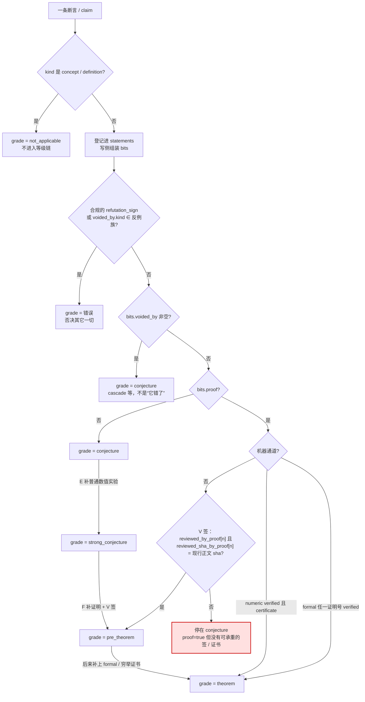
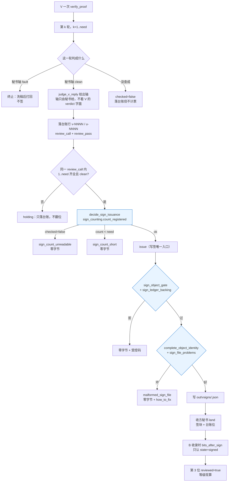

# PART：证据与签 —— 一条断言怎样走到 proof 级

> 范围：`src/agentflow/` 里「断言 → 五元位 → 等级」与「V 三转 → 系统计数 → 签文件 → 落签」这条链。
> 本文只写**设计**：每个判据回答什么问题、闸在哪一侧、哪一格是可复算的凭据。
>
> 不重复的既有文档：
> - `docs/TWO-AXES-GRADE-AND-KIND.md` 已有五元位的 32 组全枚举表与等级/档位横表；本文只取「等级 · 凭据 · 谁签 · 落哪一格」这一条，并补它没覆盖的「错误」短路与 `kind` 漂移现场。
> - `docs/FORMAL-TOOLCHAIN.md` 写 Lean / Mathlib 的安装与探测；本文只把 `formal` 位当作第 4 位的一条机器通道，不复述工具链。
> - `docs/ROLE-SPECS*.md` 写角色动作面；本文只写这些动作落下的**证据形状**。
>
> 本文的结论只有一句：**等级是五元位的函数，五元位是台账的读数，签是台账的复算 —— 三者没有任何一层相信“文件在盘上”或“角色说自己通过了”。**

---

## 0. 三层与一条不变式

| 层 | 盘上的东西 | 它回答什么 | 谁写的 |
|---|---|---|---|
| 断言 | `data/statements.json` 的一行（`stmt_id` / `kind` / `proof_text` / `bits`） | 我们提出了什么 | B 的登记正路（`register_statement`） |
| 台账 | `verifications/<命题号>.jsonl` 或 `verifications/pending/<键>.jsonl` 的一行 | 谁在哪一趟、第几轮、判了什么 | V 的写口（`record_verification` / `record_pending_sign`） |
| 签 | `out/vsigns/<artifact_sha>.json`（一稿一签） | 框架从台账**现数**出来的一签 | `vsigns.issue`（唯一写入口） |
| 等级 | `bits.grade`（每次读都现算，不信任盘上缓存） | 这一条到哪一档 | `evidencebits.derive_grade` |

不变式：`derive_grade` 只读五元位；五元位只读台账与行上的凭据字段；签只由台账复算得到。任何一层拿到的是“角色声称”，都不进入下一层。

---

## 1. 证据五元位：谁签、要什么、落在哪一格

### 1.1 五位与它们的 owner

`evidencebits.py::BIT_NAMES` 定义位名，`evidencebits.py::BIT_OWNERS` 定义 owner，`evidencebits.py::BIT_LEDGERS` 定义每位去哪个台账查（`BIT_LEDGERS`，四格：`owner` / `ledger` / `pointer` / `criteria`）。

| # | 位 | owner | 取值域 | 台账 / 落点 | 判据说“位上有”时表里要查到什么 |
|---|---|---|---|---|---|
| 1 | `numeric` | E | `pending` / `na` / `failed` / `verified`（`BIT_STATES`，`evidencebits.py::BIT_STATES`） | `experiments`（`method='numeric'`） | 指针指的那条实验行存在，且 `method='numeric'`；`verified` 还要有脚本 + sha |
| 2 | `proof` | F | `bool` | `statements.proof_text`（同表内查） | 同行 `proof_text` 非空；引用命题例外（凭据是文献代号 + 逐字核验） |
| 3 | `reviewed` | V | `bool`（“凭什么”另有三态 `reviewed_source`：`v` / `citation` / 空） | `bits.evidence.reviewed_by_proof[证明号]`，读数在 `verifications/<命题号>.jsonl` | 被审的那一份证明号在册台账里有一条「成立」的签；别的号签过不算 |
| 4 | `formal` | L | 二维 `{证明号: 状态}`；逐路径五态 `pending` / `na` / `failed` / `verified` / `stale`（`FORMAL_PATH_STATES`，`evidencebits.py::FORMAL_PATH_STATES`） | `experiments`（`method='formal'`），凭据落 `bits.evidence.formal_by_proof[证明号]` | 那个证明号的凭据指的实验行存在、`method='formal'`；汇总按“任一路径 verified” |
| 5 | `audited` | H | `bool` | `documents`（按稿件钉） | 只查稿件在不在册；命题级判不了 |

第 5 位**不进等级**：`derive_grade` 一个字节都不读 `audited`，它的落点是并列的 `bits.audited_badge`（`evidencebits.py::bits_of`；TWO-AXES §3.3 用 16 对对照钉住）。

### 1.2 等级是现算的，不信任任何自报

`derive_grade`（`evidencebits.py::derive_grade`）的优先级逐字如下：

1. `kind="concept"` ⇒ `not_applicable`（`evidencebits.py::derive_grade`，概念没有真值，不参与排序）；
2. 合规的 `bits.evidence.refutation_sign` ⇒ `错误`（`evidencebits.py::refutation_sign`）；
3. `bits.voided_by.kind` 落在 `REFUTATION_EVIDENCE_KINDS`（反例 / 构造 / 判词）⇒ `错误`（`evidencebits.py::derive_grade`）；
4. 其它 `bits.voided_by`（`cascade` 等，不是“它错了”）⇒ `conjecture`（`evidencebits.py::derive_grade`）；
5. `proof ∧ (formal 任一路径 verified ∨ numeric verified 且是穷举证书)` ⇒ `theorem`（`evidencebits.py::derive_grade`）；
6. `proof ∧ reviewed` ⇒ `pre_theorem`（`evidencebits.py::derive_grade`）；
7. `numeric verified`（普通数值实验）⇒ `strong_conjecture`（`evidencebits.py::derive_grade`）；
8. 兜底 ⇒ `conjecture`（`evidencebits.py::derive_grade`）。

两处容易读错的地方：

- 第 4 位的 `stale`（验过、但验的不是现在这一份）**不算** `verified`：`_BIT_OR_ORDER` 把它夹在 `pending` 与 `na` 之间（`evidencebits.py::_BIT_OR_ORDER`）。它既不是“没验”，也不是“验过”。
- 第 1 位的 `verified` 只有在 `numeric.certificate` 为真（穷举证书）时才与第 4 位同级；普通数值实验只抬到强猜想（`_numeric_is_certificate`，`evidencebits.py::_numeric_is_certificate`）。旧行没有 `certificate` 这一格时按“是证书”读（向后兼容，不是放宽）。

### 1.3 等级表：需要什么凭据 · 谁签 · 落了哪一格

| 等级 | 需要什么凭据 | 谁签 | 落了哪一格 |
|---|---|---|---|
| `not_applicable`（不适用） | 无：`kind` 是 `concept` / `definition` 就短路 | 无 | `bits.grade`（概念行可以 `bits={}`） |
| `conjecture`（猜想） | 没有机器通道，也没有有效 V 签；或只有 `proof` 没有第 3 位 | 无 | `bits.grade` |
| `strong_conjecture`（强猜想） | 第 1 位 `verified`，且不是穷举证书（普通数值实验） | E（落 `experiments` 行，带 script + sha） | `bits.numeric` + `bits.evidence.numeric` |
| `pre_theorem`（预备定理级） | 第 2 位 `proof=true` **且** 第 3 位 `reviewed=true` | F 写正文；V 签第 3 位（逐份证明号） | `bits.proof` + `bits.reviewed` + `bits.evidence.reviewed_by_proof[n]` / `reviewed_sha_by_proof[n]` |
| `theorem`（正式定理，形式化通道） | 第 2 位 **且** 第 4 位任一证明号 `verified` | F 写正文；L 落形式化实验行（检查器原话） | `bits.proof` + `bits.formal[n]` + `bits.evidence.formal_by_proof[n]`（`checker` / `experiment_id` / `proof_sha256`） |
| `theorem`（正式定理，穷举通道） | 第 2 位 **且** 第 1 位 `verified` 且是签下的穷举证书 | F 写正文；E 落穷举实验；V 的机械会审给 `review_scope=single_round`（E 的 `need=1`） | `bits.proof` + `bits.numeric` + `bits.evidence.numeric`（`certificate=true`） |
| `错误`（error） | 合规证伪签，或 `voided_by.kind ∈ {numeric_counterexample, construction, defect_ref}` | V 落证伪签；E / D 落反例/构造；判词由对应入口落 | `bits.evidence.refutation_sign`（三格必填）或 `bits.voided_by` |
| `unjudged`（未判） | 登记回执那一刻 `derive_grade` 算不出来 | —（只出现在登记回执的 `grade_at_registration` 读数里） | 回执读数，不写进 `bits.grade` |

两个反直觉点，必须写清而不是绕开：

1. **`theorem` 不要求 V 签。** 机器通道（Lean/Coq/Isabelle 的 `formal` 或穷举证书）与 V 签是两条并列凭据；一条证明只要机器可核，就到了定理（TWO-AXES 表一 #04/#05/#20/#21）。这是“穷举证书相当于 Lean 形式化”那条口径的落点，不是漏判。
2. **`kind` 只是历史名。** `evidence_kind` / `kind` 是等级的反算名（`GRADE_TO_KIND`，`evidencebits.py::GRADE_TO_KIND`），判定面读等级。真机 `lp-ball-15` 的 13 行全部写着 `kind="theorem"`，现算之后只有 3 行到 `pre_theorem`、10 行仍是 `conjecture`（§8.3）。这不是“档位写错了”，而是“作者写的名字不许替证据说话”。

---

## 2. 引文：三态、五档与 `no_evidence`

引文这条链有两个写侧入口、一个读侧口径。三者的分工是本节的重点。

### 2.1 写侧 `check_quote`：True / False / None

`quoteverify.check_quote`（`quoteverify.py::check_quote`）只做一件事：把引文与来源文本按同一套保守规范化（`textutil.quote_match_text`）做子串定位。返回 `QuoteCheck.verified` 是三态（`quoteverify.py::QuoteCheck`），不是布尔。

| 返回 | `reason` | 含义 | 处置 |
|---|---|---|---|
| `True` | `substring_match` / `substring_match_outside_declared_range` / `substring_match_fulltext` | 逐字命中；后两档把“页码不对/退到全文”如实标出来 | 写 `quote_verified=True`，并落命中区间 |
| `False` | `not_found` / `not_found_page_unknown` | 逐字没找到 | 写 `quote_verified=False`；**不区分“改写”与“编造”**（模块边界，`src/agentflow/quoteverify.py` 的模块 docstring「边界：本模块只判「逐字不在」，不判「被改写/拼接」」一节） |
| `None` | `no_text_layer` / `empty_quote` / `empty_page_range` / `page_unreadable` / `page_status_unknown` | 没法判（扫描版无文本层、空引文、空区间、页抽取失败、诊断取不到） | **不写通过也不写失败**；`None` 不是 `False` |

三处“没查成”被单列，都是同一个方向：宁可判“无法判定”，也不把“我们没读到”判成“这句话不存在”。

- 没有 `pages` ⇒ `no_text_layer`（`quoteverify.py::check_quote`）；
- 声明了 `start > end` 的空区间 ⇒ `empty_page_range`，不是 `not_found`（`quoteverify.py::check_quote`：空区间里不可能有页，拿它去指控页码错是反向的）；
- 试过的窗口里任何一页抽取失败 ⇒ `page_unreadable`，不是 `not_found`（`quoteverify.py::check_quote`）；页状态取不到 ⇒ `page_status_unknown`（`quoteverify.py::check_quote`）。把真引文判成幻觉是这条链最贵的方向。

`allow_fulltext_fallback` 默认 `False`（`quoteverify.py::check_quote`）：页码未知时不做“全文搜到就算过”的默认放宽。

### 2.2 写侧只补一种值：`_normalize_quote_mode`

`schema._normalize_quote_mode`（`schema.py::_normalize_quote_mode`）把一行的 `quote_verified` / `quote_mode` 摆成自洽的一对：

1. `quote_verified is True` 且 `quote_mode` 空 ⇒ **有区间**才记实成 `verbatim`；区间为空就保持空串（`schema.py::_normalize_quote_mode`）。这一格是写侧唯一给 `mode` 补值的地方，补错就是把自报升成结论；
2. 不是 `True`（`False` / `None`）⇒ 方式一律归空串（`schema.py::_normalize_quote_mode`）；
3. 词表外的值 ⇒ 抛错（`schema.py::_normalize_quote_mode`）；
4. `semantic` 还要 `quote_span` **和** `quote_call_sha256` 都非空，否则抛错（`schema.py::_normalize_quote_mode`）——“语义相同”必须说清对着哪一段、哪一次判的。

注意第 1 条只能补 `verbatim`，不能把空区间补成 `verbatim`。空区间那一档留给读侧读成 `no_evidence`。

### 2.3 读侧 `quote_state`：五档

`evidencebits.quote_state`（`evidencebits.py::quote_state`）是引文状态唯一的读口径，判据见 `evidencebits.py::quote_state`。

| `quote_state` | 判据 | 谁产出的 | 含义 |
|---|---|---|---|
| `verbatim` | `quote_verified is True` 且方式是 `verbatim`（或空方式 + 有区间） | `check_quote` / 写侧归一 | 逐字命中（不花模型钱） |
| `semantic` | `quote_verified is True` 且 `quote_mode="semantic"` 且 `quote_span` 与 `quote_call_sha256` 都非空 | H 的语义判定 | 语义相同（允许改写、换记号、跨语言） |
| `mismatch` | `quote_verified is False` | `check_quote` / H | 查过了、不一致 |
| `unchecked` | `quote_verified is None`，或方式那一栏是词表外的词 | 还没查 / 说不出方式 | 还没查（欠一次回验） |
| `no_evidence` | `quote_verified is True`，但 `quote_span` 为空；或 `semantic` 缺 `quote_call_sha256` | 读侧兜底 | **说通过了，却拿不出可复核的区间** |

`QUOTE_STATES`（`evidencebits.py::QUOTE_STATES`）是这五档的唯一词表；`no_evidence` 刻意不进 `QUOTE_MODES`（`evidencebits.py::QUOTE_NO_EVIDENCE`），因为它不是一种“方式”，而是“没有证据”。

### 2.4 为什么“说通过却无区间”必须是 `no_evidence`

这一档的存在不是因为“区间好看”，而是因为三种折法都会造成一个具体的假读数：

- **折进 `verbatim`**：把“说通过、指不出核的是哪一段”读成“逐字通过”。真机曾有一批行 `quote_verified=true` / `quote_mode=verbatim` / `quote_span=""`，读侧照“逐字通过”给引用学分（`clean_statement_ids`）——而“核了哪一段、在第几页”在盘上根本不存在（`evidencebits.py::QUOTE_NO_EVIDENCE` 的现场）。
- **折进 `unchecked`**：把它印成“还没人查过”。两者欠的东西不同：`unchecked` 欠一次回验（把它降回 `None` 再查），`no_evidence` 欠的是**证据本身**（要补区间）。一个词盖住两件事，读的人会去补一条不存在的工序。
- **折进 `mismatch`**：等于说“查过了、不一致”，而它并没有被查成不一致。

落点不在文案，在账：

- `closing` 的 `quote_verified_rows` 把 `no_evidence` **单列一栏**，且它**不进 `judged` 的分母**（`closing.py::_leg_reading`）：“没有区间的通过”没有可复核读数，不该给这一档加分；
- 同一份 `closing` 的口径在 `closing.py::_leg_reading` 重复：有结论的行只认 `verbatim` / `semantic` / `mismatch`；`no_evidence` 既不进“有结论”，也不进“未查 + 理由”。

一句话：`no_evidence` 的用途是让“通过”与“可复核的通过”在账上分得开，而不是把一个人为的第三种状态再加一层。

### 2.5 同一种病：TRACEFIX 的 `changed` 三档

`changed` 原先是个布尔，而盘上至少有两种完全不同的“变了”，处置也完全不同。`artifacts.CHANGE_REASONS`（`artifacts.py::CHANGE_REASONS`）把它拆成三档，`changed_reason`（`artifacts.py::changed_reason`）给出分类：

| 理由码 | 含义 | `explained` | 处置 |
|---|---|---|---|
| `superseded_by_later_registration` | 台账后面还有一条同路径登记，且钉的就是盘上现版 | `True` | 不用管：正常的追加登记 |
| `signed_after_registration` | 登记之后落了签块，签块改了文件字节 | `True` | 不用管：MALFORM 普查里 77 条“最后一条 sha 不符”有 38 条属这一档 |
| `rewritten_after_registration` | 登记之后有人改了内容，或分不出原因 | `False` | 要人看；分不出原因时给这一档（保守侧），不是“确认被改” |

`verify_entries`（`artifacts.py::verify_entries`）的 `status` 一个字不动（仍是 `ok` / `changed` / `missing` / `unreadable` / `not_a_file`，`artifacts.py::KIND_STATES`），`reason` / `explained` 只对 `changed` 有内容。它和 `quote_state` 是同一条设计：**布尔只能回答“一不一样”，回答不了“为什么不一样、要不要处置”**。

### 2.6 相邻的第四组：`no_source` 四态

引文还有一组不在这五档里的读数：`quoteevidence.no_source_state`（`quoteevidence.py::no_source_state`）回答“这一行是不是压根没有外部原文可核”：

| 状态 | 含义 | 读法 |
|---|---|---|
| `not_applicable` | 概念行（`kind="concept"`） | 引文回验不适用，不是“假”也不是“未查” |
| `no_source_backed` | 理由走了「无来源可核」，且指到我方手稿的某一处 | 有背书 |
| `no_source_unbacked` | 理由走了那一档，却没有指到位置 | 写入期应被拒（`no_source_without_backing`）；盘上这一档只可能是历史行 |
| `no_source_absent` | `quote_verified` 不是 `True`，而理由一个字都没写 | “该说说不出” |

空串 = 不属于这四态，走 §2.3 的三态/五档那一套。`closing` 把四态各算一栏，且从 `unchecked` 里摘出去（`closing.py::_leg_reading`）——“一行只归一次账”，否则两个数的和会大于行数。

---

## 3. V 的三转与发签

### 3.1 “三转”是一次调用内的三转

`src/agentflow/agent_v/core.py` 的模块 docstring 把这条口径写死：一次 `verify_proof` = V 在**同一次调用内**对同一份正文连判 `review_pass_bound()` 轮（现读 `SIGN_STREAK_NEED`，F/B 为 3），每判一轮落一行台账、问一次秘书发不发；跨两次送审绝不累计。

四种终局：

| 终局 | 触发 | 结果 |
|---|---|---|
| 连续 `need` 转 clean | 每转秘书轴 `clean`，无未解决 error | 发签（在册档由秘书落，未在册档由 V 颁发信封） |
| 任一转 fault | 秘书判「有缺陷要指出」 | 立刻终止；这一转就是终局，台账行经秘书洗稿后打回 F |
| 任一转拿不到合法结论 | 没缝 / 空回复 / 解析失败 | `checked=False`，**一个字节都不写**（不写一行“没查成”来冒充“审过了”） |
| 循环跑完既没签也没打回 | 门槛 ≤ 0 或秘书在够次数那一转既不签也不判 | 返回内部不一致（`checked=False`），绝不写成“次数没到” |

轴只有两档（`clean` / `fault`），且**只由秘书给**（`v_rowread.row_signable`，`v_rowread.py::row_signable` 的第一句就是 `ledger_axis(row) == "clean"`）。V 的 `verdict` 字面不是轴：`historical_axis` 已经是墓碑，恒返回空串（`v_rowread.py::historical_axis`）。

### 3.2 系统计次：唯一门槛

`sign_counting.count_rows`（`sign_counting.py::count_rows`）的规则逐条可单独钉住（`sign_counting.py::count_rows`）：

| 规则 | 读数 / 效果 |
|---|---|
| 只取同一份正文（`proof_sha256` 逐字相同）且同一 `review_call` 的行 | 跨趟不拼票 |
| 轮号必须恰好是 `1..need`，缺号 ⇒ `terminated=missing_pass` | 这一组不成立（不能拿 1、3 两轮凑三票） |
| 同号重放（同一 `review_pass` 多行）不增加计数 | `replayed` 只作读数 |
| 轴是 `fault` ⇒ 当场终止 | 后面再 clean 也救不回来 |
| 轴不是 clean / 行自己签不住 ⇒ 同样终止 | “没查成”不是票 |
| 机械会审的行整组只算 1 轮 | E 的 `need=1` 够；F/B 的 `need=3` 永远不够（负控） |
| 没有 `review_call` 的老行 | 走 `legacy_tail`，显式 `legacy=True` + `counted_by="legacy:ledger_tail"`，不进新组计数 |
| 台账读不出来 | `checked=False`（没查成，不是 0 次） |

`count_registered`（`sign_counting.py::count_registered`）是在册台账那一口：按 `#proof_no` 分组，`review_call` 没给就从这一份证明的最后一行读；单轮会审（`review_scope="single_round"`）按 `EXHAUSTION_SIGN_STREAK_NEED` 数。`ticket`（`sign_counting.py::ticket`）把一行台账翻成签文件里的一张票：`verification_id` / `at` / `proof_sha256` 三格必填，另带 `review_call` / `review_pass` / `object_sha256` / `object_path` / `round` / `verdict` / `axis`。

### 3.3 need 分档：E=1，F/B=3

| 档 | `need` | 常量 | 理由（代码里的原话） |
|---|---:|---|---|
| F / B（散文证明 / 收录） | 3 | `SIGN_STREAK_NEED = 3`（`v_vocab.py::SIGN_STREAK_NEED`） | 同一份正文在同一趟内连判三次 |
| E（穷举型证据） | 1 | `EXHAUSTION_SIGN_STREAK_NEED = 1`（`v_vocab.py::EXHAUSTION_SIGN_STREAK_NEED`） | 业主 2026-11-17：“实验侧报告不承重（承重的是程序）”，从三次降成一次 |

三个数不许混写（`v_vocab.py::EXHAUSTION_SIGN_STREAK_NEED`）。E 的判词来自机械七项会审（`exhaustionreport.review`），不是模型散文；机械行在计数层整组只算 1 轮，所以 `need=1` 下够，`need=3` 下永远不够——这正是“同一份判词复制三份不构成三轮”的落点。

### 3.4 `decide_sign_issuance`：系统计数 + 轴 clean，不问模型

`secretary_sign.decide_sign_issuance`（`secretary_sign.py::SignMixin.decide_sign_issuance`）的判定只有一层：

1. 候选轴从台账行读（`secretary_judge`，唯一来源，`secretary_sign.py::SignMixin.decide_sign_issuance`）；没有轴 ⇒ `candidate_ok=False`，不是“没问题”；
2. 门槛由框架从台账现数（`sign_counting.count_registered`，`secretary_sign.py::SignMixin.decide_sign_issuance`）；`within_call`（调用方递进来的第几轮）**只作读数**；
3. `count >= need` 且 `candidate_ok` ⇒ 发签；否则不发；
4. **不问模型**：2026-11-16 裁定 ③ 删掉了原先“问模型签发/不签发”那一层（`secretary_sign.py::SignMixin.decide_sign_issuance`）；`note_decision` 只落一行“决定”，不再有模型判定行（`secretary_sign.py::SignMixin.decide_sign_issuance`）。

| 结局 | 返回 | 是否落签 |
|---|---|---|
| 地板过了 | `checked=True` + `issue=True` + `decision=签发` | 由秘书 `_land_sign_issuance` 落 |
| 地板没过 | `checked=True` + `issue=False` + `decision=不签发` | 不落；这一转只算“还不算一票”，终局在 V 的循环 |
| 没缝 / 开关关着（仅旧直调）/ 台账读不成 / 坏 JSON | `checked=False` + `issue=False` + 理由 | 不落（`checked=False` 不是“可以签”，也不是“次数不够”） |

“决定 ≠ 落地”是拆分点：`decide_sign_issuance` 只决定；`_land_sign_issuance`（`secretary_sign.py::SignMixin._land_sign_issuance`）才把决定落成签文件；签文件里的 `written_by` / 收方由 `vsigns.SECRETARY_OF` 约束（`vsigns.py::SECRETARY_OF`，只认 `secretary:F/B/E`）。

### 3.5 台账两形态：在册 vs pending

V 的“签”在盘上有两种台账形态。两者的身份、编号、字段都不同，唯一相同的是“一行一次审校”。

| 字段 | 在册 `verifications/<命题号>.jsonl` | pending `verifications/pending/<键>.jsonl` |
|---|---|---|
| 什么时候用 | 命题已在册 | 命题还没在册（“先签后收录”是主路） |
| `verification_id` | `v-NNNN`，按文件内顺序发（`v_ledger_write.py::record_verification`） | `u-NNNN`，**跨所有 pending 文件**取最大 +1（`v_pending_write.py::_next_pending_verification_id`） |
| `statement_id` / `stmt_id` | 两键同值 = 命题号（`v_ledger_write.py::record_verification`） | 两键都为空串（`v_pending_write.py::record_pending_sign`：“没有命题号是这一档的定义”） |
| `proof_no` | canonical（#p1）**不写**；显式 >1 才写（旧多证明兼容，`v_ledger_write.py::record_verification`） | 不写（`v_pending_write.py::record_pending_sign`） |
| `round` | 文件内行号 | 文件内行号 |
| `review_call` / `review_pass` | 无条件写（`v_ledger_write.py::record_verification`） | 无条件写（`v_pending_write.py::record_pending_sign`） |
| `object_sha256` / `object_path` | 调用方给了才写（`v_ledger_write.py::record_verification`；SIGNMAL 之后在册写口必须给，见 `agent_v/core.py::AgentV._write_review_row`） | 无条件写（`v_pending_write.py::record_pending_sign`） |
| `manuscript` | 给了才写（`v_ledger_write.py::record_verification`） | 无这一格（手稿由 `land_unregistered_sign` 落） |
| `review_scope` | 只有单轮会审写（`v_ledger_write.py::record_verification`） | 不写 |
| `landed` | 不写 | `"pending"`（`v_pending_write.py::record_pending_sign`） |
| `secretary_judge` | 无条件写（`v_ledger_write.py::record_verification`） | 无条件写（`v_pending_write.py::record_pending_sign`） |
| `washed_relay` | `washed=True` 才写（`v_ledger_write.py::record_verification`） | 同（`v_pending_write.py::record_pending_sign`） |
| `citation_checks` | 每一行都写（可为空数组，`v_ledger_write.py::record_verification`） | 同（`v_pending_write.py::record_pending_sign`） |
| `hard_ban_markers` | 命中才写（`v_ledger_write.py::record_verification`） | 同（`v_pending_write.py::record_pending_sign`） |
| 坏行/并发 | 追加式；**没有**跨进程锁 | 两层锁（进程内 + `filelock`，`v_pending_write.py::pending_write_lock`）+ 跨文件发号 |

pending 的文件名是 `object_sha256 or proof_sha256`（`v_pending_write.py::record_pending_sign`），必须是 64 位小写 hex（`v_pending_read.pending_ledger_path`，`v_pending_read.py::pending_ledger_path`）。所以任务里说的“`pending/<object_sha>.jsonl`”在盘上的完整路径是 `verifications/pending/<object_sha 或 proof_sha>.jsonl`。

### 3.6 签文件 `out/vsigns/<artifact_sha>.json`

台账是“审了几轮”的正本；签文件是“框架从台账现数出来的一签”。字段由 `_sign_document`（`vsigns.py::_sign_document`）拼成，不读盘、不判事：

| 字段 | 含义 |
|---|---|
| `schema` | `"vsign/1"`（`vsigns.py::SIGN_SCHEMA`） |
| `artifact_sha` | 被签正文的 sha；同时是文件名（`sign_path`，`vsigns.py::sign_path`） |
| `artifact_path` | 签的载体（`reports/(f/b/e)-proof-*.md`） |
| `artifact_sha_rule` | 这把 sha 是什么的说明（`proofregistry.proof_sha`，不是文件字节 sha） |
| `ledger` | 锚点（`verifications/<号>.jsonl#v-…` 或 `verifications/pending/<键>.jsonl#u-…`） |
| `statement_id` | 命题号；空 = 未在册（合法形态） |
| `verdict` | 恒 `成立`（签只能是成立） |
| `streak` / `need` | 连续票数 / 门槛 |
| `counted_by` / `count` / `legacy` | 这个数从哪来（`sign_counting` / `legacy:*`）、数出来几票、是不是历史形态 |
| `passes[]` | 逐票：`verification_id` / `at` / `proof_sha256` / `review_call` / `review_pass` / `object_sha256` / `object_path` / `round` / `verdict` / `axis` |
| `objections[]` | 保留的反对读数（非空即不是“无异议”） |
| `source_note` | “passes 是逐转读数，全文在台账” |
| `at` / `written_by` / `envelope` | 落签时刻 / 写签者（`secretary:F/B/E` 或 `sign_statement(direct)`）/ 收方信封 |

新形态的 `passes` 不是调用方递进来的清单，而是 `_system_count_update` 数过的那几行（`vsigns.py::_sign_document`）；`streak` 那个数也是框架现数（`vsigns.py::_sign_document`）。签文件因此能自己回答“这三票是不是同一趟”。

---

## 4. 写侧闸：为什么必须写侧拒，而不是读侧宽容

### 4.1 `issue` 的闸序（全部在写盘之前，拒绝零字节）

`vsigns.issue`（`vsigns.py::issue`）是签文件的唯一写入口。它按顺序过：

| # | 闸 | 拒什么 | 码 |
|---|---|---|---|
| 1 | `by` ∈ `SECRETARY_OF` | 不是收方秘书（含 `secretary:V`） | `not_a_secretary`（`vsigns.py::NOT_A_SECRETARY`） |
| 2 | `_sha_key(artifact_sha)` | 文件名不是 64 位 hex | `VsignError`（`vsigns.py::_sha_key`） |
| 3 | `streak < need` | 调用方自称的门槛不够（廉价 fail-closed） | `refused_below_need`（`vsigns.py::issue`） |
| 4 | `_existing_sign_update` | 同一份正文已有同 sha 的签 ⇒ `idempotent`（不重写，只补归档） | `vsigns.py::sign_ledger_backing` |
| 5 | `sign_object_gate` | 没对象 / 台账不是 V 那本 / 三票缺读数 / 载体不对 | `statement_id_missing` / `ledger_not_verification` / `passes_incomplete`（`vsigns.py::sign_object_gate`） |
| 6 | `sign_ledger_backing` | 台账行不在 / sha 不符 / 那一行自己签不住 | `sign_without_ledger` / `ledger_row_missing` / `ledger_sha_mismatch` / `ledger_not_signable`（`vsigns.py::sign_object_gate`） |
| 7 | `_system_count_update` | 系统计数没查成 / 不够 / 锚点不是最后一轮 | `sign_count_unreadable` / `sign_count_short` / `sign_count_anchor_not_last`（`vsigns.py::_existing_sign_update`） |
| 8 | `complete_object_identity` + `sign_file_problems` | 签的读数字段不是能用的形状 | `malformed_sign_file` + `how_to_fix`（`vsigns.py::issue`） |
| 9 | `_write_atomic` | 写盘失败 | 理由串（`vsigns.py::issue`） |

另有一档不在闸序里、位置在第 8 道之后：同名文件在盘上、但里面的 `artifact_sha` 不是这一份正文的 ⇒ `conflict`，**不覆盖**（`vsigns.py::issue`）。可疑的签要人看，不许工具悄悄修好它。

第 5、6、7 道都在“这一签该不该发”；第 8 道在“发出去的这一份能不能用”。缺任何一道，坏形状就只能等事后对账抓——SIGNMAL 的现场就是缺第 8 道。

### 4.2 `sign_file_problems` 判什么、不判什么

`sign_file_problems`（`vsigns.py::sign_file_problems`）的判据表（`vsigns.py::sign_file_problems`）：

| 格 | 判据 | 为什么 |
|---|---|---|
| `artifact_sha` | 64 位小写 hex | 它同时是文件名 |
| `passes` | 非空列表（一签至少一票） | “0 票”不是签 |
| `proof_sha256` | 非空 ⇒ 64 位小写 hex，且逐字等于 `artifact_sha` | 签的是哪一版正文，一票都不许含糊 |
| `object_sha256` | 非空 ⇒ 64 位小写 hex | 被审的是哪一份文件；认领 / 对账按它找 |
| `review_call` | 非 `legacy` 的签，每一票都非空 | 同一趟送审才是同一组票 |
| `review_pass` | 非 `legacy` 的签，每一票都是正整数 | 轮号是这一趟的身份，0 / 缺号不算票 |

**不判**的（`vsigns.py::sign_file_problems`）：每一票有没有 `verification_id` / `at` / `proof_sha256` 三格（那是 `sign_object_gate` 的 `passes_incomplete`）；`statement_id` 空（合法）；`artifact_path` 缺失（直调/夹具的既有受控形态）。

`object_sha256` 为空时**不拒**：`complete_object_identity`（`vsigns.py::complete_object_identity`）在 `_write_atomic` 之前用 `artifact_path` 的字节 sha 把它补上（与未在册那一支同一个值）；只有“点了名、文件在盘上而读不出来”才拒。非空而形状坏则一个字节都不改、直接交格式闸判拒——“替它改写等于替它作证”（`vsigns.py::complete_object_identity`）。

所以这道闸是**修补 + 拒绝两半**，不是单纯拒绝。说“格式闸会拒掉所有畸形签”是不准确的：空 `object_sha256` 走修补，形状坏才走拒绝；已经躺在盘上的旧文件不会被追溯修补。

### 4.3 SIGNMAL 事故一句话

真机 `projects/lp-ball-15` 的 `out/vsigns/2f77e321….json`：三票的 `object_sha256` 全是空串。根因不是值写坏，而是**SIGNMAL 改前在册那一支的台账行从来不带这一格**（`agent_v/core.py` 的在册写口没传 `object_sha256` / `object_path`，`v_ledger_write.py::record_verification` 条件写入）⇒ `sign_counting.ticket` 原样抄成空串 ⇒ `issue` 原样落盘。写侧此前只判“这一签该不该发”，不判“这一份签的读数字段能不能用”；事后 `reconB` 对账才报“pass#1/#2/#3 的 `object_sha256` 不是 64 位 hex”（`scripts/recon_b.py::item4_signs`）。

### 4.4 为什么必须写侧拒，而不是读侧宽容

三句话：

1. **读侧宽容救不了“已经落盘的证据”。** 签文件一旦写成，B 的收录、`bits_after_sign`、等级派生都会读到它；读侧把它读成“不合格”只是多一个警告，盘上那份假证据还在。
2. **读侧宽容分不清“旧形态”与“新写坏”。** 空 `object_sha256` 在旧盘上真实存在；如果读侧一律宽容，新写坏的也一起被放过；如果读侧一律拒绝，旧签会被追溯判假。两种都不是处置，只是把问题推给下一个读的人。
3. **只有写侧能给出“怎么修”。** `sign_file_problems` 的拒信带 `HOW_TO_FIX_MALFORMED_SIGN`（`vsigns.py::HOW_TO_FIX_MALFORMED_SIGN`）：三票的 `proof_sha256` 是正文的 sha，`object_sha256` 是被审文件的字节 sha，台账行在写的时候就要带这两格。读侧拿不到生产现场，给不出这句。

写侧拒的代价是“这一签不落盘”；读侧宽容的代价是“坏签永远在盘上”。前者可重试，后者不可逆。

---

## 5. 读回：文件在不算签

### 5.1 `sign_reading`：唯一的“有没有签、签的是哪一版”

`vsigns.sign_reading`（`vsigns.py::sign_reading`）的算式是顺序即优先级（`vsigns.py::_any_credential`）：

1. 正文：调用方给的 `proof_text` 或 `manuscript_path`；**不拿 `statements.proof_text` 顶替**；
2. `sha = proof_sha(正文)`，与台账 `proof_sha256`、签文件 `artifact_sha` 同一把尺；
3. 凭据 `out/vsigns/<sha>.json` 在不算签：`_recomputable` 复算不过 ⇒ `unbacked`；复算过但归属对不上 ⇒ `borrowed`；对得上 ⇒ `signed`；
4. 没有凭据 ⇒ 数票：同一 sha 上最近一趟 `review_call` 内、从 pass 1 起连续 `is_a_vote` 的轮数；停因按 `fault_kind` 分；
5. 状态表：`signed` / `holding` / `stale` / `rejected` / `retry_report` / `unissued` / `unsigned` / `unreadable`（`v_vocab.REVIEW_STATES` 是其中六档的正式词表，`v_vocab.py::REVIEW_STATES`；`unbacked` / `borrowed` 是凭据那一支的读数）。
6. 2026-11-22 起凭据那一支多一档 `sign_does_not_back_the_row`（`vsigns.py::SIGN_READING_WORDS`）：凭据复算通过、`statement_id` 也对得上，但**这一行结构上不可能持有那份正文**（概念行 + 非 `b-proof` 稿）。它不许折成 `borrowed`（那是"签是别条命题的"）或 `unbacked`（那是"签自己复算不上"）—— 真机 `lp-ball-15` 第 4 份签（`2f77…`，`statement_id="000003"` 是概念行）报的就是这一档（判据 `tests/test_sign_reading.py`）。

| 状态 | 含义 | 处置 |
|---|---|---|
| `signed` | 现行版有「成立」那一签，且连续次数够 | 认 |
| `holding` | 签过、判成立，但连续次数还没到 | 再派 `need - streak` 次 |
| `stale` | 签的是旧版 | 重派 V（不是改证明） |
| `rejected` | 现行版被签过，结论不是「成立」 | 改证明 |
| `retry_report` | 停在程序性/文体性缺陷 | 补报告再送 |
| `unissued` | 够票却没发签 | 查签发路径 |
| `unsigned` | 一次都没签 | 派一次 |
| `unreadable` | 台账读不出来 / 证明号认不出 | 修台账；不是“没签过” |
| `unbacked` | 签文件在，但复算不上 | 不认（文件在不算签） |
| `borrowed` | 复算过，但归属不是这一条 | 不认（不许借光） |

`stale` 与 `rejected` 必须分开：前者“签过、但签的不是现在这一份”，后者“签的就是这一份、结论是没过”。折成一个“不算”，会让“改完稿还没送审”与“审过了、没过”长得一样，而处置相反（前者重派 V，后者改证明）。

### 5.2 `credential_reading` / `_recomputable`：复算才能认

`credential_reading`（`vsigns.py::credential_reading`）读一份签文件并调 `_recomputable`（`vsigns.py::_recomputable`）。`_recomputable` 的判据只有一条：文件里那句“连续 need/need”必须能在锚点指定的那本台账上逐条找到**同一趟送审**的 need 行，且每行自己签得住：

- 锚点必须是 V 那本台账；指向稿自己 ⇒ `sign_without_ledger`；
- `call` 形态（带 `review_call` / `review_pass`）：`review_pass` 恰好 1..need、同 `review_call`、每票 `verification_id` 在台账里存在、`review_call` / `review_pass` 与文件逐字一致、行 `proof_sha256 == artifact_sha`、`row_signable`；
- `legacy` 形态：锚点往前数 need 行、同 sha、每行签得住。

复算不过的签文件不是“签”，只是一份 JSON。

### 5.3 `sign_ledger_backing`：独立背书的四档

`sign_ledger_backing`（`vsigns.py::sign_ledger_backing`）判“签的 `台账` 那一格是不是真的有一行”：

| 结局 | 码 | 含义 |
|---|---|---|
| 压根不是台账锚点（稿头自述 / 空串 / 别的路径） | `sign_without_ledger` | 签没有独立背书 |
| 锚点形状对，但台账 / 那一行不在盘上 | `ledger_row_missing` | 回指落空 |
| 行在，但 `proof_sha256` 不是这一份正文的 | `ledger_sha_mismatch` | 签的不是这一版 |
| 行在、sha 也对，但那一行自己签不住 | `ledger_not_signable` | 有行也不构成签 |

`checked=False` 只在“台账读不出来”时给：那是“没查成”，不是“没有背书”。

### 5.4 `bits_after_sign`：唯一认签口与 pending 只认领一次

`vsigns.bits_after_sign`（`vsigns.py::bits_after_sign`）是 B 收录时把签写进第 3 位的唯一入口。它只调 `sign_reading`：

- 手稿里的签块只作诊断读数（`out["block"]`），块自称 `signed` 不构成签（`vsigns.py::bits_after_sign`；N1 的现场是“手写一块 `连续=3/3` + 台账只 1 条 clean”就能换到第 3 位）；
- 只有 `state == "signed"` 才 `applied=True`；`holding` / `stale` / `unbacked` / `borrowed` / `unsigned` 一律不 applied；
- pending 那一签要交 claim：同一份正文只认领一次，已认给别的命题 ⇒ `already_claimed`（`vsigns.py::bits_after_sign`）。

`_apply_review_to_bits`（`vsigns.py::_apply_review_to_bits`）是第 3 位两张表（`reviewed_by_proof` / `reviewed_sha_by_proof`）的唯一写法；签文件、pending、手稿块三条路共用它。第 3 位的 owner 是 V，B 只在“认领”时按这一份实现写，不自己造第二套。

---

## 6. `optimized_by_proof`：洗过、重签与“不许空口说 true”

### 6.1 四档

`OPTIMIZED_STATES`（`evidencebits.py::OPTIMIZED_STATES`）是读侧词表；写侧只写前两档 + 第四档：

| 状态 | 含义 | 谁能改 | 受控码 / 读数 |
|---|---|---|---|
| `true` | 这一份记过 true，且 `reviewed_by_proof[n] is True`、`reviewed_sha_by_proof[n] == proof_sha(现行正文)` | B 的换正文那一笔（`_attach_proofs` / `_replace_proof_entry` / canonical 支） | `optimized_signature` 通过；`optimized_standing` 给 `true` |
| `false` | 新稿刚挂上来，还没洗过；或换正文而没拿到覆盖新正文的签 | B 首登（`with_optimized_defaults`）/ 换正文失败（`with_optimized_flag(...,False)`）/ 空号替换复位 | `optimized_blocked=no_sign` / `sha_mismatch` |
| `not_recorded` | 存量行没有这一格 | 不写 | 合法初态；不是 `false`，不是“没查成” |
| `hard_to_prove` | 优化阶段试过了、证不出来 | B 的 `hard_to_prove` 入口 | `bits.evidence.hard_to_prove_by_proof[n]`（`basis` + `at`） |

`true` 的三个条件缺一不许（`optimized_standing`，`evidencebits.py::optimized_standing`）：先得有人记过 true；再 `reviewed_by_proof[n]` 为真；再 `reviewed_sha_by_proof[n]` 与现行正文 sha 逐字一致。第 2、3 条只在 `optimized_signature`（`evidencebits.py::optimized_signature`）一处判——写侧打 true 之前和读侧重放共用同一条核。

`hard_to_prove` 为什么另开一格：`optimized_by_proof` 的值按 `bool` 归一，把字符串 `"hard_to_prove"` 塞进去会被读成 `True`，于是“证不出来”变成“已优化”（`evidencebits.py::HARD_TO_PROVE_KEY`）。同一格不许有两种语义。

### 6.2 洗 → 换正文 → 重签 的链

这里的“洗”是**优化线换正文**，不是 `Secretary.wash_delegation` 的格式面洗——两个中文词撞车，读文档的人要分清。

```
新证明正文（机械录入那一版）
  → bits.evidence.optimized_by_proof[n] = false        （with_optimized_defaults，首登）
  → V 审、V 签（三转够数）
  → B 的优化线拿“带 V 签的新正文”来换
      → _optimized_gate: reviewed_by_proof[n] ∧ reviewed_sha == 新正文 sha
      → 过了：旧正文进 proof_history[n]，proof_text 换成新正文，
              optimized_by_proof[n] = true
      → 没过：受控拒 proof_without_v_sign / proof_sha_mismatch，盘上零字节
```

“洗过的肯定能保证 V 签”是业主口径，落成两句可机器判的话（`optimized_signature` 的 docstring，`evidencebits.py::optimized_signature`）。所以 `true` 不是“我们打算洗这一份”，而是“这一份正文已经带签、且它就是现在盘上这一份”。

### 6.3 为什么 `true` 必须有覆盖现行正文的签

87 的漏洞：四条命题的 `optimized_by_proof` 写着 true，而 `reviewed_by_proof` 里根本没有那一份（`evidencebits.py::optimized_state`）。“优化过”成了比签更强、却可以是空的声称。修法不是把 true 改读成 false（那会追溯改写历史），而是：

- 盘上原值仍可查（`optimized_by_proof`，`evidencebits.py::optimized_by_proof`）；
- “能不能声称”走 `optimized_standing`：true 只在三条件齐时给；否则 `false` + `optimized_blocked` 说原因（`no_sign` / `sha_mismatch`，`evidencebits.py::OPTIMIZED_BLOCKED_NO_SIGN`）；
- 写入期另有一道形状闸：`sysresidue.optimized_cells_problems`（`sysresidue.py::optimized_cells_problems`）判表必须是“证明号 ⇒ 布尔”，且 `true` 不在这里抢签的结论（“有没有同号的签”留给 `_optimized_gate` / `optimized_standing`，否则反真空判据无法复现）。

空号替换（`secretary_vacant._reset_optimization_column`，`secretary_vacant.py::VacantMixin._reset_optimization_column`）是同一件事的反向：新稿替换“难以自证”的空号时，`optimized_by_proof[n]=false` 且 `hard_to_prove_by_proof[n]` 整条删掉——两格都要动，缺一格就留下旧稿的结论。

---

## 7. 拒信：框架 bug 与“你不合格”必须分档

### 7.1 三档（代码里的两种信 + `_guard` 的第三档）

`refusalfault.py` 只定义两种拒信正文：

- `framework_failure`（`refusalfault.py::framework_failure`）：受控码 `framework_error`（`refusalfault.py::FRAMEWORK_ERROR_KIND`）；异常类型表 `FRAMEWORK_FAULTS = (TypeError, AttributeError, KeyError, IndexError, AssertionError, NameError, UnboundLocalError, NotImplementedError)`（`refusalfault.py::FRAMEWORK_FAULTS`）。拒信第一句就是“框架内部错误 … 这是框架侧的问题，不是你交的东西不合格 —— 换措辞重试没有用：同一份东西再交一次，框架还会在同一处抛同一个错”，并给出“报给 M / 人”的改法与盘上落库事实。
- `validation_failure`（`refusalfault.py::validation_failure`）：`ValueError` / `TypeError` 落到“你交的东西不合格”那一档；拒信给逐条问题 + 可执行改法 + 落库事实。

“三档”的第三档在 `tools/attack_tools._guard`（`tools/attack_tools.py::_guard`）：`PlanError` ⇒ `plan_error`（你自己的计划不成立）；`FRAMEWORK_FAULTS` ⇒ `framework_error`；`ValueError` / `TypeError` ⇒ `validation_error`。注意 `except` 的顺序：`FRAMEWORK_FAULTS` 先抓（`TypeError` 在类型表里），所以默认类型表下 `validation_error` 实际接住的是 `ValueError`；`TypeError` 只在反真空把类型表清空时才落到这一支（`test_attack_step_refusal_tells_the_truth.py` 的 e 钉住）。`_guard` 的 docstring 自己说“现在分成三档”（`tools/attack_tools.py::_guard`），但代码还有 `store_error`（`tools/attack_tools.py::_guard`）与 `tool_error`（上抛，由 `ToolRegistry.call` 映射）。所以严格说：**拒信正文两档（`refusalfault`），分派三档（`_guard` 的 plan/framework/validation），另有 store/tool 两个受控失败**。AGENTS.md 的“三档分派”指的是 `_guard` 这个层面。

| 档 | 判据 | 拒信首句 | 处置 | 受控码 |
|---|---|---|---|---|
| 计划不成立 | `PlanError` | “攻坚计划被拒绝：…” | 改计划 / 换入口 | `plan_error` |
| 框架 bug | `FRAMEWORK_FAULTS` 类型表 | “框架内部错误（framework_error）：… 不是你交的东西不合格 —— 换措辞重试没有用” | 报 M / 人；别重试同一份 | `framework_error` |
| 你不合格 | `ValueError`（`TypeError` 已被类型表先抓走；只有反真空把类型表清空时才落这一支） | “校验失败：…” | 按逐条问题改输入 | `validation_error` |
| 存储故障 | `StoreError` | “存储故障：… ⇒ **没查成**（不是‘没有记录’）” | 修/重建表 | `store_error` |

### 7.2 落库三态：拒信里那句“有没有落库”只许照盘上说

`LandingProbe`（`refusalfault.py::LandingProbe`）在写入口前后各读一次盘；`landing_reading`（`refusalfault.py::landing_reading`）把两次读数折成 `checked` / `landed` / `facts`；`landing_sentence`（`refusalfault.py::landing_sentence`）只照它说：

| 读数 | 拒信那一句 | 为什么 |
|---|---|---|
| `checked=False` | “落库状态：没查成（…）—— 这不等于没有落库；别据此重交同一份东西。” | 读不到 ≠ 没落库 |
| `landed=True` | “已落库 —— {facts}。这些内容已经在盘上了，别把它们当成没写进来再交一次。” | 旧拒信无条件说“没有落库”，而同一秒稿已经落盘 |
| `landed=False` | “这一笔没有落库（前后两次读数一样）。” | 只有两次读数一样才敢说“没有” |

### 7.3 诊断不丢、审计留痕

- `problems_of`（`refusalfault.py::problems_of`）三态：`None` = 这一档没有校验器（没查，回执不许出现“0 条”）；`[]` = 查了、0 条（这也是要如实说的一句）；非空 = 逐条。异常路径上重新调一次（只读、幂等），不把已经算出的问题吞掉。
- `record_step_refusal`（`refusalfault.py::record_step_refusal`）在写回炸了之后，单独补一行 `history[*].refusal`，打 `REFUSAL_AUDIT_MARKER`（`refusalfault.py::REFUSAL_AUDIT_MARKER`），并在 `disk_state` 数 history 时把它排除——否则“我自己补的那一行”会被读成“这一笔的稿落库了”。

### 7.4 真机 `lp-ball-13` 一句话

`agent_f/core.py` 的一次 dict 解包被 lint 抹成 set 字面量 ⇒ 每次 `attack.step` 写回都抛 `TypeError: unhashable type: 'dict'`。工具层把它折成“校验失败：…（这一笔没有落库）”。结果：F 15 次调用 15 次同一个拒信，5 连拒之后 `no_progress_limit` 收工；而同一秒稿已经落盘，真正要修的框架那一行一次都没被说出来。修法就是本章三件事：类型表分档、落库照盘上说、诊断与审计不丢（`src/agentflow/refusalfault.py` 的模块 docstring「[为什么] 这个模块存在的理由（真机 `projects/lp-ball-13`，2026-11-20）」一节）。

---

## 8. 真机读数：`lp-ball-15`

### 8.1 复现命令

以下读数全部只读，探针在 `agentflow/temp/syscomp2/probe_lp15.py`：

```powershell
cd D:\Incubator\agentflow
python -X utf8 temp\syscomp2\probe_lp15.py
```

等价的单句（签格式那一段）：

```powershell
python -X utf8 -c "import sys;sys.path.insert(0,r'src');from agentflow import vsigns as V;import json,pathlib;ws=pathlib.Path(r'D:\Incubator\projects\lp-ball-15');
[print(p.name[:12], V.sign_file_problems(json.loads(p.read_text(encoding='utf-8')))) for p in sorted((ws/'out'/'vsigns').glob('*.json')) if p.name!='issued.json']"
```

### 8.2 签：4 份文件，3 份合格

| 签文件 | `statement_id` | `artifact_path` | passes | `object_sha256` | `reconB` 判 | 对上的命题 |
|---|---|---:|---:|---|---|---|
| `499c340a5878…` | `""` | `reports/f-proof-000001.md` | 3 | 64 位 hex | ✓ 合格 | `000189` |
| `60d45acd05b2…` | `""` | `reports/f-proof-000000.md` | 3 | 64 位 hex | ✓ 合格 | `000187` |
| `f4dd17cce73b…` | `""` | `reports/f-proof-000002.md` | 3 | 64 位 hex | ✓ 合格 | `000188` |
| `2f77e321f1ea…` | `"000003"` | `reports/f-proof-000003.md` | 3 | **空串**（三票） | ✗ 不合格 | 无（`2f77…` 不在任何 statements 行） |

前三份签的 `statement_id` 是空串（未在册形态）；“对上的命题”不是签文件自己写的，是 `reconB` 按 `statements.proof_sha256` 反查出来的。

`4` 份签文件（另有 `issued.json` 索引 4 条）中，按 `reconB` 的“每一票 `object_sha256` 是 64 位小写 hex”口径，**3 份合格 / 1 份不合格**。但 `vsigns.sign_file_problems` 对 4 份都返回 `[]`：它不拒空 `object_sha256`（§4.2），空串在写侧由 `complete_object_identity` 补。所以“4 份文件 / 3 份合格”是两个不同判据的读数，不能混着说。

### 8.3 命题：190 行，3 行有签，10 行有 `proof_sha` 无签

`data/statements.json` 共 190 行：

| 现算 | 行数 | 说明 |
|---|---:|---|
| `not_applicable` | 177 | 全部 `kind="concept"`，不参与等级链 |
| `pre_theorem` | 3 | `000187` / `000188` / `000189`，`origin=own_result`，`reviewed=true`，有 V 签（pending 台账 `u-000005` / `u-000011` / `u-000018`） |
| `conjecture` | 10 | `000125` / `000127` / `000130` / `000131` / `000132` / `000181` / `000182` / `000183` / `000185` / `000186`，全部 `origin=external_lit`，有 `proof_text` / `proof_sha256`，但没有签 |

“有 proof_sha 但无签文件 10 条”是 `scripts/recon_b.py::item4_signs` 的读数：`statements.proof_sha256` 非空、且命题号不在 `signed_stmt` 里。这 10 条**不是缺陷**：它们是文献侧录入的定理陈述（9 条 `proof_source=citation`，1 条 `000185` 是 `own`），`proof` 位靠引用为真，第 3 位没有 V 签，所以等级停在 `conjecture`。它们正是“第二阶段逐个优化重写、拿正常 V 签”的队列，不是“10 份该签而漏签的证明”。

这 13 行的 `kind` 全写着 `theorem`，而现算等级只有 3 行 `pre_theorem`、10 行 `conjecture`。这是 §1.3 第 2 条的最直接现场：**作者写的档位不算证据**。

第 4 份签（`2f77e321…`）还有一个地址问题：它的 `artifact_sha` 不在任何 `statements` 行的 `proof_sha256` 里，而 `statement_id="000003"` 对应的是一行 `kind="concept"`、`proof_text=""` 的概念行。`sign_reading` 仍然返回 `signed`——因为认签的地址判据只比签文件里的 `statement_id` 与问的号（`_sign_is_for_this_path`，`vsigns.py::_sign_is_for_this_path`），不反查那一行是否装着这份正文。这是今天的设计边界：**正文由调用方给，不由 statements 行复核**。读的人不能把“签文件在 + 地址对得上”当成“这一行真的持有这份正文”。

### 8.4 `relations`：`lp-ball-15` 是 0；170 条在另外 6 个区

| 工作区 | `relations` 行数 | `no_evidence` |
|---|---:|---:|
| `lp-ball-15` | 198 | **0** |
| `lp-ball-10` | 27 | 27 |
| `lp-ball-7` | 47 | 28 |
| `lp-ball-6` | 31 | 6 |
| `project1` | 110 | 98 |
| `project4` | 10 | 10 |
| `dct-min3-20261111` | 1 | 1 |
| **合计（6 个非 15 的区）** | — | **170** |

`lp-ball-15` 的 198 条 relations 是 `verbatim=197` / `unchecked=1` / `no_evidence=0`。170 条 `no_evidence` 分布在上表另外 6 个区；`temp/tracefix/REPORT.md:240` 已经写过“13/14/15 的 relations `no_evidence` 都是 0 —— MALFORM 的 170 条分布在另外 6 个工作区”。把 170 说成 `lp-ball-15` 的读数，是把两个不同的现场并成了一句。

### 8.5 本节读到的三处不一致

1. **格式闸与 `reconB` 的口径不同**：`sign_file_problems` 放空 `object_sha256`（修补），`reconB` 判它不是 64 位 hex（不合格）。所以“lp-ball-15 有几份合格签”必须先说判据：`reconB` 口径 3/4，`sign_file_problems` 口径 4/4。
2. **第 4 份签的地址**：`statement_id="000003"` 是概念行、`artifact_sha` 不在任何 statements 行的 `proof_sha256` 里；`sign_reading` 仍报 `signed`（§8.3 末段）。
3. **~~`reconB` 的 `need` 硬编码 3~~ → 2026-11-22 已销账（`recon` 的 need 分档）**：`recon_b.py` 现在不按 3 判票数与 need —— 它先问 `sign_need_reading`（E 的穷举签 = 1，F / B = 3），再拿读出的 `need` 与 `passes` 比（`scripts/recon_b.py::item4_signs`；分档真身 `v_vocab.py::SIGN_STREAK_NEED`、`v_vocab.py::EXHAUSTION_SIGN_STREAK_NEED`）。所以 E 的 `need=1` / `passes=1` 签不会再被读成"要 3"的不合格签；写侧分档与读侧判据现在是同一套口径。

---

## 9. Mermaid

### 9.1 从一条断言到 proof 级



红色的 `CJP` 是“没有签就必然降级”的那一格：一条断言即使 `proof=true`，只要既没有机器通道、也没有覆盖现行正文的 V 签，等级就只能停在 `conjecture`；它不会因为作者写 `kind="theorem"` 或 `proof_text` 很长而升一档。

### 9.2 从三转到签文件



蓝色节点是“框架判定”，没有一个是“问模型发不发签”：`decide_sign_issuance` 只看系统计数与秘书轴（§3.4），`issue` 的四道闸看的都是盘上读数（§4.1）。

---

## 10. 索引与复现

| 想查什么 | 读哪里 |
|---|---|
| 五元位与 32 组等级全表 | `docs/TWO-AXES-GRADE-AND-KIND.md` §2-§3 |
| 五元位实现 | `src/agentflow/evidencebits.py::BIT_NAMES`（位名）/ `src/agentflow/evidencebits.py::derive_grade`/ `src/agentflow/evidencebits.py::BIT_LEDGERS` |
| 引文三态 | `src/agentflow/quoteverify.py::check_quote` |
| 引文五档 | `src/agentflow/evidencebits.py::quote_state`/ `src/agentflow/evidencebits.py::QUOTE_STATES` |
| 引文写侧归一 | `src/agentflow/schema.py::_normalize_quote_mode` |
| 无来源四态 | `src/agentflow/quoteevidence.py::no_source_state` |
| 三转与秘书判定 | `src/agentflow/agent_v/core.py::AgentV._decide_sign_issuance` / `src/agentflow/secretary_sign.py::SignMixin.decide_sign_issuance` |
| 系统计数 | `src/agentflow/sign_counting.py::count_rows`/ `src/agentflow/sign_counting.py::count_registered` |
| need 分档 | `src/agentflow/v_vocab.py::SIGN_STREAK_NEED`、`src/agentflow/v_vocab.py::EXHAUSTION_SIGN_STREAK_NEED` |
| 签文件写入口 | `src/agentflow/vsigns.py::issue`/ `src/agentflow/vsigns.py::_sign_document` |
| 签文件格式闸 | `src/agentflow/vsigns.py::sign_file_problems`/ `src/agentflow/vsigns.py::complete_object_identity` |
| 签读回 | `src/agentflow/vsigns.py::sign_reading`/ `src/agentflow/vsigns.py::_recomputable`/ `src/agentflow/vsigns.py::sign_ledger_backing` |
| 洗过 / 重签 | `src/agentflow/evidencebits.py::optimized_standing`/ `src/agentflow/evidencebits.py::optimized_signature` |
| 拒信三档 | `src/agentflow/refusalfault.py::product_problems`、`src/agentflow/refusalfault.py::framework_failure`、`src/agentflow/tools/attack_tools.py::_guard` |
| 工件 `changed` 三档 | `src/agentflow/artifacts.py::CHANGE_REASONS`、`src/agentflow/artifacts.py::_sign_block_at` |
| 真机读数 | `agentflow/temp/syscomp2/probe_lp15.py`（只读探针） |

---

## 11. 一句结论

**这条链没有一个“相信”的环节：等级只信五元位，位只信台账，签只信复算；因此“没有签”不会把一条断言抬到 `pre_theorem`，“文件在盘上”也不会把一份畸形签变成证据——真正会漏的只剩写口漏写一格而没人拦，这正是 SIGNMAL 的形态。**
