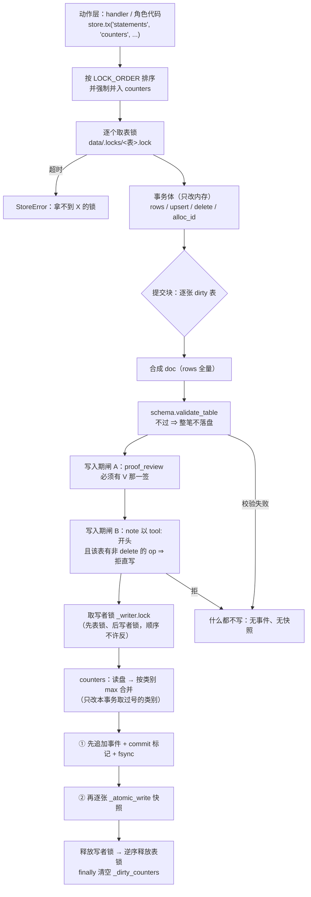
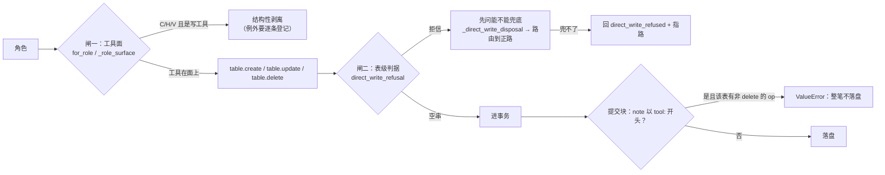
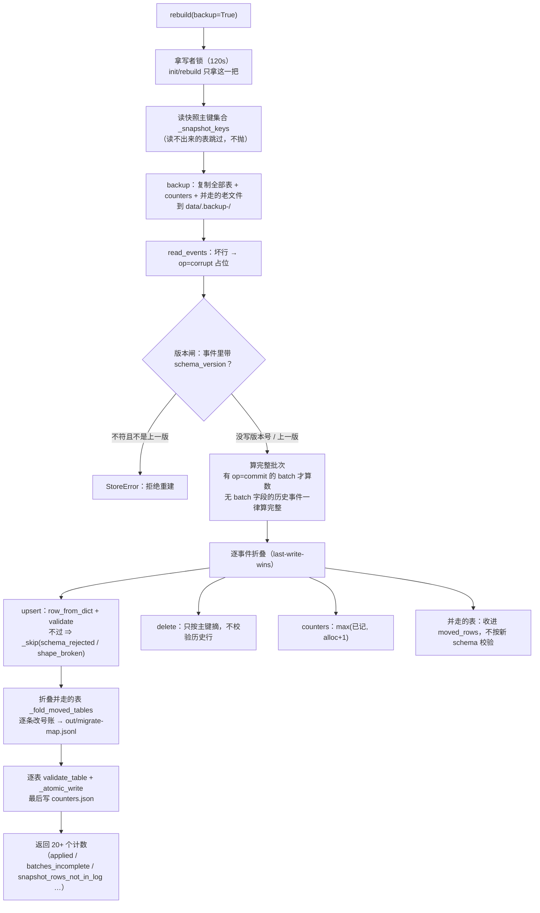

# 台账与存储（PART · 数据台账与存储）

> **这份文档管什么**：`data/` 里那 16 张在用表（另有 1 张已退役，见 §3.1 末）是什么、谁写谁读、写一笔事务在盘上发生什么、
> 事件流怎样把表重建回来、JSONL 与 JSON 各管什么、以及"读不到 / 没写过 / 0 行"怎么分开。
>
> **不管什么**：`out/` 下的报表长什么样（见 `SYSTEM-INTRO.md`）、角色权限面的设计（见
> `ROLE-SPECS.md`）、收工门的八格（见 `SYSTEM-COMPONENTS.md` 的"收工门"一行）。
>
> **核实口径**：路径相对 `agentflow/`；行号在 2026-11-22 逐条核过。所有行数/字节数都是
> 现算的，命令随文给出，基线工作区 `projects/lp-ball-15`（该工作区最后一次写盘
> 2026-11-21 17:00，是一趟跑完的库，不是正在跑的 `lp-ball-16`）。
>
> **FC-27 提醒**：本文大量引用的 `src/agentflow/store.py` 与 `src/agentflow/schema.py`
> 整份在禁改区（`AGENTS.md` 的 `[category: schema-migration]`）。这份文档只读它们。

---

## 1. 工作区布局

一个工作区（`projects/<名字>/`）不是一个数据库文件，而是**一棵有主人的目录树**：`data/`
归 `store`，`library/` 归文献链，`manuscripts/`（正文）与 `work/`（草稿）归手稿，
`reports/` 与 `documents/` 是**旧布局、不再支持**，`out/` 归报表与时钟，`runs/` 归运行期
簿记。`Store.init()` 只建 `data/`、`library/`、`work/` 与 `data/.locks/`（`src/agentflow/store.py::Store.init`），
其余目录都由各自的写者按需创建 —— 所以"目录不在"通常等于"那条链还没跑过"，
**不等于坏了**。

```text
projects/<workspace>/
├── data/                     ← store 的唯一地盘：16 张在用表 + counters.json + events.jsonl + .locks/
│   ├── <表>.json             ← 每张表一个快照文件（`schema.TABLES`，16 个；旧工作区另有退役的 `eval_results.json`）
│   ├── counters.json         ← 发号器缓存（不是表；不在 schema.TABLES 里）
│   ├── events.jsonl          ← 只追加的事件流（重建的唯一输入）
│   ├── .locks/               ← 表锁 <表>.lock + 写者锁 _writer.lock
│   └── .backup-<ts>/         ← rebuild(backup=True) 的快照备份（data/ 下，不参与读）
├── library/                  ← 文献库：按 lit_id 收编的正文与附件
├── downloads/                ← 抓取中间态：还没收编进 library 的下载件
├── documents/                ← 旧布局（不再支持）：documents/<doc_id>.md 曾是稿件正文；现落点见 manuscripts/ 与 work/
├── manuscripts/              ← 正文手稿（manuscripts/<角色>/<doc_id>.md；交接账本不在这里）
├── work/                     ← 草稿区与交接账本（work/<角色>/、work/handoffs.jsonl）
├── reports/                  ← 退役（不再支持）：手稿/报告曾平铺在这里；现落点 manuscripts/<角色>/ 与 work/<角色>/
├── notes/                    ← 研究笔记（可被提升为手稿的来源之一）
├── out/                      ← 运行期产物：out/clock、out/paper、out/review、out/secretary、out/surfaces
├── runs/                     ← 运行期簿记：cache 档位、stopctl 的 pid/停历史、checkpoint、手稿占用登记
├── sessions/                 ← 会话记录 sessions/<sid>.jsonl（只追加，一行一步）
├── verifications/            ← 签的台账：verifications/<命题号>.jsonl、verifications/pending/
├── code/                     ← E 写的实验脚本（experiments.code_path 指到这里）
├── ARTIFACTS.jsonl           ← 产物归属台账（一行一条：path + sha256 + producer）
├── budget.json               ← 预算寄存器（总额/已花/追加历史）
├── resume-brief.json         ← 续跑简报（M 侧生成的交接面）
├── RELIABLE-REFERENCES.json  ← 用户点名的可信文件/目录（M 逐字抄下来）
└── AGENT-PROFILES.md         ← 角色画像（渲染产物，供 fs.read）
```

| 路径 | 谁建/谁写 | 一句话 | 出处 |
|---|---|---|---|
| `data/` | `Store.init()` | 16 张在用表 + 发号器 + 事件流的唯一目录 | `src/agentflow/store.py::Store.init` |
| `library/` | `Store.init()`；文献链收编 | 按 `lit_id` 收编的正文，`literature.path` 的默认坐标系（**B2a 落点统一中**） | `src/agentflow/store.py::Store.__init__`、`src/agentflow/seedinject.py` 的模块 docstring |
| `downloads/` | `search.download` | 还没收编进库的下载件（另一个合法坐标系，不是垃圾） | `src/agentflow/tools/search_tools.py::_Ctx.downloads_dir` |
| `documents/` | 旧布局（不再支持） | 稿件行的可读正文曾放这里（`documents/<doc_id>.md`）；现落点是 `manuscripts/<角色>/`（正文）与 `work/<角色>/`（草稿） | `src/agentflow/wellformed/layout.py::DOCUMENTS_DIR`、`src/agentflow/wellformed/layout.py::UNSUPPORTED` |
| `manuscripts/` | 手稿落点 | 正文手稿（`manuscripts/<角色>/<doc_id>.md`）；交接账本**不在这里**（旧布局 `manuscripts/handoffs.jsonl` 不再支持） | `src/agentflow/manuscripts.py::MANUSCRIPTS_DIR`、`src/agentflow/wellformed/layout.py::UNSUPPORTED` |
| `work/` | 草稿区 + 交接账本 | 交接账本 `work/handoffs.jsonl`（一行一份交接的**正文**）；`work/<角色>/` 是草稿区 | `src/agentflow/manuscripts.py::HANDOFFS_DIR`、`::HANDOFFS_NAME`、`src/agentflow/refvocab.py::_handoff_rows` |
| `reports/` | 退役（不再支持） | 手稿与报告曾平铺在这里（2026-11-22 退役）；现落点是 `manuscripts/<角色>/` 与 `work/<角色>/` | `src/agentflow/wellformed/layout.py::REPORTS_DIR`、`src/agentflow/wellformed/layout.py::UNSUPPORTED` |
| `notes/` | B/D 的笔记 | 研究笔记；`manuscriptform` 认它是可提升来源 | `src/agentflow/agent_loop.py::NOTES_DIR_NAME`、`src/agentflow/manuscriptform.py::PROMOTE_SOURCE_ROOTS` |
| `out/` | 时钟/收工/秘书/网页 | 运行期产物总目录（`paper`/`review`/`clock`/`secretary`/`surfaces`…） | `src/agentflow/clockbase.py::STATE_REL`、`src/agentflow/secretary_ledger.py::SECRETARY_DIR`、`src/agentflow/store.py::Store.migration_ledger_path` |
| `runs/` | cachectl / stopctl / autonomy | 运行期簿记：档位记录、pid 与停历史、checkpoint、手稿占用登记 | `src/agentflow/store.py::_WORKSPACE_ROOT_ENTRIES`、`src/agentflow/manuscriptids.py::claims_path` |
| `sessions/` | `agent_loop` 每步 | 会话记录，一行一步，只追加 | `src/agentflow/sessions.py::SESSIONS_DIR_NAME` |
| `verifications/` | V 落签 | 命题的签台账（一号一个 JSONL），另有 `pending/` | `src/agentflow/v_vocab.py::VERIFICATIONS_DIR` |
| `code/` | E 写脚本 | 实验脚本落点，`experiments.code_path` 指到这里 | `src/agentflow/agent_e/author_script.py::_AuthorScript.author_script` |
| `ARTIFACTS.jsonl` | `artifacts.record` | 产物归属台账（path + sha256 + producer） | `src/agentflow/artifacts.py::LEDGER_NAME`、`src/agentflow/artifacts.py::record` |
| `budget.json` | `budget` 层 | 预算寄存器；寄存器压过命令行 flag | `src/agentflow/budget.py::REGISTER_NAME` |
| `resume-brief.json` | M 侧 | 续跑简报 | `src/agentflow/tools/conductor_tools.py::_write_resume_brief` |
| `RELIABLE-REFERENCES.json` | M | 用户点名的可信路径（A 的入库闸读它） | `src/agentflow/locallib.py::DECLARATION_NAME` |
| `AGENT-PROFILES.md` | 渲染 | 角色画像 | `src/agentflow/agent_prompts.py::PROFILES_FILE` |

**为什么"工作区根"值得单写一节**：`Store.init()` 有一条外来目录守卫 ——
没有 `data/`、又不是空目录、又没有 `.agentflow-workspace` 标记 ⇒ 拒绝 init
（`src/agentflow/store.py::Store._foreign_dir_guard_should_refuse`）。白名单是
`{data, library, projects, reference, .agentflow-workspace, runs, work, manuscripts}`（`src/agentflow/store.py::_WORKSPACE_ROOT_ENTRIES`）：
`work` 与 `manuscripts` 2026-11-22 起在列（`init` 自己会建 `work/`）。`library/` 的落点正在统一（**B2a 落点统一中**），本文其余处按现盘写。
所以 `work/`、`manuscripts/` 之外的那些目录能在根上和平共处，是因为**有 `data/` 之后守卫直接放行**，而不是因为它们在白名单里
—— 这条区分是真机事故换来的（`src/agentflow/store.py::Store.init` 记了一次反面事故：一个复核脚本把
19 个条目补进了一个只放着 `我的资料.txt` 的人手目录）。

---

## 2. 一次写事务：从动作到盘

这是整个存储层唯一的写路径（`Store.tx`，`src/agentflow/store.py::Store.tx`）。任何"直接改表文件"
的写法都绕开了下面每一道闸。



这张图上有五条**顺序**不变量，每一条都对应一次真实事故：

| # | 不变量 | 为什么 | 出处 |
|---|---|---|---|
| 1 | 先校验，后落盘 | 校验失败要"整笔放弃"，不能留半笔 | `src/agentflow/store.py::Store.tx` |
| 2 | **先事件，后快照** | 反过来崩一次就留下"快照有、事件无"的行，而 `rebuild` 只信事件 ⇒ 那笔提交无痕消失（实测：快照 2 行 / counters=2 ⇒ 重建后 1 行） | `src/agentflow/store.py::Store.tx` |
| 3 | 先表锁，后写者锁 | 反过来两个写者互等；`init`/`rebuild` 只拿写者锁，`tx` 两把都要 | `src/agentflow/store.py::Store._writer_lock` |
| 4 | `counters` 的终值在写者锁**内**定 | `set_counters` 拿同一把锁，能在窗口里落盘；用旧缓存整份覆盖会把它吞掉（实测：C 写 999、B 提交后盘上是 4，无日志无异常） | `src/agentflow/store.py::Store.tx`、`src/agentflow/store.py::Store.set_counters` |
| 5 | `_dirty_counters` 在 `finally` 里清 | 只在成功时清会让失败事务把号留在内存里，下一次发号基于盘上不存在的值 | `src/agentflow/store.py::Store.tx` |

**六件落盘事务之外的事，事务不做**：读路径不拿锁（`R3-1` 的既有裁定，`src/agentflow/store.py::Store._check_version`
的 docstring 写明"读侧不拿锁、缓存键是 `(路径, mtime_ns, size)`"），所以并发读者可能读到
"一半新一半旧"的多表视图 —— 这是**已知且被接受**的边界，不是 bug。

---

## 3. 16 张在用表（+ 1 张已退役）

`schema.TABLES` 是"有哪些表"的唯一真身（`src/agentflow/schema.py`）；
`schema.RETIRED_TABLES` 是"退役了、但历史工作区里那份文件仍要读得懂"的清单（2026-11-22 起：`eval_results`）。
两者**互不相交**，由导入期 `assert_table_registry_contract()` 对账。
一张表 = `{file, row, id_field, id_kind}`：文件名、行类（dataclass）、主键列、ID 类别。

### 3.1 总表（行数是 `lp-ball-15` 现算）

| 表名 | 文件 | 主键 | 关键列 | 谁写 | 谁读 | 行数 |
|---|---|---|---|---|---|---|
| `search_requests` | `search_requests.json` | `request_id`（`r-NNNNNN`） | `topic` `mode` `done` `claimed_by` `lease_until` `result_lit_ids` `outcome` | A/C/D/F（`WRITE_SETS`）；落点 `src/agentflow/agent_a/core.py::_Core._enqueue_search` 等 17 处 | A 认领并消费；C/D/F 提交；收工门数配额 | 8 |
| `literature` | `literature.json` | `lit_id` | `title` `path` `processed` `dedup_key` `doi` `download.status` `pages` `claimed_by` | A（入库）、B（补摘要/路径）；`src/agentflow/agent_a/run_once.py::_auto_intake_declaration_refusal`、`src/agentflow/agent_b/core.py::_Core._normalize_legacy_literature_paths` | B 判重与引文回验；C/D 引用；`verify` 核 `dedup_key` | 19 |
| `relations` | `relations.json` | `relation_id` | `concept_ids` `statement` `quote` `quote_verified` `status` `duplicate_of` `dedup_key` | B（抽取+判重）；`src/agentflow/agent_b/core.py::_quote_evidence_on_reprocess_write` | B 后续合并；C 梳理；D 读矛盾对；`verify` | 198 |
| `research_questions` | `research_questions.json` | `question_id` | `question` `status` `kind` `gap_reason` `contradiction_*` | D；`src/agentflow/agent_d/ingest.py::_Ingest.ingest` | D 自己的主线；C 取题；F 取攻题 | 3 |
| `conjectures` | `conjectures.json` | `conjecture_id` | `statement` `form` `testable` `status` `promoted_to` `refusal_ref` | **唯一写点** `conjectureledger.register`（`src/agentflow/conjectureledger.py::register`），产出来自 E/F/B；`WRITE_SETS` 记 B/E/F | E/F 攻题、B 收录后回读；`closing` 数未决猜想 | 16 |
| `analysis_reports` | `analysis_reports.json` | `report_id` | `kind` `summary` `payload` `markdown_path` | C（唯一落点 `src/agentflow/agent_c/_support.py::AnalysisReport.persist`） | D 写报告时读 C 的产物（`src/agentflow/agent_d/core.py::_Core._chain_concept_path`）、`pipeline`、`closing` | **0** |
| `reprocess_requests` | `reprocess_requests.json` | `reprocess_id`（`p-NNNNNN`） | `reason` `relation_ids` `status` `lease_until` `attempts` | B/F；`src/agentflow/agent_b/core.py::_Core._reject_reprocess`、`src/agentflow/agent_f/core.py::_Core._deploy_b` | B/F 自己消费；`closing` 读数 | **0** |
| `experiments` | `experiments.json` | `experiment_id` | `claim` `method` `evidence_kind` `result` `negation_kind` `code_path` `code_hash` `voided_by` `certificate` | E、L（`src/agentflow/agent_e/run_experiment.py::_RunExperiment.run_experiment`、`src/agentflow/agent_l/record.py::_Record.record`）；号段 E/L 各半 | B 的入库闸；V 落签要引它；G/F 的证明出口；`closing`/`verify` | 9 |
| `attack_plans` | `attack_plans.json` | `plan_id` | `problem` `status` `rounds` `budget` `subgoals` `history` `depth` | F；`src/agentflow/agent_f/create_plan.py::_CreatePlan.create_plan`、`src/agentflow/agent_f/core.py::_Core._write_plan` | F 的 `step`/`abandon`；收工门 | 3 |
| `documents` | `documents.json` | `doc_id` | `kind` `title` `markdown_path` `claims` `sections` `status` `review_verdict` `content_sha256` | G（`doc.build_document` → `src/agentflow/tools/doc_tools.py::build_document`）；H 只改审校轴（`src/agentflow/agent_loop.py::AgentLoop._stamp_h_review_axis`） | H 审校；G 改稿；`verify`/`closing` 的交付面 | 1 |
| `dependencies` | `dependencies.json` | `dep_id` | `used_by` `kind` `label` `source_lit_id`/`source_stmt_id`/`source_experiment_id` `status` | G（`doc.register_dependency` → `src/agentflow/tools/doc_tools.py::register_dependency`）；B 的秘书链 `src/agentflow/secretary_deps.py::DepsMixin._write_dep_steps` | `verify`（承重栏）；G 渲染依赖段；C 梳理 | 6 |
| `statements` | `statements.json` | `stmt_id` | `origin` `kind` `statement_full` `proof_text` `evidence_kind` `bits` `status` `aliases` | **唯一正路** B 的 `Secretary.record_statement`（`src/agentflow/secretary_statement.py::StatementMixin.record_statement`）；通用写口一律拒（`src/agentflow/store.py::direct_write_refusal`） | 几乎每个角色；`verify`；`closing` 的承重计数 | 190 |
| `review_findings` | `review_findings.json` | `finding_id` | `doc_id` `kind` `level` `target` `evidence` `status` `axis` `line` | H（`src/agentflow/tools/review_tools.py::_apply_finding_status`）；G 改稿时回填（`src/agentflow/agent_g/revise.py::_Revise.revise`） | H 复审；G 修稿；`closing` | **0** |
| `tasks` | `tasks.json` | `task_id` | `role` `action` `called_by` `parent_task_id` `depth` `status` `outcome` `item_state` `tokens` `usd` | **框架**（`conductor` 28 处 `tx.upsert`，如 `src/agentflow/conductor.py::Conductor._row_with_id`）；无角色的 `WRITE_SETS` 含它 | 全员（可见面受 `_visible_tasks` 收窄：非 M 只看自己+直接下级+父）；`agenttrace` | 179 |
| `usage_ledger` | `usage_ledger.json` | `usage_id` | `scope` `role` `task_id` `tokens_in/out/total` `usd` `idem_key` | `tokenmeter`（`src/agentflow/tokenmeter.py::TokenMeter.charge`、`src/agentflow/tokenmeter.py::TokenMeter.charge_once`） | `modelcost`、`readouts`、收工门的花销格、`verify` | 1227 |
| `lit_candidates` | `lit_candidates.json` | `slot` | `batch` `status` `title` `doi` `relevance` `lit_id` `reason_code` `withdrawn_reason` | `litstage`（9 处，入口 `src/agentflow/litstage.py::stage_entries` `stage_entries`、`src/agentflow/litstage.py::admit` `admit`）；A 的自动入库 | A 判重；B 的收录；`closing` 的 `literature_pending` 格 | 61 |

**合计 1920 行**（16 张在用表；`usage_ledger` 一张占 64%）。

> **`eval_results`（2026-11-22 退役）**：全仓 0 个写点、51 个工作区全 0 行 ⇒ 从来没有产出方。
> 它已不在 `TABLES` 里（新工作区不再生成 `eval_results.json`，`store.tx` / `table.*` 一律拒写）；
> 历史工作区里那份文件仍按 `RETIRED_TABLES` 读得懂（`store.read("eval_results")` 带 `retired=true`，行照旧读得出来）。
> 取证与复算命令见 `docs/REPRO-eval-results-no-producer.md`。


### 3.2 现算命令与本次读数

```powershell
# 16 张在用表的行数（表名, 文件, 行数）—— 在 D:\Incubator 下跑（eval_results 不在其中）
python -B -c "import sys,json,pathlib;sys.path.insert(0,'agentflow/src');from agentflow import schema as S;d=pathlib.Path('projects/lp-ball-15/data');rows=[(n,len(json.loads((d/s['file']).read_text(encoding='utf-8'))['rows'])) for n,s in S.TABLES.items()];print(len(S.TABLES),'tables');print(rows);print('sum',sum(v for _,v in rows))"
```

2026-11-22 实测：

```text
16 tables
[('search_requests', 8), ('literature', 19), ('relations', 198), ('research_questions', 3),
 ('conjectures', 16), ('analysis_reports', 0), ('reprocess_requests', 0), ('experiments', 9),
 ('attack_plans', 3), ('documents', 1), ('dependencies', 6), ('statements', 190),
 ('review_findings', 0), ('tasks', 179), ('usage_ledger', 1227),
 ('lit_candidates', 61)]
sum 1920
```

```powershell
# 谁写：角色级写集（capabilities.WRITE_SETS，真身由 specs/ 派生）
python -B -c "import sys;sys.path.insert(0,'agentflow/src');from agentflow import capabilities as C;print({r:sorted(v) for r,v in sorted(C.WRITE_SETS.items())})"
```

```text
{'A': ['literature', 'search_requests'], 'B': ['conjectures', 'literature', 'relations', 'reprocess_requests', 'statements'],
 'C': ['analysis_reports', 'search_requests'], 'D': ['research_questions', 'search_requests'],
 'E': ['conjectures', 'experiments'], 'F': ['attack_plans', 'conjectures', 'reprocess_requests', 'search_requests'],
 'G': ['dependencies', 'documents', 'review_findings'], 'H': ['documents', 'review_findings'],
 'L': ['experiments'], 'M': [], 'V': []}
```

**这张反向索引读出来的三件事**（都是设计，不是遗漏）：

1. **三张表没有角色写者**：`tasks`、`usage_ledger`、`lit_candidates`。
   前两张的写者是框架自己的收口路径（派活、计费），第三张的写者是文献链的两支工具
   —— `store.py::DIRECT_WRITE_ROUTES` 逐条登记了这件事，并明确写着"不给它们兜底方"，
   同时点名 `counters`/`usage_ledger` 在通用写口上**仍然敞着**（`eval_results` 已于 2026-11-22 退役，写侧一律拒）："那是另一张单子"。
2. **只读角色 V 的写集是空集**，而 V 的落签写的是 `verifications/` 下的 JSONL（不在那 16 张表里）
   —— 所以"V 不写数据表"与"V 会落签"同时成立。
3. **`statements` 的写者只有 B**，但 `agent_g/core.py::_selftest` 也有一处 `tx.upsert("statements")`
   —— 那是 G 自检夹具（`actor="seed"`、`note="fixture"`），不是生产路径。

### 3.3 `eval_results`：一张有读口、没有写口的表

这是本仓**已经登记过**的边界，不是本文新发现：
`docs/REPRO-eval-results-no-producer.md` 写清了三条复算命令与 2026-10-07 的实测
（`src/` 里 0 个写入方、81 个 `eval_results.json` 全空、全盘唯一非空的是夹具），
判据本体是 `tests/test_eval_results_has_no_producer.py` —— 谁补上产出方它会红，
逼人回来把真正的评测口径一起补上。
本工作区 0 行与那条读数一致。

---

## 4. 契约

### 4.1 schema 版本（`SCHEMA_VERSION = 2`）

| 面 | 判据 | 出处 |
|---|---|---|
| 写 | 提交前 `validate_table`：`schema_version` 必须**等于**当前值，行必须能过 `validate()` | `src/agentflow/schema.py::assert_process_id_contract` |
| 读 | **读期 fail-closed**：不符 ⇒ `StoreError`，"不许按当前语义解释旧数据"；缺字段 = 与旧版同档（拒读），但不许崩成 `KeyError` | `src/agentflow/store.py::Store._atomic_write` |
| 重建 | 事件里带版本且不符 ⇒ **拒重建**；没有版本号的历史事件照常重放并计数；`SCHEMA_VERSION-1` 的事件按折叠规则处理并计数 | `src/agentflow/store.py::Store._rebuild_locked` |

`SCHEMA_VERSION = 2` 的全部含义是"`concepts` 表并进了 `statements`"（`kind="concept"` 的行）
—— `src/agentflow/schema.py::SCHEMA_VERSION`。
并走的表没有从磁盘上"消失得无影无踪"：名字留在 `_MOVED_TABLES` 里，读到它会给一条带指路的
受控错，而不是"未知表"（`src/agentflow/store.py::_MOVED_TABLES`、`src/agentflow/store.py::Store._read_doc`）。本工作区实测：

```text
data/concepts.json exists = False
store.rows('concepts') -> StoreError : 表 'concepts' 已经并走（S1r 并表：`SCHEMA_VERSION=2` 起概念行住
`statements`（号由同一分配器重发））⇒ 它不在当前 schema 里。新家是 'statements'：读 `statements` 里
`kind="concept"` 的行；统一入口是 `conceptrows.view(store, shape="legacy")`（老字段名）…
```

### 4.2 列词表与编号（`schema.TABLES` 之外的四个字典）

| 字典 | 回答什么 | 出处 |
|---|---|---|
| `TABLES` | 有哪些表：`{file, row, id_field, id_kind}` | `src/agentflow/schema.py::TABLES` |
| `ID_COUNTERS` | 哪 14 类 ID 吃编号空间（`lit`/`relation`/`question`/`conjecture`/`report`/`experiment`/`plan`/`doc`/`dep`/`stmt`/`finding`/`usage`/`eval`/`candidate`）；过程记录（`r-`/`p-`）不吃 | `src/agentflow/schema.py::RETIRED_TABLES` |
| `ID_SEGMENTS` | 一个类别由多个角色发号时怎么分段：今天只有 `experiment`，E 用前半段、L 从 500000 起 | `src/agentflow/schema.py::NOT_ENABLED_TABLES` |
| `ROLE_SEGMENTS` | 角色 → 段标签（`experiment: {E:"", L:"L"}`） | `src/agentflow/schema.py::NOT_ENABLED_TABLES` |

ID 的形制：`ID_DIGITS = 6`（`src/agentflow/schema.py::ID_DIGITS`），`format_id` 补零到 6 位
（`src/agentflow/schema.py::LEGACY_ID_PATTERN`），上限 `MAX_ID = 999999`（`src/agentflow/store.py::MAX_ID`，
导入期由 `assert_id_space_contract()` 与 `ID_DIGITS` 对账）。旧数据里的 4 位号仍可读
（`ID_OR_LEGACY_PATTERN`，`src/agentflow/schema.py::ID_OR_LEGACY_PATTERN`）。

### 4.3 写权限两道闸

模型的手能碰到表，要过两道**互不替代**的闸：一道管"这个角色手里有没有这件工具"，
一道管"这张表许不许由通用写口写"。



| 闸 | 位置 | 判据 | 挡的是谁 | 拒的形态 |
|---|---|---|---|---|
| **闸一：工具面** | `src/agentflow/tools/base.py::for_role`、`src/agentflow/tools/base.py::_role_surface`（`_role_surface`，剥离逻辑 `src/agentflow/tools/base.py::_role_surface`） | `READ_ONLY_ROLES = ("C","H","V")`（`src/agentflow/tools/__init__.py::READ_ONLY_ROLES`）+ `SIDE_EFFECTS_WRITE = ("write_local",)`（`src/agentflow/tools/__init__.py::SIDE_EFFECTS_WRITE`） | 只读角色**结构性**拿不到写工具（`external=="exec"` 也一并剥） | 工具根本不在面上，模型看不到 |
| **闸二：表级** | `src/agentflow/store.py::direct_write_refusal` | `STATEMENT_WRITE_TABLES`（`src/agentflow/store.py::STATEMENT_WRITE_TABLES`）、`CONJECTURE_WRITE_TABLES`（`src/agentflow/store.py::CONJECTURE_WRITE_TABLES`）、`DOCUMENT_WRITE_TABLES`（`src/agentflow/store.py::DOCUMENT_WRITE_TABLES`）、`lit_candidates` 分支（`src/agentflow/store.py::direct_write_refusal`） | 通用写口（A–D 的 `table.create`/`table.update`） | `direct_write_refused` + 逐条指路（每条正路的名字与参数） |
| **闸二的第二道** | `src/agentflow/store.py::Store.tx`（提交块） | 事务 `note` 以 `tool:` 开头**且**该表有 `delete` 以外的 op ⇒ 再调一次同一个函数 | 绕过工具层的裸事务 | `ValueError`，整笔一行都不写 |
| 兜底路由 | `src/agentflow/tools/table_tools.py::_direct_write_disposal`（算意图）→ `::_direct_write_intent` → `::_route_direct_write`（分发） | `store.DIRECT_WRITE_ROUTES`（`src/agentflow/store.py::DIRECT_WRITE_ROUTES`） | —— 只换入口，不换判据 | 能兜底的由兜底方正路办（秘书 / `register_dependency` / `lit.*`），兜不了的才回拒信 |

**为什么两道闸都必须有**：闸一只管"工具的 `roles` 字段"，而 `table.*` 的 `roles` 是
`("A","B","C","D")`（`src/agentflow/tools/table_tools.py::TOOL_ROLES`）—— E/F/G/H/L/V 连 `table.*`
都拿不到，它们写表靠各自领域工具里人写过的代码路径。闸二管"表"，因为明天谁再加一支
`table.upsert_many`，它不该因为"没人记得这条规矩"而重新打开直写
（理由逐字写在 `src/agentflow/store.py::direct_write_refusal`）。两处调**同一个函数**，所以关掉它的负控对
两层同时生效。

### 4.4 原子写（`store._atomic_write`）

`src/agentflow/store.py::Store._merge_counters_for_commit`。三段：**写临时文件 → `flush` + `fsync` → `os.replace`**。

| 细节 | 口径 | 为什么 |
|---|---|---|
| 临时名 | `<file>.<pid>-<tid>.tmp`（`src/agentflow/store.py::Store._atomic_write`） | 旧版是固定的 `<file>.tmp`，两个写者互抢 ⇒ Windows `WinError 32`。实测两进程各写 12 次：都退出码 0、各自以为写了 24 行，盘上只剩 8 行 |
| 重试 | `os.replace` 失败重试 6 次、指数退避，总等待 ≈0.62 秒（`src/agentflow/store.py::_REPLACE_ATTEMPTS`、`src/agentflow/store.py::Store._atomic_write`）；最后一次失败后不再 sleep | 目标被另一个进程短暂持有时不再硬崩 |
| 退避的记账 | 退避真睡，但记进主时钟（`kind="atomic_retry"`，`src/agentflow/store.py::Store._atomic_write`） | 业主 2026-10-25 裁定"主时钟要控制所有计时类工作" |
| 失败 | 抛 `StoreError`（带路径与最后一次 OS 错误），不是裸 `OSError`（`src/agentflow/store.py::Store._atomic_write`）；`tx` 再翻一次并点名"事务没有生效"（`src/agentflow/store.py::tx`） | 磁盘满 / 只读盘 / 被占用三类，恢复路径不同 |
| 临时文件 | `finally` 里删；删不掉不算失败（`src/agentflow/store.py::Store._atomic_write`） | 留着 `<表>.json.<pid>-<tid>.tmp` 的危害远小于掩盖真正的失败原因 |
| 缓存 | 成功后**整份**清空读缓存（`src/agentflow/store.py::Store._atomic_write`） | 关掉"同尺寸且同 mtime_ns 的两次写"这一档理论盲区 |

它**不**保证"并发写同一张表不丢更新"（`src/agentflow/store.py::Store._atomic_write`）—— 那件事只有锁能保证。

### 4.5 锁：`LOCK_ORDER` + 写者锁

| 锁 | 文件 | 谁拿 | 出处 |
|---|---|---|---|
| 表锁（16+1 把：16 张在用表 + 一只 `counters`） | `data/.locks/<表>.lock`，外加一只 `counters` | 多表事务按 `LOCK_ORDER` 顺序逐把拿 | `src/agentflow/store.py::LOCK_ORDER`、`src/agentflow/store.py::Store.tx` |
| 写者锁（1 把） | `data/.locks/_writer.lock` | `tx` 的提交块、`init`、`rebuild`、`set_counters` | `src/agentflow/store.py::Store.__init__`、`src/agentflow/store.py::Store.tx` |

`LOCK_ORDER` 的排序不是字母序，是**业务顺序**，每一格都写了理由（`src/agentflow/store.py::LOCK_ORDER`）：

- `lit_candidates` 紧跟 `literature`：候选先落、筛完才入库，两把锁在同一条链路上相邻；
- `statements` 插在 `documents` 之后、`dependencies` 之前：命题是依赖的锚点，"先锁锚点、再锁依赖"
  与读图顺序一致；
- `counters` **永远最后**：任何 `alloc` 都要它。

规则一句话：**先拿全部表锁，再拿写者锁；任何地方不许反过来。**
`init`/`rebuild` 不拿表锁，所以它们只拿写者锁。锁文件放在 `.locks/` 下、名字以 `_` 开头，
于是不会被当成某张表（`tx` 只按 `LOCK_ORDER` 拼名字）。拿不到锁 ⇒ `StoreError`，
消息里写清"若进程已死，锁文件可安全删除（filelock 用 OS 锁，不含内容）"（`src/agentflow/store.py::Store.tx`）。

### 4.6 `alloc_id` 的编号规则

`src/agentflow/store.py::Tx.mark_dirty`。号由系统统一发，一条规则四步：

| 步 | 做什么 | 出处 |
|---|---|---|
| ① 校验类别与段 | `kind ∈ ID_COUNTERS`；`segment ∈ counter_bands(kind)`；不猜段 | `src/agentflow/store.py::Tx.alloc_id` |
| ② 读计数器 | 优先用**本事务内**已改过的 `counters`（否则同一事务连续取号会发同一个号）；坏值当段起点 | `src/agentflow/store.py::Tx.alloc_id` |
| ③ **跳过被占用的号** | 在事务声明的目标表里查该号是否已存在，占用就往后跳；跳了就发一条 `info` 事件留痕（`alloc_id_skipped_occupied`） | `src/agentflow/store.py::Tx.alloc_id` |
| ④ 推进并越界失败 | `counters[key] = nxt + 1`；越出本段 ⇒ `IdExhausted`，**不静默跨段、不升位宽** | `src/agentflow/store.py::Tx.alloc_id` |

配套三条边界：

- `alloc_id(kind)` 要求事务声明了那张表，否则抛 `StoreError`（`F-2`：跳过占用检查会让发号器
  发出已占用的号，而 `upsert` 按主键替换 ⇒ **静默覆盖旧行**，`src/agentflow/store.py::upsert`）；
- 计数器落后于表 ⇒ 靠"跳过"自愈，失序由 `verify` 的 `counter_behind` / `id_gap` 报出
  （`src/agentflow/verify.py::_check_1`）；
- "只抬不发号"是另一个显式形状 `raise_counter_to`（`src/agentflow/verify.py::_check_5`）—— 别用"多调一次 `alloc_id`"顶计数器，
  那会烧掉一个没建行的号、留下 `id_gap`（`src/agentflow/verify.py::_check_5` 记了这次试错）。

**`counters.json` 不是表，且有两个写者** —— 这是本节最容易被忽略的一条：

| 写者 | 写什么键 | 并发保护 | 出处 |
|---|---|---|---|
| `store._merge_counters_for_commit` | `ID_COUNTERS` 那 14 类 | 写者锁内"读盘 → 按类别 `max` 合并 → 落盘" | `src/agentflow/store.py::Store.set_counters` |
| `manuscriptids._write_doc` | 手稿族键 `manuscript`/`bmanuscript`/`emanuscript`/`enummanuscript` | 只拿**进程内** `threading.RLock`（`src/agentflow/manuscriptids.py::_LOCK`、`src/agentflow/manuscriptids.py::next_manuscript_id`） | `src/agentflow/manuscriptids.py::FAMILY_COUNTERS`、`src/agentflow/manuscriptids.py::_write_doc` |

两个方向不对称：`store` 提交时按类别取 `max`，**不会**吞掉手稿族刚推进的号；而手稿发号是
"读整份 → 改一格 → 写整份"，读与写之间没有跨进程锁 —— 窗口里若有一笔 `store` 提交推进了某个
ID 计数器，那次推进会被这份旧文档覆盖回去（后果是 `counter_behind` + 下一次 `alloc_id` 跳过
已被占用的号自愈，不丢行，但计数漂移）。本工作区 `counters.json` 的 14 个键里三个是手稿族键、
三个 ID 类别（`report`/`finding`/`eval`）从未发过号，正是"两个写者各管一半"的形态：

```powershell
python -B -c "import json;d=json.load(open('projects/lp-ball-15/data/counters.json',encoding='utf-8'));print(len(d['counters']),sorted(d['counters']))"
```

```text
14 ['bmanuscript', 'candidate', 'conjecture', 'dep', 'doc', 'enummanuscript', 'experiment',
    'lit', 'manuscript', 'plan', 'question', 'relation', 'stmt', 'usage']
```

---

## 5. 事件重放：`rebuild`

`events.jsonl` 是**唯一**能重建快照的输入。一行一条事件，字段
`{seq, ts, batch, op, table, row, actor, note}`；一批事件末尾跟一条 `op="commit"` 的标记
（`src/agentflow/store.py::Store._append_events`）。`seq` 由**日志尾巴**（最大 `seq`）决定，不是数行数
（`src/agentflow/store.py::Store._append_events`，理由是坏行占位会把"第 n 行"与"第 n 个 seq"拆开）。



`rebuild` 的返回值是这份设计的**读数面**，不是日志。挑八个必须看的键：

| 键 | 读它回答什么 | 出现"坏"的时候的处置 |
|---|---|---|
| `batches_incomplete` | 有几批事件没有 `commit` 标记（= 崩在追加中途） | 丢弃的是那一批；配合 `snapshot_rows_not_in_log` 看丢了什么 |
| `corrupt_events` | 日志里有几行坏（半行 JSON / 不是 JSON） | 旧版把这件事吞在占位里，"没抛异常"会被读成"日志是好的"（`I-5`） |
| `snapshot_rows_not_in_log` + `snapshot_ahead` | 快照里有、日志里从来没有过的行（**这次重建会丢掉的数据**） | 非空 ⇒ 先查是谁手改了 `<表>.json`，别急着重跑 |
| `legacy_events_without_version` | 有多少条是加版本号之前写的 | 照常重放，但要知道这次重放含老格式 |
| `migrated_v1_events` / `migrated_concepts` | v1 事件折了多少、折出多少新行 | 折叠口径的唯一实现是 `migrate_concepts` |
| `deletes_replayed` | 重放里真的删了几行（与 `applied` 分开） | 两者混起来就看不见"重建后比删之前多" |
| `unknown_ops` | 日志里有认不出的 `op` | 静默忽略 = 日志里有读不懂的东西没人看得见 |
| `skipped_by_reason` + `skipped_details` | 跳过的行为什么跳过（表/主键/原因/事件下标） | `skipped=3` 与 `skipped=0` 的差别不能只是三个数字 |

**重放的三条定义性边界**（写在这份文档里，因为"重建什么都不丢"是句会被误读的话）：

1. 只重放**完整批次**；没有 `batch` 字段的历史事件一律当完整（否则历史库整体不可用，
   而 `rebuild` 是唯一的灾难恢复手段）。`src/agentflow/store.py::Store._rebuild_locked`。
2. **合并而非替换**：事件行里带的非 schema 键（`_keys`、`_quote_check` 这类诊断字段）保留；
   但**只存在于快照、从未进过事件**的字段，重建后不在了 —— 那是"从日志重建"的定义，不是缺陷
   （`F-9`，`src/agentflow/store.py::Store._rebuild_locked`）。
3. 快照里的行若日志里从没有过，本次重建**不报错**但会**丢掉**它们，并如实报
   `snapshot_rows_not_in_log`（`R3-3`，`src/agentflow/store.py::Store.rebuild`）。

本工作区的日志规模（现算）：

```powershell
python -B -c "import sys,pathlib;sys.path.insert(0,'agentflow/src');from agentflow import jsonlfile as JF;p=pathlib.Path('projects/lp-ball-15/data/events.jsonl');r,b,s=JF.read_jsonl_state(p);print(p.stat().st_size,'bytes',len(r),'records','state=',s,'bad=',len(b))"
```

```text
6690411 bytes 8162 records state= ok bad= 0
```

（`read_jsonl_state` 只数"合法 JSON 对象行"，`commit` 标记也在其中。）

---

## 6. JSONL 与 JSON 的分工

一句话：**JSON 是快照（可整份重写、可被重建覆盖），JSONL 是日志（只追加、是重建的唯一输入）。**
两者不是"格式偏好"，是两种不同的可恢复性。

| 面 | 表文件（`data/*.json`） | 事件流（`data/events.jsonl`） |
|---|---|---|
| 写法 | 整份重写：临时文件 → fsync → `os.replace` | 追加：逐条 `write`，批末一次 `flush` + `fsync`，末尾 `op=commit` |
| 可否丢 | **可丢**：可以从事件流重建 | **不可丢**：丢了就真丢了（`rebuild` 的唯一输入） |
| 一致性 | 每份文件各自原子，多份之间**不**原子（读者可能看到半新半旧） | 批内原子（要么整批带 `commit`，要么整批不算） |
| 读法 | `store.read/rows`，进程内按 `(路径, mtime, size)` 缓存 | `store.read_events()`，坏行变成 `op=corrupt` 占位 |
| 谁写 | `store.tx` 的提交块、`init`、`rebuild` | 只有 `store._append_events`（写者锁内） |
| 版本 | 读期 fail-closed（不符就拒读） | 重放期分档：不符拒、没写版本号的照常放行并计数 |
| 典型规模（本工作区） | 17 个文件，最大 `usage_ledger.json`（1227 行 / 593 KB） | 6.69 MB / 8162 条记录 |

同一套 JSONL 读法被多处共用（`src/agentflow/jsonlfile.py`）：`ARTIFACTS.jsonl`
（`src/agentflow/artifacts.py::LEDGER_NAME`）、签台账 `DOC-SIGNATURES.jsonl`（`src/agentflow/signatures.py::LEDGER_NAME`）、
会话 `sessions/*.jsonl`（`src/agentflow/sessions.py::read_jsonl_state`）、`verifications/*.jsonl`
（`src/agentflow/verifications.py` 里 `from . import jsonlfile as JF` 那一处）以及名册/交接那一族 —— 理由是"坏行的定义只能
有一个落点"，各写一份必然漂成"同一份坏文件，`verify` 说它坏、`session show` 说它好"
（`src/agentflow/jsonlfile.py` 的模块 docstring）。

**JSONL 不是 JSON 的"临时格式"**：`sessions/`、`ARTIFACTS.jsonl`、`verifications/` 这三类
从来没有 JSON 快照版本，它们的"真相"就是那些行 —— 所以它们用 `read_jsonl_state` 的四态
（下一节）而不是 `store.rows`。

---

## 7. 三态纪律在台账上的体现

本仓的三态是"**读不到 / 没写过 / 0 行**"三件事分开说。在存储层，这个纪律落在**四个不同的口**上，
每个口的区分能力不一样 —— 这是最容易读错的地方。

| 口 | 能区分到哪一档 | 出处 |
|---|---|---|
| `store.rows(表)` | **不能**区分"文件不在"与"文件在但 0 行"：文件不在 ⇒ `S.empty_table()`（`rows: []`） | `src/agentflow/store.py::Store._read_doc` |
| `store.rows("concepts")` 一类并走的表 | 直接给受控错 + 指路（"已经被并走"不是"读不到"） | `src/agentflow/store.py::Store._read_doc` |
| `jsonlfile.read_jsonl_state` | **四态**：`absent`（还没写过）/ `empty`（写了没内容）/ `ok` / `unreadable`（没查成） | `src/agentflow/jsonlfile.py::READ_STATES`、`src/agentflow/jsonlfile.py::read_jsonl_state` |
| `rebuild` 的返回值 | 逐表报"快照有、日志没有"的行（`snapshot_ahead`）与坏事件数 | `src/agentflow/store.py::Store._rebuild_locked` |

四组**真实读数**（`projects/lp-ball-15`，2026-11-22 现算）：

**① 0 行 ≠ 没写过（四个表文件都在、都是 `rows: []`、都是 40 字节，逐字节相同）**

```text
analysis_reports.json     40 bytes  {"schema_version": 2, "rows": []}
reprocess_requests.json   40 bytes  {"schema_version": 2, "rows": []}
review_findings.json      40 bytes  {"schema_version": 2, "rows": []}
eval_results.json         40 bytes  {"schema_version": 2, "rows": []}
```

这四张表**不是坏了**，是 `init()` 建过、从来没有行落进来。判据是"文件在 + 合法 JSON +
`schema_version=2` + `rows=[]`"。谁把它们读成"表不存在"就会去重跑 `init`；谁把它们读成
"链断了"就会去查一条根本没开始的链。

**② 读不到（并走的表）—— 报错也必须能指下一步**

```text
store.rows('concepts') -> StoreError : 表 'concepts' 已经并走 … 新家是 'statements' …
```

这条读数的价值在"**能分辨两种读不到**"：`data/concepts.json` 不在盘上，而 `data/statements.json`
在、190 行（其中 `kind="concept"` 177 行、`kind="theorem"` 13 行，现算见 §10 ⑦）——
前者是"这张表已并入别处"，后者是"概念行住在那里"。折成一句
"表不存在"会让人去改代码或查笔误。

**③ 没写过（JSONL 侧）—— `absent` 与 `empty` 是两件事**

```text
data/does-not-exist.jsonl     state=absent      records=0
ARTIFACTS.jsonl               state=ok          records=130  problems=0
sessions/2026-11-21b.jsonl    state=ok          records=3040 problems=0
verifications/pending/*.jsonl 12 个文件，state=ok，每个 1–4 条
```

`absent` 是**合法初态**（这条链还没跑过），`empty` 是"文件在、一条记录也没读出来"，
`unreadable` 才是"没查成"。三者处置完全不同，所以 `read_jsonl_state` 在 `read_jsonl` 之外
单独存在（`src/agentflow/jsonlfile.py` 的模块 docstring「四态（把"文件在不在"与"读的时候炸了"从"没有记录"里分出来）」一节）。

**④ 本工作区"没有一条 `unreadable`"本身是个读数**

上面 130 条产物登记逐条核对的结果是 `ok=79 / changed=51 / missing=0 / unreadable=0`
（见 `docs/PART-ARTIFACTS-LEDGER.md` 的现算命令）。"0 条 missing" 与 "没查" 的区别，
正是这一节存在的理由：**没有坏读数，要先证明查过。**

---

## 8. 常见故障与读数

| 现象 | 看哪个读数 | 怎么修 |
|---|---|---|
| 事务报"获取 X 的锁超时" | `StoreError` 文本里有表名与秒数；`data/.locks/<表>.lock` 在盘上 | 先确认那个进程还活着（`runs/` 里的 pid）；确认已死 ⇒ 删锁文件（filelock 是 OS 锁，锁文件不含内容），重试 |
| 报"写者锁超时（rebuild/init 这个工作区）" | 同上，锁名是 `_writer.lock` | 同上；别在 `rebuild` 跑着的时候开第二趟 |
| 报"磁盘满 / 只读盘 / 文件被占用"，并说"事务没有生效" | `StoreError` 里带 errno 与目标文件名；盘上原快照未变、无残留 `.tmp` | 腾空间或改权限后重试；**不要**重跑整个流程（`src/agentflow/store.py::Store.tx`） |
| 表文件读不出来（`不是合法 JSON` / 没有 `rows` / 顶层不是对象） | `StoreError` 文本点名文件名；`verify` 的同一张表 | 先备份这份文件，再 `agentflow rebuild`（从 `events.jsonl` 重建）；`rebuild(backup=True)` 会先把 16 张在用表（外加并走表与 `counters.json`）复制进 `data/.backup-<ts>/`（真身：`store.Store._rebuild_locked` 的 backup 段） |
| 报"`schema_version` 与当前不符 ⇒ 拒读" | 消息里有两个版本号（盘上 / 期望） | 确认以哪一版为准；必要时显式迁移，或 `rebuild`；**不许**手改版本号糊过去 |
| `verify` 报 `counter_behind` | 某类 ID 的计数器落后于表里已用的号 | `agentflow rebuild`（按事件里的 `alloc` 折叠计数）或 `Store.set_counters`（公开入口，写者锁内） |
| `verify` 报 `id_gap` | 分配了号却没建成行 | 查那笔事务为什么在发号之后失败；别用"多取一个号"去顶 |
| 日志里出现 `op=corrupt` | `read_events()` 的占位；`rebuild` 的 `corrupt_events` | 那几行是崩在追加中途的半行；`rebuild` 不中断，但要知道坏了几行 |
| `rebuild` 报 `snapshot_rows_not_in_log > 0` | 逐表明细在 `snapshot_ahead` | 有人手改过 `<表>.json`。先查是谁改的；这份数据本次重建会丢（重建只信日志） |
| `rebuild` 报 `batches_incomplete > 0` | 计数 + `skipped_details` | 那些批没有 `commit` 标记 ⇒ 崩在追加中途；丢掉的是那一批，不是整个库 |
| 表里明明有行，`rebuild` 之后不见了 | `F-9`：那些行/字段从没进过事件 | 这是"从日志重建"的定义；要它们回来只能补事件或改走 `rebuild` 之外的恢复手段 |
| `alloc_id` 抛 `IdExhausted` | 消息里有本段起止号 | 不静默跨段（跨段会与另一角色的号段撞号）；要么归档，要么由人裁定新号段 |
| `data/` 里多出一堆 `*.tmp` | 文件名里带 pid 与线程 id | 是写失败留下的；`finally` 删不掉的才留下。看同一个 pid 的进程是否还在，再删 |
| `store.rows("concepts")` 报"已经并走" | 受控错的指路 | 改读 `statements` 里 `kind="concept"` 的行（`conceptrows.view`）；老库跑一次 `rebuild` 把 v1 事件折进新家 |

---

## 9. 核过之后仍然不一致的地方

以下四条都是**读代码读出来的事实**（在 FC-27 区内的那几条，本文只登记、不建议在这个 lane 里动；
第 4 条是文档面，2026-11-22 已按"改生成器 + 重生成"销账并留痕）：

1. **`DIRECT_WRITE_ROUTES` 的"出处"列全部漂了**（`src/agentflow/store.py::DIRECT_WRITE_ROUTES`）。
   六条指路里有六条行号都不指向它声称的符号：

   | 表里写的（字符串原文，不是导航引用） | 实际符号在哪 |
   |---|---|
   | `secretary.py` 第 2990 行（`record_statement`） | `src/agentflow/secretary_statement.py::StatementMixin.record_statement`（`secretary.py` 里没有 `def record_statement`） |
   | `doc_tools.py` 第 1876 行（`register_dependency`） | `src/agentflow/tools/doc_tools.py::register_dependency`（第 1876 行是 `build_document` 里的 `kind` 校验） |
   | `litstage.py` 第 290 行（`stage_entries`） | `src/agentflow/litstage.py::stage_entries`（第 290 行在 `_pending_why` 里） |
   | `litstage.py` 第 493 行（`withdraw`） | `src/agentflow/litstage.py::withdraw` |
   | `litstage.py` 第 510 行（`reject`） | `src/agentflow/litstage.py::reject` |
   | `litstage.py` 第 808 行（`admit`） | `src/agentflow/litstage.py::admit` |

   这恰好印证了 `.noai-paths` 的登记纪律"理由里写符号名、刻意不写行号"——行号会漂，
   而漂了**没有任何判据会红**（这六条指路是给人读的字符串）。

2. **`counters.json` 的两个写者并发保护不对称**（见 4.6）。`store` 侧有写者锁 + 按类别合并；
   手稿族侧只有进程内 `RLock` + 整份读改写。后果不是丢行，是计数漂移（靠 `alloc_id` 跳过占用号
   与 `verify` 的 `counter_behind` 兜住）。**这条没有被任何判据钉住**，值得下次进 FC-27 评审时
   一起看。

3. **`store.rows()` 无法区分"文件不在"与"0 行"**（`src/agentflow/store.py::rows`）。
   这是**刻意的**（缺表文件是 `init` 的正当用法之一，见 `src/agentflow/store.py::init`），
   但它意味着：任何"用 0 行判断链有没有跑过"的代码都在猜。本仓的补法是分层的 —— `jsonlfile`
   给四态、`rebuild` 给 `snapshot_ahead`、`verify` 给逐表问题。写新读数的人应当选对层，
   而不是在 `rows()` 上再加一个布尔。

4. ~~**`SYSTEM-COMPONENTS.md` 说"会话与错误统计…只读 `out/sessions` 与 `events.jsonl`"**~~
   **2026-11-22 已销账（DOCREG）**：这处漂的是**文档**不是代码 —— 会话一直在
   `<工作区>/sessions/`（`src/agentflow/sessions.py::SESSIONS_DIR_NAME`）。改法按"生成物改生成器"：
   `tools/write_system_docs.py::COMPONENTS` 那一格由「只读 `out/sessions` 与 `events.jsonl`」
   改成「只读 `sessions/`（工作区根）与 `data/events.jsonl`」，再跑
   `python -B tools/write_system_docs.py` 重生成 —— 现盘 `docs/SYSTEM-COMPONENTS.md:46`
   与现算逐字节一致（判据 `tests/test_system_docs_are_generated.py`）。

---

## 10. 复算清单

在 `D:\Incubator` 下逐条跑（都只读；`projects/**` 一个字节都不写）：

```powershell
# ① 16 张在用表的行数（本文 3.1 的最后一列）
python -B -c "import sys,json,pathlib;sys.path.insert(0,'agentflow/src');from agentflow import schema as S;d=pathlib.Path('projects/lp-ball-15/data');rows=[(n,len(json.loads((d/s['file']).read_text(encoding='utf-8'))['rows'])) for n,s in S.TABLES.items()];print(len(S.TABLES),'tables');print(rows);print('sum',sum(v for _,v in rows))"

# ② 谁写（4.3 的两道闸 + 3.1 的"谁写"列）
python -B -c "import sys;sys.path.insert(0,'agentflow/src');from agentflow import capabilities as C;print({r:sorted(v) for r,v in sorted(C.WRITE_SETS.items())})"

# ③ 事件流规模与坏行（第 5 节）
python -B -c "import sys,pathlib;sys.path.insert(0,'agentflow/src');from agentflow import jsonlfile as JF;p=pathlib.Path('projects/lp-ball-15/data/events.jsonl');r,b,s=JF.read_jsonl_state(p);print(p.stat().st_size,'bytes',len(r),'records','state=',s,'bad=',len(b))"

# ④ counters.json 的 14 个键（4.6）
python -B -c "import json;d=json.load(open('projects/lp-ball-15/data/counters.json',encoding='utf-8'));print(len(d['counters']),sorted(d['counters']))"

# ⑤ 四张 0 行表逐字节相同（7.①）
python -B -c "import pathlib;d=pathlib.Path('projects/lp-ball-15/data');[print(n,(d/f).stat().st_size,'bytes',repr((d/f).read_text(encoding='utf-8'))) for n,f in [('analysis_reports','analysis_reports.json'),('reprocess_requests','reprocess_requests.json'),('review_findings','review_findings.json'),('eval_results','eval_results.json')]]"

# ⑥ 并走的表给的是受控错而不是"未知表"（4.1）
python -B -c "import sys,pathlib;sys.path.insert(0,'agentflow/src');from agentflow import store as ST;st=ST.Store(pathlib.Path('projects/lp-ball-15'));
try: st.rows('concepts')
except Exception as e: print(type(e).__name__, str(e)[:120])"

# ⑦ statements 里概念行与命题行各多少（7.② 的 177 / 13）
python -B -c "import json,pathlib,collections;rows=json.loads(pathlib.Path('projects/lp-ball-15/data/statements.json').read_text(encoding='utf-8'))['rows'];print(collections.Counter(r.get('kind') for r in rows),len(rows))"
```

本文档使用的探针脚本在 `temp/syscomp1/`（`count_rows.py` / `write_sets.py` / `scan_writes.py` /
`scan_refs.py` / `schema_fields.py` / `three_states.py` / `artifacts_reading.py`）。

---

## 11. 两张 `kind` 词表（B2d，2026-11-22）

> 背景：`draft/195` #37/#38（`ARTIFACTS.jsonl` 的 `kind`）与 #48（`statements.kind`）都是
> "只要非空就收"的字符串。这一节是两处的**受控词表与判决**；取证读数在
> `temp/b2d/REPORT.md`，判据在 `tests/test_b2d_kind_vocabularies.py`。
>
> 两处**刻意不同判**：台账要"不许丢行"（照写 + 受控标记），命题台账要"不许自造种类"
> （写侧受控拒）。理由见 11.3。

### 11.1 `ARTIFACTS.jsonl`：`artifacts.ARTIFACT_KINDS`（26 个取值）

来源不是拍脑袋：`projects/*` 的 34 个真机工作区、5,249 行台账的真实并集是 **17 个取值**
（`paper` 2,985 / `task-result` 832 / `e-num-manuscript` 444 / `f-proof-manuscript` 262 /
`experiment-log` 222 / `note` 218 / `script` 105 / `b-proof-manuscript` 58 / `research-report` 50 /
`document-note` 20 / `status-report` 13 / `status-report-readout` 13 / `review-report` 10 /
`report` 7 / `analysis-report-gaps` 6 / `analysis-report-hottest` 3 / `analysis-report-cold` 1）。
词表在此之上补进**代码里已经声明、历史只是还没跑到**的 9 个取值 —— 还没落过不等于自造。
分组只为人读；判据只有"在不在词表里"一条。

| 档 | 取值 | 语义（谁产 / 是什么） |
|---|---|---|
| 系统产物 | `task-result` | `out/tasks/t-<N>.json`：一次召唤的终态存档（`conductor` 写） |
| | `status-report` | M 的项目状态报告 markdown（`statusreport.write_status_report`） |
| | `status-report-readout` | 同一份状态报告的机器读数 JSON |
| | `report` | **历史的"台账渲染表"**：`out/SCRIPTS.md`，M 的 A4/R-52 登记；不指任何审校报告 |
| 手稿 | `f-proof-manuscript` / `b-proof-manuscript` / `e-proof-manuscript` / `e-num-manuscript` | `manuscriptfamily.FAMILY_ORDER` 四族的手稿（`reports/<族>-<号>.md`） |
| | `manuscript` | 无族手稿的泛称（`family` 为空时的兜底；今天 0 行） |
| 报告与成稿 | `research-report` | D 的初步研究报告（`reports/<号>-research.md`） |
| | `review-report` | H 的审校报告（`out/review/<doc>-review.md`，G1–G15 全量） |
| | `experiment-report` | E 的实验报告（`exhaustionreport.land_report`） |
| | `analysis-report-hottest` / `-paths` / `-cold` / `-gaps` / `-proof_chain` | C 的分析器报告：`analysis-report-<schema.REPORT_KINDS>`（5 档，**不是模型自造**：`REPORT_KINDS` 是受控词表） |
| | `document-survey` / `document-paper` / `document-note` | G 渲染的 `documents` markdown：`document-<schema.DOC_KINDS>`（3 档） |
| 日志 | `experiment-log` | E 的 `out/experiments/<号>.log` 原始运行日志 |
| 其它 | `note` | `notes/<角色>.md`：代理自己的过程笔记（`agent_loop.write_note`） |
| | `paper` | 外部 `paper-generator` 逐文件登记的**论文包成员**（同一工作区 `out/paper/` 下每个文件各一行；不是"论文正文"） |
| | `paper-pdf` | `papercompile` 编出的那一份 PDF（`out/paper/main.pdf`） |
| | `script` | `code/*.py`：M 的历史登记（A4/R-52） |
| | `file` | `record` 的缺省值（调用方没给 `kind`） |

**不合并的三对（有证据）**：

| 看着像一对 | 证据 | 判决 |
|---|---|---|
| `report` / `review-report` | `report`（7 行）的 `path` 全是 `out/SCRIPTS.md`、`producer=M`、`note` 逐字「A4/R-52：把 artifacts report 台账渲染」；`review-report`（10 行）是 H 的 `<doc>-review.md` | **不合并**：前者是"台账的渲染表"，后者是审校报告 |
| `paper` / `paper-pdf` | `paper` 2,985 行全是外部 `paper-generator` 逐文件登记（同一工作区多行、路径在 `out/paper/` 下各不相同）；`paper-pdf` 是 `papercompile` 对一份 PDF 的登记（今天 0 行） | **不合并**：一个是"包里的每个文件"，一个是"编译产物本身"；也没有 `paper-package` 这个取值 |
| `note` / `document-note` | `note` 218 行、路径 `notes/<角色>.md`、`note` 字段逐字「草稿本追加一行（agent_loop.write_note）」；`document-note` 20 行、路径 `documents/<doc_id>.md`、`note` 逐字「documents 行指向的 markdown（由 doc_tools 渲染）」 | **不合并**：前者是过程笔记，后者是交付成稿 |

**判决：词表外照写 + 受控标记。** `artifacts.record` 对词表外的 `kind` **不拒收**
（台账少一行 = 下游读不到那份产物，是不可逆的信息损失，与 `producer` 的"未登记是可见、
不是否决"同一条纪律），但：

- 行上写 `kind_unknown=true`（框架现算，不由调用方填）；
- `summarize()` 多三格读数：`kind_states`（三态计数）/ `unknown_kinds`（词表外取值各几条）/
  `kind_flag_mismatch`（标记与取值不一致的条数）；
- `render_markdown()` 在表尾点名词表外的取值。

**历史宽容的三态**（`artifacts.kind_state`，`KIND_STATES`）：

| 态 | 判据 | 读法 |
|---|---|---|
| `canonical` | 取值在 `ARTIFACT_KINDS` 里 | 正常 |
| `legacy` | 取值不在词表里，且**没有** `kind_unknown` 这一格 | 词表生效前落的历史行：**照读**，不判畸形、不进坏行 |
| `unknown` | 取值不在词表里，且**有** `kind_unknown` 这一格 | 词表生效后的新写：照写，但标记落行、读数点名 |

### 11.2 `statements.kind`：`schema.STATEMENT_KINDS`（8 个取值）

| 取值 | 语义 | 参与等级链？ |
|---|---|---|
| `theorem` | 定理 | 是 |
| `lemma` | 引理 | 是 |
| `proposition` | 命题 | 是 |
| `corollary` | 推论 | 是 |
| `conjecture` | 猜想（**我们自己提出、还没证**的那一档） | 是 |
| `example` | 例子（玩具例子；处理与普通命题一致） | 是 |
| `definition` | 定义 | 是（**历史口径**：`derive_grade` 只对 `concept` 短路，`tests/test_agent_b_concept_registration_carries_kind.py` 钉住"只换 theorem/definition ⇒ 五个位逐字相同"；B2d 不改这条） |
| `concept` | 概念 / 术语（`concepts` 表并表后的概念行） | **否**（`derive_grade` 短路成 `not_applicable`） |

**两根轴，不许互相冒充**：

- `kind` = **命题的种类**：它长什么样；
- `grade` = **证据等级**：我们凭什么信它（`conjecture` / `strong_conjecture` /
  `pre_theorem` / `theorem` / `error` / `not_applicable`；不落盘，由
  `evidencebits.derive_grade` 从五元位现算）。

所以 **`kind="theorem"` + `grade="conjecture"` 不是自相矛盾**：真机 `lp-ball-15` 的 13 条
`kind=theorem` 里，10 条是 `origin=external_lit` + 逐字回文通过 + `grade=conjecture`
（文献里的定理陈述**就是**定理这个种类，而我们的证据只有引文回验、没有自己的证明）；
另 3 条是 `origin=own_result` + 证明 + V 签 + `grade=pre_theorem`（我方有证明、未机器核验）。
读侧 `closing.type_ahead_of_grade_rows` 只点名 `origin=own_result` 且无引文支撑的行 ——
文献定理不在它的射程里，正是为了不把上面那 10 条读成"声明强于证据"。

**为什么 `note` / `remark` 不在词表里**：

- `note`：不是命题。`DOC_KINDS.note` 是**文稿体裁**、`notes/` 是**过程笔记**；放进
  `statements.kind` 会让一条没有真值的记录经 `derive_grade` 读成"猜想" —— 那正是
  这次要消掉的混淆。
- `remark`：`papermapping.NON_PROPOSITION_KINDS` 里它是**正文环境标签**（Remark），
  不是命题台账的种类；真机 34 个工作区 0 行（`temp/` 夹具里有 1 行，是负控探针）。
  放进来会造出第二个"不是命题却参与等级链"的洞。

**判决：新写词表外受控拒；历史行照读。** 判据是
`schema.statement_kind_problem(kind, created_at=...)`：

| 档 | 条件 | 处置 |
|---|---|---|
| 词表内 | `kind ∈ STATEMENT_KINDS` | 照写 |
| 历史行 | 词表外，但 `created_at` 早于 `STATEMENT_KIND_VOCAB_SINCE = "2026-11-22"` | 过 `validate()`；读侧 `evidencebits.statement_kind_reading` 记 `kind_legacy=true` |
| 新写 | 词表外，且 `created_at` 不早于生效日 | **受控拒**（`ValueError`，一个字节都不落） |

为什么界线要按 `created_at`：`Statement.validate()` 既在写盘前跑，也在 `store.rebuild()`
重放历史时跑，而 rebuild 会把 `validate()` 抛异常的行**静默跳过**。硬拒历史行等于下次
重建时把它丢掉 —— 那是改历史，不是收紧新写。官方两个写点
（`Secretary.record_statement` 的 `row.validate()` 与 `table.create/update` 的
`obj.validate()`）都会补 `created_at`，所以新写一定落在"拒"那一档。

**读侧三态**（`evidencebits.statement_kind_reading`，`STATEMENT_KIND_STATES`）：

| 态 | 判据 | 读法 |
|---|---|---|
| `canonical` | `kind ∈ STATEMENT_KINDS` | 正常 |
| `legacy` | 词表外，且 `created_at` 早于生效日（或没有 `created_at`） | 历史自由值：照读，`kind_legacy=true` |
| `unknown` | 词表外，且 `created_at` 不早于生效日 | 新写越界（写侧本该拒）：读侧点名，不当正常值 |

### 11.3 为什么两处判得不一样

- **台账是"这个路径归谁"的唯一证据**：少一行是不可逆的信息损失，所以词表外只能标记，
  不能拒（与 `producer` 同一条纪律）。它的代价由读数承担：`kind_states` / `unknown_kinds`。
- **命题台账是一个有类型分支的数据契约**：`kind` 已经参与同一性合并、`pending_definition`、
  `derive_grade` 短路、稿头交叉核对。一条自造种类的行没有任何读者能解释它，而"拒"发生在
  写盘之前（一个字节都不写），不是事后判畸形。

### 11.4 复算清单（只读）

```powershell
# ① 真机 kind 并集（17 个取值 / 5,249 行 / 34 个工作区）
python -B agentflow/temp/b2d/probe_kind_writers.py

# ② statements.kind 与 grade 的交叉表（34 个工作区里 25 个有 statements.json）
python -B agentflow/temp/b2d/probe_statement_kind.py
```

---

## 12. 两个 `handoffs`：同名，两件东西（一件在用、一件未启用）

`handoffs` 这个词在本仓指两件**互不相干**的东西，名字撞了，语义正好相反：一件是**正文**
（"我要你接着做什么"），另一件**没有正文**（"我不再有活"的静默信号）。任何"handoffs
有几行"的读数，先问清是哪一件。

| | 交接手稿（正文） | 交差账（静默信号） |
|---|---|---|
| 路径 | `<工作区>/work/handoffs.jsonl`（旧布局 `<工作区>/manuscripts/handoffs.jsonl` 不再支持） | `<工作区>/out/clock/handoffs.json` |
| 一行是什么 | `to` / `sender` / `body` / `summary` / `id` / `sha256` / `refs` / `task_id` / `sid` / `created_at`（一行一份交接的**全文**） | `handoff_id` / `task_id` / `parent_task_id` / `role` / `reason` / `at` / `timers` / `children`（父收过的另有 `seen_by`；**没有正文**） |
| 谁写 | `agent_loop._do_handoff`（`agent_loop.py::_do_handoff`）→ `Secretary.handoff_add`（`src/agentflow/secretary_handoff.py::HandoffMixin.handoff_add`）→ `manuscripts.write`（`manuscripts.py::write`） | `clockwaitany.record_handoff`（`clockwaitany.py::record_handoff`）；唯一调用点 `agent_loop._hand_off`（`agent_loop.py::_hand_off`） |
| 谁读 | `manuscripts.read` 工具、`agenttrace._last_handoff`（任务进度那一段"上一次交接"）、`closing.handoff_rows`（收工门的"交接手稿份数"；旧名 `closing.manuscript_rows` 仍照读且同值，见 `docs/SYSTEM-INTRO.md` 的「读数键」）（**B3 改名中**） | `clock.read_handoffs` → `conductor.handoff_index`（`conductor.py::handoff_index`）→ `agent_state` 第 ⑦' 步 / `handoffs_reading`（`conductor.py::Conductor.handoffs_reading`）/ `retire_ready` 的 `handed` |
| 真机读数 | 新落点 **0 / 55** 个工作区、0 行；旧布局（不再支持）在 **26 / 55** 个工作区、合计 **549 行**，不迁移也不回读 | **0 / 55** 份，0 行 |
| 状态 | 在用（提示词与收工门都指着它） | **未启用**（`clock.HANDOFF_LEDGER_STATE == "unused"`） |

历史关系：**不是从同一件拆出来的两套**。交接手稿是 `draft/39` §C1 时代的通道（2026-10，
"交接工作正文"）；交差账是 2026-10-27 业主第四条裁定（"无事可做且无计时器 ⇒ 交差 ⇒ 父记
静默"）新增的独立一格，晚 20 天落地（commit `1ab029ff`）。两者只共用了一个英文词。

### 12.1 交差账为什么一份都没有（不是"还没轮到"）

| 读数（2026-11-22 现算） | 值 |
|---|---|
| `projects/*/out/clock/handoffs.json` | **0** 份 / 55 个工作区 |
| `agent_handoff` 事件（47 个 `sessions/*.jsonl`、52,215 条事件） | **0** 条 |
| `agent_park` 的 `decision` 分布 | `park` 888 / `woke` 687 / `handoff` **0** |
| `agent_run_end` 里 `handed_off` 非空 | **0** / 819 |
| 真实 `clock.wait_any` 调用（47 个会话里逐条读结果） | 95 次：90 次带表受理、5 次别的拒（`monitor_turn_restricted` ×3 / 参数过长 ×2）、**0** 次"0 表" |
| `clock.cancel` / `clock.periodic_stop` 真实调用 | **0** / 0 |
| 跑在交差账落地之后的工作区（47,744 条事件） | 同样 **0** |

根因一条：**写侧唯一入口被一条更晚的前置判据堵死**。

- 唯一写口是 `agent_loop._park_gate` 第 ② 支（`agent_loop.py::_park_gate` 起）：`wait_any` 意图在
  账上、且名下一条计时器都没有 ⇒ `decision=handoff` ⇒ `_hand_off` ⇒ `record_handoff`。
- 而能让 `wait_any_reading.requested` 为真的唯一写口是 `clock.wait_any` →
  `request_wait_any`（`clockwaitany.py::request_wait_any`），它在 0 条计时器时**受控拒绝**
  （`no_timers_to_wait`）—— 这条前置判据是 2026-10-27 的 `d46cdbaf` 加的，比交差账晚一天。
- 于是"意图在账上"与"零计时器"在真机上互斥：意图受理时总有表；表到点会算"醒"
  （`requested` 立刻变假）；唯一能把表变没而不触发的动作是 `clock.cancel`，真机 0 次。
- 现有判据 `test_d_nothing_to_do_and_no_timer_is_a_handoff` 用**手工撤表**
  （`CLK.cancel_timer`）造出那个状态 —— 那是夹具，不是模型能走到的路。

### 12.2 父侧现在靠什么读静默（本账不在其中）

`conductor.agent_state` 第 ⑩ 步：台账那一行已是终态、且时钟上一条都没有 ⇒ `silent`
（`conductor.py::agent_states`，理由逐字「它已收工：没有任务、也没有任何计时器」）。真机 33 次
`conductor.state` 读数里 `silent` 共 137 次，理由**全部**是这一档；`handoffs_reading` 的
`silent` 那一格恒为空。同一批读数里还有 47 次 `flying`，其中"循环已结束而台账仍是
`running`"的陈旧读数 **0** 次 —— 也就是说交差账本来要补的那个窗口，真机上没有出现过。

### 12.3 判决：(b) 标注未启用（不是修触发，也不是退役）

- **不选修触发**：修点不在本批允许面（`agent_loop._park_gate` 第 ② 支 / `clock_tools` 的
  0 表分支），而且要动一条业主裁定过的受控拒绝（`no_timers_to_wait`）。真机证据也不支持
  "条件太窄所以差一点就中"：互斥是结构性的，不是概率。
- **不选退役**：`read_handoffs` 的读者是活的（`agent_state` / `handoffs_reading` /
  `retire_ready` / `conductor.state` 的 `silent_children`），把它连同读者一起处置会动到
  三态与销号门这两个不可逆面，远超本批。
- **选标注未启用**：机器可读的一格是 `clock.HANDOFF_LEDGER_STATE`（`"unused"`）+ 读数
  `clock.handoff_ledger_reading()`（`{state, used, why, parent_read, enable_at}`），
  判据是 `tests/test_the_clock_handoff_ledger_is_marked_unused.py`（五条 + 两条反真空）。
  重新启用的落点写在 `HANDOFF_LEDGER_ENABLE_AT`：① 第 ② 支改按"无活 + 零计时器"判；
  或 ② 给模型一个显式的「交差」动作 —— 0 表拒信里那条「按交差收工」目前没有落点。

**读法上的禁令**：不要把"盘上没有 `out/clock/handoffs.json`"读成"这条链还没跑到"；
也不要拿 `handoff_rows`（旧名 `manuscript_rows`；数的是交接手稿行数；**B3 改名中**）去推断交差账的行数。两者不是一件事。

### 12.4 复算清单（只读）

```powershell
# ① 两份账的存在性与行数（交差账 0 份；交接账本新落点 0 个工作区，旧布局 26 个 / 549 行）
python -B agentflow/temp/b2e/probe_handoff.py

# ② 真机三态：silent 137/137 走的是哪一档
python -B agentflow/temp/b2e/probe_states.py

# ③ "循环已结束但台账还 running"的陈旧在飞读数（0 次）
python -B agentflow/temp/b2e/probe_stale_flying.py

# ④ 交接账本两处落点的存在性与行数（新落点 0 / 55、0 行；旧布局 26 / 55、549 行）
python -B agentflow/temp/dochandoff/probe_handoff_homes.py
```

