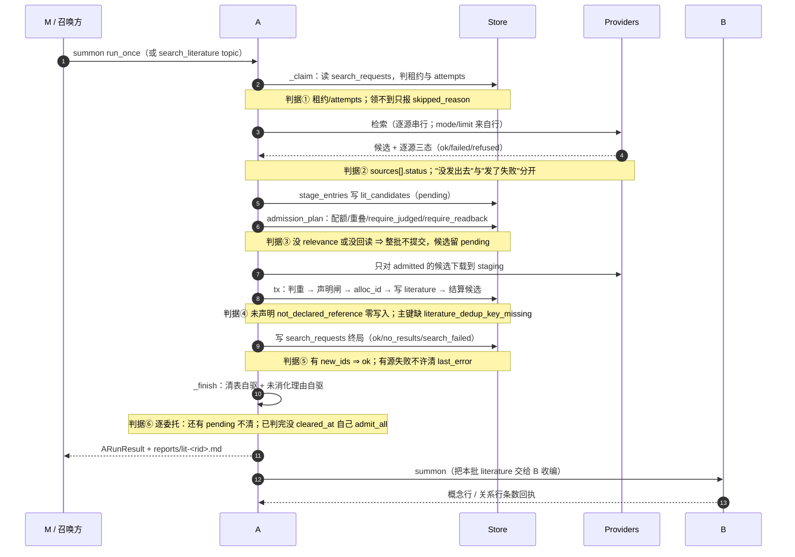

# ROLE-A：检索（A）

> 基线：2026-11-22。声明真身 `src/agentflow/specs/a.py`；实现 `src/agentflow/agent_a/`。
> 本文所有数字都是现算读数，命令见文末「取数命令」。正文不抄声明原文，只指到行。

## 1. 一句话定位

A 把「一条检索委托」变成 `literature` 台账里**可被 B 抽读的行**，并把没做到的那一档（没发出、没取到、没读到、被拒收）如实留在 `search_requests` 与候选表上 —— 定位原文见 `src/agentflow/specs/a.py::SPEC.brief.duty`，典型误根（把丢掉一条候选说成这篇文献不存在）见 `src/agentflow/specs/a.py::SPEC.brief.signature_error`。

## 2. 输入 / 输出

| # | 口 | 来源 | 形态 | 落到哪 | 证据（file:line） |
|---|---|---|---|---|---|
| 1 | 待办检索请求 | M / D / F / H 派活，或 CLI `submit` | `search_requests` 行（`done=false`） | 同表：`claimed_by` / `lease_until` / `attempts` 被认领 | `src/agentflow/agent_a/core.py::_Core._claim`（`_claim`）、`src/agentflow/schema.py::SearchRequest`（行定义） |
| 2 | 按主题现查 | 召唤方给 `topic/mode/description/providers` | 动作参数 | 先过 I7 准入，再新建一行 `search_requests` | `src/agentflow/agent_a/search_literature.py::_SearchLiterature.search_literature`、`src/agentflow/agent_a/core.py::_Core._enqueue_search` |
| 3 | 盘上目录 | `ingest_local(books_dir=…)` | 本地文件树 | 按内容 sha256 幂等写 `literature` 行 | `src/agentflow/agent_a/ingest_local.py::_IngestLocal.ingest_local` |
| 4 | 候选暂存 | 宽搜 / 本地发现的结果 | `lit_candidates` 行（`pending`，槽位只增不复用） | 同表；**此时还没有 `lit_id`** | `src/agentflow/agent_a/run_once.py::_RunOnce.run_once`、`src/agentflow/schema.py::LitCandidate` |
| 5 | 判收 / 判拒 | A 的模型动作（`lit.admit` / `lit.stage_reject`） | 候选状态 | `lit_candidates.status`；判收只到 `qualified`，**提交才发号** | `src/agentflow/agent_a/run_once.py::_RunOnce.run_once`（结算） |
| 6 | 文献行 | 输出 | `literature` 行（`path` / `download` / `processed=false`） | B 的 `run_once` 领取 | `src/agentflow/agent_a/run_once.py::_RunOnce.run_once`、`src/agentflow/agent_b/core.py::_Core._claim` |
| 7 | 请求终局 | 输出 | `outcome ∈ {ok,no_results,search_failed,gave_up}` + `result_lit_ids` + `last_error` | 召唤方、收工门第八格 | `src/agentflow/agent_a/run_once.py::_RunOnce.run_once`、`src/agentflow/schema.py::SEARCH_OUTCOMES` |
| 8 | 交付报告 | 输出 | `reports/lit-<request_id>.md`（进度稿，非定稿） | 召唤方 / 归档 | `src/agentflow/agent_a/run_once.py::_RunOnce.run_once` |
| 9 | 返回值 | 输出 | `ARunResult` / `ASearchResult`（含 `pending_total` / `sources[]`） | 调用栈上的召唤方 | `src/agentflow/agent_a/run_once.py::_RunOnce.run_once`、`src/agentflow/agent_a/search_literature.py::_SearchLiterature.search_literature` |

要点：`ok` 不等于「登记成功」。`ingest_local` 的 `ok` 只说调用做完了，有没有进台账看 `ingested / already_present / unreadable`（`src/agentflow/agent_a/ingest_local.py::_IngestLocal.ingest_local`）；`run_once` 的 `outcome=no_results` 还要结合 `last_error` 的「命中 N 条、入库 0 条」读（`src/agentflow/agent_a/run_once.py::_hits_reading`）。

## 3. 动作面

从 `specs/a.py::ACTIONS` 现读（6 条，`src/agentflow/specs/a.py::ACTIONS`）。

| 动作 | 参数要点 | 它写什么 | 不满足时哪种受控拒 |
|---|---|---|---|
| `run_once`（`specs/a.py::ACTIONS`） | `request_ids`（只认领点名的委托；不给=全部有 pending 的） | `literature`、`search_requests`、`lit_candidates`（暂存与结算） | 队列档只给 `skipped_reason`（`no_pending_request` / `pending_requests_all_leased` / `pending_requests_all_in_backoff`，`agent_a/core.py::_Core._claim`）；逐槽位拒 `not_declared_reference` / `literature_dedup_key_missing`（`agent_a/run_once.py::_RunOnce.run_once`） |
| `run`（`specs/a.py::ACTIONS`） | `max_requests ≥ 1` | 同 `run_once`，有界循环 | 无独立拒；循环在 `skipped_reason` 或 `claimed_delegations` 处停（`agent_a/run.py::_Run.run`） |
| `search_literature`（`specs/a.py::ACTIONS`） | `topic`（必填，≤400）、`mode`、`description`、`providers[]` | 先入队 `search_requests`，再跑 `run_once` 链路写 `literature` / `lit_candidates` | `bad_topic` / `bad_mode` / `bad_providers` / `unknown_provider` / `no_provider`（`agent_a/search_literature.py::_SearchLiterature.search_literature`）；`query_not_applicable` 是零写入的有效三态（`agent_a/search_literature.py::_SearchLiterature.search_literature`） |
| `walk_citations`（`specs/a.py::ACTIONS`） | `lit_id`（必填）、`direction`（backward/forward）、`limit` | **不写表**（只读走查） | `no_store` / `bad_lit_id` / `bad_direction` / `bad_limit`（`agent_a/walk_citations.py::_WalkCitations.walk_citations`） |
| `ingest_local`（`specs/a.py::ACTIONS`） | `books_dir`（必填）、`pattern`、`limit`、`max_bytes`、`dry_run` | `literature`（需要时也写 `search_requests` 的登记行） | `bad_books_dir` / `dir_not_found` / `not_declared_reference` / `io_error`（`agent_a/ingest_local.py::_IngestLocal.ingest_local`） |
| `shelf_search`（`specs/a.py::ACTIONS`） | `query`、`limit`、`lit_id`、`local_limit`、`max_chars` | **不写表**（本地书架只读） | `no_store` / `bad_limit` / `bad_query`（`agent_a/shelf_search.py::_ShelfSearch.shelf_search`） |

## 4. 职责正文要点

- **duty（一句话）**：把搜索请求变成已登记的文献行，并如实报告每一次失败（`src/agentflow/specs/a.py::SPEC.brief.duty`）。
- **boundary（一句话）**：`admitted>0` 之后必须派 B 收编；候选被丢掉只能否定「这一条没进结果」，不能否定「这篇文献不存在」；下载失败/无正文不许当成功；一次检索最多入库 10 篇，判收不是注册，提交才发号，清表才算收工（`src/agentflow/specs/a.py::SPEC.brief.boundary` 起，关键三处 `src/agentflow/specs/a.py::SPEC.brief.boundary`）。
- **policy（一句话）**：预算与命中率决定收手；题面式说法不是查询词，`no_results` 后要换规范术语再查；被问「有没有人说它不成立」要做反证检索并允许 `unresolved`；泛化检索按推广/类比/特例三档交回（`src/agentflow/specs/a.py::SPEC.brief.policy` 起，关键三处 `src/agentflow/specs/a.py::SPEC.brief.policy`）。

## 5. 边界与禁令

1. **出边只有 B**：`edges=('B',)`（`src/agentflow/specs/a.py::SPEC.edges`），权威派生在 `src/agentflow/capabilities.py::ALLOWED_EDGES`。A 唤不起 M/D/E/F/G/H/V，越权召唤会吃 `forbidden_edge`（`src/agentflow/policy.py::check`）。
2. **声明写集三张表**：`literature` + `search_requests` + `lit_candidates`（`src/agentflow/specs/a.py::SPEC.write_set`）。`lit_candidates` 是 2026-11-22（WRITESETFIX）补进来的：`run_once` 的提交事务本来同时持有它（`src/agentflow/agent_a/run_once.py::_RunOnce.run_once`），写集漏列会让并发轴漏算这一张（判据 `tests/test_write_sets_match_their_write_points.py`）。
3. **不建概念、不写关系/命题**：`table.create(table="statements")` 会被通用写口的表级闸当场拒（`src/agentflow/store.py::direct_write_refusal`、`src/agentflow/tools/table_tools.py::_direct_write_disposal`）；A 的声明也把「敢创新」写成结构禁止（`src/agentflow/specs/a.py::SPEC.local_notes`）。
4. **丢掉一条候选 ≠ 这篇文献不存在**：这是 A 的典型误根（`src/agentflow/specs/a.py::SPEC.brief.signature_error`），也是 `no_results` 必须配「命中 N 条 / 未入库理由分布」读数才不歧义的原因（`src/agentflow/agent_a/run_once.py::_hits_reading`）。
5. **没有正文不许判收**：`lit.admit` 只接受读过正文的候选（`content_read` 是机器现算），只有题录/摘要/抽取失败的一律 `lit.stage_reject` + 理由码（`src/agentflow/specs/a.py::SPEC.brief.boundary`）。
6. **只有用户点名的才可入库**：非 dry 的 `ingest_local` 与自动登记链都过 `locallib.declaration_verdict`，未声明 ⇒ `not_declared_reference`、零写入（`src/agentflow/agent_a/ingest_local.py::_IngestLocal.ingest_local`、`agent_a/run_once.py::_RunOnce.run_once`）。
7. **不许把「没这一签/没取到」写成「没有」**：下载失败只登记 `download.status=failed`，不写成这篇不存在；`fetch_kind` 分档处置写在 policy（`src/agentflow/specs/a.py::SPEC.brief.policy`）。

## 6. 与谁协作

| 对谁 | 通过什么 | 收 / 发什么 | 哪条边 / 哪个读写口 |
|---|---|---|---|
| M | `conductor.summon` 派 `run_once` / `search_literature`；A 交 `final` 回执 | 收：委托与优先级；发：`ARunResult` + 报告 + `pending_total` | `M → A`：`src/agentflow/specs/m.py::SPEC.edges`、`src/agentflow/capabilities.py::ALLOWED_EDGES` |
| D | D 的缺口/研究流程直接派 A 查文献 | 收：研究问题里的检索需求；发：`search_requests` 终局与文献行 | `D → A`：`src/agentflow/specs/d.py::SPEC.edges` |
| F | F 要证明里的标准事实有可引出处时派 A | 收：命题/事实描述；发：`lit:` 号或「没取到可读全文」 | `F → A`：`src/agentflow/specs/f.py::SPEC.edges` |
| H | 引文对不上原文时让 A 核实 | 收：要核的引文；发：原文行与逐字定位 | `H → A`：`src/agentflow/specs/h.py::SPEC.edges` |
| B | **A 自己派 B 收编**（唯一出边） | 发：`literature` 行；收：B 的「概念行/关系行条数」回执 | `A → B`：`src/agentflow/specs/a.py::SPEC.edges` |

## 7. 典型一轮长什么样



## 8. 常见失败与读数

下表全部用 `projects/lp-ball-15`（已收工）与 `projects/lp-ball-16`（取数时仍在跑）的真实形态举例。

| 现象 | 该看哪个读数 | 判定标准 / 真实例子 |
|---|---|---|
| 题面原句当查询，返回 `no_results` | `search_requests.outcome` + `last_error` 的「命中 N 条」+ `sources[].count` | 不是「没有文献」。lp-ball-15 `r-000006`（"maximal hyperplane sections… exact …"）命中 15 条、全部 `rejected_off_topic`；`r-000007`（"Beta function"）15 条里 13 条离题 + 2 条纯题录，两批共 28 槽由一次 `stage_reject` 判拒（`A-20261121-155019-001` step 4） |
| 换了规范术语后才拿到来源 | 同一委托的 `topic` 与 `result_lit_ids` | `r-000008` 先用 `Euler integral of the first kind`（precise）拿到候选，最终 `outcome=ok`、`lit:000018` |
| 没回读就 `lit.admit` | 工具结果 `kind=no_readback`，整批 `call_size=0` | 零写入、一条也不提交。lp-ball-15 `A-20261121-151307-001` step 18、`A-20261121-155019-001` step 32 都是这一形 |
| 判完没清表 | `lit_candidates` 行上的 `cleared_at`；收工门 `literature_pending` | lp-ball-15 共 61 行候选、只有 51 行有 `cleared_at`：`r-000003` 2/5、`r-000004` 3/5、`r-000008` 1/6（后者的 5 条判拒行一行都没清）。`closing` 的 `delegation_not_cleared` 就报这一格（`src/agentflow/closing.py` 的模块 docstring） |
| 抽不出正文仍想判收 | `lit.admit` 的 `no_read_evidence`；候选行的 `reason_code` | lp-ball-15 的 42 条 rejected 里，`rejected_low_quality` 5 条、`rejected_off_topic` 28 条、`registration_failed` 2 条、`not_screened` 7 条；`slot 000003/000004` 是 `garbled_text`（控制字符占比 0.01528 / 0.01061） |
| 参数过长被参数门拒 | 工具结果 `kind=param_error` | `lit.stage_reject` 的 `note` 上限 400；lp-ball-15 `A-20261121-151244-001` step 18 被拒一次，step 19 压缩后成功 |
| 机器上没有接检索后端 | `search_literature` 返回 `kind=no_provider` | 零写入；不是「这个主题没有文献」（`agent_a/search_literature.py::_SearchLiterature.search_literature`） |

## 取数命令

```powershell
cd D:\Incubator\agentflow
# A 的动作表（6 条）
python -c "import sys;sys.path.insert(0,'src');from agentflow import specs;print([a.action for a in specs.builtin_specs()['A'].actions])"
# lp-ball-15 的 A 盘上读数
python -c "import json;d=json.load(open(r'D:\Incubator\projects\lp-ball-15\data\literature.json',encoding='utf-8'));print('literature',len(d['rows']))"
python -c "import json,collections;d=json.load(open(r'D:\Incubator\projects\lp-ball-15\data\search_requests.json',encoding='utf-8'));print(collections.Counter(r['outcome'] for r in d['rows']))"
python -c "import json,collections;d=json.load(open(r'D:\Incubator\projects\lp-ball-15\data\lit_candidates.json',encoding='utf-8'));print('cand',len(d['rows']),'cleared',sum(1 for r in d['rows'] if str(r.get('cleared_at') or '').strip()))"
```
