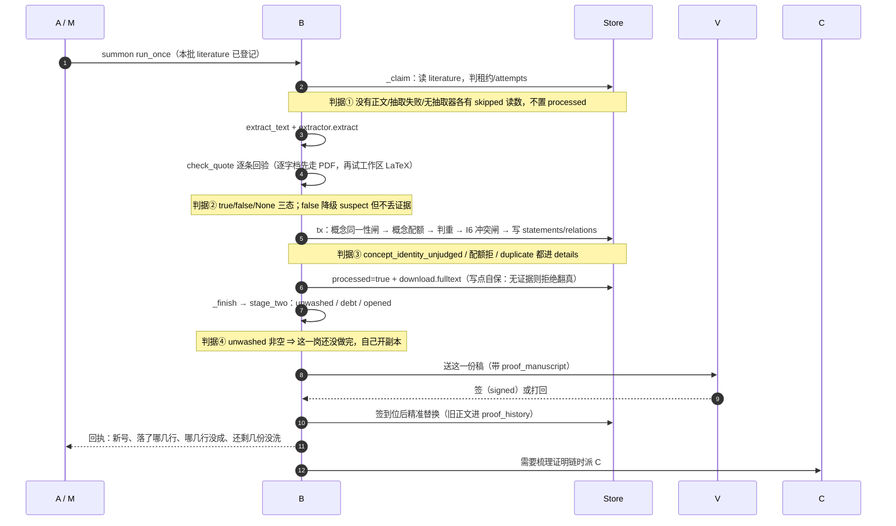

# ROLE-B：整理 / 手稿（B）

> 基线：2026-11-22。声明真身 `src/agentflow/specs/b.py`（政策正文分居 `b_ingest_policy.py` / `b_sign_policy.py`）；
> 实现 `src/agentflow/agent_b/`。本文数字都是现算读数，命令见文末。

## 1. 一句话定位

B 把 A 交来的 `literature` 行、E/D 交来的手稿（F 的稿经 D 转到 B），变成 `statements`（概念行与命题行）、`relations`（带逐字引文的边）与 `conjectures`（命题线索），并把「快录」之后那一遍**洗稿 → 重拿 V 签 → 精准替换**当作自己的主职（`src/agentflow/specs/b_ingest_policy.py::STAGE_TWO_DUTY`）。

## 2. 输入 / 输出

| # | 口 | 来源 | 形态 | 落到哪 | 证据（file:line） |
|---|---|---|---|---|---|
| 1 | 未处理文献 | A 的 `run_once` 链写下的 `literature` 行 | 表行（`processed=false`） | B 认领：`claimed_by` / `lease_until` / `mine_attempts` | `src/agentflow/agent_b/core.py::_Core._claim` |
| 2 | 正文 | `literature.path` 指向的 PDF / 工作区 LaTeX | 文件 | `extract_text` → `DocumentText` | `src/agentflow/agent_b/run_once.py::_RunOnce.run_once`、`src/agentflow/agent_b/run_once.py::_RunOnce._manuscript_doc`（`out/paper/main.tex` 兜底） |
| 3 | 概念/关系抽取 | `self.extractor.extract(doc, lit_id, meta)` | 内存对象 | 同一个事务写 `statements`（`kind=concept`）与 `relations` | `src/agentflow/agent_b/run_once.py::_RunOnce.run_once` |
| 4 | 手稿 | `reports/f-proof-*` / `e-proof-*` / `e-num-*` / `b-proof-*` | 文件 + 路径 | `ingest_manuscript` 按块回填 `cells`；`register_statement` 按手稿路径收录 | `src/agentflow/agent_b/ingest_manuscript.py::_IngestManuscript.ingest_manuscript`、`src/agentflow/agent_b/register_statement.py::_RegisterStatement.register_statement` |
| 5 | 命题/证明/依赖 | 手稿 `## 命题` / `## 证明` / `## 依赖` | 文本 | `statements`（正文/证明）+ `dependencies` | `src/agentflow/agent_b/register_statement.py::CONJECTURE_START_KINDS`、`src/agentflow/agent_b/register_statement.py::_RegisterStatement.register_statement` |
| 6 | B 自己的证明稿 | `land_manuscript` / `open_polish_copy` | 文件 | `reports/b-proof-<B稿号>.md` | `src/agentflow/agent_b/land_manuscript.py::_LandManuscript.land_manuscript`、`agent_b/open_polish_copy.py::_OpenPolishCopy.open_polish_copy` |
| 7 | 文献消化位 | 输出 | `literature.processed=true` + `download.fulltext` | A 的收尾读数、收工门 | `src/agentflow/agent_b/run_once.py::_RunOnce.run_once` |
| 8 | 命题线索 | 输出 | `conjectures` 行（已有行则只记 `promoted_to_statement`） | E / D / F 读 | `src/agentflow/specs/b.py::SPEC.write_set`、`src/agentflow/conjectureledger.py::register`、`src/agentflow/conjectureledger.py::_upsert` |
| 9 | 二阶段欠账 | 输出 | `stage_two.unwashed` / `washed_count` / `next_action` | 召唤方、B 自己下一拍 | `src/agentflow/agent_b/stage_two.py::_StageTwoSelfDrive._finish`、`src/agentflow/agent_b/stage_two.py::_StageTwoSelfDrive._stage_two_self_drive` |

要点：`own.run_once` 是「自动链接」的一段，不是全部 —— 第二阶段的入口是同一拍回执里的 `stage_two.unwashed`（`src/agentflow/specs/b_ingest_policy.py::STAGE_TWO_BOUNDARY`）。`statements` 的写盘不在 `agent_b/` 里：它经秘书的 `record_statement` 落行（`src/agentflow/secretary_statement_tx.py::StatementTxMixin._record_statement_tx`），通用写口直写 `statements` 会被表级闸拒（`src/agentflow/store.py::direct_write_refusal`）。

## 3. 动作面

从 `specs/b.py::ACTIONS` 现读（10 条，`src/agentflow/specs/b.py::ACTIONS`）。

| 动作 | 参数要点 | 它写什么 | 不满足时哪种受控拒 |
|---|---|---|---|
| `run_once`（`specs/b.py::ACTIONS`） | 无参数 | `literature`（整行的 `processed` / `download.fulltext`）、`statements`（概念行）、`relations` | 队列档只给 `skipped_reason`（`no_unprocessed_literature` / `pending_literature_all_leased`，`agent_b/core.py::_Core._claim`）；抽取失败只写 `last_mine_error` 与退避租约（`agent_b/run_once.py::_RunOnce.run_once`）；概念同一性判不了 ⇒ `concept_identity_unjudged`（`agent_b/run_once.py::_RunOnce.run_once`）；配额拒只进读数（`agent_b/run_once.py::_RunOnce.run_once`） |
| `reprocess_once`（`specs/b.py::ACTIONS`） | 无参数 | 重抽取请求的处理结果（关系/命题行的修订） | `no_pending_reprocess`（`agent_b/reprocess_once.py::_ReprocessOnce.reprocess_once`）；领到但失败 ⇒ `error` 非空、请求不标 done（`agent_b/reprocess_once.py::_ReprocessOnce.reprocess_once`） |
| `run_reprocess`（`specs/b.py::ACTIONS`） | `max_requests ≥ 1` | 同 `reprocess_once`，有界 | 无独立拒 |
| `decide_structural_duplicate`（`specs/b.py::ACTIONS`） | `candidate`（必填）、`concepts`、`relations` | **不写库**（只判定） | `reject` + 理由：非两概念 / 有直接关系 / 名字侧两路不成立（`agent_b/decide_structural_duplicate.py::_DecideStructuralDuplicate.decide_structural_duplicate`） |
| `resolve_structural_duplicate`（`specs/b.py::ACTIONS`） | `candidate`（必填） | `statements`（`status=superseded` 等）、`relations`（`status`） | 决定为 `reject` 时零写入（`agent_b/resolve_structural_duplicate.py::_ResolveStructuralDuplicate.resolve_structural_duplicate`） |
| `run`（`specs/b.py::ACTIONS`） | `max_docs ≥ 1` | 同 `run_once`，有界；经 OCR 读 PDF ⇒ 外部轴 `egress` | 无独立拒 |
| `register_statement`（`specs/b.py::ACTIONS`） | `statement_full` / `proof_manuscript` / `origin` / `source_lit_id` / `page_range` / `kind` / `label` / `quote_verified` / `quote_mode` / `quote_reason` / `quote_span` / `self_authored` / `doc_id` / `line_range` | `statements`（经秘书）、`dependencies`、`conjectures` | `empty_statement_text`、`concept_identity_unjudged` / `proof_kind_unjudged`、`concept_origin_refused`、`citation_below_proof_review`、`dependency_section_missing` / `_unreadable`、`manuscript_legacy_name`、`d_gives_manuscript_pointers_only`（`agent_b/run_once.py::_RunOnce.run_once`、`src/agentflow/secretary_proofkind.py::PROOF_KIND_UNJUDGED`、`agent_b/register_statement.py::_RegisterStatement._register_statement_impl`、`agent_b/register_statement.py::_RegisterStatement._register_pointer_manuscript`、`src/agentflow/depsection.py::REFUSED_SECTION`、`src/agentflow/depsection.py::REFUSED_SECTION_MISSING`、`src/agentflow/depsection.py::REFUSED_LEVEL_TOO_LOW`） |
| `land_manuscript`（`specs/b.py::ACTIONS`） | `statement_id` + `proof_text`（必填）、`statement_full`、`label`、`source_manuscript`、`if_match_sha256` | 只写文件 `reports/b-proof-<B稿号>.md`，不写台账 | `statement_missing` / `empty_statement_text` / `stale_target` / `path_not_found`（`agent_b/land_manuscript.py::_LandManuscript.land_manuscript`） |
| `ingest_manuscript`（`specs/b.py::ACTIONS`） | `manuscript`（必填）、`target_stmt_id`、`cells`、`conflict`、`mode`、`if_match_proof_sha256`、`path_group` | 按 `target_stmt_id` 回填 `statements` 的点名格 | `path_not_found` / `path_mismatch`（`agent_b/ingest_manuscript.py::_IngestManuscript.ingest_manuscript`）；`manuscript_owner_mismatch`（`agent_b/register_statement.py::_RegisterStatement._register_statement_impl`） |
| `open_polish_copy`（`specs/b.py::ACTIONS`） | `statement_id`（必填）、`source_manuscript` | 只写 `reports/b-proof-<B稿号>.md` 副本，清掉 `- V 签：` 行 | `no_source_draft` / `signed_table_unreadable` / `source_missing` / `manuscript_frozen`（`src/agentflow/manuscriptfreeze.py::MANUSCRIPT_FROZEN`、`agent_b/open_polish_copy.py::_OpenPolishCopy._polish_source`） |

## 4. 职责正文要点

- **duty（一句话）**：第一阶段快录（机械录入证明原文与已有的 V 签），第二阶段逐个优化是主职且自驱、不必等 M 派（`src/agentflow/specs/b_ingest_policy.py::STAGE_TWO_DUTY`）。
- **boundary（一句话）**：没有逐字引文支撑的关系不许产出；缺命题正文或出处才拒收，缺证明不拒收（落最低等级并进待办）；`quote_verified` 三态；已拿签的稿只读，改前先开 B 号副本；快录完之后同一拍就做二阶段（`src/agentflow/specs/b.py::SPEC.brief.boundary` 起，关键 `src/agentflow/specs/b.py::SPEC.brief.boundary`、`specs/b_ingest_policy.py::STAGE_TWO_BOUNDARY`）。
- **policy（一句话）**：方法学五步是「先定位再登记 / 三件式 / 逐字回验三态 / 洗稿完整链 / 自检两格」；等级按凭据定不按怕不怕定，`pre_theorem` 只认 `signed`；入库前逐条判 relevance；收录是「你指定位置和格、工具按块回填」（`src/agentflow/specs/b_ingest_policy.py::B_METHOD_POLICY`、`src/agentflow/specs/b.py::SPEC.brief.policy` 起，关键 `src/agentflow/specs/b.py::SPEC.brief.policy`）。

## 5. 边界与禁令

1. **出边只有 C / D / H / L / V**：`edges=('C','D','H','L','V')`（`src/agentflow/specs/b.py::SPEC.edges`）。B 唤不起 A / E / F / G；越权召唤吃 `forbidden_edge`（`src/agentflow/policy.py::check`）。F 的稿是 F 交来、B 收，不是 B 去催 F。
2. **写集六张表**：`literature`（只翻 `processed` / 补理由）、`relations`、`reprocess_requests`、`statements`、`conjectures`、`dependencies`（`src/agentflow/specs/b.py::SPEC.write_set`）。`documents` / `experiments` / `analysis_reports` 都不在写集里。`dependencies` 是 2026-11-22（WRITESETFIX）补进来的：落行在秘书（`src/agentflow/secretary_deps.py::DepsMixin._write_dep_steps`），B 是写者、秘书是执行者，写集漏列会让 `B×G` 这一对并发冲突漏算（判据 `tests/test_write_sets_match_their_write_points.py`）。
3. **`statements` 不直写**：登记经秘书的 `record_statement`（`src/agentflow/secretary_statement_tx.py::StatementTxMixin._record_statement_tx`）；`table.create(table="statements")` 被 `store.direct_write_refusal` 拒（`src/agentflow/store.py::direct_write_refusal`）。
4. **没有逐字引文的关系不许产出**：`relations` 行必须带 `quote` + `page_range`，`quote_verified` 只认回验三态（`src/agentflow/specs/b.py::SPEC.brief.boundary`、`specs/b_ingest_policy.py::B_METHOD_POLICY`）。
5. **自产概念要显式声明**：`kind="concept"` + `origin="own_result"` 不传 `self_authored=True` ⇒ `concept_origin_refused`；与 `source_lit_id` 同给也拒（`src/agentflow/specs/b.py::SPEC.brief.policy`、`agent_b/register_statement.py::_RegisterStatement._register_statement_impl`）。
6. **已拿签的稿只读**：就地改会被 `manuscript_frozen` 拒；正确路是 `open_polish_copy` 副本 → 洗 → 重签 → 替换（`src/agentflow/specs/b.py::SPEC.brief.boundary`、`agent_b/open_polish_copy.py::_OpenPolishCopy.open_polish_copy`）。
7. **不受理无 V 签的 F 证明**：收到没有 V 签的 F 稿 ⇒ 不润色、整笔退回，让 F 先拿签（`src/agentflow/specs/b.py::SPEC.brief.policy`）。
8. **D 只递指针、不递正文**：D 传正文会被 `d_gives_manuscript_pointers_only` 拒（`src/agentflow/agent_b/register_statement.py::D_POINTER_ONLY_REFUSAL`）。

## 6. 与谁协作

| 对谁 | 通过什么 | 收 / 发什么 | 哪条边 / 哪个读写口 |
|---|---|---|---|
| A | A 派 B 收编 | 收：本批 `literature` 行；发：概念行/关系行条数与未消化原因 | `A → B`：`src/agentflow/specs/a.py::SPEC.edges` |
| M | `conductor.summon` 派 `run_once` / `register_statement` | 收：委托；发：回执与 `stage_two.unwashed` | `M → B`：`src/agentflow/specs/m.py::SPEC.edges` |
| D | D 派 B 收稿/收录；B 判断缺陷在路线本身时派 D 做研究 | 收：手稿指针；发：收录结果或「这条路线的研究问题」 | `D → B` 与 `B → D`：`src/agentflow/specs/d.py::SPEC.edges`、`specs/b.py::SPEC.edges` |
| E | E 交数值/证明实验手稿 | 收：`reports/e-num-*` / `e-proof-*`；发：`statements` 行 | `E → B`：`src/agentflow/specs/e.py::SPEC.edges`（`edges` 含 B，权威表 `src/agentflow/capabilities.py::ALLOWED_EDGES`） |
| F | F 交证明稿（B 收，不反向派） | 收：`reports/f-proof-*`；发：收录行、概念/关系 | `F → B` **已撤**；F 只把稿交给 D，由 D 派 B（`src/agentflow/specs/f.py::SPEC.edges`） |
| V | B 派 V 审这份稿，签回来再收录/替换 | 发：`statement_id` + `proof_manuscript`；收：`verifications/<号>.jsonl` 的签 | `B → V`：`src/agentflow/specs/b.py::SPEC.edges` |
| H | 逐字不中但语义相同的引文交 H 判 | 发：引文 + 来源；收：`quote_verified=true` + `quote_mode=semantic` 的凭据 | `B → H`：`src/agentflow/specs/b.py::SPEC.edges` |
| L | 用户点名要形式化时才逐条派 L | 发：命题 + 证明链 + 已核依赖；收：检查器原话/退出码/三态 | `B → L`：`src/agentflow/specs/b.py::SPEC.edges`、`src/agentflow/specs/b.py::PROOF_CHANNEL` |
| C | B 可派 C 梳理证明链 | 发：命题/依赖范围；收：`analysis_reports` 行 | `B → C`：`src/agentflow/specs/b.py::SPEC.edges` |

## 7. 典型一轮长什么样



## 8. 常见失败与读数

下表用 `projects/lp-ball-15`（已收工）与 `projects/lp-ball-16`（取数时仍在跑）的真实形态举例。

| 现象 | 该看哪个读数 | 判定标准 / 真实例子 |
|---|---|---|
| 登记命题时没写 `quote_reason` | 工具结果 `kind=missing_quote_reason` + `refusal_reason=invalid_params` | 三态纪律：不是 true 就必须说为什么。lp-ball-15 共出现 3 次（`B-20261121-151216-001` step 13、`B-20261121-151253-001` step 17、`B-20261121-155000-001` step 8），补上后同一笔重交成功 |
| 命题形态不合格 | `kind=proposition_form_refused` + `problems[]` | lp-ball-15 `B-20261121-151253-001` step 21：一条「存在最优上界 + 确认猜想 + 最大值点」混写的命题被拒，理由逐条列出；零落行、零写稿 |
| 第二阶段（洗稿）没做 | `stage_two.unwashed`、`own.open_polish_copy` 调用次数、`statements.optimized_by_proof` | lp-ball-15 的 10 趟 B run 共 271 步，`own.run_once` 23 次、`own.register_statement` 49 次、**`own.open_polish_copy` 0 次**；13 条有 `proof_text` 的命题里只有 3 条 `bits.reviewed=true`、3 条 `pre_theorem` |
| 概念配额截断 | `run_once` 的 `concept_quota` / `concepts_refused` / `relations_deferred`、`details[].stage=concept_quota` | 单轮配额满了照常把 `processed=true`，被拒的逐条点名；lp-ball-15 有 B 回执写「lit:000002 因概念配额耗尽零落地，需补一轮」（`B-20261121-143933-001` final） |
| 关系被降级为 suspect | `relations.status` 与 `_quote_check` / `_conflict_check` | 引文失败或 I6 冲突都会降级但保留行。lp-ball-15 的 198 条关系里 5 条 `suspect`、193 条 `active`；`quote_verified` 197 true / 1 None |
| 文献 `processed` 没翻 | `literature.processed` + `unprocessed_reason` | lp-ball-15 的 19 条文献里 18 条 `processed=true`；`lit:000018` 是 false 且盘上没有 `unprocessed_reason` —— 这一形要靠 A 的收尾自驱补（`src/agentflow/agent_a/clear_stage.py::_unprocessed_reason_self_drive`），补不上就由收工门的 `acceptance` 如实计 `literature_unprocessed` |
| 同一篇被重复抽取 | `literature.processed` + `claimed_by/lease_until` | 同 `lit_id` 已有 `processed=true` 后不再进候选（`agent_b/core.py::_Core._claim`）；退避租约 `claimed_by=None` + 未到期的 `lease_until` 也照样拦住（`agent_b/core.py::_Core._claim`） |

## 取数命令

```powershell
cd D:\Incubator\agentflow
# B 的动作表（10 条）
python -c "import sys;sys.path.insert(0,'src');from agentflow import specs;print([a.action for a in specs.builtin_specs()['B'].actions])"
# lp-ball-15 的 B 盘上读数
python -c "import json,collections;d=json.load(open(r'D:\Incubator\projects\lp-ball-15\data\statements.json',encoding='utf-8'));print(collections.Counter(r['kind'] for r in d['rows']),collections.Counter(str(r.get('quote_verified')) for r in d['rows']))"
python -c "import json,collections;d=json.load(open(r'D:\Incubator\projects\lp-ball-15\data\relations.json',encoding='utf-8'));print(len(d['rows']),collections.Counter(str(r.get('quote_verified')) for r in d['rows']))"
# B 的 10 趟 run 里各工具被调了几次
python -c "import json,pathlib,collections;c=collections.Counter();[c.update(str(s['payload']['name']) for s in json.load(open(f,encoding='utf-8')).get('steps',[]) if s.get('payload',{}).get('name')) for f in pathlib.Path(r'D:\Incubator\projects\lp-ball-15\runs').glob('B-*.json')];print({k:v for k,v in c.items() if k.startswith('own.')})"
```
