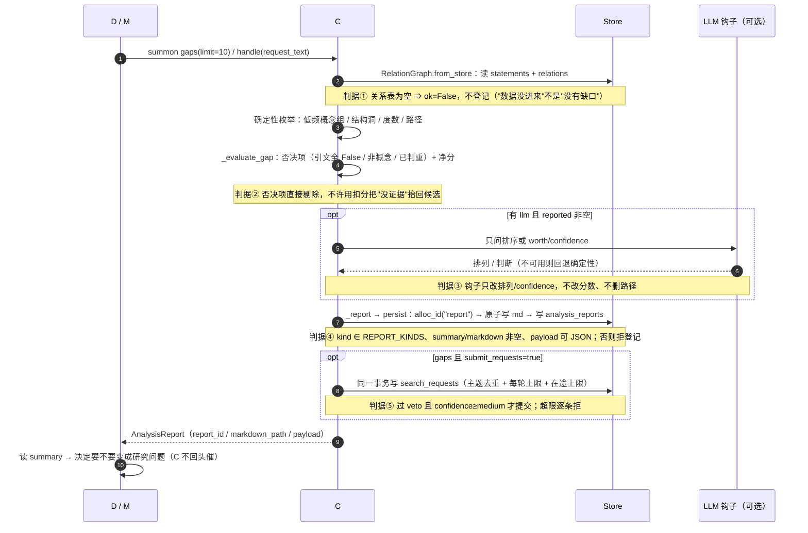

# ROLE-C：分析 / 审查（C）

> 基线：2026-11-22。声明真身 `src/agentflow/specs/c.py`；实现 `src/agentflow/agent_c/`。
> 本文数字都是现算读数，命令见文末。

## 1. 一句话定位

C 用**确定性代码**在 `statements` / `relations` 构成的图上算度数、路径、结构洞与证明链，只在「排序」与「措辞」两件事上允许模型介入，并把结果登记成 `analysis_reports` 一行 + `reports/<report_id>-<kind>.md` 一份（`src/agentflow/specs/c.py::SPEC.brief.duty`、`src/agentflow/specs/c.py::SPEC.brief.boundary`）。

## 2. 输入 / 输出

| # | 口 | 来源 | 形态 | 落到哪 | 证据（file:line） |
|---|---|---|---|---|---|
| 1 | 图数据 | B 写的 `statements`（概念行/命题行）、`relations` | 表行 | 内存 `RelationGraph`（一次构建、多次查询） | `src/agentflow/agent_c/core.py::_Core.build_graph`、`src/agentflow/agent_c/core.py::_Core._g` |
| 2 | 自然语言需求 | 召唤方给 `request_text` | 字符串 | 关键词分派到 hottest / paths / cold / gaps | `src/agentflow/agent_c/handle.py::_Handle.handle`、`src/agentflow/agent_c/handle.py::_Handle._dispatch_request` |
| 3 | 结构化参数 | `top_n` / `a,b` / `limit` / `concept_id` / `target` 等 | 动作参数 | 分析器入参 | `src/agentflow/specs/c.py::ACTIONS` |
| 4 | 报告行 | 输出 | `analysis_reports` 一行（`report_id` / `kind` / `summary` / `payload` / `markdown_path`） | 同表 | `src/agentflow/agent_c/_support.py::AnalysisReport.persist` |
| 5 | 报告文件 | 输出 | `reports/<report_id>-<kind>.md`（原子写） | 盘上 | `src/agentflow/agent_c/_support.py::AnalysisReport.persist` |
| 6 | 检索请求（条件性） | `gaps(submit_requests=true)` | 表行 | `search_requests`（只由调用方显式开启） | `src/agentflow/agent_c/core.py::_Core._submit_gap_requests` |
| 7 | 返回值 | 输出 | `AnalysisReport`（带 `report_id` / `markdown_path`）或 `dict` | 召唤方（报告随返回值交回） | `src/agentflow/agent_c/handle.py::_Handle.handle`、`src/agentflow/specs/c.py::SPEC.brief.deliverable` |

要点：六个「报告型」动作（`hottest` / `paths` / `cold` / `gaps` / `handle` / `proof_chain`）走 `_report` ⇒ 产出即登记；四个「查询型」动作（`neighbors` / `relations_between` / `contradictions` / `structural_duplicates`）返回 `dict`、**不落表**（`src/agentflow/specs/c.py::ACTIONS`）。`handle` 自己还会再收口一次 `persist()`，幂等（`agent_c/handle.py::_Handle.handle`）。

## 3. 动作面

从 `specs/c.py::ACTIONS` 现读（10 条，`src/agentflow/specs/c.py::ACTIONS`）。

| 动作 | 参数要点 | 它写什么 | 不满足时哪种受控拒 |
|---|---|---|---|
| `hottest`（`specs/c.py::ACTIONS`） | `top_n ≥ 1`、`request` | `analysis_reports` + markdown（度数中心性最热榜） | 关系表为空 ⇒ `ok=False`、**不落盘**，`error` 明说「数据还没进来」（`agent_c/hottest.py::_Hottest.hottest`） |
| `paths`（`specs/c.py::ACTIONS`） | `a`、`b`（必填）、`max_paths` / `max_len` / `max_overlap` / `request` | 同上（两概念间关系路径） | 概念解析不到 / 路径为空 ⇒ `ok=False` 不落盘（`agent_c/paths.py::_Paths.paths`；由 `_report` 统一判） |
| `cold`（`specs/c.py::ACTIONS`） | `top_n ≥ 1`、`request` | 同上（冷门/孤立概念） | 关系表为空 ⇒ `ok=False` 不落盘（`agent_c/cold.py::_Cold.cold`，与 `hottest` 同口径） |
| `gaps`（`specs/c.py::ACTIONS`） | `limit ≥ 1`、`request`、`submit_requests`（默认 false） | 同上；`submit_requests=true` 时另把候选落成 `search_requests` | 关系表为空 ⇒ `ok=False` 不落盘（`agent_c/gaps.py::_Gaps.gaps`）；提交侧逐条拒：空 topic / 重复主题 / 超每轮上限 / 超在途上限（`agent_c/core.py::_Core._submit_gap_requests`） |
| `neighbors`（`specs/c.py::ACTIONS`） | `concept_id`（必填）、`depth`、`max_nodes` | **不写表** | 概念表为空 ⇒ `checked=False`（不是「没有邻居」）；代号不存在 ⇒ `checked=True` + `reason`（`agent_c/neighbors.py::_Neighbors.neighbors`） |
| `relations_between`（`specs/c.py::ACTIONS`） | `a`、`b`（必填）、`include_inactive` | **不写表** | 概念解析不到 ⇒ `checked=False` / 空结果（`agent_c/relations_between.py::_RelationsBetween.relations_between`，口径同 `neighbors`） |
| `contradictions`（`specs/c.py::ACTIONS`） | `relation_ids`、`limit` | **不写表** | 读不出来 ⇒ `checked=False`；不是「没有矛盾」（`agent_c/contradictions.py::_Contradictions.contradictions`） |
| `structural_duplicates`（`specs/c.py::ACTIONS`） | `limit` | **不写表**（I5 的输入，合并权在 B） | 图读不出来 ⇒ `checked=False`（`agent_c/structural_duplicates.py::_StructuralDuplicates.structural_duplicates`） |
| `handle`（`specs/c.py::ACTIONS`） | `request_text`（必填） | 分派后的报告按 `_report` 落 `analysis_reports` | 空请求 / 关键词未命中 ⇒ `kind=unknown`、`ok=False`，**不落盘**（`agent_c/_support.py::AnalysisReport.persist` 会再拒表外 kind；`agent_c/handle.py::_Handle._dispatch_request`） |
| `proof_chain`（`specs/c.py::ACTIONS`） | `target`（必填）、`max_depth`、`k`、`weights` | 同上（最短证明依赖链） | 找不到根/有歧义 ⇒ 如实报，不硬选（`agent_c/proof_chain.py::_ProofChain.proof_chain`） |

## 4. 职责正文要点

- **duty（一句话）**：关系分析 —— 用确定性代码算图与计数，只在排序与措辞这两件事上动用模型（`src/agentflow/specs/c.py::SPEC.brief.duty`）。
- **boundary（一句话）**：对**其它智能体的产出**只读（不改别人的稿/台账/报告），出边为空；可写的只有自己侧的产物（`analysis_reports`、自己的板项与计时器），知识表零写入；`gaps(submit_requests=true)` 是调用方开启的登记例外（`src/agentflow/specs/c.py::SPEC.brief.boundary` 起，关键 `src/agentflow/specs/c.py::SPEC.brief.boundary`）。
- **policy（一句话）**：两个钩子各只做一件事（路径排序只给 index 排列、缺口判断只给 `worth`/`confidence`）；缺口不能只写在报告里，要让调用方开 `submit_requests=true` 落成检索请求；选根只能用台账已有内容，匹配不到或有歧义就如实报（`src/agentflow/specs/c.py::SPEC.brief.policy` 起，关键 `src/agentflow/specs/c.py::SPEC.brief.policy`）。

## 5. 边界与禁令

1. **只读角色**：`read_only=True`（`src/agentflow/specs/c.py::SPEC.read_only`）；工具面按 `tools.READ_ONLY_ROLES = ("C","H","V")` 过滤，写工具进不了 C 的手（`src/agentflow/tools/__init__.py::READ_ONLY_ROLES`、`src/agentflow/tools/base.py::ToolRegistry.for_role`）。
2. **出边为空**：`edges=()`（`src/agentflow/specs/c.py::SPEC.edges`）。C 唤不起任何角色，只能被召唤；权威表 `src/agentflow/capabilities.py::ALLOWED_EDGES`。
3. **写集只有两张表**：`analysis_reports`（自己的产出）+ `search_requests`（仅 `gaps` 的受控例外，默认关闭）（`src/agentflow/specs/c.py::SPEC.write_set`）。`statements` / `relations` / `literature` / `conjectures` 零写入点。
4. **唯一的写工具是产出登记口**：`analysis.register_report`（`src/agentflow/tools/base.py::READONLY_CALL_EXCEPTIONS`），落点复用 `AnalysisReport.persist`；它只写 `analysis_reports`，不碰知识表。
5. **模型只许排序/判断，不许改分数、不许删路径**：`src/agentflow/specs/c.py::SPEC.brief.boundary`；钩子不可用或返回坏结果必须回退确定性顺序并写明来源（`src/agentflow/specs/c.py::SPEC.brief.boundary`）。
6. **`ok=False` 的报告不落盘**：失败报告不是「一份分析产物」，登记它会让 `analysis_reports` 混进答非所问的行（`src/agentflow/agent_c/handle.py` 的模块 docstring、`agent_c/core.py::_Core._report`）。
7. **落盘失败不许静默**：`persist()` 抛什么就让它穿出去；报告文件写了但产物归属登记失败 ⇒ 这一笔按失败报（`src/agentflow/agent_c/_support.py::AnalysisReport.persist`）。

## 6. 与谁协作

| 对谁 | 通过什么 | 收 / 发什么 | 哪条边 / 哪个读写口 |
|---|---|---|---|
| D | D 用 `conductor.summon` 派 C，C 的报告随返回值交回 | 收：研究问题/分析需求；发：`analysis_reports` 行 + `report_id` | `D → C`：`src/agentflow/specs/d.py::SPEC.edges` |
| M | M 可直接派 C | 收：委托；发：报告与读数 | `M → C`：`src/agentflow/specs/m.py::SPEC.edges` |
| B | B 可派 C 梳理证明链 | 收：命题/依赖范围；发：证明链报告 | `B → C`：`src/agentflow/specs/b.py::SPEC.edges` |
| D / 编排层（读） | 读 `analysis_reports.summary` 作为第一入口 | 发：`report_id` / `kind` / `summary` / `markdown_path` | `src/agentflow/specs/c.py::SPEC.brief.deliverable`、`src/agentflow/closing.py::_manuscript_paths_for`（`c_products_in_delivery`） |
| **无出边** | C 不向任何人发请求 | — | `src/agentflow/specs/c.py::SPEC.edges` |

## 7. 典型一轮长什么样



## 8. 常见失败与读数

下表用 `projects/lp-ball-15`、`projects/lp-ball-16`（取数时仍在跑）与历史真机 `lp-ball-12` 的真实形态举例。

| 现象 | 该看哪个读数 | 判定标准 / 真实例子 |
|---|---|---|
| **C 从没被派过**，分析报告为 0 | `tasks` 里 `role=C` 的行数；`analysis_reports` 行数；`closing.c_products_in_delivery` 的 `analysis_reports` | lp-ball-15：`tasks` 179 行里 C 0 行、`analysis_reports` 0 行；lp-ball-16（13:37 快照）：C 0 行、`analysis_reports` 0 行。而输入其实在盘上（lp-ball-15 有 190 statements / 198 relations）⇒ 链断在最后一跳，不是「没有可分析的图」 |
| 报告产出了却没进交付面 | `analysis_reports` 行数 + 手稿 `refs` 里的 `rel:` 引用 | `c_products_in_delivery` 把两条出口并列：`rel:` 出现在手稿/`documents.claims`，或 `analysis_reports` 有行（`src/agentflow/closing.py::c_products_in_delivery`） |
| 关系表为空却报了「无缺口」 | `gaps` 的 `ok` 与 `error`；`hottest/cold` 的 `ok` | 空表的 `verdict="无"` 不是「查过了、确实没有」，`ok=False` 且不登记（`agent_c/gaps.py::_Gaps.gaps`、`agent_c/hottest.py::_Hottest.hottest`） |
| 分派关键词未命中 | `handle` 的 `kind=unknown` / `error`；`analysis_reports` 是否新增 | 空请求与关键词未命中都不落盘；`persist` 会因 `kind` 不在 `REPORT_KINDS` 再拒一次（`agent_c/handle.py::_Handle._dispatch_request`、`agent_c/_support.py::AnalysisReport.persist`） |
| LLM 钩子返回坏结果 | `payload.hook` / `warnings` / `confidence_deterministic` | 钩子不可用 ⇒ 回退确定性结论并写 `hook_note`；`confidence_deterministic` 保留对照（`agent_c/gaps.py::_Gaps.gaps`） |
| 截断被读成「就这些」 | `gaps` 的 `truncated` + `warning`；`neighbors` 的 `truncated` + `budget_notes` | 触 `pair_budget` / `max_nodes` 会明说「结果不完整，不能据此断言就这些」（`agent_c/gaps.py::_Gaps.gaps`、`agent_c/neighbors.py::_Neighbors.neighbors`） |
| 历史上确实跑通过一次 | `analysis_reports.kind` 与 `markdown_path` | lp-ball-12 有 1 行 C 任务、3 份报告（`hottest` 1 + `gaps` 2，`reports/000000-hottest.md` 等）；lp-ball-6 有 4 份、lp-ball-7 有 3 份 —— 说明这条链只在被派到时才长出来 |

## 取数命令

```powershell
cd D:\Incubator\agentflow
# C 的动作表（10 条）
python -c "import sys;sys.path.insert(0,'src');from agentflow import specs;print([a.action for a in specs.builtin_specs()['C'].actions])"
# lp-ball-15 / 16 的 C 盘上读数
python -c "import json,collections;print('c_tasks',sum(1 for r in json.load(open(r'D:\Incubator\projects\lp-ball-15\data\tasks.json',encoding='utf-8'))['rows'] if r.get('role')=='C'))"
python -c "import json;print('reports',len(json.load(open(r'D:\Incubator\projects\lp-ball-15\data\analysis_reports.json',encoding='utf-8'))['rows']))"
# 历史真机的 C 报告
python -c "import json;print([(r['kind'],r['markdown_path']) for r in json.load(open(r'D:\Incubator\projects\lp-ball-12\data\analysis_reports.json',encoding='utf-8'))['rows']])"
```
