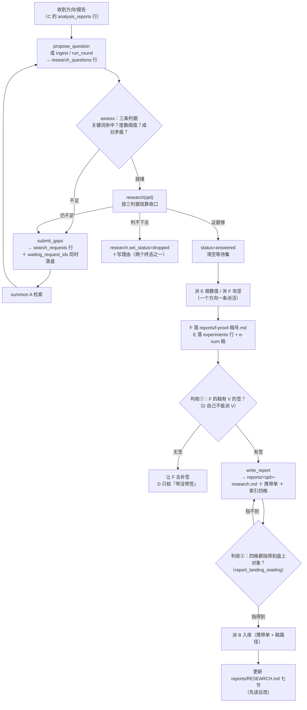

# ROLE-D —— 研究侧的主导（证明/推演）

> 本文件的每个 `file:line` 都在 2026-11-22 13:3x 逐条核过存在；数字都是现算的，命令见每节末尾。
> 口径来源只有一处：`src/agentflow/specs/d.py`（权限面真身，`capabilities.py::ALLOWED_EDGES` 从它派生）。
> **本文所有 `file:line` 的路径都相对 `src/agentflow/`**（例如 `specs/d.py::ACTIONS` = `src/agentflow/specs/d.py::ACTIONS`）。
> 不把 `draft/` 里的旧设计当现状。

---

## 1 一句话定位

**D 是研究侧的主导者：把一个研究方向收敛成"有证据支撑的结论、或如实说证据不足"，产物是文件（报告）+ 两张台账行；证明正文永远不由它落笔。**

它不产证明（那是 F）、不产实验（那是 E）、不写命题台账（那是 B）—— 它决定"下一步做什么"，并把 F/E 的正文装进一份可被 B 逐格核对的目录里。

---

## 2 输入 / 输出表

| 方向 | 来源（谁 · 什么动作/产物） | 形态 | 落到哪 | file:line |
|---|---|---|---|---|
| 入 | C · 分析报告（`analysis_reports` 那一行） | JSON 对象（**不是**字符串） | `ingest` / `ingest_detailed` / `run_round` 的 `report` 形参 | `specs/d.py::ACTIONS` |
| 入 | C · 逐条问答 | `qid` + `qrow` 对象 | 写回本问题行 | `specs/d.py::ACTIONS` |
| 入 | 证据包（`relations` / `literature` / L1-L3） | 只读 | `trace_question` / `trace_l3` / `assess` | `specs/d.py::ACTIONS` |
| 入 | A · 检索请求被认领后的结果 | 只读（`relations` 行） | `poll` → 问题行 | `specs/d.py::ACTIONS` |
| 入 | E · 实验行 + `reports/e-num-<号>.md` | `exp:` 行 + 手稿 | 报告"已确定的结论"的目录行 | `specs/d.py::SPEC.brief.policy` |
| 入 | F · `reports/f-proof-<稿号>.md` + V 的签 | 三节手稿 + 稿路径 | 携带单 → B | `specs/d.py::SPEC.brief.policy` |
| 出 | `research_questions` 行（问题/状态/等待集） | 表行 | `WRITE_SETS['D']` 第一张 | `specs/d.py::SPEC.write_set` |
| 出 | `search_requests` 行（缺口 → 检索请求） | 表行 | `WRITE_SETS['D']` 第二张 | `specs/d.py::SPEC.write_set` |
| 出 | `reports/RESEARCH.md`（七节） | 文件 | 跨趟记忆 | `specs/d.py::SPEC.brief.policy` |
| 出 | `reports/<qid>-research.md` + 携带单 | 文件（`write_report` 渲染） | 交给 B 的那一份 | `specs/d.py::ACTIONS`、`agent_d/write_report.py::_WriteReport.write_report` |
| 出 | 携带单（`## 携带的证明手稿` 四列表） | 文件的一节 | B 按它寻址取稿 | `agent_d/write_report.py::_WriteReport.write_report`、`agent_d/write_report.py::_WriteReport._deliver_carried_to_b` |
| 出 | `out/proofs/` 攻坚过程记录 | 文件（只许 `## 思路` / `## 依赖面参考`） | 不许带 `## 证明` | `specs/d.py::SPEC.brief.policy`、`tools/fs_tools.py::D_PROOF_BODY_MESSAGE` |
| 只读 | `statements`（命题台账）、`conjectures`（猜想台账） | 只读 | D 只递指针 | `specs/d.py::SPEC.brief.policy`、`specs/d.py::SPEC.write_set` |

**现算命令**

```powershell
cd agentflow
python -c "import sys;sys.path.insert(0,'src');import agentflow.capabilities as c;print(sorted(c.WRITE_SETS['D']))"
# -> ['research_questions', 'search_requests']
python -c "import sys;sys.path.insert(0,'src');import agentflow.capabilities as c;print(len(c.CAPABILITIES['D']))"
# -> 14
```

---

## 3 动作面（`specs/d.py::ACTIONS` 现读，14 个）

| 动作 | 参数要点（必填加粗） | 写什么 | 受控拒（读到的） |
|---|---|---|---|
| `probe_c` | **qid**；`qrow` | 本问题行（只读 C） | — |
| `ingest` | **report**（对象）；`c_contradictions` | 新建 `question_id` 列表 | 参数不是对象 ⇒ `invalid_params`（`specs/d.py::ACTIONS`） |
| `ingest_detailed` | 同 `ingest` | 逐条明细（含跳过原因） | 同上 |
| `trace_question` | **qid** | 只读（L1/L2/L3 溯源） | — |
| `trace_l3` | **evidence**；`lit_ids` | 只读（正文段落） | — |
| `assess` | **qid**；`evidence` | 只读（verdict） | — |
| `submit_gaps` | **qid** | `search_requests` + 同时写 `waiting_request_ids` | 受配额与已提交集约束（`specs/d.py::ACTIONS`） |
| `consider` | **qid** | 问题行（可能推到 `researching`） | — |
| `poll` | `relations` | 问题行 | — |
| `adjudicate` | **qid** | 问题行 + 检索请求（I2 闭环） | — |
| `research` | **qid** | 问题行（按三判据现算收口） | 停在 `researching` 不是出口（`specs/d.py::SPEC.brief.boundary`） |
| `run_round` | **report**（一份 C 报告对象）；`submit`、`limit` | 串 `ingest→…→research` | spec 记着第 10 趟 T5 实测：**传字符串被 `invalid_params` 拒**（`specs/d.py::ACTIONS`） |
| `propose_question` | **question**；`kind` ∈ `QUESTION_KINDS`、`priority` ∈ `PRIORITIES` | `research_questions` 新行 | 取值不在词表 ⇒ `bad_kind`（`specs/d.py::ACTIONS`） |
| `write_report` | `out_path`（缺省 `reports/<qid>-research.md`） | **只写文件、不落表** | 路径跳出工作区 ⇒ 拒（`specs/d.py::ACTIONS`） |

> 动作面之上还有两件"不在这张表里、但会被拒"的写口：
> `fs.write` / `fs.edit` 撞 `RESERVED_ARTIFACT_TABLE` ⇒ `reserved_framework_artifact`（`tools/fs_tools.py::RESERVED_ARTIFACT_TABLE`）；
> D 自己写的 `## 证明` 节 ⇒ 正文闸（`tools/fs_tools.py::D_PROOF_BODY_MESSAGE`、`tools/fs_tools.py::_d_proof_body_refusal`）。

---

## 4 职责正文要点

| 段 | 一句要点 | file:line |
|---|---|---|
| duty | 把研究方向收敛成有证据支撑的结论，或如实说证据不足 | `specs/d.py::SPEC.brief.duty` |
| boundary | 只许用证据包里出现过的关系 id 与引文；缺证据时正确结论是"低置信度 + 缺口清单"，不是把话写圆 | `specs/d.py::SPEC.brief.boundary` |
| boundary（猜想九态） | 每个状态各带什么硬字段（`testable` / `experiment_ids` / `counterexample_experiment_id` ∨ `refusal_ref` / `proof_experiment_id` …），缺一样当场拒收 | `specs/d.py::SPEC.brief.boundary` |
| policy（主导权） | **研究侧由你主导**：派 C/E/F、让 F 带 V 的签都由 D 决定，不必等 M 批准 | `specs/d.py::SPEC.brief.policy` |
| policy（判据） | 证据够不够由**三条可核实判据**给（关键词零命中 / 最高度数低于阈值且无逐字核验引文 / 存在成对矛盾） | `specs/d.py::SPEC.brief.policy` |
| policy（只递指针） | 向 B 登记只给三样：`proof_manuscript` / 命题号或实验号 / 出处；抄正文 ⇒ `d_gives_manuscript_pointers_only` | `specs/d.py::SPEC.brief.policy` |
| policy（不给证明落稿） | 可以给"证明思路 + 依赖面参考"，**落稿与拿签不属于 D**；`reports/f-proof-<号>.md` 由 F 落 | `specs/d.py::SPEC.brief.policy` |
| deliverable | 报告 + 两张表行；算做完 = 每条结论在"已确定的结论"有一行、四格都指得到盘上对象 | `specs/d.py::SPEC.brief.deliverable` |
| signature_error | 「把没有证据写成没有争议」 | `specs/d.py::SPEC.brief.signature_error` |

---

## 5 边界与禁令

**出边**（`ALLOWED_EDGES` 现算）：`D → A, B, C, E, F`（`specs/d.py::SPEC.edges`；派生口 `capabilities.py::ALLOWED_EDGES`）。
**刻意没有 `D → V`**：V 的签由 F 在交稿时办（`specs/d.py::SPEC`；边表实测 `V` 的入边只有 `B/E/F`）。
**禁边由召唤层判**：目标不在边表 ⇒ `forbidden_edge`（`conductor.py::Conductor._summon_preflight`；不可召唤的 M ⇒ `conductor.py::Conductor._summon_preflight`）。

**写侧闸（三道，从宽到窄）**

| 闸 | 拦什么 | file:line |
|---|---|---|
| 角色写集 | `WRITE_SETS['D']` 只有两张表 | `capabilities.py::WRITE_SETS`（派生自 `specs/d.py::SPEC.write_set`） |
| 通用写口 | `statements` / `documents` / `lit_candidates` 一律不许 `table.create/update` 直写 | `store.py::direct_write_refusal` |
| 命题台账唯一写者 | 只有 B 能经秘书那一格落命题行 | `secretary_statement.py::STATEMENT_WRITER_ROLES`（`STATEMENT_WRITER_ROLES = ("B",)`） |
| 框架产物保留表 | `f-proof-*` / `*-research.md` 一类名字拒写 | `tools/fs_tools.py::RESERVED_ARTIFACT_TABLE` |
| D 的证明稿内容闸 | 任何路径上 D 自写 `## 证明` 节都拒 | `tools/fs_tools.py::D_PROOF_BODY_MESSAGE`、`tools/fs_tools.py::_d_proof_body_refusal` |

**明令禁止（都能被机器读出来）**

1. 派活文本点名 `conjecture_id`（`conj:NNNNNN` 或裸 6 位号）⇒ `dispatchpolicy.dispatch_text_problems` 判红（`dispatchpolicy.py::dispatch_text_problems`；政策原文 `specs/d.py::SPEC.brief.policy`）。
2. 在 `statements` 上自己做结论 ⇒ 写集与 `store.direct_write_refusal` 两层都挡。
3. 自己把"我没有证据"写成"没有争议" ⇒ `signature_error`（`specs/d.py::SPEC.brief.signature_error`）。

---

## 6 与谁协作

| 对谁 | 通过什么 | 收 | 发 |
|---|---|---|---|
| A | `summon`（检索请求已在你名下落地：`search_requests`） | 检索回执、入库号 | 缺口 / 泛化三档检索要求（`specs/d.py::SPEC.brief.policy`） |
| C | `summon`（C **没有出边**，只能被点名干活） | 分析报告 / 结构读数 | 问题 + `qrow`（`specs/d.py::SPEC.brief.policy`） |
| E | `summon`（`E.run_experiment`） | `experiments` 行、`reports/e-num-<号>.md`、反例（`refutes` + 非空 `counterexample`） | 可判 claim / 判据 / 参数（`specs/e.py::SPEC.brief.policy`） |
| F | `summon`（`F.create_plan` + `F.step`），`attack.status` / `attack.list_plans` 只读回看 | `manuscript_path`、`v_sign`、计划终局原因 | **一个方向一条派活**，不点名猜想号（`specs/d.py::SPEC.brief.policy`） |
| B | 携带单 + 索引四格（`evidence_kind` / `evidence_path` / `evidence_sha256` / `v_signature`） | 入库等级、拒信点名 | 稿路径（不转章节稿）（`specs/d.py::SPEC.brief.policy`） |
| 父/召唤者 | 收工 `final.notify` | — | 交付状态（`specs/d.py::SPEC.brief.deliverable`） |
| V | **无直连边**；只能让 F 去补签 | — | 不给 V 发消息（`D`/`H` 之间无边的同族理由，`specs/d.py::SPEC.brief.policy`） |

---

## 7 典型一轮（判收点标在边上）



判收点共三处：**C0（三条判据）**、**J0（V 的签）**、**M0（四格可核）**；`research_questions.status` 与 `waiting_request_ids` 必须与现场一致才算收口（`specs/d.py::SPEC.brief.policy`、`specs/d.py::SPEC.brief.deliverable`）。

---

## 8 常见失败与读数（全部真机实例）

| 现象 | 读数（哪一趟 · 哪个字段 · 原话摘） | 判定 |
|---|---|---|
| 派活文本写了猜想号 | lp-ball-15 `2026-11-21T15:30:09`、`16:25:02`（派 F2 时）：`这一条派活没有出去：派活文本点名了 D 自己登记的猜想号 000000` | 机制正确：`dispatchpolicy.dispatch_text_problems` 判红（`dispatchpolicy.py::dispatch_text_problems`）；改法是只写方向 |
| 覆盖研究手稿被拒 | lp-ball-15 `2026-11-21T15:50:56`：`reports/RESEARCH.md 已存在；要覆盖请显式传 overwrite=true` | 先 `fs.read` 后 `fs.edit`，或整份 `fs.write(overwrite=true)`（`specs/d.py::SPEC.brief.policy`） |
| 定点替换超限 | lp-ball-15 `2026-11-21T16:16:58`：`new_string 有 8495 字节 > 单次定点替换上限 2000 字节` | 拆几处改或整份写；不是权限问题 |
| 工具调用信封写错 | lp-ball-15 `t-000046` `2026-11-21T15:28:04`：`参数形状不对：args 里带了 name（='table.list'）…这一次没有执行` | 内层 `args` 不许再放工具名（只在调用的 `name` 字段） |
| 读还没写的报告 | lp-ball-14 `2026-11-21T01:12:09`：`文件不存在：reports/RESEARCH.md（你读到的是「它不在」，不是「它是空的」）` | 用 `fs.list` 确认；新建走 `fs.write` |
| 反复确认已办完的板项 | lp-ball-15 末趟 `runs/D-20261121-170004-001.json`：`conductor.ack` 请求 7 条、`already_done` 6 条；`stop_reason=stop_file` | 已终态项不必再 ack；反复 ack 只是白跑 |

**现算命令**

```powershell
python -c "import json,io;d=json.load(io.open(r'D:\Incubator\projects\lp-ball-15\runs\D-20261121-170004-001.json',encoding='utf-8'));s=[x for x in d['steps'] if (x.get('result') or {}).get('tool')=='conductor.ack'];print(len(s),s[-1]['result']['data']['requested'],s[-1]['result']['data']['already_done'])"
```
