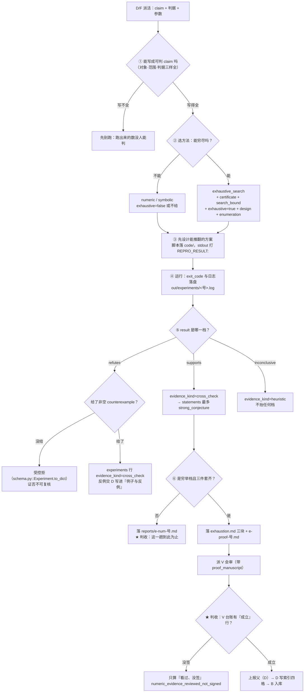

# ROLE-E —— 数值实验与反例

> 每个 `file:line` 在 2026-11-22 13:3x 逐条核过；数字现算，命令见节末。
> 口径真身：`src/agentflow/specs/e.py`（`capabilities.py::ALLOWED_EDGES` 从它派生边表）。
> **所有 `file:line` 的路径相对 `src/agentflow/`**（例如 `specs/e.py::ACTIONS` = `src/agentflow/specs/e.py::ACTIONS`）。

---

## 1 一句话定位

**E 把一条断言变成可复现的实验或反例：脚本自己说结论（`REPRO_RESULT:`），读数由代码判、登记成 `experiments` 一行；它产出的"证明级"只可能是穷举档，且那一档的签由 V 盖。**

---

## 2 输入 / 输出表

| 方向 | 来源（谁 · 什么动作/产物） | 形态 | 落到哪 | file:line |
|---|---|---|---|---|
| 入 | D/F 派的活：可判 claim + 判据（`criterion` / `params` / `expected_bound`） | 文本 + 参数对象 | `run_experiment` 的 `claim` / `params` | `specs/e.py::ACTIONS`、`specs/e.py::SPEC.brief.policy` |
| 入 | 盘上的实验脚本 | 工作区内相对路径 | `run_experiment.script_path`（必须已存在） | `specs/e.py::ACTIONS`、`specs/e.py::SPEC.brief.policy` |
| 入 | 上一轮的实验行 / 界 | 只读 | `evidence_for` / `list_experiments` | `specs/e.py::ACTIONS` |
| 出 | `experiments` 行（`result` / `exit_code` / `code_hash` / `observations`） | 表行 | `WRITE_SETS['E']` | `specs/e.py::SPEC.write_set` |
| 出 | `conjectures` 行（"我提出过这条命题"） | 表行 | 同事务里落 | `specs/e.py::SPEC.write_set` |
| 出 | 脚本原样输出 | `out/experiments/<实验号>.log` | 文件 | `specs/e.py::SPEC.brief.policy` |
| 出 | 穷举三块 + 签名 | `out/experiments/<实验号>/exhaustion.md` | 文件 | `specs/e.py::SPEC.brief.policy` |
| 出 | 普通数值手稿（**不过 V**） | `reports/e-num-<E稿号>.md`（`## 命题` + `## 数值结果`） | 文件 | `specs/e.py::SPEC.brief.policy`、`exhaustionreport.py::land_numeric_manuscript` |
| 出 | 穷举手稿（**要 V 签**） | `reports/e-proof-<E稿号>.md`（三节：`## 命题`/`## 证明`/`## 依赖`） | 文件 | `specs/e.py::SPEC.brief.policy`、`exhaustionreport.py::MANUSCRIPT_PREFIX`、`exhaustionreport.py::land_manuscript` |
| 上报 | 拿到签之后**报父**（父是 D 就报 D），不自己去入库 | 回执（程序路径 + ②③ + V 的签） | 父的收件箱 | `specs/e.py::SPEC.brief.policy` |

**现算命令**

```powershell
cd agentflow
python -c "import sys;sys.path.insert(0,'src');import agentflow.capabilities as c;print(sorted(c.WRITE_SETS['E']),len(c.CAPABILITIES['E']))"
# -> ['conjectures', 'experiments'] 4
```

---

## 3 动作面（`specs/e.py::ACTIONS` 现读，4 个）

| 动作 | 参数要点（必填加粗） | 写什么 | 受控拒（读到的） |
|---|---|---|---|
| `run_experiment` | **claim** / **claim_key** / **script_path**；`method` ∈ `COMPUTATIONAL_METHODS`（numeric / symbolic / exhaustive_search）；`params`、`timeout`、`for_question_id`、`certificate`、`search_bound`、`design`、`enumeration`、`exhaustive`、`search_space`、`kind`、`sleep` | `experiments` 行 + 日志 + 两族手稿（按档） | `formal` ⇒ `formal_not_in_e`；`refutes` 无反例 ⇒ 拒（`schema.py::Experiment.to_dict`）；穷举缺三件套 ⇒ 只落 `cross_check`（`specs/e.py::ACTIONS`） |
| `evidence_for` | `claim_key`、`for_question_id` | 只读（**必须带 `checked` 位**的三态） | — |
| `list_experiments` | `claim_key`、`limit` | 只读（默认只回**本实例**的行） | `row_not_yours`（改/删别人行时） |
| `run_script_experiment` | **claim** / **claim_key** / **script_path** | 同 `run_experiment` 的便捷封装 | 缺 `script_path` ⇒ `param_error`（真机见 §8） |

> `method` 的枚举是 `experiment_methods.COMPUTATIONAL_METHODS`（`experiment_methods.py::COMPUTATIONAL_METHODS`），**不是** `schema.EXPERIMENT_METHODS` 全表 —— `formal` 仍留在 schema 里给 L 用，但 E 第一句就拒它（`specs/e.py::COMPUTATIONAL_METHODS`、`agent_e/_support.py::COMPUTATIONAL_METHODS`）。

---

## 4 职责正文要点

| 段 | 一句要点 | file:line |
|---|---|---|
| duty | 数值实验：把一条断言变成可复现的实验或反例 | `specs/e.py::SPEC.brief.duty` |
| boundary | 判读必须确定性（数字由代码判）；脚本自报 `proof` 一律按凭据降级；跑不过如实落 `failed`/`unknown` | `specs/e.py::SPEC.brief.boundary` |
| policy（方法学） | 先写成可判 claim → 选方法并说清为什么够 → 反例优先 → 脚本先说结论 → 读结果并登记 | `specs/e.py::SPEC.brief.policy` |
| policy（脚本协议） | stdout 一行 `REPRO_RESULT: {…}`；`refutes` 必须带非空 `counterexample` | `specs/e.py::SPEC.brief.policy` |
| policy（两样原话） | 每条实验必须留 `exit_code`（没跑成是 `None`，不许拿 0 冒充）与脚本原样输出 | `specs/e.py::SPEC.brief.policy` |
| policy（穷举协议） | 跑前报三件套（搜索空间 / 穷尽判据 `exhaustive=true` / 边界处理）；②③ 只写在 `exhaustion.md`；跑完立刻派 V | `specs/e.py::SPEC.brief.policy` |
| policy（反例唯一落法） | `result=refutes` + 非空 `counterexample`；只写进 `certificate` 不算法 | `specs/e.py::SPEC.brief.policy` |
| deliverable | `experiments` 行 + 日志 + 两族手稿；算做完 = 每条断言有 `result` 且 `exit_code` 为真实值，穷举三件套齐且 V 的签读到 | `specs/e.py::SPEC.brief.deliverable` |
| signature_error | 「把跑不过的代码块当成通过」 | `specs/e.py::SPEC.brief.signature_error` |

---

## 5 边界与禁令

**出边**：`E → B, D, V`（`specs/e.py::SPEC.edges`；实测 `ALLOWED_EDGES`）。
`E → V` 是**单向**且必须存在：穷举档的 ②③ 是 E 写的，唯一判定者是 V，隔一次 M 转发就多一处"谁该看什么"的猜测（`specs/e.py::SPEC.edges`）。

**写侧闸**

| 闸 | 内容 | file:line |
|---|---|---|
| 写集 | 只有 `experiments` / `conjectures` | `specs/e.py::SPEC.write_set` |
| 作用域 | 改/删别人的实验行 ⇒ `row_not_yours`；`list_experiments` 默认只回本实例 | `specs/e.py::SPEC.brief.policy` |
| 证据等级 | 计算类要 `proof` 必须过 `numericproof.exhaustion_problems`（搜索空间 / 布尔 `exhaustive` / 覆盖说明 / 程序相对路径） | `schema.py::Experiment.validate`、`numericproof.py::exhaustion_problems` |
| 签名 | 计算类 proof 行必须带 `signed_by=V`、`proof_authors` 含 E、`proof_reason=exhaustion` | `schema.py::Experiment.validate`、`numericproof.py::is_signed_exhaustion` |
| 落盘 | ②③ 必须落成盘上可核的读数（`out/experiments/<号>/exhaustion.md` 三块齐） | `numericproof.py::report_problems`、`schema.py::Experiment.validate` |
| 入库 | B 那一侧还要核 V 的会审签与索引四格 | `numericproof.py::filing_problems`、`numericproof.py::resolve_index` |

**禁令**：不许自己把等级报到 `theorem`、不许为"补证据"造一个反例、不许把 `refutes` 写成没有反例的证否、不许替 B 入库（`specs/e.py::SPEC.brief.policy`）。

---

## 6 与谁协作

| 对谁 | 通过什么 | 收 | 发 |
|---|---|---|---|
| D（父） | 回执 / `final` | 可判 claim、判据、参数 | 实验行 + 两族手稿 + V 的签（`specs/e.py::SPEC.brief.policy`） |
| F | 直接边（`F → E` 通） | 要证的子目标 / 该证否的具体断言 | 实验结果与反例（`specs/e.py::SPEC.edges`） |
| V | `summon`（`role="V"`，穷举档**必须**带 `proof_manuscript`） | 两态判词（成立 / 有毛病） | 穷举手稿 + ②③ + 只读读数（`specs/e.py::SPEC.brief.policy`） |
| B | 直接边（只作"文献侧内容"的活；E 不派 B 入库自己的实验） | 收录等级 | — |

---

## 7 典型一轮（判收点标出）



判收点：**⑤（结果三档 + 反例）**、**⑥/★（穷举三件套）**、**Q（V 的签）**。三者都过，这一条才可能进 `theorem`；少一样就停在 `cross_check`。

---

## 8 常见失败与读数（全部真机实例）

| 现象 | 读数 | 判定 |
|---|---|---|
| 证否没给反例 | lp-ball-14 `2026-11-21T01:24:32`（×2）：`脚本给出 result='refutes' 却没有给出非空的 counterexample ⇒ 证否必须可复核（拒绝登记）` | 拒在**跑完判读**那一层；改脚本让 `REPRO_RESULT` 带 `counterexample`（`schema.py::Experiment.to_dict`） |
| 参数在跑之前就不合格 | lp-ball-15 `2026-11-21T15:49:30`：`for_question_id 必须是 6 位十进制字符串…收到 ''（R-01：一分钟都不该花）` | 记 `failed` 不是 `refutes`；先修参数 |
| 漏必填 `script_path` | lp-ball-15 `2026-11-21T15:52:10`：`缺少必填参数：script_path` | 脚本要先落盘（`specs/e.py::SPEC.brief.policy`） |
| 给有效实验行补撤销痕迹 | lp-ball-14 `2026-11-21T01:33:55`（×5）：`有效（status='active'）的实验行不许带撤销留痕：['voided_by','void_reason']` | 撤销是一整笔，不许半截（`schema.py::Experiment.validate`） |
| 实验行里找 `exp_id` | lp-ball-15 `2026-11-21T15:38:17`：`experiments 没有字段 ['exp_id']` | 投影字段要用真名（`experiment_id`） |
| 反例被当成支撑引 | lp-ball-15 `2026-11-21T15:58:32`（G 侧）：`这条断言引了 000004 当支撑，而 000004 自己的结论是 result='refutes'` | 反例不能当支撑引（下游 G 的闸先抓到） |

**现算命令**（验 §8 的读数）

```powershell
python -c "import json,io,collections;d=json.load(io.open(r'D:\Incubator\projects\lp-ball-15\data\experiments.json',encoding='utf-8'));r=d['rows'];print(len(r),collections.Counter(x['method'] for x in r),collections.Counter(x['result'] for x in r),collections.Counter(x['evidence_kind'] for x in r))"
# -> 9 Counter({'numeric': 9}) Counter({'supports': 3, 'inconclusive': 3, 'refutes': 3}) Counter({'cross_check': 6, 'heuristic': 3})
```
