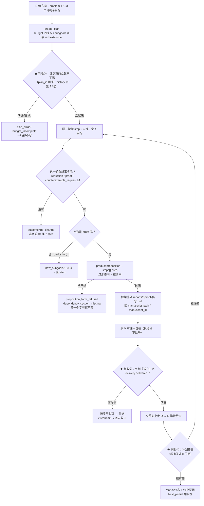

# ROLE-F —— 攻坚：把一道难题拆成可判步骤

> 每个 `file:line` 在 2026-11-22 13:3x 逐条核过；数字现算，命令见节末。
> 口径真身：`src/agentflow/specs/f.py`。
> **所有 `file:line` 的路径相对 `src/agentflow/`**（例如 `specs/f.py::ACTIONS` = `src/agentflow/specs/f.py::ACTIONS`）。

---

## 1 一句话定位

**F 在预算内一轮一轮把难题逼近平息或反例：立项（`create_plan`）只是摆上台面，推进是 `step`；它产出的证明落成三节手稿、必须拿到 V 的签才算交差。**

---

## 2 输入 / 输出表

| 方向 | 来源（谁 · 什么动作/产物） | 形态 | 落到哪 | file:line |
|---|---|---|---|---|
| 入 | D 的一个研究方向（`problem` + 1–3 个可判子目标） | 文本 + `{sid,text,owner}` | `create_plan` 的参数 | `specs/f.py::ACTIONS`、`specs/d.py::SPEC.brief.policy` |
| 入 | 台账里在册的 `stmt:`（可引池） | 只读 | 写证明前的"依赖面" | `specs/f.py::SPEC.brief.policy` |
| 入 | E 的实验读数 / A 的文献号 / V 的判词 | 回执 | 下一轮往哪打 | `specs/f.py::SPEC.brief.policy` |
| 出 | `attack_plans` 行（`status` / `subgoals` / `history` / `best_partial`） | 表行 | `WRITE_SETS['F']` | `specs/f.py::SPEC.write_set` |
| 出 | `reports/attack-<plan_id>.md`（阶段性推进台账） | 文件 | 一条一行（状态 / 依据 / 下一步） | `specs/f.py::SPEC.brief.policy` |
| 出 | `reports/f-proof-<稿号>.md`（`## 命题` / `## 证明` / `## 依赖`） | 文件（框架渲染，不手写） | 交付物 | `specs/f.py::SPEC.brief.policy`、`manuscriptform.py::render_proof_manuscript` |
| 出 | `reprocess_requests` / `search_requests` 行 | 表行 | 写集里 | `specs/f.py::SPEC.write_set` |
| 出 | `conjectures` 行（"我提出过这条"） | 表行 | 开稿那一刻 | `specs/f.py::SPEC.write_set` |
| 上报 | 稿路径 + `v_sign` 向上交给 **D**（不是向下派 B） | 回执 | D 携带 → B | `specs/f.py::SPEC.edges`、`specs/f.py::SPEC.brief.deliverable` |

**现算命令**

```powershell
cd agentflow
python -c "import sys;sys.path.insert(0,'src');import agentflow.capabilities as c;print(sorted(c.WRITE_SETS['F']),sorted(c.ALLOWED_EDGES['F']),len(c.CAPABILITIES['F']))"
# -> ['attack_plans','conjectures','reprocess_requests','search_requests'] ['A','C','D','E','V'] 5
```

---

## 3 动作面（`specs/f.py::ACTIONS` 现读，5 个）

| 动作 | 参数要点（必填加粗） | 写什么 | 受控拒（读到的） |
|---|---|---|---|
| `create_plan` | **problem** / **problem_key**；`for_question_id`、`subgoals`、`budget`（四类键缺一不可）、`depth`、`parent_plan_id` | `attack_plans` 新行 | 预算缺键 ⇒ `budget_incomplete`（`specs/f.py::SPEC.brief.boundary`、`schema.py::AttackPlan.to_dict`）；子目标缺 `sid` ⇒ `plan_error`（真机见 §8） |
| `step` | **plan_id**；`product`（按 `attackround.HANDED_PRODUCT_SCHEMA`：`kind=proof`/`reduction`） | 计划行 + 手稿（过闸才落） | 形态闸 ⇒ `proposition_form_refused`（`specs/f.py::SPEC.brief.policy`）；已签稿就地改 ⇒ `manuscript_frozen`（`specs/f.py::SPEC.brief.policy`）；引不在册号 ⇒ `dependency_source_not_registered`（`specs/f.py::SPEC.brief.policy`） |
| `status` | **plan_id** | 只读（计划视图 + `delivery` 逐条交差读数） | 非属主 ⇒ `plan_error` / `plan_not_yours`（真机见 §8） |
| `list_plans` | `problem_key`、`include_terminal` | 只读 | — |
| `abandon_plan` | **plan_id** / **reason**（三档：`math_error` / `difficulty` / 「不再需要」）；`basis`、`difficulty`、`salvaged` | 计划行 `status=abandoned` + `history` 一行 | 已终态再放弃 ⇒ 拒；理由空 / `difficulty` 不真 ⇒ `abandon_reason_missing` / `abandon_difficulty_not_genuine`（`specs/f.py::ACTIONS`、`specs/d.py::SPEC.brief.policy`） |

> `subgoals` 每一项是 `{sid, text, owner}`，`owner` ∈ `SUBGOAL_OWNERS`（写错会让子目标派给不存在的人，`schema.py::SUBGOAL_OWNERS`）；`closed` 必须有 `proof_experiment_ids`（FC-22，`schema.py::SUBGOAL_OWNERS`）；`blocked` 必须有 `blocked_reason`（`schema.py::SUBGOAL_OWNERS`）。

---

## 4 职责正文要点

| 段 | 一句要点 | file:line |
|---|---|---|
| duty | 多轮难题攻坚：在预算内一轮一轮逼近平息或反例，并如实报告进展 | `specs/f.py::SPEC.brief.duty` |
| boundary | 终止条件是预算与轮次、不是感觉；不许把没推进写成已完成；不许自己改结论 | `specs/f.py::SPEC.brief.boundary` |
| boundary（关门由稿决定） | `stalled`/`resolved`/`supported_not_proved` 只在稿已拿到 V 签（或它没有要签的稿）时出现；未完工的计划不关 | `specs/f.py::ACTIONS`、`specs/f.py::SPEC.brief.policy` |
| policy（方法学） | 命题化 → 拆子目标（一个子目标只判一件事）→ 一轮一步 → 写成 V 能逐行审的三节稿 → 登记与交回 | `specs/f.py::SPEC.brief.policy` |
| policy（派 V） | 证明写完**由 F 自己派 V**，`task` 只点 `F.step` 返回的 `manuscript_path`；不许点论文章节稿 | `specs/f.py::SPEC.brief.policy` |
| policy（依赖面） | `## 依赖` 不手写：只交每步的 `cites`，框架按它渲染三列表；引用门槛 `pre_theorem` 及以上 | `specs/f.py::SPEC.brief.policy` |
| policy（交稿方向） | 交稿**向上走 D**（`F → D`），不向下派 B；`F → B` 那条边 2026-11-07 已裁掉 | `specs/f.py::SPEC.edges`、`specs/f.py::SPEC.brief.policy` |
| deliverable | 每个计划有终局 `status` 与终止原因；交出去的每份稿 `v_sign=已签`（没签不算交差） | `specs/f.py::SPEC.brief.deliverable` |
| signature_error | 「把无变化写成有进展」 | `specs/f.py::SPEC.brief.signature_error` |

---

## 5 边界与禁令

**出边**：`F → A, C, D, E, V`（`specs/f.py::SPEC.edges`；实测 `ALLOWED_EDGES['F']`）。
**刻意没有** `F → B`（交稿不许向下派，`specs/f.py::SPEC.edges`）与 `F → L`（形式化只走 B 的 `PROOF_CHANNEL`，`specs/f.py::SPEC.edges`）。

**写侧闸**

| 闸 | 内容 | file:line |
|---|---|---|
| 写集 | `attack_plans` / `reprocess_requests` / `search_requests` / `conjectures`；**`dependencies` 与 `statements` 都不在** | `specs/f.py::SPEC.write_set` |
| 手稿写口 | `reports/f-proof-*` 由框架渲染；F 手写撞保留表 ⇒ `reserved_framework_artifact` | `tools/fs_tools.py::RESERVED_ARTIFACT_TABLE`、`specs/f.py::SPEC.brief.policy` |
| 计划归属 | 计划归立它的那个 F 实例，非属主读/推都拒（K3） | `agent_f/core.py::_Core._require_own_plan`、`agent_f/status.py::_Status.status`、`schema.py::AttackPlan`（`created_by`） |
| 预算 | 四类键缺一 ⇒ 拒创建、一行不写（FC-18） | `schema.py::AttackPlan.to_dict`、`agent_f/create_plan.py::_CreatePlan.create_plan` |
| 子目标关闭 | 只有 proof 级证据（`proof_experiment_ids`）才能 `closed`；数值支持只能 `supported_not_proved` | `schema.py::Document`、`specs/f.py::SPEC.brief.boundary` |

**禁令**：不许把没推进写成已完成（`signature_error`）；不许拿"再建一份计划"代替推进（同 `problem_key` 会命中既有计划原样返回，`specs/f.py::SPEC.brief.policy`）；不许自己把命题拆成多条来凑路径（`specs/f.py::SPEC.brief.policy`）。

---

## 6 与谁协作

| 对谁 | 通过什么 | 收 | 发 |
|---|---|---|---|
| D（父） | 收工 `final` + `message` | 研究方向与约束 | 每轮成果/卡点、稿路径、`v_sign`（`specs/f.py::SPEC.brief.policy`、`specs/f.py::SPEC.brief.deliverable`） |
| V | `summon`（只有 F 能派 V 审自己的证明稿） | 两态判词（成立 / 有毛病，指到步号） | `proof_manuscript` + `readonly_facts`（`specs/f.py::SPEC.brief.policy`） |
| E | 直接边 | 反例、数值读数 | 要证否的具体断言（`specs/f.py::SPEC.brief.stance`） |
| A | 直接边（可引池 0 条时**直接派 A 补库**） | 新入库号 | "要什么样的命题 / 拿它推哪一步"（`specs/f.py::SPEC.brief.policy`） |
| C | 直接边 | 结构读数 | 命题的结构定位 |
| B | **没有出边**（受控拒 `f_proposition_must_be_a_manuscript` 是第二道防线） | — | 稿经 D 携带 |

---

## 7 典型一轮（判收点标出）



判收点：**①计划真的立起来**、**②V 的签 + `delivery.delivered`**、**③稿决定计划能否关**。三处任一不过，这一轮都不算推进（`specs/f.py::SPEC.brief.policy`、`specs/f.py::ACTIONS`）。

---

## 8 常见失败与读数（全部真机实例）

| 现象 | 读数 | 判定 |
|---|---|---|
| 子目标没给 `sid` | lp-ball-15 `t-000060` `2026-11-21T15:36:20`（同类共 4 次）：`攻坚计划被拒绝：subgoals[0] 缺少 sid **这一个子目标还缺**：sid、text、owner` | `plan_error`；一次给齐三个键（`schema.py::Document.claims`） |
| 查看别人的计划 | lp-ball-15 `t-000071` `2026-11-21T15:53:47`：`拒绝查看（plan_not_yours）：计划 '000000' 不属于你 —— created_by='agent-F-F1'，你是 'agent-F-f-sec3d'` | 计划按**实例**归属；建议交回属主或父 D（K3） |
| `step` 传了未声明键 | lp-ball-15 `2026-11-21T15:55:49`：`出现未声明的参数：['self_assessment']（schema 只允许 ['plan_id','product']）` | `self_assessment` 属于返回值、不是入参 |
| 字段名猜错 | lp-ball-15 `2026-11-21T15:38:17`：`experiments 没有字段 ['exp_id']` | 用 `experiment_id`；投影前先看真名 |
| 预算耗尽而计划没关 | lp-ball-15 `2026-11-21T16:47:10` F 的 `step` 返回：`"budget_left": {"max_rounds_left": 0, …}`，同一计划仍 `status=attacking` | 正常形态：**未完工的计划不关**（`specs/f.py::ACTIONS`）；要收场只能 `abandon_plan` |
| 把命题直接交 B | lp-ball-15 里 F 若直派 B：受控拒 `f_proposition_must_be_a_manuscript`（`specs/f.py::SPEC.edges` 的第二道防线） | 交稿只有一条路：稿经 D 携带 |

**现算命令**（验"3 条计划 / 16 轮 progress / 每份稿一稿一号"）

```powershell
python -c "import json,io,collections;d=json.load(io.open(r'D:\Incubator\projects\lp-ball-15\data\attack_plans.json',encoding='utf-8'));r=d['rows'];print(len(r));[print(x['plan_id'],x['status'],x['rounds'],collections.Counter(h['outcome'] for h in x['history'])) for x in r]"
# -> 3 / 000000 stalled 8 {'no_change':3,'progress':6} / 000001 attacking 8 {'no_change':2,'progress':6} / 000002 attacking 4 {'no_change':1,'progress':4}
```
