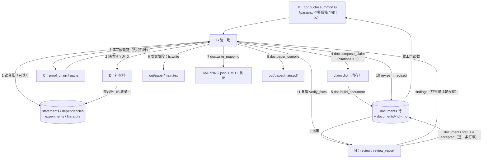

# ROLE-G · 手稿 / 写作

> **一句话**：G 是唯一能落 `documents` 正文行的笔 —— 把 B 台账里的命题、D 的研究手稿、E 的实验读数汇编成
> 「每条断言都带引用」的稿件；它**不判**断言真假、**不判**稿件合格（那是 H）、**不发签**（那是 V 与收方秘书）。
>
> 本文件的权限面真身是 `specs/g.py`（`.noai-paths` 里受保护：改它等于改权限面）。所有 `file:line` 都在
> 2026-11-22 13:40 现核过；真机读数取自 `projects/lp-ball-15`（历史）与 `projects/lp-ball-16`（在跑），
> 取法与时刻见 `docs/CHAIN-G-H-V.md` 第七节与 `temp/roledoc3/readings.py`。

---

## 0. 速查

| 项 | 值 | 出处 |
|---|---|---|
| 角色号 | `G` | `schema.ROLES`（`schema.py::ROLES`） |
| 动作数 | **7** | `specs/g.py::ACTIONS` |
| 出边（能召唤谁） | `C` / `D` / `H` | `specs/g.py::SPEC.edges` |
| 入边（谁能召唤它） | `M` | `capabilities.ALLOWED_EDGES`（`capabilities.py::ALLOWED_EDGES` 派生） |
| 写集（会写哪几张表） | `dependencies` / `documents` / `review_findings` | `specs/g.py::SPEC.write_set` |
| 只读？ | 否（`read_only=False`） | `specs/g.py::SPEC.read_only` |
| 可被召唤？ | 是（`summonable=True`） | `specs/g.py::SPEC.summonable` |
| 实现类 | `agentflow.agent_g:AgentG` | `specs/g.py::SPEC.class_path` |
| 构造依赖 | `needs=("workspace_root",)` —— 它写文件 | `specs/g.py::SPEC.needs` |
| 本文件引用的动作面 | 全部 7 个 | `specs/g.py::ACTIONS` |

---

## 1. 定位

G 站在这条链的**落笔位**，不是判定位。它做三件事：**汇编**（把台账已有的结论按论证结构重组）、
**登记**（claims / dependencies / documents 三张表）、**成文**（`out/paper/main.tex` + `MAPPING.json`）。

三条结构性约束决定了它「写得出什么」：

1. **无引用的断言不可能进稿**。数学断言的价值取决于「它来自哪里」：`schema.Document.validate` 是最后一道闸，
   G 侧的第一道闸在 `compose_claim` / `build_document`（构造那一刻就报错，因为手里还拿着「是哪一句话」）——
   见 `agent_g/__init__.py` 的模块 docstring。`compose_claim` 的参数面因此把 `citations` 的最小长度写成 1
   （`specs/g.py::ACTIONS`：只写 `_ARR_S` 会让派活面放行「零引用断言」，而工具层必然拒收）。
2. **证据档位不许被夸大**。`cross_check` 的断言由结构强制带上「不构成证明」的声明（FC-22），
   「已证明」这类措辞出现在非 proof 断言里直接抛错（`agent_g/__init__.py` 的模块 docstring）；`evidence_kind` 只是历史列，
   等级一律由五元位现算（`evidencebits.py::derive_grade`，映射表 `evidencebits.py` 的模块 docstring「等级机械派生（不许任何角色自报等级）」一节）。
3. **G 与 H 的分工是结构性的**：H 提发现（`review_findings`），G 改稿（`documents`）。G 对 H 的发现只能改
   `status` 与 `resolution_note`，`kind/level/target/evidence/message` 一个字都不许动 —— 那是 H 的判断依据；
   G 自称「已修复」不作数，H 的 `verify_fixes` 会重跑检查（`agent_g/__init__.py` 的模块 docstring）。

写作口径还有一条业主裁定：**正文的定理/引理/命题结构以 B 台账登记的命题为准**，一条命题对一个环境，
L 的形式化产物只作「这一条命题的形式化已验证」的凭据、其内部 lemma/step 分解不进正文
（`specs/g.py::WRITING_SCOPE` 的 `WRITING_SCOPE`；关档时整段换成 `WRITING_SCOPE_NO_LEAN`，`specs/g.py::WRITING_SCOPE_NO_LEAN`）。

---

## 2. 输入输出表

| 方向 | 对象 | 从哪来 | 落到哪 | 判据 / 读数 |
|---|---|---|---|---|
| 入 | 派活 `params` | M（`conductor.summon`） | 动作参数门 | 参数面 = `ACTIONS[*].params`；缺必填在派活那一刻被拒 |
| 入 | `statements` 行 | B 收录（G 只读） | `claims[*]` 的推理结构 | 定理类环境只能来自这里（`specs/g.py::WRITING_SCOPE`） |
| 入 | `dependencies` 行 | C 的链（`proof_chain` / `paths`）、D 的指针 | `register_dependency` | `closed` 时必须核到已入库来源（FC-23，`specs/g.py::ACTIONS`） |
| 入 | `experiments` 行 | E（G 只读） | `claims` 的 `exp:` 引用 | `result` 只支持它说的那一档（`specs/g.py::SPEC.brief.policy`） |
| 入 | `literature` / `relations` | A / B（G 只读） | `lit:` 引用、`\cite` | 研究型手稿必须引 `lit:`（`specs/g.py::SPEC.brief.policy`） |
| 入 | `review_findings` 行 | H（G 只读正文之外的判断） | `revise` 的 `fixed_findings` | 只能改 `status` / `resolution_note`（`agent_g/__init__.py` 的模块 docstring） |
| 入 | 对应表格子 | `doc.mapping_cells`（工具，只读现算） | `write_mapping` 的 `rows` | 值以 `cells` 为准，取不到照 `problems` 缺口上报（`specs/g.py::SPEC.brief.policy`） |
| 出 | claim dict | `compose_claim` | 内存（`side_effect="none"`） | 至少一份引用；强度与证据相称 |
| 出 | `dependencies` 行 | `register_dependency` | `data/dependencies.json` | `status` ∈ `DEP_STATUSES`（`schema.py::DEP_STATUSES`） |
| 出 | `documents` 行 + markdown | `build_document` / `refresh_markdown` | `data/documents.json` + `documents/<doc_id>.md` | `kind` ∈ `DOC_KINDS`、`claims` 至少 1 条（`schema.py::DOC_KINDS`） |
| 出 | 论文正文与 PDF | `fs.write` → `doc.paper_compile` | `out/paper/main.tex` / `main.pdf` | 英文（CJK=0）、正文 Overfull>20pt 条数必须 0（`specs/g.py::SPEC.brief.policy`） |
| 出 | 对应表三份 | `write_mapping` | `out/paper/MAPPING.json` + MD + 正文附录 | 顺序死：json → MD/附录 → 编 PDF（`specs/g.py::SPEC.brief.policy`） |
| 出 | findings 状态 | `revise` | `review_findings.status` | 仍复现 ⇒ H 的 `verify_fixes` 重新打开（`agent_g/__init__.py` 的模块 docstring） |

---

## 3. 动作面表（`specs/g.py::ACTIONS`）

### 3.1 七个动作

| 动作（`specs/g.py` 行） | 必填参数 | 关键约束（同一行的参数 schema） | 返回 | `side_effect` | 实现 |
|---|---|---|---|---|---|
| `compose_claim`（`agent_g/compose_claim.py::_ComposeClaim.compose_claim`） | `text` `citations` `evidence_kind` `section` | `citations` 至少 1 项；`kind` ∈ `CLAIM_KINDS`（定义/定理/命题/引理/推论/例/注/反例）；`status` ∈ `CLAIM_STATUSES`（证/验/待精化/作废）；`allowed_use` ∈ `ALLOWED_USE_KINDS`；另 11 格（`proof_location` / `numeric_evidence` / `counterexamples` / `frozen` / `freeze_reason` / `scope_caveat` / `revision_hash` / `errata_ids` …）逐个转发 `doc.compose_claim` | claim dict | `none` | `agent_g/compose_claim.py` |
| `register_dependency`（`agent_g/register_dependency.py::_RegisterDependency.register_dependency`） | `used_by` `kind` `label` | `source_stmt_id` / `path_group`（同组=一条路径，组间任一）；`page_range` = `[start, end]` 且 1–2 格；`status` ∈ `DEP_STATUSES` | dependency dict | `write_local` | `agent_g/register_dependency.py` |
| `build_document`（`agent_g/build_document.py::_BuildDocument.build_document`） | `kind` `title` `claims` | `kind` ∈ `DOC_KINDS`（survey/paper/note）；`claims` 至少 1 条；`out_path` **只写渲染落点、不是论文本体** —— 指到 `out/paper/main.tex` 会把 26 KB 正文换成 4 KB 台账稿（真机实测，不可逆），既有且不属于任何 `documents` 行的文件一律拒绝覆盖 | dict（`doc_id` / `markdown_path`） | `write_local` | `agent_g/build_document.py` |
| `render`（`agent_g/render.py::_Render.render`） | `doc` | `dependencies` 可选；**不写库、不落盘** | markdown 文本 | `read` | `agent_g/render.py` |
| `refresh_markdown`（`agent_g/refresh_markdown.py::_RefreshMarkdown.refresh_markdown`） | `doc_id` | 按库里当前数据重画；不改数据行 | 文件绝对路径 / `None` | `write_local` | `agent_g/refresh_markdown.py` |
| `revise`（`agent_g/revise.py::_Revise.revise`） | `doc_id` | `fixed_findings[]` / `new_claims[]` / `note`；把稿推成 `revised` —— 签名仍钉着改前那一版 | dict | `write_local` | `agent_g/revise.py` |
| `write_mapping`（`agent_g/write_mapping.py::_WriteMapping.write_mapping`） | `project`（1–300 字）`rows`（至少 1 行） | 每行六格必填（`kind` `label` `env_no` `ledger_id` `proof_no` `file`）+ 条件必填（`numeric_evidence` / `exhaustion_note` / `lean_file` / `lean_target` / 索引四格）；条件必填由 `papermapping` 读侧判，不进 `required` | mapping json | `write_local` | `agent_g/write_mapping.py` |

### 3.2 动作面的三条派生纪律（为什么这些格子不能随便写）

- **动作名必须是真的**：`ActionSpec.handler_name` 由 `capabilities.assert_capabilities` 在导入期用 `importlib`
  取类并逐个 `callable(getattr(...))` 核过 —— 编造一个不存在的动作名会让模块根本 import 不进来（`capabilities.py` 的模块 docstring「三条纪律（每一条都是"不许另写第二份判据"的形态）」一节）。
- **参数面从工具层派生、不手抄**：`write_mapping` 的 `minItems` / `minLength` 是逐字镜像工具层 `doc.write_mapping`
  的 `@tool` 声明（`specs/g.py::ACTIONS`），漂移由 `assert_capabilities()` 第 [9c] 条（`_PARAMS_DERIVED_FROM_TOOL`）
  逐键对拍 —— 改工具层不改这里 ⇒ 导入期当场红。
- **写集从 `store.tx(...)` / `alloc_id(...)` 读**：写集是并发轴读数（两张写集相交 ⇒ 串行），不是权限闸；
  G 的写集里多出 `review_findings` 是因为 `revise` 只改 finding 的 `status`（`agent_g/revise.py::_Revise.revise`）。

---

## 4. duty / policy / boundary 要点

### 4.1 duty、boundary、门面

| 项 | 逐字要点 | 出处 |
|---|---|---|
| duty | 「论文撰写：把台账里的结论汇编成可审校的稿件，附带每条断言的来路」 | `specs/g.py::SPEC.brief.duty` |
| boundary ① | 不做语义判定：引文是否逐字可达、断言强度是否超过引文，由判据与 H 判 | `specs/g.py::SPEC.brief.boundary` |
| boundary ② | `strong_conjecture` 的免责声明由框架自动附上；G 要写对的是**等级** —— 这一格写错，强度就错 | `specs/g.py::SPEC.brief.boundary` |
| boundary ③ | 没有证据的判断不写进稿件；确实要写就写进待办或缺口 | `specs/g.py::SPEC.brief.boundary` |
| boundary ④ | 证据不足要回去要：把「缺什么、要什么样的证据」写清**交给 D**；形式化要不要做由用户指定 | `specs/g.py::SPEC.brief.boundary` |
| signature_error | 「把『有一条数值/交叉验证支持』说成『这条断言已经成立』」 | `specs/g.py::SPEC.brief.signature_error` |
| deliverable | `documents` 行 + markdown + `out/paper/main.tex` / `main.pdf` + `MAPPING.json`；算做完 = `build_document` 回 `doc_id`、每条 claim 引得到台账、H 审到 `accepted` | `specs/g.py::SPEC.brief.deliverable` |
| stance | 取舍要留痕（删了什么、并进谁、为什么写进 `revise` 的 `fixed_findings`/`note`）；写稿不是复述 | `specs/g.py::SPEC.brief.stance` |
| 官能 | 眼睛 core、脑子 core、手 core、高观点 core、有品味 core；**敢创新 denied** | `specs/g.py::SPEC.emphasis` |
| local_notes | 「敢创新：不新增论断 —— 没有证据的话回头要证据，或者删掉」 | `specs/g.py::SPEC.local_notes` |

### 4.2 policy 要点（逐条带行号）

| # | 要点 | 出处 |
|---|---|---|
| 1 | 能撤自己孩子的板项：`conductor.void_items(item_ids, why)`，`why` 逐字进留痕 | `specs/g.py::SPEC.brief.policy` |
| 2 | 方法学五步：断言一行 · 强度与证据相称 · 结构照台账 · 自检再落库 · 登记后读回 | `specs/g.py::SPEC.brief.policy` |
| 3 | **正文是 G 自己写的、不是脚本生成的**：`fs.write` 写 `out/paper/main.tex`，`doc.paper_compile` 编译；产物与退出码分两栏读（MiKTeX 可能写完 PDF 却以 0xC0000409 退出） | `specs/g.py::SPEC.brief.policy` |
| 4 | **论文只在成文阶段写**：没让交付论文时，产出是 `kind=note/survey` 的研究手稿，不要写 `main.tex` | `specs/g.py::SPEC.brief.policy` |
| 5 | 稿件行归写它的那一支笔：`owner_task` / `owner_instance`；删别人的稿受控拒 `row_not_yours`；通用写口造稿/改稿一律拒 | `specs/g.py::SPEC.brief.policy` |
| 6 | 论文体例：Abstract（3–6 句，不含内部编号）→ 1 Intro → 2 Definitions → 3 Main results → 4 Discussion → References → Appendix A；「没有新增结论的稿子不许投」 | `specs/g.py::SPEC.brief.policy` |
| 7 | 第 3 节合格线：台账每条命题各一个定理类环境、各带 `\begin{proof}` 且分 (1)(2)(3) 步；文字证明签完这一格的等级是 `pre_theorem` | `specs/g.py::SPEC.brief.policy` |
| 8 | **正文缺内容一律走 D**：`ALLOWED_EDGES['G']` 只有 C/D/H，直接召唤 A/E/F 判 `forbidden_edge`；四段链 = 派 D → D 去补 → B 收录 → G 从台账读 | `specs/g.py::SPEC.brief.policy` |
| 9 | 成文之前先派 C 拿依赖链（`proof_chain` / `paths`），先根后叶；给不出号就把内容原样交给 C | `specs/g.py::SPEC.brief.policy` |
| 10 | **改完稿必须送回 H 复审**：`revise` 后签名钉的是旧版，改完派 `H.verify_fixes` / `H.review`；H 不召唤 G | `specs/g.py::SPEC.brief.policy` |
| 11 | 正文禁令六样：内部编号 / 自审小节 / 过程词 / 内部术语 / 计算证据 / 凑长度 | `specs/g.py::SPEC.brief.policy` |
| 12 | 附录 A 是内部编号与算过的东西的唯一落点；主证明不许搬进附录 B | `specs/g.py::SPEC.brief.policy` |
| 13 | 语言硬线：整份英文、全文 CJK 字符数为 0（连注释也不留中文）；抬头用 `article` 而非 `ctexart` | `specs/g.py::SPEC.brief.policy` |
| 14 | 长路径 / 长哈希必须可断行（`\allowbreak` / `\path`）；`\appendix` 之前 Overfull `\hbox` >20pt 必须 0 条 | `specs/g.py::SPEC.brief.policy` |
| 15 | 断言只能声称所引实验 `result` 支持的东西（`inconclusive` 只能写成「没得出结论」）；引 `refutes` 当支撑由判据报 error | `specs/g.py::SPEC.brief.policy` |
| 16 | 研究型手稿要引 `lit:`（收工门有 `document_literature_citations` 专门数「零文献引用」）；正文引文献一律 `\cite` + `\bibitem`，`lit:` 只活在台账与附录 A | `specs/g.py::SPEC.brief.policy` |
| 17 | 引自家命题用 `stmt:<号>`；引了不存在的号是悬空引用（写入期与审计期都判 error）；正文写「由 Theorem 3.2 得」 | `specs/g.py::SPEC.brief.policy` |
| 18 | **成稿是四步动作序列**：build_document → fs.write 正文 → write_mapping → paper_compile；只写正文不写对应表 ⇒ 收工门 `mapping_not_written` | `specs/g.py::SPEC.brief.policy` |
| 19 | 对应表格子先调 `doc.mapping_cells` 直接取；抄不到再按 `sources` 回退，仍取不到照 `problems` 上报、**不许先填一个像样的值** | `specs/g.py::SPEC.brief.policy` |
| 20 | 数值实验定理的证明栏三块（程序地址 / 程序设计思路 / 穷举论证）作者是 E，G 只原样引用；E 没给两块时正文不许写「定理」 | `specs/g.py::SPEC.brief.policy` |

---

## 5. 边界与禁令（`capabilities.ALLOWED_EDGES`）

`ALLOWED_EDGES` 是 A–H 调用矩阵的权威定义（`capabilities.py::ALLOWED_EDGES` ← `specs.edges()`，`specs/__init__.py::edges`）。
G 这一行：

```
ALLOWED_EDGES['G'] = {'C', 'D', 'H'}        # specs/g.py::SPEC.edges
入边：{r | 'G' ∈ ALLOWED_EDGES[r]} = {'M'}
```

| 禁令 | 违反时的读数 | 出处 |
|---|---|---|
| 不许召唤 `A` / `B` / `E` / `F` / `V` | `forbidden_edge`（白丢一步） | `specs/g.py::SPEC.brief.policy`、`specs/g.py::SPEC.edges` |
| 不许改别人的稿件行（删/改都受控拒） | `row_not_yours` | `specs/g.py::SPEC.brief.policy` |
| 不许用通用写口造稿 / 改稿 | 受控拒绝（`doc.build_document` 是唯一正路） | `specs/g.py::SPEC.brief.policy` |
| 不许把 `build_document.out_path` 指到主稿 / 任何非 `documents` 的既有文件 | 拒绝覆盖（真机 26 KB → 4 KB 事故） | `specs/g.py::ACTIONS` |
| 不许改 H 的 finding 的 `kind/level/target/evidence/message` | 越权写被拒（只能改 `status` / `resolution_note`） | `agent_g/__init__.py` 的模块 docstring |
| 不许自报等级（`evidence_kind` 只能由五元位反算） | 判据报 error（`bits.grade` 写明与现算不符即红） | `evidencebits.py::GRADE_TO_KIND`、`evidencebits.py::kind_from_bits` |
| 不许在正文写内部编号 / 过程词 / 计算证据 | H 落 error 级 finding（`rejected` 的唯一入口） | `specs/h.py::SPEC.brief.policy` |

工具面的结构保护：G 的两件写工具 `doc.build_document` / `doc.register_dependency` 的角色收窄到 `("G",)`，
H 拿不到它们 —— 「发现问题的人」与「改写稿件的人」结构上不是同一个（`agent_g/__init__.py` 的模块 docstring）。

---

## 6. 与谁协作

| 对方 | 关系 | 交接物 | 出处 / 判据 |
|---|---|---|---|
| **M** | 父（唯一入边） | 派活 `params`；G 的 `final` 交 `documents` 行号 / 缺口 | `capabilities.ALLOWED_EDGES` |
| **C** | 出边：理结构（不是补材料） | 每条成果的依赖链（`proof_chain` / `paths`，先根后叶）；给不出链就如实写 | `specs/g.py::SPEC.brief.policy` |
| **D** | 出边：补材料的唯一入口 | 「缺哪条命题、缺哪一步证明、它要撑哪一节」；D 补完交台账、B 收录、D 只回指针 | `specs/g.py::SPEC.brief.policy` |
| **H** | 出边：审读 + 复审 | `documents` 行 / `main.tex` → `review_findings` + `documents.status`；G 改完再送回 H | `specs/g.py::SPEC.brief.policy` |
| **B** | **无直接边**（G→B 不存在） | B 从 **D 的研究手稿**收录入库；G 只从 `statements` 读成品 | `specs/g.py::SPEC.brief.policy` |
| **V** | 无直接边 | 只读 `statements` 的等级 / `reviewed` 位；V 的签由 B/F/E 送审产生 | `evidencebits.py` 的模块 docstring「等级机械派生（不许任何角色自报等级）」一节 |
| **A / E / F** | 无直接边 | 它们的产物经 B 收录后由 G 从台账读 | `specs/g.py::SPEC.brief.policy` |

---

## 7. 典型一轮（Mermaid）



**这一轮里 G 明确不做的四件**：不判断言真假（H 判）、不自报等级（`derive_grade` 现算）、不发签（V + 收方秘书）、
不判稿件合格（H 的 `reviewed_current_rows` 才算数）。

---

## 8. 常见失败与读数

| 失败形态 | 读数（怎么看出来） | 出处 | 真机证据 |
|---|---|---|---|
| 零引用的断言进了稿 | `compose_claim` / `build_document` 受控拒（工具层 `citations.minItems=1`） | `specs/g.py::ACTIONS` | — |
| `out_path` 指到主稿，正文被台账稿覆盖 | 拒绝覆盖；真机事故 26 KB → 4 KB（不可逆） | `specs/g.py::ACTIONS` | — |
| 只写正文、没写对应表 | 收工门 `mapping_not_written`，这一趟被拦 | `specs/g.py::SPEC.brief.policy` | lp-ball-15 无 `out/paper/MAPPING.json`（未进成文阶段，合乎口径） |
| `cross_check` 写成「已证明」 | FC-22 当场抛错（结构强制免责声明） | `agent_g/__init__.py` 的模块 docstring | lp-ball-15 的 4 条 claim 全 `cross_check`，逐条带「不构成证明」 |
| 改完稿不复核 | `reviewed_current_rows` 掉下来（签名钉的是旧版） | `specs/g.py::SPEC.brief.policy` | lp-ball-15：`documents` 1 行、status=`draft`、`review_findings` 0 —— **H 一趟都没被派**（tasks 里 H=0），链断在审读这一步 |
| 缺内容直接找 B / A / E / F | `forbidden_edge` | `specs/g.py::SPEC.brief.policy` | — |
| 正文出现长路径 / 64 位 sha | `paper_compile` 日志里 Overfull >20pt 条数 ≠ 0 | `specs/g.py::SPEC.brief.policy` | — |
| 断言引了一条 `refutes` 的实验当支撑 | 判据报 error | `specs/g.py::SPEC.brief.policy` | lp-ball-15：`experiments` 9 条 = supports 3 / inconclusive 3 / refutes 3（有反例可引，属高风险面） |
| 引了不存在的 `stmt:` 号 | 悬空引用（写入期 + 审计期都判 error） | `specs/g.py::SPEC.brief.policy` | — |
| 把研究报告当论文投（内部编号铺满、长度靠清单） | H 落 error 级 finding ⇒ `rejected`；`accepted` 在这一形态上不可用 | `specs/h.py::SPEC.brief.policy` | lp-ball-15 的 `documents 000000`（kind=note）正是这一形态且从未被审 |

**读数**：lp-ball-15 全趟 179 个任务里 G 只跑了 1 趟（`t-000079`），产出 `documents` **1 行**
（`kind=note`、`status=draft`、4 条 claim 全 `cross_check`）、`out/vsigns` 4 份签里**没有一份**盖在这份稿上。
这符合口径（手稿不写论文、也不冒 proof 级），但它同时说明：**G 交出的东西在盘上从未进入「审读 → 通过」那一段**。
