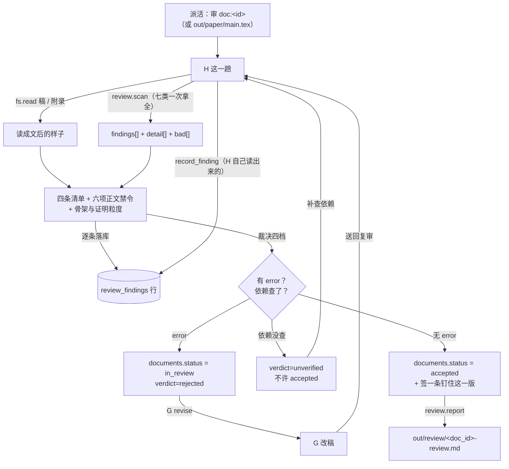

# ROLE-H · 审读

> **一句话**：H 是**稿件级**正式审查（五元位第 5 位）—— 只判「这份稿有没有把自己说清楚」，
> 不判数学对不对；它**只读别人的产出**，发现落成 `review_findings`，裁决落成 `documents.status`，
> 改稿永远是 G 的活。
>
> 权限面真身 `specs/h.py`。所有 `file:line` 在 2026-11-22 13:40 现核；真机读数见 `docs/CHAIN-G-H-V.md` 第七节。

---

## 0. 速查

| 项 | 值 | 出处 |
|---|---|---|
| 角色号 | `H` | `schema.ROLES`（`schema.py::ROLES`） |
| 动作数 | **5** | `specs/h.py::ACTIONS` |
| 出边（能召唤谁） | `A` / `E` | `specs/h.py::SPEC.edges` |
| 入边（谁能召唤它） | `B` / `G` / `M` | `capabilities.ALLOWED_EDGES`（`capabilities.py::ALLOWED_EDGES`） |
| 写集（会写哪几张表） | `documents`（只改 status / 审核轴三格）/ `review_findings` | `specs/h.py::SPEC.write_set`、`agent_h/__init__.py` 的模块 docstring |
| 只读？ | 是（`read_only=True`）—— 只对**别人的产出**只读 | `specs/h.py::SPEC.read_only`、`specs/h.py::SPEC.brief.boundary` |
| 可被召唤？ | 是 | `specs/h.py::SPEC.summonable` |
| 实现类 | `agentflow.agent_h:AgentH` | `specs/h.py::SPEC.class_path` |
| 构造依赖 | 只要 `store` / `config` / `llm`（落库代理自己注册） | `specs/h.py::_build` |
| 五元位位置 | 第 5 位「已过正式审查」 | `evidencebits.py` 的模块 docstring「等级机械派生（不许任何角色自报等级）」一节 |

---

## 1. 定位

**为什么 H 必须是只读的**：若审校者能直接改稿，它就同时是「发现者」与「修正者」，于是「发现问题」与
「掩盖问题」在结构上无法区分 —— 这不是分工洁癖，而是「审校记录能不能被信任」的前提
（`agent_h/__init__.py` 的模块 docstring）。

「H 只读」由三件事共同保证（缺一条就只剩口号）：

1. **工具面只读**：`install_h_tools()` 只把 `side_effect in ("none","read")` 的工具与通用能力放进 H 的自由工具箱，
   并在构造时断言（拿到不合规的注册表就 fail-closed 拒绝启动）（`agent_h/__init__.py` 的模块 docstring）。
2. **落库代理被钉死**：H 唯一会写盘的动作（写 `review_findings`、改 `documents.status`）走显式代理注册表
   `self.writers`，落点固定：不碰 `claims`、不碰任何知识表（`agent_h/__init__.py` 的模块 docstring）。
3. **可核对的运行期断言**：审校前后 `concepts/relations/literature` 逐字节不变；`documents.json` 的变化点只有
   `status` 与审核轴三格（`review_verdict` / `reviewed_at` / `reviewed_by`）以及跟着复审走的 `review_rounds`
   （`agent_h/__init__.py` 的模块 docstring）。

H 的三态纪律：`dependencies` **没查**（显式 `None`）与「查了、依赖都闭合」是两件事 —— 前者必须报
`dep_check.checked is False` 且**不许判 `accepted`**（`agent_h/__init__.py` 的模块 docstring）。

在链上 H 是**中间那一段**：上游是 B 的命题台账与逐字出处、以及 V 逐行走查签下的「审过」；它判稿子用的是
这两样，而不是自己读一遍就算（`specs/h.py::SPEC.brief.boundary`）。

---

## 2. 输入输出表

| 方向 | 对象 | 从哪来 | 落到哪 | 判据 / 读数 |
|---|---|---|---|---|
| 入 | 派活 `params` | M / G / B（`conductor.summon`） | 动作参数门 | `review_report` 的 `own_errors` 是必填（`specs/h.py::ACTIONS`） |
| 入 | `documents` 行 | G 的 `build_document` | `doc_id` 参数 | 没有它就没有审校对象（`documents.status` 只有那一行可改） |
| 入 | 论文正文 / PDF | G 的 `fs.write` + `paper_compile` | `fs.read` 读 | 落点通常 `out/paper/main.tex`（`specs/h.py::SPEC.brief.boundary`） |
| 入 | `statements` 行 + 逐字出处 | B（`quote_verified`） | 采信规则第 1 条 | 正文与台账**逐字一致**才算采信（`specs/h.py::SPEC.brief.boundary`） |
| 入 | `verifications/<号>.jsonl`（或 `pending/<sha>.jsonl`） | V 的签行 | 采信规则例外档 | 等级 `pre_theorem` 的凭据 = 三票齐的签行（`specs/h.py::SPEC.brief.boundary`） |
| 入 | `dependencies` | 库（缺省）/ 调用方（显式三态） | `review` / `verify_fixes` / `review_report` | 显式 `None` = 没查 ⇒ 不许 `accepted`（`specs/h.py::SPEC.brief.boundary`） |
| 入 | `review.scan` 七类读数 | 工具（只读） | H 自己的交付与回报 | `checked=false` 只表示没查成，不是零命中（`specs/h.py::SPEC.brief.policy`） |
| 出 | `review_findings` 行 | `review` / `verify_fixes` / `record_finding` | `data/review_findings.json` | `level` ∈ `FINDING_LEVELS`（error/warning/info，`schema.py::FINDING_LEVELS`） |
| 出 | `documents.status` | `review` / `verify_fixes` | `data/documents.json` | `accepted` 必须有一条钉住该版的签名（`tools/review_tools.py::CODE_ACCEPT_WITHOUT_PIN`） |
| 出 | 审校报告 | `review_report` | `out/review/<doc_id>-review.md` | 落点由框架定（`tools/review_tools.py::DEFAULT_REPORT_SUBDIR`） |
| 出 | `note` | H 自己 | `notes/<角色号>.md` | 记这一轮的判断与纠结 |
| 出 | 复审裁决 | `verify_fixes` 的 `close_as` | `documents.status` | `close_as="unresolved_review"` ⇒ 交人复核（轮数上限已撤除） |

---

## 3. 动作面表（`specs/h.py::ACTIONS`）

| 动作（`specs/h.py` 行） | 必填参数 | 关键约束 | 返回 | `side_effect` | 实现 |
|---|---|---|---|---|---|
| `review`（`specs/h.py::ACTIONS`） | `doc_id` | `dependencies` 三态：不传 = 从库读 / 显式 `None` = **没查**（`dep_check.checked=False`，verdict `unverified`）；`round_no` 可选 | dict（`checked` / `verdict` / `new_findings` / `error_count` / `dep_check` / `status` …） | `write_local` | `agent_h/review.py` |
| `verify_fixes`（`specs/h.py::ACTIONS`） | `doc_id` `round_no` | 重跑检查判 `fixed` / 仍 `open` 并逐条列出；**收不收尾由 H 判断**：给 `close_as="unresolved_review"` 才置该终态（轮数上限已撤除，不做轮次读数） | dict | `write_local` | `agent_h/verify_fixes.py` |
| `list_findings`（`specs/h.py::ACTIONS`） | — | `doc_id` / `level` / `status` / `kind` 过滤；**没有「没查成」这一档**（纯列举，读不出来就是空表） | `{'count','findings'}`（键集逐字如此） | `read` | `agent_h/list_findings.py` |
| `judge_quote_semantics`（`specs/h.py::ACTIONS`） | — | 判一条引文与来源**是不是说同一件事**：允许改写/换记号/跨语言，但引文把来源结论**加强**了不算通过；只判不写，判定交回 B 回填；没有模型缝时如实回「没查」 | dict（`tri` / `verdict` / `same_meaning` / `quote_mode` / `quote_span` / `quote_call_sha256` …） | `read` | `agent_h/judge_quote_semantics.py` |
| `review_report`（`specs/h.py::ACTIONS`） | `doc_id` **`own_errors`** | 产 G1–G15 的完整报告（markdown 落盘）；`own_errors` 缺失 ⇒ 报告照生成但显式记 `own_errors_registered=False`；`run_evidence` / `banned_words` / `claim_counts` 可选 | dict（`report_path` / `verdict` / `pass_count` / `fail_count` / `unknown_count` / `revision_hash` / `unknown_gates` …） | `write_local` | `agent_h/review_report.py` |

> `review_report` 的 `own_errors` 是**必填**：工具面 `required` 是 `["doc_id","own_errors"]`，动作面只写 `("doc_id",)`
> 的话「照动作面派活 ⇒ 工具层退回」，而那一步的预算白花、读数上还像「H 不肯干活」（`specs/h.py::ACTIONS`）。

---

## 4. duty / policy / boundary 要点

### 4.1 duty、boundary、门面

| 项 | 逐字要点 | 出处 |
|---|---|---|
| duty | 「审校（只读）：只判稿件有没有把自己说清楚，不判数学对不对」 | `specs/h.py::SPEC.brief.duty` |
| boundary ① | 对其它智能体的产出只读：不改稿、不改别人的台账与报告；可写的是自己侧的产物（`review.review_document` / `review.verify_fixes` / `review.record_finding` / `review.report` / `conductor.ack` / `conductor.post_task` / `clock.*`）；**H 不许召唤 G** | `specs/h.py::SPEC.brief.boundary` |
| boundary ② | 不判数学：数学错误不在职责里，把不确定的话写成确定的话才是要抓的 | `specs/h.py::SPEC.brief.boundary` |
| boundary ③ | **审过与通过是两件事**：审过 = 审核轴上是「成立」或「有毛病」；通过 = 裁决「成立」且逐条硬禁令查过、依赖闭合也查过；查不了 ⇒ `checked=False` + 理由（台账不留行） | `specs/h.py::SPEC.brief.boundary` |
| boundary ④ | G8（可复跑门）不归 H 跑：证据只有 `experiments` 台账行（`code_hash` + 整数 `exit_code`），由收工门现算；H 看到正文引了台账里没有的 `exp:` 号就落 finding | `specs/h.py::SPEC.brief.boundary` |
| boundary ⑤ | **采信规则**：逐字一致（`quote_verified`）+ 等级到 `theorem`（凭据 = `experiments` 行 + V 签）；开关关时文字证明采信 `pre_theorem`，凭据是 V 逐行走查的三票齐签行 | `specs/h.py::SPEC.brief.boundary` |
| boundary ⑥ | 「开关开着但没有检查器」⇒ 按**没查**处置（写环境缺口 `no_backend` / `tool_crashed`），不许读成「断言不成立」、不许写「已形式化验证」 | `specs/h.py::SPEC.brief.boundary` |
| boundary ⑦ | 审什么、在哪由派活告诉；审校报告由 `review_report` 落框架定的 `out/review/<doc_id>-review.md` | `specs/h.py::SPEC.brief.boundary` |
| boundary ⑧ | 裁决四档：有 error ⇒ `rejected`；依赖闭合没查 ⇒ `unverified`；只有 warning ⇒ `accepted_with_warnings`；都没有 ⇒ `accepted`；判 `accepted` 时框架**签一条**（钉住那一版内容哈希） | `specs/h.py::SPEC.brief.boundary` |
| signature_error | 「把『这一轮没查出 error』说成『这份稿子没问题』（只有 warning 不等于审过了）」 | `specs/h.py::SPEC.brief.signature_error` |
| deliverable | `review_findings` 行 + `documents.status`；每条 finding 指得到节或行；算做完 = 一次审校在 status 上给出裁决 | `specs/h.py::SPEC.brief.deliverable` |
| stance | 只判「说清楚没有」；「读不懂」只能落成三类 finding（记号没定义 / 指代不明确 / 论证留跳步），每条给 `file`/`line`/`ref` | `specs/h.py::SPEC.brief.stance` |

### 4.2 policy 要点

| # | 要点 | 出处 |
|---|---|---|
| 1 | **审稿清单四条**（逐条打勾）：① 定理那一档先取读数再判（`review.scan(kinds=["proofs","ledger_match"])` 拿五个数与 `statement_surplus`，**不要自己数 `\begin{proof}`**）；② 正文内部编号数 == 0（无机器读数，自己数并写行号）；③ 正文没有「数值实验」类小节；④ 三件齐全（`Abstract` / `\bibitem` / `Appendix A: Computational evidence`） | `specs/h.py::SPEC.brief.policy` |
| 2 | **机械读数走一个入口**：异常字符、`\cite` 对 `\bibitem`、`\input` 目标、`\ref` 对 `\label`、theorem 对 proof、重复声明、正文对台账 —— 七类都用 `review.scan(kinds=[…], project=…)`；`checked=false` 只表示没查成 | `specs/h.py::SPEC.brief.policy` |
| 3 | `review.scan` 的读数**不进 finding 台账**：`schema.FINDING_KINDS` 里没有这七类，`record_finding` 会当场拒收（实测 7/7）；读数本身就是凭据（每条带 `file`/`line`/`ref`），原样写进交付与回报 | `specs/h.py::SPEC.brief.policy` |
| 4 | **正文禁令六项**：内部编号 / 自审小节 / 过程词 / 内部术语 / 计算证据 / 凑长度 | `specs/h.py::SPEC.brief.policy` |
| 5 | **骨架与证明粒度**：章节顺序、第 2 节符号定义回查、第 3 节每步「由 X 得 Y」、证不了的明写 `Conjecture`/`Open problem`、`pre_theorem` 不许写「机器验证」 | `specs/h.py::SPEC.brief.policy` |
| 6 | **稿子落成研究报告时不许 `accepted`**：正文带台账气 ⇒ 落 **error 级** finding（`rejected` 的唯一入口）；够不上 error 也只能压 `accepted_with_warnings` | `specs/h.py::SPEC.brief.policy` |
| 7 | 清单每条都要**指得到行**（行号或逐字引文）；读不到就如实落一条「没查成什么」，**不许把「我没看」写成「没有」**，也不许只勾前两条 | `specs/h.py::SPEC.brief.policy` |
| 8 | 按对应表逐行核（label/env_no、`ledger_id`/`proof_no` 可解析、`file` 两种落点、`lean_file` 按通道、索引四格）；客观问题（`mapping_*` / `md_*`）可拦，主观档点名到句不拦门 | `specs/h.py::SPEC.brief.policy` |
| 9 | 能监控自己的直接下级但只看得见一层：`trace.children`（read）；要看更深用 `conductor.escalate` 向 M 请求（指导沿绝对编号链由秘书转发） | `specs/h.py::SPEC.brief.policy` |
| 10 | 要等就用时钟（`clock.timer_start` / `periodic_start` / `wait_any`），挂机期间不轮询不空转 | `specs/h.py::SPEC.brief.policy` |

---

## 5. 边界与禁令（`capabilities.ALLOWED_EDGES`）

```
ALLOWED_EDGES['H'] = {'A', 'E'}          # specs/h.py::SPEC.edges
入边：{r | 'H' ∈ ALLOWED_EDGES[r]} = {'B', 'G', 'M'}
```

| 禁令 | 违反时的读数 | 出处 |
|---|---|---|
| **不许召唤 G**（改稿由 G 自己做） | `forbidden_edge` | `specs/h.py::SPEC.brief.boundary`、`specs/h.py::SPEC.edges` |
| 不许改稿、不许改别人的台账与报告 | 工具面结构上拿不到写工具（`READ_ONLY_ROLES` 含 `H`） | `tools/__init__.py::READ_ONLY_ROLES`、`tools/base.py::READONLY_CALL_EXCEPTIONS` |
| 不许在「依赖没查」的前提下判 `accepted` | `dep_check.checked=False` + verdict `unverified` | `specs/h.py::SPEC.brief.boundary` |
| 不许把「没查成」折成「没有」 | `checked=false` + 逐字理由（台账不留行） | `specs/h.py::SPEC.brief.boundary`、`specs/h.py::SPEC.brief.policy` |
| 不许把 `review.scan` 的七类读数塞进 `review_findings` | `record_finding` 当场拒收（实测 7/7） | `specs/h.py::SPEC.brief.policy` |
| 不许给研究报告体判 `accepted` | 只能 error（`rejected`）或 `accepted_with_warnings` | `specs/h.py::SPEC.brief.policy` |
| 只给 `doc_id` 派 `review_report` | 派活那一刻就被参数门拒（缺 `own_errors`） | `specs/h.py::ACTIONS` |
| 不许「没审就判通过」 | `checked=False` + 理由；审核轴无「看不出来」这一档 | `specs/h.py::SPEC.brief.boundary` |

H 的结构保护是一条**运行期断言**，不是提示词：审校前后知识表逐字节不变、`documents` 只动 status 与审核轴三格
（`agent_h/__init__.py` 的模块 docstring）。

---

## 6. 与谁协作

| 对方 | 关系 | 交接物 | 出处 / 判据 |
|---|---|---|---|
| **G** | 父（G→H 是真边）；**H 不召唤 G** | 稿件行 / `main.tex` → H 返回 `review_findings` + `documents.status`；G 改完再送回 H 复审 | `specs/g.py::SPEC.brief.policy`（G 侧）、`specs/h.py::SPEC.brief.boundary`（H 侧） |
| **B** | 同辈上游 | B 的台账命题与逐字出处（`quote_verified`）；H 判稿用的两样之一 | `specs/h.py::SPEC.brief.boundary` |
| **V** | 同辈上游 | V 逐行走查签下的「审过」（三票齐的签行）；H 不自己判证明 | `specs/h.py::SPEC.brief.boundary` |
| **A** | 出边：核引文原文 | 「这条引文在原文里是不是这个意思」 | `specs/h.py::SPEC.brief.boundary`、`specs/h.py::SPEC.edges` |
| **E** | 出边：核实验读数 | 「这条 `exp:` 号有没有台账行、读数是不是这个数」 | `specs/h.py::SPEC.brief.boundary`、`specs/h.py::SPEC.edges` |
| **M** | 父 | 派活；板项 `conductor.ack` / `post_task` | `specs/h.py::SPEC.brief.boundary` |

---

## 7. 典型一轮（Mermaid）



---

## 8. 常见失败与读数

| 失败形态 | 读数（怎么看出来） | 出处 | 真机证据 |
|---|---|---|---|
| 把「这一轮没查出 error」说成「这份稿没问题」 | `signature_error`；只有 warning ≠ 审过 | `specs/h.py::SPEC.brief.signature_error` | — |
| 依赖没查就判 `accepted` | `dep_check.checked=False` + `verdict=unverified` | `specs/h.py::SPEC.brief.boundary` | — |
| 自己数 `\begin{proof}` 当判据 | 真稿上两数本来就差一截（18 与 7）；真问题是 `statement_surplus` | `specs/h.py::SPEC.brief.policy` | — |
| 把 `review.scan` 读数当 finding 塞库 | 当场拒收（7/7），kind 不在词表 | `specs/h.py::SPEC.brief.policy` | — |
| 没审就判通过 | `checked=False` + 理由（台账不留行） | `specs/h.py::SPEC.brief.boundary` | — |
| 给研究报告体判 `accepted` | 只能落 error 级 finding（⇒ `rejected`）或压 `accepted_with_warnings`；`accepted` 在这一形态上不可用 | `specs/h.py::SPEC.brief.policy` | lp-ball-15 的 `documents 000000`（kind=note、4 条 claim 全 `cross_check`）**未被审**，所以这一形态在盘上没有裁决 |
| 改完不复核 | 收工门 `reviewed_current_rows` 掉（签名钉的是旧版） | `specs/h.py::SPEC.brief.boundary` | lp-ball-15：`documents.status=draft`、`review_findings=0`、`out/review/` 里只有 M 的 `REPORT.md` / `STATUS-*` / `m-verdicts.jsonl`，**没有任何 `*-review.md`** |
| 只派 `doc_id`（漏 `own_errors`） | 派活那一刻被参数门拒 | `specs/h.py::ACTIONS` | — |

**读数**：`projects/lp-ball-15` 的 179 个任务里 **H = 0 趟**（M29 / A32 / B14 / D23 / E2 / F63 / V15 / G1）。
这不是「H 没查出问题」，而是**审读这一段根本没发生** —— `review_findings` 0 行、`out/review/` 无审校报告、
稿件停在 `draft`。链的「可信」在这里断掉：G 交的稿没有任何一份被「发现者 ≠ 修正者」的结构看过。
