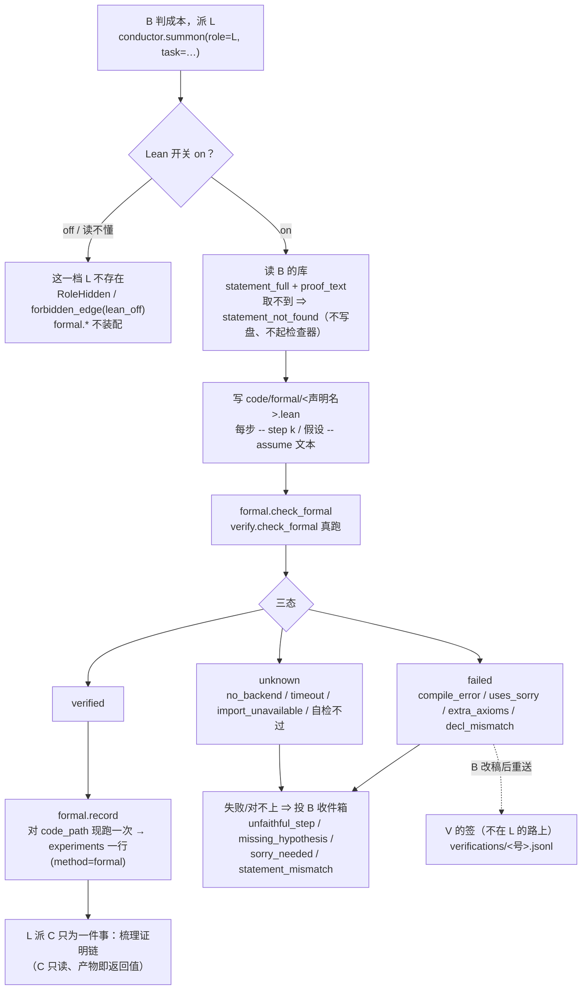

# 角色 L（Lean 形式化者）—— 默认关，唯一入口是 B

> ROLEDOC-4。声明真身：`src/agentflow/specs/l.py`（在 `.noai-paths` 的 `[category: auth-audit]` 里受保护）。
> 行号写前逐条核过（核法见 `temp/roledoc4/REPORT.md`）。

## 0. 一句话

L 是**只在 Lean 开关打开时存在**的角色：它把 B 已登记的那条命题与其证明链路搬进 Lean、
交给检查器真跑、把结论如实报回 B；它能写的表**只有 `experiments` 一格**，
它的边只有 **`B→L`（入）** 与 **`L→C`（出）**。
**L 不能给命题升档** —— 那不是靠纪律，是三层结构闸叠加的结果（§4）。

| 面 | 取值 | 真身 |
|---|---|---|
| 角色码 | `role="L"` | `src/agentflow/specs/l.py::SPEC.role` |
| 动作表 | `formalize` / `check_formal` / `record`（**3 个**） | `src/agentflow/specs/l.py::ACTIONS` |
| 实现类 | `agentflow.agent_l:AgentL`（要 `workspace_root`） | `src/agentflow/specs/l.py::SPEC.class_path` |
| 入边 | 只有 `B→L` | `src/agentflow/specs/b.py::SPEC.edges`（B 的 `edges` 含 `L`） |
| 出边 | 只有 `L→C` | `src/agentflow/specs/l.py::SPEC.edges` |
| 写集 | `frozenset(("experiments",))` | `src/agentflow/specs/l.py::SPEC.write_set` |
| 可召唤 | `True`（但只有 B 的出边里有它） | `src/agentflow/specs/l.py::SPEC.summonable` |
| 工具面 | `formal.formalize` / `formal.check_formal` / `formal.record`（`roles=("L",)`） | `src/agentflow/tools/formal_tools.py::_ROLES_L`、`src/agentflow/tools/formal_tools.py::_formal_formalize`、`src/agentflow/tools/formal_tools.py::_formal_check_formal`、`src/agentflow/tools/formal_tools.py::_formal_record` |
| 存在性判定 | `leanscope.LEAN_ONLY_ROLES = ("L",)` | `src/agentflow/leanscope.py::LEAN_ONLY_ROLES` |

---

## 1. 定位：默认关，关着时"不存在"而不是"跑不动"

三档判定只有一处实现（`leanscope.lean_reading`，`src/agentflow/leanscope.py::lean_reading`），
其余每一处都调它：

| 档 | 机器行为 | 真身 |
|---|---|---|
| **默认** | `DEFAULT_LEAN_ENABLED = False`（开关梯子：环境变量 `AGENTFLOW_LEAN_ENABLED` > 设置文件 `toolchain.lean_enabled` > 缺省） | `src/agentflow/settings.py::DEFAULT_LEAN_ENABLED`、`src/agentflow/settings.py::LEAN_ENABLED_KEY`、`src/agentflow/settings.py::ENV_LEAN_ENABLED`、`src/agentflow/settings.py::lean_enabled` |
| `on` | `is_hidden("L") == False`；`formal.*` 装配 | `src/agentflow/leanscope.py::lean_reading`、`src/agentflow/leanscope.py::is_hidden`；装配过滤 `src/agentflow/tools/__init__.py::build_registry` |
| `off` / 读不懂 | `is_hidden("L") == True`（**读不懂按关处理，fail-closed**）；按名取 L 抛 `RoleHidden`；派 `B→L` 与 `L→C` 都判 `forbidden_edge`（理由码 `lean_off` / `lean_unreadable`） | `src/agentflow/leanscope.py::lean_reading`、`src/agentflow/leanscope.py::require_visible`、`src/agentflow/leanscope.py::hidden_refusal`；策略分支 `src/agentflow/policy.py::check` |

**关着时 L 的提示词根本渲染不出来**（`leanscope.require_visible` 抛 `RoleHidden`），
所以 `specs/l.py` 的政策段不需要写"关掉时怎么办"—— 那条分支不可达
（`src/agentflow/specs/l.py::SPEC.brief.policy`、`src/agentflow/specs/l.py::LATER_EDGES`）。"关着时的说法"落在能派 L 的那一侧：
B 的 `PROOF_CHANNEL_NO_LEAN` 与 G 的 `WRITING_SCOPE_NO_LEAN`。

**"入口不是边"**：用户仍可以用 `run-agent L` 单条执行 —— 那是**入口**，不经过
`ALLOWED_EDGES`，所以不给它加边（加边就等于把形式化挂成流水线的一环）
（`src/agentflow/specs/l.py` 的模块 docstring「协作面：B 是唯一入口，L 只派 C」一节、`src/agentflow/specs/l.py::SPEC`）。

**真机读数（现算）**：`agentflow/settings.json` 里只有 `lean_bin`、没有 `lean_enabled`
⇒ 走缺省 `False`；`projects/` 下 51 个工作区的 `data/tasks.json` 合计 4879 行 `tasks`，
其中 `role=L` 的行数 **0**（命令见 `temp/roledoc4/FACTS.txt` 的脚注）。
"默认关"在真机上就表现为"一次都没出现"，而不是"出现了但被拒"。

---

## 2. 动作面：三格，落点各不相同

| 动作 | 做什么 | 参数（要点） | 副作用 / 外部性 | 真身 |
|---|---|---|---|---|
| `formalize` | 把一条命题写成 Lean 源码 → 落 `code/formal/<声明名>.lean` → 交桥接层真跑；结论三态 `verified/failed/unknown` | `claim`、`source`、`declaration_name`（必填三项）；`statement_id`（可选，钉住被形式化的那一条）、`proof_no`、`path_source`、`imports`、`timeout_sec` | `write_local` + `external="exec"` | `src/agentflow/specs/l.py::ACTIONS` |
| `check_formal` | 把源码（`source`）或工作区里的 `.lean`（`script_path`）交检查器真跑一次；前置自检不过 ⇒ 如实 `unknown` | `claim`（必填）；`script_path`/`source` 二选一 | `read` + `external="exec"` | `src/agentflow/specs/l.py::ACTIONS` |
| `record` | 把一次形式化检查登记成 `experiments` 一行（`method="formal"`）；**按 `statement_id` 读台账正文 + 对 `code_path` 现跑一次**，调用方给的读数只用于对账（不一致 ⇒ `reading_mismatch`，一行都不写） | `statement_id`、`code_path`（必填）；`proof_no`、`path_id`、`path_source`、`status`/`verified`/`checker`（对账用） | `write_local` + `external="exec"` | `src/agentflow/specs/l.py::ACTIONS` |

三格的口径与 E 的同名动作同一份桥接层（`verify.check_formal` 是唯一实现，
`src/agentflow/specs/l.py` 的模块 docstring「动作：三格（`check_formal` / `formalize` / `record`）」一节），差别只在 L 多一道前置自检与三态形状 —— 这是**看得见的差别**，
不是第二份实现。

**`record` 刻意不碰 `statements`**：声明里逐字写着「它不动 statements：形式化 ≠ 审过，
命题升档仍然要 V 的那一签」（`src/agentflow/specs/l.py` 的模块 docstring「动作：三格（`check_formal` / `formalize` / `record`）」一节、`src/agentflow/specs/l.py::ACTIONS`）。

---

## 3. 写集只有 `experiments` 一格，边只有 `B→L→C`

### 3.1 写集

```python
write_set=frozenset(("experiments",))          # src/agentflow/specs/l.py::SPEC.write_set
```

它数的是**并发轴的读数**（两张写集相交 ⇒ 串行），**不是权限闸**。
真正拦住"L 改命题"的另有其人（§4）。为什么写集里没有 `statements`：
「那一格是"命题升档"的位置，只有 V 的签字与 F/B 的登记能碰；
写集里没有它，"L 绕过 V 签"在结构上不可能（不是靠纪律）」（`src/agentflow/specs/l.py` 的模块 docstring「写集：只有 `experiments` 一格」一节）。

L 的三样产出：盘上的 `.lean`、检查器原话、`record` 落下的那一行 `experiments`
（前两样不是表行）。所以 `experiments` 是它唯一的数据表写入面。

### 3.2 边

| 方向 | 边 | 用途 | 真身 |
|---|---|---|---|
| 入 | `B→L` | B 判断"这一条值不值得付检查器成本"，逐条安排；L 形式化的东西**一定出自 B 的库** | `src/agentflow/specs/b.py::SPEC.edges`；理由 `src/agentflow/specs/l.py::LATER_EDGES` |
| 出 | `L→C` | **只为一件事：梳理证明链**（哪一步依赖哪一步、哪步是旁挂、哪步是跳变、缺口在哪） | `src/agentflow/specs/l.py::SPEC.edges`；政策 `src/agentflow/specs/l.py::SPEC.brief.policy` |

除 C 之外 L 派不动任何人（`forbidden_edge`）（`src/agentflow/specs/l.py::SPEC.brief.policy`）。
**没有入边给别的角色**：`A/C/D/E/F/G/H/M/V → L` 一条都没有，逐角色断言在
`tests/test_l_collab_surface_is_exactly_this.py`（该文件第 14 行把"M 不含 L"写成判据）。
`specs/l.py::LATER_EDGES` 还逐条登记了"评估过、最终没有开"的四条边（`F→L`/`E→L`/`D→L`/`M→L`）
及其理由 —— 那份表不被任何代码读，只给改权限面的人看。

**汇报不是边**：`formalize` 判出"失败或对不上"时自己把汇报投进 B 的收件箱
（受控形态：命题号 + 失败类型 `unfaithful_step`/`missing_hypothesis`/`sorry_needed`/`statement_mismatch`
+ 第几步 + 建议 B 补什么），返回值 `report.reported` 才是"B 真的收到了"
（`src/agentflow/specs/l.py::SPEC.brief.policy`）。V 的签在这一步之后：B 改证明 → `B→V` 重签。

---

## 4. "L 绕不过 V 签给命题升档"的真拦点

这一句是**四层结构闸**叠加的结果，每一层都能单独拦住，且每层都有自己的 file:line。
**不是**靠写集，也**不是**靠 L 的自觉。

### 第 1 层 · L 这一侧根本没有那条写路径

- 动作表 3 格，`record` 的声明逐字"不动 statements"（`src/agentflow/specs/l.py::ACTIONS`）；
- 写集只有 `experiments`（`src/agentflow/specs/l.py::SPEC.write_set`）；
- 工具面只有 `formal.*`（三件）+ `fs`（`src/agentflow/capabilities.py::_TOOL_GROUPS_BY_ROLE`，
  `_TOOL_GROUPS_BY_ROLE["L"] = ("formal", "fs")`）；
- L 的 `boundary` 逐字：「不许自己动台账里的命题与证明：B 的登记是唯一来源」（`src/agentflow/specs/l.py::SPEC.brief.boundary`）。

### 第 2 层 · 通用写口（`table.create` / `table.update`）**一律拒**

```
store.direct_write_refusal(table)  →  拒信串；空串 = 放行
```

- 判据本体唯一一处：`src/agentflow/store.py::direct_write_refusal`；
- 拒的表：`STATEMENT_WRITE_TABLES = ("statements", "dependencies")`（`src/agentflow/store.py::CONJECTURE_WRITE_TABLES`），
  以及 `conjectures`（`src/agentflow/store.py::direct_write_refusal`）、`documents`（`src/agentflow/store.py::direct_write_refusal`）、`lit_candidates`（`src/agentflow/store.py::direct_write_refusal`）；
- 理由码：`DIRECT_WRITE_REFUSED = "direct_write_refused"`（`src/agentflow/store.py::DIRECT_WRITE_REFUSED`）；
- 工具层在**进事务之前**先拒一次（给模型可读的拒信）：
  `src/agentflow/tools/table_tools.py::_direct_write_disposal`；
- **提交块再拒一次**（防有人绕过工具层）：`Store.tx` 对带 `tool:` 记号的事务重判，
  不通过就 `raise ValueError(why)`（`src/agentflow/store.py::Store._append_events`）。

拒信里指的路是「`Secretary.record_statement(payload, *, role="B")`，在循环里请调
**`own.register_statement`**」（`src/agentflow/store.py::direct_write_refusal`）—— 它不给 L 留第二条路。

### 第 3 层 · 就算走到秘书：**只有 B 能交内容**（角色判据）

```python
STATEMENT_WRITER_ROLES: tuple[str, ...] = ("B",)     # src/agentflow/secretary_statement.py::STATEMENT_WRITER_ROLES
if str(role) not in STATEMENT_WRITER_ROLES:
    out.update(refused="not_statement_writer", ...)  # src/agentflow/secretary_statement.py::StatementMixin._record_statement_impl
```

- 这是**秘书侧的角色判据**，与写集无关：L 就算拿到 `Secretary` 也交不进去；
- 同一条判据在元数据路径上重复出现两次（`src/agentflow/secretary_statement_meta.py::StatementMetaMixin.amend_statement_meta`、`src/agentflow/secretary_statement_meta.py::StatementMetaMixin.land_statement`）；
- 秘书那一笔是**事务**（`statements` + `dependencies` 一起写），B 只交内容、不调工具
  （`src/agentflow/secretary_statement.py::StatementMixin._record_statement_impl`）。

### 第 4 层 · 就算 B 替它写：**没有 V 的签，那一行写不进去**

- 写入期闸 `_refuse_fake_proof_review`：`evidence_kind="proof_review"` 的行必须有
  `verifications` 里那一条"成立"且 `proof_sha256` 等于现行正文，否则**整笔事务一行都不写**，
  错误码 `proof_review_without_evidence`（`src/agentflow/store.py::_refuse_fake_proof_review`）；
- 判据本体一处：`verifications.proof_review_gap`（写入期 / 审计期 / 收工门都读它，
  `src/agentflow/store.py::_refuse_fake_proof_review`）；
- 也就是说：L 的 `record` 至多把"形式化跑过了"记进 `experiments`
  （`method="formal"`，产物是盘上的 `.lean` + 检查器原话 + 一行实验），
  **命题那一格的档位仍停在原处，直到 V 签**。

> 一句话把四层说穿：
> **L 的手上只有 `experiments`；`statements` 的通用写口在工具层与提交块两处都拒；
> 秘书只认 `role="B"`；而 B 写进去的 `proof_review` 还要 V 的签才不被整笔拒收。**
> 所以"形式化成功"与"命题升档"之间隔着 V，不是隔着 L 的态度。

---

## 5. 忠实复述是机器读数，不是一句自述

`formalize` 的 `claim` 是自由文本，所以"它形式化的到底是不是 B 登记的那一条"另有判据
（`src/agentflow/specs/l.py` 的模块 docstring「忠实复述是机器读数，不是一句自述」一节）：

| 读数 | 含义 | 真身 |
|---|---|---|
| `statement_id` / `statement_source` | 被形式化的是哪一条；不给编号时唯一合法来源是"claim 与台账正文逐字相同且唯一" | `src/agentflow/specs/l.py` 的模块 docstring「忠实复述是机器读数，不是一句自述」一节 |
| `coverage` | `steps_total` / `steps_mapped` / `unmapped` / `sorry_lines`；漏一步或有 sorry ⇒ 只能 `unknown` | `src/agentflow/specs/l.py::ACTIONS` |
| `checker_status` 与 `status` | **刻意分开两格**：前者是检查器原话，后者是叠加逐步对照后的综合结论（"机器核过了"≠"这一趟算数"） | `src/agentflow/specs/l.py` 的模块 docstring「忠实复述是机器读数，不是一句自述」一节 |
| `faithfulness` / `steps_path` | 逐步对照落 `code/formal/<名字>.steps.jsonl` | `src/agentflow/specs/l.py::ACTIONS` |

失败要分类（`src/agentflow/specs/l.py::SPEC.brief.policy`）：
`compile_error` / `uses_sorry` / `extra_axioms` / `decl_mismatch` = **查了没通过**（`failed`）；
`no_backend` / `timeout` / `import_unavailable` / 自检不过 = **没查成**（`unknown`）。
两档不许折叠 —— 折叠之后读者分不出"命题可疑"与"我们没验"。

自检是五步（解析 / 版本 / 正样例 / 反控 / Mathlib 与图论，
`src/agentflow/specs/l.py::SPEC.brief.policy`）；自检不是 `usable` 时**不起检查器**、
全部结论记 `unknown` 并把原因写清（`src/agentflow/specs/l.py::SPEC.brief.policy`）。

---

## 6. 一轮 L 的完整动作



要点：

- **`record` 会自己再跑一次检查器**（`src/agentflow/specs/l.py::ACTIONS`）——
  调用方给的 `status`/`verified` 只用于对账，与现跑不一致就 `reading_mismatch`、一行都不写；
  采信它们等于让 `evidence_kind="proof"` 变成可随手搬运的标签；
- **只收 `.lean`**：`code_path` 不是 `.lean` ⇒ 受控拒 `artifact_not_lean`；
  数值脚本不归 L，走 E 的 `run_experiment`（`src/agentflow/specs/l.py::ACTIONS`）；
- `proof_no` 不在册 ⇒ `proof_path_not_found`；有好几份而不给号 ⇒ `proof_path_unspecified`
  （一个字节都不写）（`src/agentflow/specs/l.py::ACTIONS`）。

---

## 7. 常见失败

| 失败 | 受控拒 / 读数 | 真身 |
|---|---|---|
| 开关关着还派 L | `forbidden_edge` + `lean_off`（不是 `unknown_role`：名字没拼错，是这一档没有这条路） | `src/agentflow/policy.py::check`、`src/agentflow/leanscope.py::hidden_refusal` |
| 没有那条命题 | `statement_not_found`（不写盘、不起检查器） | `src/agentflow/specs/l.py` 的模块 docstring「协作面：B 是唯一入口，L 只派 C」一节 |
| 断言"形式化过了"⇒ 命题升档 | 通用写口 `direct_write_refused`；秘书 `not_statement_writer`；写入期 `proof_review_without_evidence` | `src/agentflow/store.py::direct_write_refusal`、`src/agentflow/secretary_statement.py::StatementMixin._record_statement_impl`、`src/agentflow/store.py::_refuse_fake_proof_review` |
| 用 `sorry` 堵缺口 | 含 sorry ⇒ 结论只能是 `unknown`（读数 `sorry_lines`） | `src/agentflow/specs/l.py::ACTIONS`；boundary `src/agentflow/specs/l.py::SPEC.brief.boundary` |
| 把"没跑成"写成 `failed` 或 `verified` | 三态纪律；`signature_error` 逐字点名这一档 | `src/agentflow/specs/l.py::SPEC.brief.signature_error` |
| 越级找 D 或 V | `forbidden_edge`（L 的出边只有 C） | `src/agentflow/specs/l.py::SPEC.brief.policy` |

---

## 8. 判据（谁在守这一页）

| 守什么 | 判据 |
|---|---|
| 协作面恰好是 `B→L` + `L→C`、其余角色一条都没有 | `tests/test_l_collab_surface_is_exactly_this.py`（七条，逐条写明改前红） |
| 关着时 L 处处不可见 | `tests/test_l_is_isolated_when_lean_is_off.py` |
| 忠实复述可测 | `tests/test_l_faithfulness_is_measurable.py`（六条） |
| 两层声明一致（动作 ↔ 工具） | `src/agentflow/capabilities.py::assert_capabilities`（导入期） |
| `formal.*` 只挂给 L | `src/agentflow/tools/formal_tools.py::_ROLES_L`+ 上述导入期断言 |

---

## 9. 与其它文档的指针

- 十一角色与 32 条边、三条硬边界：`docs/CHAIN-ALL-ROLES.md`
- M 为什么派不动 L：`docs/ROLE-M.md` §3.2
- 形式化的工具链与开关读数：`docs/LEAN-MODES.md`、`docs/FORMAL-TOOLCHAIN.md`
