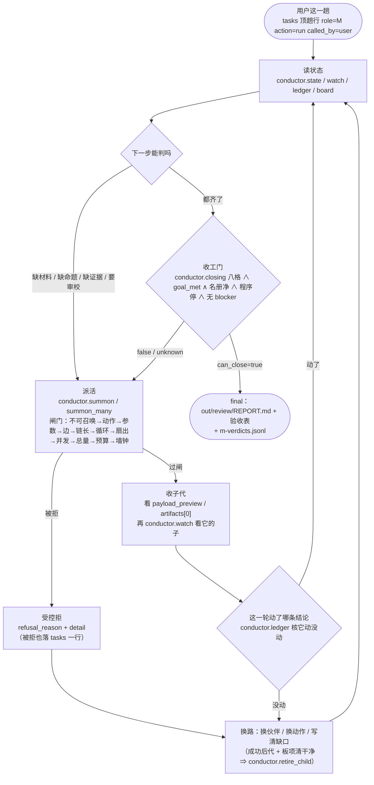

# 角色 M（主控调度）—— 唯一"派活的人"

> ROLEDOC-4。本文只写 `agentflow/` 产品里跑着的那个 M。
> 每个结论都带 `src/...:行号`；行号写前已逐条核过（核法见 `temp/roledoc4/REPORT.md`）。
> M 的权限面真身是 `src/agentflow/specs/m.py`（在 `.noai-paths` 的 `[category: auth-audit]` 里受保护）。

## 0. 一句话

M 是**调度器**：它读台账、决定派谁做什么、把结果收敛成交付；它**不产出任何领域对象**，
**没有动作表**（`CAPABILITIES["M"] == ()`），**不能写任何知识表**（`WRITE_SETS["M"] == {}`），
**没有人能召唤它**（`NON_SUMMONABLE`）。

| 面 | 取值 | 真身 |
|---|---|---|
| 角色码 | `role='M'` | `src/agentflow/specs/m.py::SPEC.role` |
| 动作表 | `ACTIONS = ()`（**0 个动作**） | `src/agentflow/specs/m.py::ACTIONS` |
| 实现类 | `class_path='agentflow.conductor:Conductor'` | `src/agentflow/specs/m.py::SPEC.class_path` |
| 出边 | `A B C D E G H`（**7 条**） | `src/agentflow/specs/m.py::SPEC.edges` |
| 写集 | `frozenset(())`（**空**） | `src/agentflow/specs/m.py::SPEC.write_set` |
| 可召唤 | `False`（`NON_SUMMONABLE`） | `src/agentflow/specs/m.py::SPEC.summonable` |
| 手（工具组） | 只有 `conductor` 一组 | `src/agentflow/capabilities.py::_TOOL_GROUPS_BY_ROLE` |
| 眼睛（文件面） | `fs.list/read/search/stat/write/edit` 六件 | `src/agentflow/tools/fs_tools.py::CONDUCTOR_FS_TOOLS` |

派生链只有一条：`specs/<角色>.py` → `specs/__init__.py::action_table` → `capabilities.py::CAPABILITIES`/
`capabilities.py::WRITE_SETS`/`capabilities.py::WRITE_SETS`（`ALLOWED_EDGES`）/`capabilities.py::ALLOWED_EDGES`（`NON_SUMMONABLE`）。
导入期由 `capabilities.assert_capabilities`（`src/agentflow/capabilities.py::assert_capabilities`）逐条断言，
**其中一条专门守"主控够得到每一个角色"**（`src/agentflow/capabilities.py::assert_capabilities`，`_INDIRECT_FROM_M` 在 `src/agentflow/capabilities.py::assert_capabilities`）。

---

## 1. 动作面：`ACTIONS` 是空的 —— M 的手不在动作表上

`specs/m.py::ACTIONS` 是一个空元组（`specs/m.py::ACTIONS`），文件自己的注释逐字写着
「本角色的动作表（M 没有动作表：它只派活，不产领域对象）」。这不是遗漏，是三层一致的声明：

1. `CAPABILITIES["M"] == ()`（由 `specs/m.py::ACTIONS` 派生，读法 `src/agentflow/capabilities.py::CAPABILITIES`）；
2. 所以按动作名派 M 永远失败：`policy.check_action('M', …)` 返回
   `unknown_action`，理由串逐字是「主控 M 有 0 个 Agent 动作（它的动作是 summon 本身，由 Conductor 实现）」
   （`src/agentflow/policy.py::check_action`）；
3. 所以"给 M 派一个动作"和"召唤 M"是两件都该被拒的事，且拒法不同（见 §5 失败 1）。

**M 真正的动作面是工具面**：`conductor.*` 共 24 件（AST 现算，见 `temp/roledoc4/FACTS.txt`），
其中 19 件 `roles=("M",)`，5 件不按 M 专属发：

| 分组 | 件数 | 说明 | 真身 |
|---|---|---|---|
| `roles=("M",)` 专属 | 19 | summon / summon_many / ledger / stop / resume_brief / cancel / ensure_project / state / role_spec / acceptance / closing / status_report / board / wake_blocked / watch / guide / patrol / review_child / patrol_verdict | `src/agentflow/tools/conductor_tools.py::conductor_summon`、`src/agentflow/tools/conductor_tools.py::conductor_summon_many`、`src/agentflow/tools/conductor_tools.py::conductor_ledger`、`src/agentflow/tools/conductor_tools.py::conductor_stop`、`src/agentflow/tools/conductor_tools.py::conductor_resume_brief`、`src/agentflow/tools/conductor_tools.py::conductor_cancel`、`src/agentflow/tools/conductor_tools.py::conductor_ensure_project`、`src/agentflow/tools/conductor_tools.py::conductor_state`、`src/agentflow/tools/conductor_tools.py::conductor_role_spec`、`src/agentflow/tools/conductor_tools.py::conductor_acceptance`、`src/agentflow/tools/conductor_tools.py::conductor_closing`、`src/agentflow/tools/conductor_tools.py::conductor_status_report`、`src/agentflow/tools/conductor_tools.py::conductor_board`、`src/agentflow/tools/conductor_tools.py::conductor_wake_blocked`、`src/agentflow/tools/conductor_tools.py::conductor_watch`、`src/agentflow/tools/conductor_tools.py::conductor_guide`、`src/agentflow/tools/conductor_tools.py::conductor_patrol`、`src/agentflow/tools/conductor_tools.py::conductor_review_child`、`src/agentflow/tools/conductor_tools.py::conductor_patrol_verdict` |
| 通用（人人都有） | 3 | `escalate` / `ack` / `post_task` | `src/agentflow/tools/__init__.py::UNIVERSAL_TOOLS` |
| 给"能当父的角色" | 2 | `retire_child` / `void_items`（名单从边表现算：有出边且非只读） | `src/agentflow/tools/conductor_tools.py::_parent_roles` |

另外 M 还拿 9 件时钟工具与 1 件 `trace.children`（通用集合 `src/agentflow/tools/__init__.py::UNIVERSAL_TOOLS`），
以及上面那 6 件 `fs.*`。这些都**不是**动作：它们不经过 `CAPABILITIES`，也不改 `WRITE_SETS`。

> 为什么这一格容易写错：`specs/m.py` 的 `brief` 里有大量"用 `conductor.X` 做 Y"的政策句
> （例如 `specs/m.py::SPEC.brief.policy` 的 watch / guide / escalate 三条手段），读者会把它们当成"M 的动作"。
> 它们是**工具调用**；M 的能力层动作数在任何一档都是 0。

---

## 2. 它怎么读状态

五条读数入口，各有各的口径，**不许互相替代**：

| 读数 | 读什么 | 口径与坑 | 真身 |
|---|---|---|---|
| `conductor.state` | 各表行数（`tables`）、猜想按状态、`tasks` 规模、三条队列（`queues.<表>.unfinished`）、`literature.unprocessed`、`thresholds`、`programs` | `tables["tasks"]` 与 `tasks` 是同一个量，**含顶趟行**；"我派了几次活"不是它 | `src/agentflow/tools/conductor_tools.py::conductor_state` |
| `conductor.watch` | 任意一支任务树：每节点的 status/outcome、`recent_steps`、`subtask_refusals`、`products`、`last_handoff`；`depth` 缺省 0 = 全树 | M 专属（别的角色只有 `trace.children` 一层） | `src/agentflow/tools/conductor_tools.py::conductor_watch` |
| `conductor.ledger` | `tree` / `stats` / `issues` / `verify` / `relays` | `task_count` 含顶趟行；召唤数看 `stats.started_total` | `src/agentflow/tools/conductor_tools.py::conductor_ledger`；口径 `src/agentflow/tools/conductor_tools.py::conductor_ledger` |
| `conductor.board` | 板上还挂着什么（未消项） | 销号闸与收工闸都读它 | `src/agentflow/tools/conductor_tools.py::conductor_board` |
| `conductor.closing` | 收工门八格 + 内容级验收；`can_close` 三态 | 见 §7 | `src/agentflow/tools/conductor_tools.py::conductor_closing` |

**关于"读 `tasks` 表"这件事要说准**：M **没有** `table.*` 工具 —— `table.list/create/...`
的 `TOOL_ROLES` 是 `("A","B","C","D")`（`src/agentflow/tools/table_tools.py::TOOL_ROLES`）。
M 读任务台账只有两条路：① `conductor.state/ledger/watch/board` 内部 `store.rows("tasks")`；
② `fs.read data/tasks.json`（M 的文件面 `src/agentflow/tools/fs_tools.py::CONDUCTOR_FS_TOOLS`，政策里确实这么写：
`src/agentflow/specs/m.py::SPEC.brief.policy` 让 M `fs.read data/attack_plans.json`）。
任务说"它怎么读状态（…/`tasks` 表）"这一格，落点在这两条，不在 `table.*`。

---

## 3. 它怎么派活

### 3.1 两个入口、一条闸门

| 入口 | 参数 | 用途 | 真身 |
|---|---|---|---|
| `conductor.summon` | `target_role`（必填）、`task`（必填）、`params`、`input_key` | 单件派活 | `src/agentflow/tools/conductor_tools.py::conductor_summon`；函数体 `src/agentflow/tools/conductor_tools.py::conductor_summon` |
| `conductor.summon_many` | `targets[]`（1–8 条，每条 `target_role`+`task`+`params`+`instance`+`input_key`）、`why` | 一批并发；`waves`/`concurrent_peak` 是"真的并发了没有"的读数 | `src/agentflow/tools/conductor_tools.py::conductor_summon_many`；翻译层 `src/agentflow/tools/conductor_tools.py::summon_many_payload` |

**没有 `action` 这个参数**：动作由被派者自己选（`conductor_tools.py::conductor_summon`）。
M 填了也没地方填 —— 形状里就不存在那一格。

两个入口共用同一段前半：`summon_begin`（`src/agentflow/conductor.py::Conductor._summon_preflight`；
`Conductor.summon`（`src/agentflow/conductor.py::Conductor.summon`）只是它的阻塞拼法，`src/agentflow/conductor.py::Conductor.summon` 明写两种拼法是同一段实现
—— 所以"可抢占版"与"阻塞版"不可能漂移）。闸门顺序本身就是判据（`src/agentflow/conductor.py::Conductor._summon_preflight` 起逐段标注）：

```
[0] 取消 / dispose / 停机开关          conductor.py::Conductor._summon_preflight
[1] 不可召唤（M）→ 动作存在性           conductor.py::Conductor._summon_preflight
[2] 参数（schema ∩ 实施签名）           conductor.py::Conductor._summon_preflight
[2b] 委托质量（同 key 既有终态行）      conductor.py::Conductor._summon_preflight._release_reservation
[3..9] 边 / 链长 / 循环 / 扇出 / 并发 / 总量 / 预算 / 墙钟   policy.check：9791 → policy.py::check
```

其中"边"那一步是 M 最常撞的一步：`policy.check` 的 `[2]`（`src/agentflow/policy.py::check`）
里顺序是 **Lean 隐藏 → 不可召唤 → 角色存在性 → 边**，所以：

- 派一个**拼错的名字** ⇒ `unknown_role`（`policy.py::check`，"名册里 N 个角色"逐字给出名单）；
- 派 **M 自己** ⇒ `forbidden_edge`（`NON_SUMMONABLE` 分支，`policy.py::check`）；
- 派**不在出边里的角色** ⇒ `forbidden_edge`，且拒信**会现算"谁能替我派它"**（`policy.py::check`）：

> 例：`M → F` 的拒信逐字是「改派 D —— 它能替你派 F（政策指定的绕路，别再重试这条边）」。

### 3.2 逐条：给谁 · 参数 · 什么算"派对了"

`ALLOWED_EDGES["M"]` 的七个目标（`src/agentflow/specs/m.py::SPEC.edges`）逐一对照：

| 目标 | M 派它是干什么（政策原文的出处） | 派活里必须写清什么 | 什么算"派对了" |
|---|---|---|---|
| **A** | 收编用户**明确点名**的本地材料（逐字抄成 `RELIABLE-REFERENCES.json`，**分批**派 A，清单外不许派）；检索请求认领 | 分批 + 逐字点名文件/目录；`paths` 来自声明文件 | 该批在 `lit_candidates` 里 `pending=0`、没有 `no_read_evidence`；提示词"未收编的本地材料"读数消失（**读不到 ≠ 0 份**）。`src/agentflow/specs/m.py::SPEC.brief.policy` |
| **B** | 抽取整理 `run_once`；命题登记 `register_statement`；二阶段逐份洗稿（**只在 B 自己停了才补派**）；用户指定形式化后转交 B | 洗稿要逐份点名 `stmt_id`；形式化要写清"验哪一条" | 回执里"洗了几份 / 还剩几份"；`closing.readings.statements_unoptimized.rows[*].optimized` 变 true。`src/agentflow/specs/m.py::SPEC.brief.policy` |
| **C** | 关系读数：`C.hottest` / `C.gaps` / `C.contradictions`（不过模型、确定性，**产物就是返回值**） | 说清要看哪一类读数 | 回执里有读数本体（C 不落台账，`tasks` 里只有一行 `role=C`）。`src/agentflow/specs/m.py::SPEC.brief.policy` |
| **D** | 研究侧执行的总入口：派 F 攻坚、补检索/补实验、把带 V 签的穷举报告转交、核签（缺签由 D 让 F 补） | 要动哪条结论（猜想/断言/验收档） | D 的回执把产物落成台账行（`attack_plans` / `verifications` / 报告索引四格）。`src/agentflow/specs/m.py::SPEC.brief.policy` |
| **E** | **M 不主动派 E**（研究执行归 D）；两处例外：M 自己写的核验脚本交给 E 跑、G8 复跑 `verify.run_experiment` | 脚本路径 `script_path`（长文本先 `fs.write` 落盘） | `experiments` 落了一行且带 `code_hash` + 整数 `exit_code`。`src/agentflow/specs/m.py::SPEC.brief.policy` |
| **G** | **全部方向落定之后**才统一派 G 成文；论文正文由 G 自己写 | 说清交付形态（论文/手稿/清单/报告），给 A 收回来的对口文献 | `out/paper/main.tex` + `main.pdf` + 两份验收表 + `MAPPING.json`（论文包）；或 `documents` 一行 + `REPORT.md`（手稿）。`src/agentflow/specs/m.py::SPEC.brief.policy` |
| **H** | 审校：审哪份稿、落点在哪 | `doc_id` + 正文落点；**不要填 `action`** | `review_findings` 有行、`out/review/<doc_id>-review.md` 存在（`review_files` 数它）。`src/agentflow/specs/m.py::SPEC.brief.policy` |

**派不动的四个**（不是故障，是边不存在）：

| 目标 | 为什么派不动 | 真身 |
|---|---|---|
| **F** | 业主 2026-10-10 裁定：不许直接控制 F；走 `M→D→F` | `src/agentflow/specs/m.py::SPEC.brief.policy` |
| **V** | 业主 2026-10-20 撤掉了 `M→V`；签在 V 侧颁发、由收方（F/E/B）落 | `src/agentflow/specs/m.py::SPEC.brief.policy` |
| **L** | 唯一入边是 `B→L`；`M→L` 与 `M→F`/`M→V` 同一族（只走间接） | `src/agentflow/specs/l.py::LATER_EDGES`；测试 `tests/test_l_collab_surface_is_exactly_this.py` |
| **M** | `NON_SUMMONABLE`：没有"召唤主控"这件事 | `src/agentflow/specs/m.py::SPEC.summonable`；判据 `src/agentflow/conductor.py::Conductor._summon_preflight` |

### 3.3 "四样写清"与"留痕"

派活的文字要求是硬的（`src/agentflow/specs/m.py::SPEC.brief.policy`）：**派谁、要他做什么、依据哪条验收、
产出落到哪** —— 四样缺一件，下游只能猜，而"猜出来的任务"在台账上看不出区别。
另外 `summon`/`summon_many` 要带一张 `notify`（`summary`+`body`）留痕；不带或填错照样派活，
但留痕会退回"框架据派活派生"的那一行 —— **那一行是日志，不算交接**（`src/agentflow/specs/m.py::SPEC.brief.policy`）。

### 3.4 一批同类的活

用 `conductor.summon_many` 一次派出去，**同一角色的每个 target 给不同 `instance`** ——
那是唯一能让它们真的并发的形态（`src/agentflow/specs/m.py::SPEC.brief.policy`）。
不写 `instance` 时工具面会确定性补 `<角色>#N` 并标 `auto_instance=true`
（`src/agentflow/tools/conductor_tools.py::summon_many_payload`）—— 补是为了不静默串行，
**但名字本身**（名册名）仍由秘书按序号发，点重了会被 `name_taken` 拒（见 §5 失败 3）。

---

## 4. 它不亲自做什么（禁令 + file:line）

| 禁令 | 机器形态 | 真身 |
|---|---|---|
| 不产出领域对象（文献/概念/关系/实验/稿件） | 动作表 0 个；写集空 | `src/agentflow/specs/m.py::ACTIONS`、`src/agentflow/specs/m.py::SPEC.write_set`、`src/agentflow/specs/m.py::SPEC.brief.boundary` |
| 不写任何知识表 | `WRITE_SETS["M"] = {}`；只读例外表里也没有 M | `src/agentflow/capabilities.py::WRITE_SETS`、`src/agentflow/capabilities.py::READ_ONLY_WRITE_EXCEPTIONS` |
| 不直写 `statements` / `dependencies` / `conjectures` / `documents` / `lit_candidates` | 通用写口一律受控拒（`direct_write_refused`），M 也在被拒之列 | `src/agentflow/store.py::direct_write_refusal`、`src/agentflow/store.py::CONJECTURE_WRITE_TABLES`；工具层先拒 `src/agentflow/tools/table_tools.py::_direct_write_disposal`；提交块兜底 `src/agentflow/store.py::Store._append_events` |
| 不派 E 做实验、不驱动攻坚、不替 D 决定下一步 | 政策句 + `M→E` 边虽在但用法受限 | `src/agentflow/specs/m.py::SPEC.brief.policy` |
| 不拿 V 签（无编辑权、也无获取义务） | 政策句 + 无 `M→V` 边 | `src/agentflow/specs/m.py::SPEC.brief.policy` |
| 不自己判哪份文献可靠 | 只有用户提示词点名的才算；默认 fail-closed | `src/agentflow/specs/m.py::SPEC.brief.policy` |
| 不重写论文正文（只许锚定替换已定稿的那几处） | `fs.edit`（`old_string`→`new_string`），不许 `fs.write` 整篇 | `src/agentflow/specs/m.py::SPEC.brief.policy` |
| 不把"停"做成关键词匹配 | 理解意思后调 `conductor.stop`（缺省优雅停）；只有明确要立刻停才 `force=true` | `src/agentflow/specs/m.py::SPEC.brief.policy` |
| 不把只读调用当进展 | 现状侦察最多一次，随后必须派活或留言 | `src/agentflow/specs/m.py::SPEC.brief.policy` |
| 不能删/移工作区文件 | 文件面逐工具给，刻意不含 `fs.delete` / `fs.move` | `src/agentflow/tools/fs_tools.py::CONDUCTOR_FS_TOOLS`、`src/agentflow/tools/fs_tools.py::_selftest` |

---

## 5. 一轮完整调度



一轮的判据不在"清单走完了"，而在三件事能不能答（`src/agentflow/specs/m.py::SPEC.brief.policy`）：
① 这一轮把哪个界的搜索推到了哪（`experiments.search_bound` 有值）；
② 有没有一条**可检验的待登记命题**（`conjectures` 行带 `testable`）；
③ 有没有一条**判决性证据**（proof 级实验，或带反例的 `refutes`）。
三件都"没有"也可以交，但交付说明里必须把"没有"写成结论。

---

## 6. 常见失败（各配一条真机实例与受控拒）

### 失败 1 · 派给不存在 / 不可召唤的角色

- **受控拒**：拼错名字 ⇒ `unknown_role`（`src/agentflow/policy.py::check`）；
  派 M 自己 ⇒ `forbidden_edge` + `NON_SUMMONABLE`（`policy.py::check`、`conductor.py::Conductor._summon_preflight`）。
- **真机实例**：`projects/p3-review/data/tasks.json` 的 `t-0171`
  —— `by=M role=M action=summon refusal=forbidden_edge`，时刻 `2026-09-29 09:38:36`，
  detail 逐字：「M 不可被召唤（NON_SUMMONABLE）：主控就是派活方，没有『召唤 M』这条边」。
  同一秒还留下 `t-0170`（`by=M role=C refusal=invalid_params`，`C.gaps` 多了未声明的 `top_n`）。
- **怎么读**：这一格是"改派活"不是"改名"—— 拒信已经点名了正确动作（把它交回自己那一层）。

### 失败 2 · 派给不在出边的角色（含同一秒重试同一条边）

- **受控拒**：`forbidden_edge`，且拒信**现算替跑者**（`src/agentflow/policy.py::check`）。
  边是结构闸门：换参数、换动作都还是同一条边（`src/agentflow/policy.py::check`）。
- **真机实例**：`projects/p9-t1-nolean-20261013-1848/data/tasks.json`
  —— `t-0008`/`t-0009`/`t-0010`/`t-0011`，`by=M role=B`，四条 `refusal=forbidden_edge`，
  **全部落在 `2026-10-13 19:15:01` 同一秒**，detail 逐字：
  「M → B 不在策略允许的边里（M 只能召唤 `['A','C','D','E','G','H']`）」。
  注意那是 2026-10-13 的边表（当时的 M 还没有 `M→B`）；今天的 M 出边是 7 条（`specs/m.py::SPEC.edges`），
  所以**这条实例证明的是"同一句拒信被连试四次"，不是"今天仍派不动 B"**。
- **怎么读**：拒信里的"改派 A、D、E"是读数（`policy.py::check`），照它改路，别重试。

### 失败 3 · 重复派同名实例（名字点重）

- **受控拒**：名册写口拒 `name_taken`（"这个名字用过：活跃 / 已收口 / 已销号"）
  `src/agentflow/secretary_roster_write.py::RosterWriteMixin._roster_add`；码表 `src/agentflow/secretary_roster_write.py::RosterWriteMixin._roster_add`。
  正确做法：**新建一个同类子代理、让秘书按序号发下一个未用名**（`src/agentflow/specs/m.py::SPEC.brief.policy`）；
  `reuse=<名>` 只有一个意思 —— 同一个子代理再接一件活（它收口了但还没销号）。
- **真机实例**：`projects/lp-ball-12/sessions/2026-11-20.jsonl`
  —— `2026-11-20T03:53:28` / `03:53:29`，M 派活时名字点重了 `D2` 与 `D1`，
  读数里逐字落下：「`D2` 已经用过（已收口或还在用）⇒ 受控拒绝（name_taken）：
  用过的名字不再发给另一个子代理（要新建一个同类子代理，让秘书按序号发下一个未用名，
  或显式给一个没用过的名字）」，紧跟着 `name_taken D2 t-000010`。
- **怎么读**：`name_taken` 是**写口拒**，不是派活拒 —— 活照跑，只是那个名字没登记成
  （`secretary_axis.py::ran_but_unnamed`：名册写口受控拒、派活照跑）。所以"派了三份活、都成功了"
  与"三份活各有一个名册名"是两件事。

### 失败 4 · 子代没收干净就收工

- **受控拒（两层）**：
  ① **不记 final**：`_final_gate_reading` 判"M 名下整棵树是否全部销号 + 这一支名下有没有在跑的程序"，
  不干净就拒，拒信逐字点名节点、未消项条数、在飞子代理数与停滞分钟数
  （`src/agentflow/agent_loop.py::AgentLoop._final_gate_reading`，拒信 `src/agentflow/agent_loop.py::AgentLoop._final_gate_reading`，停滞一句 `src/agentflow/agent_loop.py::AgentLoop._final_gate_reading`）；
  ② **销不动**：`conductor.retire_child` 对"在飞 / 待机 / 读不到"三档一律
  `refusal_code=target_not_silent`（`src/agentflow/conductor.py::RETIRE_REFUSAL_TARGET_NOT_SILENT`、`src/agentflow/conductor.py::retire_refusal`、`src/agentflow/conductor.py::_program_alive`；
  工具面 `src/agentflow/tools/conductor_tools.py::conductor_retire_child`）。
- **真机实例**：`projects/lp-ball-8/sessions/2026-11-18.jsonl`
  —— `2026-11-18T20:47:45` M 读到收工门那句「名下有 2 个在飞的子代理，其中 0 个已停滞超过 10 分钟」，
  并自己写下「the gate itself says final is refused」；`20:47:47` 的巡查读数里逐条出现
  `target_not_silent refused`（D1 在等 `t-000049`、D2 待机在等 `t-000049`）；
  `20:48:15` M 改走 `conductor.stop`（停机开关 → 广播叫停 → 有界收尾）而不是硬销。
  第二个实例：`projects/lp-ball-15/sessions/2026-11-21b.jsonl` 的 `2026-11-21T16:44:02`，
  M 自己在 `task_list` 里把「名册全部销号与收口」记成 `not_done`，
  理由逐字「仍有 31 个静默子代理与 2 条在飞（`t-000047`、`t-000146`），
  在飞期间销号会被 `target_not_silent` 拒」。
- **怎么读**：销号 ≠ 停止（`src/agentflow/specs/m.py::SPEC.brief.policy`）；先 `conductor.ack` 消板项、
  再 `retire_child` 逐个销、程序用 `program.stop` 停 —— **级联永远是先子后父**。

---

## 7. 收工：谁能说"可以交"

M 的收工不是自述，是**一份合成结论**（`src/agentflow/closing.py::Finding.detail`）：

```
can_close = 八格逐格 ∧ m_says_done ∧ retire.complete ∧ programs_ok ∧ 没有 blocker
```

- **八格**：`contradictions / load_bearing / report_shape / user_pending / substance /
  acceptance / artifact_ledger / literature_pending`（`src/agentflow/closing.py::DEFAULT_CHECKS`），
  每格三态（通过 / 拦住 / 没查成）；**`unknown` 不算通过**，也不折成 fail。
- **M 的那一格**：`goal_met` + `basis` + 自列的 `task_list`（`src/agentflow/tools/conductor_tools.py::conductor_closing`）；
  不给 ⇒ `m_says_done=false`（"没人判过"不是"判过能交"）。
- **两处收工必需物**：`out/review/REPORT.md` 与 `out/paper/ACCEPTANCE-TARGETS.json`；
  预算余量掉到 `budget.PAPERWORK_RESERVE_USD`（今天 $1.00）以下时**先落盘再攻证明**
  （政策句 `src/agentflow/specs/m.py::SPEC.brief.policy`，正文本体 `budget.PAPERWORK_FIRST_RULE`）。
- **收工的那句话**：`conductor.closing` 的 `can_close` 是**三态**（`bool | None`）；
  `None` = 没查成，既不是过也不是不过（`src/agentflow/tools/conductor_tools.py::conductor_closing`）。

---

## 8. 与其它文档的指针

- 十一角色与 32 条边的总图、典型流水、三条硬边界：`docs/CHAIN-ALL-ROLES.md`
- 形式化那一岗（默认关、B 是唯一入口）：`docs/ROLE-L.md`
- 声明层怎么被读出来：`docs/ROLE-SPECS.md`、`src/agentflow/specs/__init__.py::action_table`
- 权限面为什么是禁改区：`AGENTS.md`（`[category: auth-audit]` 那几行）
