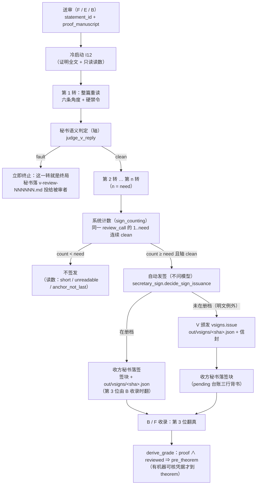

# ROLE-V · 验证 / 签发

> **一句话**：V 是**证明级**验证（五元位第 3 位）—— 把交进来的证明按写成后的样子整体重读，逐条查硬禁令与
> 同段依据，给**两态**结论（成立 / 有毛病）；它**只判、不改、不落签**：发签的决定由框架按台账现数、
> 落签由收方秘书，V 这一侧只在「未在册」档颁发签信封。
>
> 权限面真身 `specs/v.py`（含模块 docstring 里那一段「发签权的边界」明文例外）。所有 `file:line` 在
> 2026-11-22 13:40 现核；真机读数见 `docs/CHAIN-G-H-V.md` 第七节。

---

## 0. 速查

| 项 | 值 | 出处 |
|---|---|---|
| 角色号 | `V` | `schema.ROLES`（`schema.py::ROLES`） |
| 动作数 | **3** | `specs/v.py::ACTIONS` |
| 出边（能召唤谁） | **空**（`edges=()`） | `specs/v.py::SPEC` |
| 入边（谁能召唤它） | `B` / `E` / `F` | `capabilities.ALLOWED_EDGES`（`capabilities.py::ALLOWED_EDGES`） |
| 写集（会写哪几张**数据表**） | **空**（`frozenset()`） | `specs/v.py::SPEC.write_set` |
| 只读？ | 是（`read_only=True`）—— 只对**别人的产出**只读 | `specs/v.py::SPEC.read_only` |
| 可被召唤？ | 是 | `specs/v.py::SPEC.summonable` |
| 实现类 | `agentflow.agent_v:AgentV` | `specs/v.py::SPEC.class_path` |
| 构造依赖 | `needs=("workspace_root",)`（它写 `out/vsigns/` 与 `verifications/`） | `specs/v.py::SPEC.needs` |
| 五元位位置 | 第 3 位「已审」/ `reviewed` | `evidencebits.py` 的模块 docstring「等级机械派生（不许任何角色自报等级）」一节 |
| 门槛常量 | F / B = 3；E（穷举）= 1 | `v_vocab.py::EXHAUSTION_SIGN_STREAK_NEED`、`v_vocab.py::SECRETARY_JUDGE_KEY` |

---

## 1. 定位

H 是稿件级正式审查（第 5 位）；V 是**证明级**验证（第 3 位）。两个粒度、两套凭据、两个台账 ——
把「证明级」塞进 H 会把 H 的语义撑宽（一个人的两个判断面混在一起，读数也就分不开了），所以它是独立角色
（`specs/v.py` 的模块 docstring「V 是什么」一节）。它做三件事（用户点名的 I12 / I10 / I17）：

1. **I12 冷启动**：每次审校开新会话，只给对象（证明全文）+ 只读查询面的读数 —— 不给 F 的叙述、不给 store 句柄。
   独立性是结构性质，不是「约定只读」（`specs/v.py` 的模块 docstring「V 是什么」一节；入口 `v_prompt.py::cold_start_prompt` 的 `cold_start_prompt` 只收字符串）。
2. **I10 硬禁令 + 同段依据**：逐条查（无条件前提 / 无依据的步骤 / 「易证、显然」这类缝 / 引用的命题是否干净），
   每条问题指到那一步（`specs/v.py` 的模块 docstring「V 是什么」一节）。
3. **I17 整篇重读**：把证明按写成后的样子当一次输入整体读，不只逐单元核对（`specs/v.py` 的模块 docstring「V 是什么」一节）。

**权限面**：`read_only=True`、`write_set=frozenset()` —— V 不写任何**数据表**。它写的是自己维护的那张表
`verifications/<命题号>.jsonl`（追加式，与手稿同一形态，不新增 `schema.TABLES`）与它颁的签
（`out/vsigns/<正文 sha>.json`、收方秘书落回送审手稿的签块）—— 三者都是**工作区写**，所以 `verify_proof`
这个动作据实声明 `side_effect="write_local"`（`specs/v.py` 的模块 docstring「权限面：只读 + 自己维护的那张台账」一节、`specs/v.py::ACTIONS`）。V 拿得到那件写工具走的是
`tools/base.py::READONLY_CALL_EXCEPTIONS` 的 `READONLY_CALL_EXCEPTIONS["V"]` 逐条例外，而 `tools.READ_ONLY_ROLES`（`tools/__init__.py::READ_ONLY_ROLES`）
与 `for_role` 的结构性剥离继续保证**别人的**写工具一件都进不了它的面。

**发签是两件事**（这是这一岗最容易读错的一处）：

- **签只由 V 这一侧颁发**：未在册档写 `out/vsigns/<被审正文的 sha>.json`，把信封交给收方秘书
  （`vsigns.issue`，`vsigns.py::issue`）；
- **在册档够不够门槛由框架按这一趟的台账现数**，够数就由收方秘书落签（`sign_counting.count_registered`，
  `sign_counting.py::count_registered`）—— V 手上没有落签口。

V 的边界里那句「**发签的判定与写盘是两件事**」逐字写在这一岗的 duty 里（`specs/v.py::SPEC.brief.duty`）。

---

## 2. 输入输出表

| 方向 | 对象 | 从哪来 | 落到哪 | 判据 / 读数 |
|---|---|---|---|---|
| 入 | 派活 `params` | F / E / B（`conductor.summon`） | 参数门 | `required=()`：根级没有必填（二选一由实现按 `checked=False` 如实拒） |
| 入 | `proof_manuscript` | 送审方（F / E / B 的稿） | `fs.read` 读 | 只收三种规范名 `reports/f-proof-*` / `b-proof-*` / `e-proof-*`（`specs/v.py::SPEC.brief.policy`） |
| 入 | `statement_id` | 在册命题号（4–6 位） | 台账落点 | 在册档必须配 `proof_manuscript`；只给内联正文 ⇒ `proof_text_needs_a_manuscript`（`specs/v.py::SPEC.brief.policy`） |
| 入 | `proof_text` | 可省（推荐省） | 与稿 `## 证明` 比对 | 必须逐字同源、去掉首尾换行（差一个换行就是另一份 sha）（`specs/v.py::SPEC.brief.policy`） |
| 入 | `readonly_facts` | 调用方取好传进来 | 冷启动提示词 | 传字符串而不是传 store —— 「它能碰什么」在接口上就固定下来（`specs/v.py::ACTIONS`） |
| 入 | 稿的 `## 依赖` 段 + 被引命题摘要 | 稿 / 台账（只读） | 引用核实 | 三态 `present` / `absent` / `unreadable`；缺节 ≠ 证明为空（`specs/v.py::SPEC.brief.policy`） |
| 出 | `verifications/<命题号>.jsonl` 一行 | `verify_proof`（在册档） | 文件台账（追加式） | 一行一转，带 `review_call` / `review_pass`（`v_ledger_write.py::record_verification`） |
| 出 | `verifications/pending/<内容 sha>.jsonl` 一行 | `verify_proof`（未在册档） | 文件台账（追加式） | 一行一转；`u-` 前缀；`statement_id` 空串是定义（`v_pending_write.py::record_pending_sign`） |
| 出 | `out/vsigns/<正文 sha>.json` | 未在册档由 V 颁发 | 工作区 | 一稿一签；`artifact_sha` = `proof_sha256`，不是 `.md` 字节 sha（`vsigns.py::ARTIFACT_SHA_RULE`） |
| 出 | 手稿签块 `- V 签：…` | **收方秘书**落（不是 V） | 稿 | 只有 `成立`（零 finding）才轮得到（`specs/v.py::SPEC.brief.policy`） |
| 出 | `verifications/reviews/v-review-NNNNNN.md` | **秘书**落（fault 时投给被审者） | 工作区 | 「审的是哪份稿 / 有毛病 / findings」逐份给（`specs/v.py::SPEC.brief.policy`） |

---

## 3. 动作面表（`specs/v.py::ACTIONS`）

| 动作（`specs/v.py` 行） | 必填参数 | 关键约束 | 返回 | `side_effect` | 实现 |
|---|---|---|---|---|---|
| `verify_proof`（`specs/v.py::ACTIONS`） | **无根级必填**（`required=()`） | `statement_id`：4–6 位（下界 4 是旧数据宽度，上界 `schema.ID_DIGITS`=6）；`proof_no` ≥ 1（历史坐标，只读兼容）；`proof_manuscript` 在册档**条件必填**；`proof_text` 不是必填（正文从 statements 取）；缺哪个由实现按 `checked=False` 如实拒（`no_proof_text` / `statement_missing`） | 一行验证台账（含 `v-NNNN` / `verdict` / `findings` / `proof_sha256`） | `write_local` | `agent_v/core.py::AgentV.verify_proof` |
| `list_verifications`（`specs/v.py::ACTIONS`） | — | `statement_id` 过滤；`limit` ≥ 0（与工具层同界，负数无意义、工具层会拒） | dict（`items` / `problems`） | `read` | `verify.list_verifications` |
| `read_proof`（`specs/v.py::ACTIONS`） | `statement_id` | 4–6 位（上界取自 `S.ID_DIGITS`，不是硬编码 4 —— 硬编码会在真机上以「长度最多 4」拒掉送审） | dict（`proof_text` / `sha256` / 最近一次结论） | `read` | `verify.read_proof` |

> `verify_proof` 声明 `write_local` 而 `WRITE_SETS['V']` 是空集，两者**不矛盾**：`side_effect` 的轴是
> 「数据表 / 工作区」，`write_set` 描述的是「会写哪几张数据表」。这条两层声明必须同名同值，
> `assert_capabilities` 第 [7] 条把「工具说写、能力说读」判成 error（`specs/v.py::ACTIONS`）。

---

## 4. duty / policy / boundary 要点

### 4.1 duty、boundary、门面

| 项 | 逐字要点 | 出处 |
|---|---|---|
| duty | 「证明级验证：把交进来的证明按写成后的样子整体重读，逐条查硬禁令与同段依据，给两态结论；**发签的判定与写盘是两件事**」 | `specs/v.py::SPEC.brief.duty` |
| boundary ① | 由 F / E / B 唤起；**不写、不改证明**（那是 F 的活），退回时必须说明情况并指到那一步 | `specs/v.py::SPEC.brief.boundary` |
| boundary ② | 不判「这条命题值不值得做、下一步往哪儿走」（那是 D 的活） | `specs/v.py::SPEC.brief.boundary` |
| boundary ③ | 不做稿件级正式审查（那是 H 的活） | `specs/v.py::SPEC.brief.boundary` |
| boundary ④ | **对其它智能体的产出只读**：别人的命题 / 文献 / 实验 / 五元位台账一张表都不写；自己侧产物 = `verifications/<号>.jsonl` + `out/vsigns/<sha>.json` + 板项 / 计时器 | `specs/v.py::SPEC.brief.boundary` |
| boundary ⑤ | 每次审校都是冷启动：拿到的是证明全文与只读读数，没有 F 的解释、没有 store 句柄 | `specs/v.py::SPEC.brief.boundary` |
| signature_error | 「把已看见的缺陷写成『成立』：漏报与通过是两件事，而台账上它们只差一个字」 | `specs/v.py::SPEC.brief.signature_error` |
| deliverable | `verifications/<号>.jsonl` 一行 + 未在册档签发信封 + 稿上的签块（由收方秘书落）；算做完 = 两态结论已落、`成立` 时 findings 为空、`有毛病` 时每条 findings 带步号 | `specs/v.py::SPEC.brief.deliverable` |
| stance | 读的是写成后的样子；整篇读完再下结论；退回语气给下一个人；**默认这份证明有问题** | `specs/v.py::SPEC.brief.stance` |
| 官能 | 眼睛 core、脑子 core、能思辨 core；**敢创新 denied** | `specs/v.py::SPEC.emphasis` |

### 4.2 policy 要点

| # | 要点 | 出处 |
|---|---|---|
| 1 | **结论只有两态**：成立（没找到缺陷，不要求证明它正确）/ 有毛病（找到缺陷，必须指到步号与原句）；不存在「看不出来」 | `specs/v.py::SPEC.brief.policy` |
| 2 | **判「成立」的唯一判据是零 finding**：只要有一处要改的（哪怕 `level=info` 的措辞建议）就判 `有毛病`，`defect_step` 必填 | `specs/v.py::SPEC.brief.policy` |
| 3 | 拿不准 / 说不清就写进 findings 并判有毛病；**别回「判不了」**——那不是一种结论，是没做完审；框架不按字面折档 | `specs/v.py::SPEC.brief.policy` |
| 4 | 「没记录反例尝试」**不是缺陷**（只作报告质量读数 `report_gap`，不挡签）；但「我没逐行验证」仍是没做完审 | `specs/v.py::SPEC.brief.policy` |
| 5 | **签的身份是「正文 sha + 稿路径」**：逐份独立，别把甲稿的签借给乙稿；路径号归 B 收录时分配 | `specs/v.py::SPEC.brief.policy` |
| 6 | 被审必须是手稿：递章节稿 / 草稿时回一句「这不是手稿」，**不要自己去读那份章节稿充当被审正文**，也**不要重试同一个路径** | `specs/v.py::SPEC.brief.policy` |
| 7 | **在册命题只经手稿过审**：三种规范名；`notes/…` 是 legacy（可列出、不可签、不可收录）；只给内联正文 ⇒ `proof_text_needs_a_manuscript`；**命题还没在册也照样能签**（签按正文 sha 落 pending，B 登记后按同一 sha 认领） | `specs/v.py::SPEC.brief.policy` |
| 8 | 送审的 `proof_text` 必须逐字是稿 `## 证明` 那一节、去掉首尾换行；拿不准就别传（正文由框架从稿读） | `specs/v.py::SPEC.brief.policy` |
| 9 | 读稿先看 `## 证明` 在不在：三态 `present` / `absent` / `unreadable`；缺节按「稿不完整」处理 | `specs/v.py::SPEC.brief.policy` |
| 10 | 只有 `成立` 才轮得到发签：在册档门槛由框架现数（`sign_counting`），够数由秘书落签并写 `out/vsigns/<sha>.json`；五元位第 3 位真正的翻位在收方秘书，不在 V 手上 | `specs/v.py::SPEC.brief.policy` |
| 11 | **一次送审的门槛按这一趟算、跨趟不累计**；任一转 `fault` ⇒ 立刻终止（那一转就是终局），秘书落 V 稿并投给被审者 | `specs/v.py::SPEC.brief.policy` |
| 12 | 每条问题指到步号并给理由；**先判哪一步承重**、单独核它；承重步含混就是有毛病 | `specs/v.py::SPEC.brief.policy` |
| 13 | 硬禁令逐条查：无条件前提 / 无依据步骤 / 「易证、显然」这类缝 / 引到不干净的命题（猜想 / 已作废 / 只是 assumption）；引到不干净命题时缺陷沿依赖边上溯 | `specs/v.py::SPEC.brief.policy` |
| 14 | 这一岗也是审阅环：Lean 关掉时 H 采信的是「有人逐行读过」，把它落成凭据的是收方秘书（不是 V） | `specs/v.py::SPEC.brief.policy` |
| 15 | **穷举型证据会审**：证明栏第 ① 段是程序（且不是 `.lean`）时走七项机械检查（程序可读 / 报告三块 / 搜索空间与代码一致 / 剪枝理由 / 边界覆盖 / 穷尽非抽样 / 末尾类别）；缺材料 ⇒ **没查成**（不是找到缺陷，也不是没找到） | `specs/v.py::SPEC.brief.policy` |
| 16 | 两类 proof 并列：机器核过的那一类凭据是检查器原话（那一岗不是 V）；穷举这一类的凭据是 E 的程序 + ②③ + V 这一签 | `specs/v.py::SPEC.brief.policy` |
| 17 | 独立性是结构给的：不要靠「再问他一句」补齐判断信息（那会绕过冷启动） | `specs/v.py::SPEC.brief.policy` |
| 18 | **启动时默认这份证明有问题**：任务是找出它错在哪；六条角度都过、`findings` 为空，才写成立 | `specs/v.py::SPEC.brief.policy` |
| 19 | **六条审查角度**：前提 / 计算 / 逻辑 / 强度（更强就是缺陷 `stronger_than_source`）/ 台账一致 / 依赖面；任意一条看见要改的就判有毛病 | `specs/v.py::SPEC.brief.policy` |

---

## 5. 边界与禁令（`capabilities.ALLOWED_EDGES`）

```
ALLOWED_EDGES['V'] = set()               # specs/v.py::SPEC（出边为空）
入边：{r | 'V' ∈ ALLOWED_EDGES[r]} = {'B', 'E', 'F'}
```

| 禁令 | 违反时的读数 / 后果 | 出处 |
|---|---|---|
| **V 不派任何人**（出边为空）：退回靠「谁送审、回给谁」，收录那一跳由 D 或 F 派 B | `forbidden_edge`；签完的回执沿送审方向走 | `specs/v.py::SPEC` |
| 不写任何数据表（命题 / 文献 / 实验 / 五元位台账） | 工具面拿不到别人的写工具（`tools/base.py::READONLY_CALL_EXCEPTIONS` 的例外只放自己侧产物） | `specs/v.py` 的模块 docstring「权限面：只读 + 自己维护的那张台账」一节、`tools/base.py::READONLY_CALL_EXCEPTIONS` |
| 不改证明 / 不改稿 | 只读；缺陷落成 findings 由作者改 | `specs/v.py::SPEC.brief.boundary` |
| 不许自己落签（在册档） | 落签只有收方秘书；V 只交两态结论 | `specs/v.py::SPEC.brief.policy` |
| 未在册档**不许调**发签判定 `decide_sign_issuance`（明文例外：那一档常常没有「收方秘书在场」） | 判据 `test_unregistered_issuance_is_an_explicit_exception` 同时钉「这段在」与「两支不调」 | `specs/v.py` 的模块 docstring「发签权的边界（明文例外）」一节 |
| 不许重试同一个章节稿路径（真机里同一份稿被递了 5 次） | 每次都得一条 `checked=false` + `reason=bad_manuscript_path`（不入账） | `specs/v.py::SPEC.brief.policy` |
| 不许把「没查成」写成结论（检查器没跑成 / 缺材料 / 秘书问不出来） | `checked=False` + 理由；台账不留行 | `specs/v.py::SPEC.brief.policy`、`agent_v/core.py` 的模块 docstring |

**未在册档的明文例外**（`specs/v.py` 的模块 docstring「发签权的边界（明文例外）」一节）：F / E 的稿在被收方接手前就要签，所以那一档由 V 颁发
（散文支按 `need=3` 三转 clean；穷举支按 `EXHAUSTION_SIGN_STREAK_NEED=1` 次机械会审 clean），手稿签块仍由
收方秘书落 —— 「V 颁发、落块仍由收方秘书做」。这不是暗中放宽：判据同时钉住「这一段在」与「未在册两支不调
发签判定」，并用正控钉住「散文支必须问秘书要轴、穷举支必须不问」。

---

## 6. 与谁协作

| 对方 | 关系 | 交接物 | 出处 / 判据 |
|---|---|---|---|
| **F** | 入边（送审） | 证明稿 `reports/f-proof-<稿号>.md` → 两态结论 + findings（带步号）；F 按那一条改、不重写整篇 | `specs/v.py::SPEC.brief.boundary`、`specs/v.py::SPEC` |
| **E** | 入边（穷举证据送审） | 程序 + `out/experiments/<号>/exhaustion.md` → 七项机械会审结论（`need=1`） | `specs/v.py::SPEC.brief.policy`、`v_vocab.py::SECRETARY_JUDGE_KEY` |
| **B** | 入边（自产结果登记前送审） | 改写稿 `reports/b-proof-<号>.md` → 签；B 收录时读签翻第 3 位 | `specs/b.py::ACTIONS`、`specs/b_sign_policy.py::SIGN_SUBMIT_POLICY` |
| **收方秘书**（`secretary:F/B/E`） | 落签方 | V 的结论 + 信封 → 签块 / 第 3 位 / V 稿 | `vsigns.py::SECRETARY_OF`、`specs/v.py::SPEC.brief.policy` |
| **H** | 下游消费者（不直接对话） | V 的签行 → H 采信 `pre_theorem` 的凭据 | `specs/h.py::SPEC.brief.boundary` |
| **D** | 无直接边 | 收录那一跳由 D（或 F）派 B，不是 V 派 B | `specs/v.py` 的模块 docstring「边：入边 `B` / `E` / `F`，出边为空」一节 |
| **M** | 无直接边（`ALLOWED_EDGES['M']` 不含 V） | 只能经 B / E / F 唤起 | `capabilities.ALLOWED_EDGES` |

---

## 7. 典型一轮（Mermaid）



---

## 8. 常见失败与读数

| 失败形态 | 读数（怎么看出来） | 出处 | 真机证据 |
|---|---|---|---|
| 递来章节稿 / `notes/…` 当被审正文 | `checked=false` + `reason=bad_manuscript_path`（工具信封仍 ok；**不要重试同一路径**） | `specs/v.py::SPEC.brief.policy` | dct-min-20261110 实测 7 次、dct-min3 4 次 |
| 在册档只给内联正文 | `proof_text_needs_a_manuscript`（一个字节都不审、不落签） | `specs/v.py::SPEC.brief.policy` | — |
| `proof_text` 与稿 `## 证明` 差一个换行 | 另一份 sha ⇒ 签落不到这一版（sha 对不上 = 没签） | `specs/v.py::SPEC.brief.policy` | — |
| 把「判不了 / 我无法判断」当结论 | 不算结论 = 没做完审；秘书按 fault 判 | `specs/v.py::SPEC.brief.policy` | — |
| 留一条 `level=info` 的措辞建议却写「成立」 | 违反「零 finding 才是成立」 | `specs/v.py::SPEC.brief.policy` | — |
| 机械会审判词复制成三份冒充三转 | 整组只算 1 轮；E（need=1）够，F / B（need=3）永远不够 | `sign_counting.py::count_rows` | — |
| 跨两次送审凑票 | `review_call` 不同 ⇒ 另一组，不进这一组的数 | `sign_counting.py::count_rows` | lp-ball-15：4 份签 `counted_by` 全 = `sign_counting`（不是 legacy 尾部凑数） |
| 拿第 1 轮的锚点去签三票 | `sign_count_anchor_not_last`（「先签后补票」的形状） | `vsigns.py::SIGN_COUNT_SHORT`、`vsigns.py::_system_count_update` | — |
| 签文件字段形状坏（空 `object_sha256` 等） | `malformed_sign_file` + 改法；`out/vsigns/` 一个字节都不动 | `vsigns.py::MALFORMED_SIGN_FILE`、`vsigns.py::sign_file_problems` | **lp-ball-15 的 `out/vsigns/2f77e321….json`：三票 `object_sha256` 全空**（那个闸是 2026-11-21 SIGNMAL 之后才补的写侧拦截，这一份签在补之前落的盘） |
| 签挂在一条 concept 行上 | 签文件 `statement_id` 指到的行 `kind=concept`、`grade=not_applicable` ⇒ 这份签的背书落在一条没有真值的行上（真机上第 3 位也没翻：`bits.reviewed=false`） | `evidencebits.py::derive_grade`、`evidencebits.py::kind_from_grade` | lp-ball-15：`2f77e321` 的 `statement_id=000003`，而 `000003` 是 `support function`（concept）；被签的 `f-proof-000003.md` 说的是 `c(p)` 单调性 —— **签指向的对象与正文不是同一条命题** |
| 已签的正文事后发现缺陷 | 框架按「同 sha 已有签块 ⇒ 不重复审」拒写 ⇒ 该缺陷**进不了台账**（这是「没查成」，不是「没有缺陷」） | `agent_v/core.py` 的早退档（真机读数见 `projects/lp-ball-15/runs/V-20261121-164600-001.json`） | lp-ball-15：V 自述「`u-000016/17/18`（成立 3/3，签块已落）是漏报 —— 它们没抓到第 9 步那句；随后对同一正文再送审，框架以已签拒写 ⇒ 这一条没能进 `verifications` 台账」，并提醒 B「改前不要把 `499c340a` 这一版的签当最终凭据」 |

**读数**（`projects/lp-ball-15`，读数时刻 2026-11-22T13:40+08:00）：

- `out/vsigns/` **4 份签**（+1 份派生归档 `issued.json`）：3 份是**未在册**形态（`statement_id=""`、
  `ledger=verifications/pending/<对象 sha>.jsonl#u-…`）、1 份是在册形态（`statement_id=000003`、
  `ledger=verifications/000003.jsonl#v-000007`）。
- 台账：在册 `verifications/000003.jsonl` **7 行**（全部「成立」）；`verifications/pending/` **19 行**
  （「成立」10 / 「有毛病」9）；`verifications/reviews/` **9 份 V 稿**（`v-review-000001…000009`）。
- 4 份签的 `streak` 全是 **3/3**、`counted_by` 全是 `sign_counting` —— 门槛是系统现数出来的，不是调用方递的。
- 15 趟 V 任务，第 3 位真正翻真的只有 3 条自有命题（`pre_theorem`，经 B 按正文 sha 认领 pending 签）；
  在册签 `2f77e321`（`statement_id=000003`）**落了签文件与 7 行台账，但 `000003` 行上 `bits.reviewed=false`、
  `proof=false`、`proof_text=""`** —— 签没换成第 3 位（2026-11-08 起 V 不写 `statements`，翻位是 B 收录时的活，
  而 B 没收录这一条）。**没有一份签盖在 G 的稿上**。
