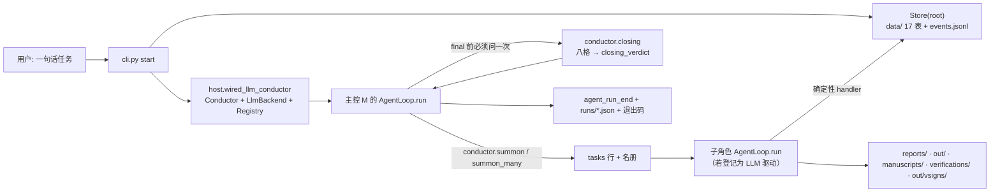

# SYSTEM-INTRO —— agentflow 系统介绍（与当前实现对账）

> **观测时刻**：2026-11-21 23:20 +08:00（本机 `D:\Incubator`，git `master` @ `e1584e9c` + 未提交工作树）。
> **读法**：路径默认相对 `agentflow/`（仓库根 = `D:\Incubator`，产品根 = `agentflow/`）。代码简写约定：
> `specs/…`、`agent_*/…`、裸模块名（`closing.py` / `store.py`…）与 `tools/base.py` 都在
> `src/agentflow/` 下；`scripts/…` 与巡检/发布用的 `tools/repo_survey.py` / `tools/release_all.py`
> 在产品根；工作区文件（`data/…`、`out/…`）见 §4.3。每个数字都带
> "现算"命令；命令都在本机跑过。行号是**取证指针**，会随代码漂，符号名比行号稳。
> **权威序**：代码与判据 > [`docs/INDEX.md`](INDEX.md) > 各份规格 > 本文。**本文是地图，不是规格** ——
> 与代码冲突时以代码为准。
> **交付边界**：`tests/` 不随仓库交付（业主 2026-11-21 裁定，`.gitignore` §16；删除已暂存、尚未提交，
> 提交前 HEAD 仍带 `tests/`，见 §8.4）。所以本文把判据分成
> "**随仓交付的运行门**"与"**本机开发门**"两类写；后者在干净 clone 里跑不了（§8.4）。

---

## 一、这是什么、给谁

**一句话**：`agentflow` 是面向数学研究的多智能体协同框架。用户给一句研究意图，主控 M 把活派给
职责互不重叠的角色（检索 / 立案 / 关系分析 / 研究循环 / 数值实验 / 攻坚 / 撰文 / 审校 / 验证 /
形式化），每一步都落进**追加式台账**，结论要带**可回验的证据与签名**，最后由**收工门**判"能不能交"。

它不是"一个模型一口气答完"的聊天壳，而是**持久工作区**：一个 `<ws>/` 里同时有数据表、事件流、
会话、手稿、产物与签；换一趟、换一个实例、换一个进程，账都还在（[`README.md`](../../README.md) §Highlights）。

**三十秒版**：

1. **11 个角色**：`schema.ROLES` 是 10 个专家（A–H、V、L）＋主控 `M`（`src/agentflow/schema.py:2768`、`:2775`；
   现算 `python -c "import sys;sys.path.insert(0,'src');from agentflow import schema as s;print(len(s.ROLES),s.ROLES,s.CONDUCTOR_ROLE)"`）。
2. **17 张表**：`schema.TABLES`（`schema.py:3651`；现算 `python -c "import sys;sys.path.insert(0,'src');from agentflow import schema as s;print(len(s.TABLES))"`）＋一份只追加的
   `data/events.jsonl`（`store.py:832`）。
3. **67 个动作**：`capabilities.CAPABILITIES` 的动作总数（`capabilities.py:1719`；现算
   `python -c "import sys;sys.path.insert(0,'src');from agentflow import capabilities as c;print(sum(len(v) for v in c.CAPABILITIES.values()))"`）。
4. **8 格收工门**：`closing.DEFAULT_CHECKS`（`closing.py:88`；现算 `python -c "import sys;sys.path.insert(0,'src');from agentflow import closing as C;print(len(C.DEFAULT_CHECKS))"`）。
5. **三态纪律**：`0` = 查过且好 / `1` = 查过且坏 / `2` = **没查成**（`stop_reasons.EXIT_CODE_UNIFIED`，`stop_reasons.py:39`）。

**给谁**：

| 读者 | 该从哪读 |
|---|---|
| **第一次拿到 repo 的人** | 本文 → 根 [`README.md`](../../README.md)（怎么装/怎么跑）→ [`docs/INDEX.md`](INDEX.md)（哪份算数） |
| **要跑一次的人** | 本文 §2.4 与 §5；命令在 [`docs/USER-GUIDE.md`](USER-GUIDE.md) |
| **要改代码的 agent** | 根 [`AGENTS.md`](../../AGENTS.md)（工作方式 R1–R4）→ [`../AGENTS.md`](../AGENTS.md)（FC-27 禁改区）→ [`DEVELOPMENT.md`](../DEVELOPMENT.md) |
| **角色模型** | **不读本文**：提示词来自 `src/agentflow/specs/<角色>.py` 的声明与工作区 `skills/`（[`../README-PRODUCT.md`](../README-PRODUCT.md) §谁读这份） |
| **要判断"结论能不能信"的人** | 本文 §6–§8 |

**两个根，故意的**：git 根是 `D:\Incubator`（`README.md`、`demo/` 在这里）；产品根是 `agentflow/`
（`pyproject.toml` 在这里）。`python -m agentflow` 要在产品根跑，或装成 console script
`agentflow`（`pyproject.toml` 的 `[project.scripts]`）。

---

## 二、架构与运行形态

### 2.1 八层（每层都有"真身"和"守着它的东西"）

| 层 | 真身（代码） | 它保证什么 | 关键入口 |
|---|---|---|---|
| **数据层** | `src/agentflow/schema.py`、`store.py`、`data/` | 表结构、原子落盘、多表事务、事件重放、ID 分配 | `Store.init`（`store.py:871`）、`Store.tx`（`:1298`）、`Store.rebuild`（`:1537`） |
| **声明层** | `src/agentflow/specs/*.py`、`capabilities.py`、`agentspec.py` | 谁能做什么、谁能叫谁、会写哪些表 —— **一份声明派生四张表** | `specs.action_table/edges/write_sets/non_summonable`（`specs/__init__.py:35-52`） |
| **工具层** | `src/agentflow/tools/*.py`、`src/agentflow/tools/base.py` | 模型可见的工具面、只读角色结构性过滤、参数门、副作用/外部性两根轴 | `ToolRegistry.for_role`（`src/agentflow/tools/base.py:989`）、`ToolRegistry.call`（`:897`） |
| **角色层** | `src/agentflow/agent_a … agent_v` | 每个角色的确定性实现与动作 handler | `AgentX` 类（`class_path` 写在 `specs/<role>.py` 的 `SPEC`） |
| **循环层** | `agent_loop.py`、`llmseam.py`、`modelgw.py`、`modelclient.py` | 一个角色的 ReAct 循环、模型缝、预算与计量、插话/挂机/停止 | `AgentLoop.run`（`agent_loop.py:9923`）、`LlmBackend.call`（`:15321`）、`run_role`（`:16054`） |
| **编排层** | `conductor.py`、`host.py`、`cli.py`、`runflow.py`、`autonomy.py` | 派活/收行/名册/板项/秘书/预算/多轮；CLI 的四个入口 | `Conductor.summon`（`conductor.py:9284`）、`summon_many`（`:10407`）、`host.wired_llm_conductor`（`host.py:458`） |
| **质量层** | `closing.py`、`verify.py`、`wellformed/`、`sysguard.py`、`sysresidue.py`、`scripts/` | 收工八格、一致性审计、畸形、写点读数、禁改区门、发布门 | `closing.check_closing`、`verify.verify_all`、`scripts/*.py`（§8） |
| **用户面** | `cli.py`、`src/agentflow/webui/`、`ui/`（Preact + Vite） | 命令行四个入口与只读网页；`ui/` 是前端工程，构建产物入库在 `src/agentflow/web/static/` | `python -m agentflow --help` |

**为什么"声明只有一份"很重要**：`specs/<角色>.py` 的 `SPEC` 是权限面真身；`capabilities.py` 的
`CAPABILITIES` / `ALLOWED_EDGES` / `WRITE_SETS` / `NON_SUMMONABLE` 全部由它派生
（`capabilities.py:1719`、`:1995`、`:2111`、`:2118`）。改 `specs/` 就是改权限面，所以它在
`.noai-paths` 的 `auth-audit` 组里（`../AGENTS.md`）。两层一致性由
`capabilities.assert_capabilities()` 的八条断言守（`capabilities.py:2593`）；它**默认不在 import
期跑**（开关 `AGENTFLOW_CAPABILITY_AUDIT` 才跑，`capabilities.py:3367`），日常由本机判据显式调。

### 2.2 运行形态

| 形态 | 命令（在 `agentflow/` 下） | 角色 | 典型用途 |
|---|---|---|---|
| 多角色研究 | `python -m agentflow --root <ws> start --task "…"`（`--mode research` 或 `auto` 推断） | 主控 M（出边 A/B/C/D/E/G/H；V 与 L 由 B/E/F 唤起） | 主路径：长研究、跨会话 |
| 单角色循环 | `python -m agentflow --root <ws> start --mode role --role B --task "…"` | 只跑一个角色 | 调试某个角色、补一趟 |
| 主题管线 | `python -m agentflow --root <ws> start --mode topic --task "…"` | 检索→抽取→跑题（`runflow.run_topic`） | 一次跑完的小任务 |
| 只读网页 | `python -m agentflow --root <ws> start --watch` | 不起角色 | 看会话/台账/板 |
| 离线自检 | `python -m agentflow --root <ws> doctor`（或 `init` → `submit` → `run-a --provider fixture`，候选清单在 `<ws>/fixtures/candidates.json`） | 无模型 | 验证这台机器与记录链路；`demo` 已退场并**整体删除**（exit 2，见 §9.3） |

CLI 的四个入口是 `incubate` / `inspect` / `run` / `serve`，旧命令名一个都没删
（`python -m agentflow --help` 现算；[`README-PRODUCT.md`](../README-PRODUCT.md) 的"怎么用"一节也是同一口径）。

**一次运行需要什么**：Python ≥ 3.11；运行期只强依赖 `filelock` 与 `PyYAML`（`pyproject.toml` 的
`dependencies`）；PDF 解析是 `[pdf]` 可选，OCR 是 `[ocr]` 可选，浏览器端到端是 `[browser]` 可选。
**没有模型 key 也能起工作区、跑 `doctor --selfcheck`、读台账**；真跑模型没有 key 会以退出码 2 明说
（`README-PRODUCT.md` §怎么用）。

### 2.3 主干图（只画一条主路）



### 2.4 最小可见命令（零模型、零写入优先）

```powershell
# 在 agentflow/ 下
python -m agentflow --help                       # 四个入口与全部旧名
python -m agentflow doctor --selfcheck           # 只扫包内源码：0=齐 / 1=有缺 / 2=没查成
python -m agentflow --root <ws> init             # 建 17 张空表 + counters + events
python -m agentflow --root <ws> start --task "…" --dry-run   # 只出计划：一个字节不写、一次模型不调
python -m agentflow --root <ws> status           # 读表
python -m agentflow --root <ws> verify           # 一致性审计：0/1/2
python -m agentflow --root <ws> closing --project-dir <ws> --report <ws>/out/review/REPORT.md --no-index
```

`--dry-run` 已实测：退出 0，且**不创建** `<ws>`（见附录 B 第 16 条）。

---

## 三、十一角色：职责、协作面、写什么、吐什么

**读法**：**入边** = 谁的 `ALLOWED_EDGES` 指向它（谁能召唤它）；**出边** = 它能召唤谁。
两张表都从 `capabilities.ALLOWED_EDGES` 现读（`capabilities.py:2111`），由 `specs/<role>.py` 派生。
**写集** = `WRITE_SETS[role]`（`capabilities.py:1995`）。注意：**写集是并发轴的读数，不是权限闸** ——
真正拦直写的是 `store.direct_write_refusal`（`store.py:291`，通用写口一律拒 `statements`/`dependencies`）
＋秘书那一道"只有 B 能经命题登记格落"的角色判据（`specs/l.py:53-58` 的写集说明逐字解释：
"写集里没有它，'L 绕过 V 签'在结构上不可能"）。

现算动作数（每个角色 `SPEC.actions` 的长度）：

```powershell
python -c "import sys;sys.path.insert(0,'src');from agentflow import specs;sp=specs.builtin_specs();[print(r,len(s.actions),[a.action for a in s.actions]) for r,s in sp.items()]"
```

### 3.1 总表

| 角色 | 一句话职责 | 入边（谁能召唤） | 出边（它能召唤） | 写集 | 动作数 | 主要吐出 |
|---|---|---|---|---|---|---|
| **A** 文献检索 | 把搜索请求变成已登记的文献行，并如实报告每次失败 | D、F、H、M | B | `search_requests`、`literature` | 6 | `literature` 行、`search_requests.outcome`、下载与抽读件 |
| **B** 文献整理 | 第一阶段机械录入；第二阶段逐个优化（洗稿→重拿 V 签→精准替换），自驱 | A、D、E、F、M | C、D、H、L、V | `statements`、`relations`、`conjectures`、`literature`、`reprocess_requests` | 10 | 概念行/命题行、关系行、`reports/b-proof-*.md` 副本 |
| **C** 关系分析 | 用确定性代码算图与计数，只在排序与措辞上用模型 | B、D、F、G、L、M | （空） | `analysis_reports`、`search_requests` | 10 | `analysis_reports` 一行 + `reports/<report_id>-<kind>.md` |
| **D** 研究循环 | 把一个方向收敛成有证据的结论，或如实说证据不足 | B、F、G、M | A、B、C、E、F | `research_questions`、`search_requests` | 14 | `reports/RESEARCH.md`、问题状态、检索/实验请求 |
| **E** 数值实验 | 把一条断言变成可复现的实验或反例 | D、F、H、M | B、D、V | `experiments`、`conjectures` | 4 | `experiments` 行 + `out/experiments/*.log` + `reports/e-num-*.md` |
| **F** 多轮攻坚 | 在预算内一轮轮逼近平息或反例，并如实报告进展 | D、M | A、C、D、E、V | `attack_plans`、`conjectures`、`search_requests`、`reprocess_requests` | 5 | `attack_plans` 行 + `reports/attack-*.md` + `reports/f-proof-*.md` + V 签 |
| **G** 论文撰写 | 把台账里的结论汇编成可审校的稿件，附每条断言的来路 | M | C、D、H | `documents`、`dependencies`、`review_findings` | 7 | `documents` 行 + `documents/<doc_id>.md` + `out/paper/*` + `MAPPING.json` |
| **H** 审校（只读） | 只判稿件有没有把自己说清楚，不判数学对不对 | B、G、M | A、E | `documents`、`review_findings` | 5 | `review_findings` 行、`documents.status`、`out/review/<doc>-review.md` |
| **V** 证明验证 | 把证明按写成后的样子整体重读，逐条查硬禁令与同段依据，给两态结论 | B、E、F | （空） | （空） | 3 | `verifications/<号>.jsonl` 或 `pending/<sha>.jsonl`、`out/vsigns/<sha>.json`、稿上签块（签块由收方秘书落） |
| **L** Lean 形式化 | 把 B 登记的那条命题与证明链路忠实搬进 Lean，交给检查器真跑 | B | C | `experiments` | 3 | `code/formal/<声明名>.lean` + 检查器原话 + `experiments` 行 |
| **M** 主控 | 决定派谁做什么、按什么顺序做，把结果收敛成可读交付 | （不可被召唤） | A、B、C、D、E、G、H | （空） | 0 | `tasks` 行、派活、`out/review/REPORT.md`、验收表 |

> 入边/出边逐条现算：`python -c "import sys;sys.path.insert(0,'src');from agentflow import capabilities as c;print({k:sorted(v) for k,v in c.ALLOWED_EDGES.items()});print(sorted(c.NON_SUMMONABLE))"`
> 换来的结构性质：**M 不可被召唤**；**C 与 V 出边为空**（只读结论不做请求）；**B 是唯一的枢纽**
> （入边 5 家、出边 5 家）；**L 只由 B 唤起**，且 Lean 关着时 L 根本不存在（`leanscope.py:59`）。

> **一处必须点名的"写集 ≠ 实际写过的表"**：A 的候选落在 `lit_candidates`（`litstage.py:1208` 等
> 六处 `tx("lit_candidates", actor=…)`），而 `WRITE_SETS["A"]` 只列 `literature` / `search_requests`。
> 这不是笔误可掩盖的：写集是**并发轴的读数**，不是权限闸；实际写面要以动作 handler 为准。逐表
> 对账时请按"handler 实际写哪张表"核，不要拿 `WRITE_SETS` 当完整清单。

### 3.2 逐角色：吃什么、吐什么、哪条硬约束最容易踩

#### A —— 文献检索（`specs/a.py:216`，动作表 `:29`）

- **吃**：`search_requests` 里 `pending` 的委托（`run_once` 可用 `request_ids` 点名认领）；或调用方给
  `topic` / `mode` / `providers` 现查（`search_literature`）。也能从本地书架 `ingest_local`、按题名
  检索 `shelf_search`。
- **吐**：`literature` 行（`lit_id` 由系统发号）、`search_requests.outcome` 与 `result_lit_ids`、
  下载与抽读件；收进 `literature`（`admitted > 0`）后**必须派 B 的 `run_once`** 收编。
- **硬约束**：候选先落 `lit_candidates`（待入库候选表），判收/判拒/提交是三步，提交（`lit.admit_all`）
  才批量注册并清表；**没有正文不许判收**（`content_read` 由机器现算，不靠自报）；命中校验三态
  `matched ∈ exact / partial / mismatch`（第三态是"对不上"）；把命题交给下游前的**定位**是另一栏：
  `exact / partial / none`，`none` 不许交给 B —— 两栏不是同一个 `matched`，别混读。
- **为什么写集是这样**：它只写请求与文献两张表；概念网是 B 的活。

#### B —— 文献整理（`specs/b.py:428`，动作表 `:33`）

- **吃**：A 交来的文献（`run_once` / `run`）；F 的证明稿与 E 的数值证明稿（`ingest_manuscript` /
  `land_manuscript`）；`reprocess_requests`（重做请求）。
- **吐**：`statements`（`kind=concept` 的概念行 ＋ 命题行）、`relations`、`conjectures`、`reports/b-proof-*.md`
  副本、`literature.processed`。**第一阶段是快录，第二阶段才是主职**：洗稿 → 重拿 V 签 → 精准替换，
  旧正文进 `proof_history`，`bits.evidence.optimized_by_proof[n]=true`。
- **硬约束**：没有逐字引文支撑的关系不许产出；`quote_verified` 是三态（`True`/`False`/`None`），
  不是 `True` 就必须写 `quote_reason`；**已拿签的稿只读** —— 要洗先 `open_polish_copy` 开 B 号副本；
  没有盖在新正文上的签不许替换（签只认最新一版）。
- **为什么它是枢纽**：命题台账的正式写口在这里，G/H/V/E/F 全部围着它转。

#### C —— 关系分析（`specs/c.py:117`，动作表 `:26`）

- **吃**：`relations` / `statements`（只读）；调用方给的分析请求（`hottest` / `paths` / `cold` /
  `gaps` / `neighbors` / `relations_between` / `contradictions` / `structural_duplicates` /
  `proof_chain` / `handle`）。
- **吐**：`analysis_reports` 一行（落库口是 `AnalysisReport.persist()`，`handle` 在用：
  `agent_c/_support.py:231`；自由产出的登记口是 `analysis.register_report`，登记在
  `READONLY_CALL_EXCEPTIONS["C"]` 里的**自有产物代理**，`src/agentflow/tools/base.py:142`）＋
  `reports/<report_id>-<kind>.md`。
- **硬约束**：计数、索引、图搜索、路径枚举、去重、评分、溯源**全部由代码算**，不许模型重算；
  模型只能给排列或"值不值得研究"的判断，不许改分数、不许删路径；钩子坏了退回确定性顺序并写明。
- **出边为空**：C 不向任何人发请求；缺口要变成检索/实验请求时，由调用方（D）去做。

#### D —— 研究循环（`specs/d.py:161`，动作表 `:29`）

- **吃**：`research_questions`（`qid`/`row`）、B 的入库结果、C 的分析报告、E/F 的实验与攻坚结果。
- **吐**：`reports/RESEARCH.md`（跨趟交付：成果概述 / 定义与已知 / 已确定的结论 / 尝试与失败 /
  例子与反例 / 未解问题 / 下一步）、`reports/<qid>-research.md`、`research_questions.status`、
  `search_requests`（缺口转检索）、猜想的九个状态。
- **硬约束**：只用证据包里出现过的关系 id 与引文；置信度只能等于或低于确定性口径；证据不足时的
  正确结论是低置信度＋缺口清单；`needs_evidence` 必须同时写非空 `waiting_request_ids`。
- **四条出边**：派 A 检索、派 E 做实验、派 F 攻坚、派 B 立案；`F → D` 是直接边（F 可反过来派 D）。

#### E —— 数值实验（`specs/e.py:126`，动作表 `:26`）

- **吃**：`claim` / `claim_key` / 脚本路径 / 参数 / 方法 / `kind`（`run_experiment`）；`evidence_for` /
  `list_experiments` 读历史。
- **吐**：`experiments` 行（`experiment_id`、`method`、`result ∈ supports/refutes/inconclusive`、
  `exit_code`、`code_path`、`code_hash`、`artifact_paths`、`counterexample`、`verifier_output`）＋
  `out/experiments/<实验号>.log`；穷举档另有三件套（搜索空间 / 穷尽的判据 / 边界处理）与
  `out/experiments/<号>/exhaustion.md` ＋ `reports/e-num-<号>.md`，送 V 会审（need=1）。
- **硬约束**：数值判读是确定性的，不许过模型；脚本自报的"proof 级"一律降级（计算类最多到
  `strong_conjecture`）；跑不过/读不到就 `inconclusive` 或 `failed/unknown`，不许补写结论。
- **为什么 E 能到 `theorem`**：穷举证书与 Lean 核查**同级**（`evidencebits.py:42-57`）。

#### F —— 多轮攻坚（`specs/f.py:122`，动作表 `:26`）

- **吃**：`problem` / `problem_key` / 子目标 / 预算（`create_plan`）；`plan_id` 与 `product`
  （`step`）。
- **吐**：`attack_plans`（`plan_id`、`status`、`rounds`、`history`、`subgoals`、`best_partial`）＋
  `reports/attack-<plan_id>.md`；证明稿 `reports/f-proof-<稿号>.md` 交 V。
- **硬约束**：终止条件是预算与轮次，不是感觉；`stalled` 必须交非空 `best_partial`；子目标
  `closed` 必须有 proof 级证据（`proof_experiment_ids` 非空，凭据只有两类：机器核过的源码原话、
  已由 V 会审成立的穷举证明）；**形式化不是 F 的活**，只能用户指定、由 B 逐条派 L。
- **为什么有直接边到 A/C/D/E/V**：攻坚需要检索、图分析、再研究、实验、验证，但它只"请求"，
  不替它们下结论。

#### G —— 论文撰写（`specs/g.py:353`，动作表 `:29`）

- **吃**：`statements`（含 `kind=concept` 的概念行）、`experiments`、B 的台账、D 的研究稿、
  C 的分析报告；`compose_claim` 组织 claims。
- **吐**：`documents` 行（`doc_id`、`kind`、`title`、`markdown_path`、`claims`、`status`、
  `content_sha256`）＋ `documents/<doc_id>.md`；成文阶段 `out/paper/main.tex`、`out/paper/main.pdf`、
  `out/paper/MAPPING.json`；引用依赖 `dependencies`。
- **硬约束**：不做语义判定（引文是否可达、强度是否超过引文由判据与 H 判）；`evidence_kind` 历史列
  写错会导致断言强度错；没有证据的判断不进稿件；证据不足要回去要（交 D），不许把话说软。
- **按 T0–T4 分档处理篇幅**：T0 可一句、T1 可压缩进附录、T2 正文留框架、T3/T4 框架与动机必须留正文；
  压缩可以，失踪不行。

#### H —— 审校（只读，`specs/h.py:118`，动作表 `:29`）

- **吃**：`documents`（`doc_id`）/ `out/paper/main.tex` / `out/paper/main.pdf`（派活会点名落点）；`fs.read` 是主要手段。
- **吐**：`review_findings`（`finding_id`、`doc_id`、`level`、`target`、`line`、`message`、
  `suggestion`）＋ `documents.status`（`accepted` / `in_review` / `unresolved_review`）＋
  `out/review/<doc_id>-review.md`（路径由框架定）。
- **硬约束**：只判"说清楚没有"（记号没定义 / 指代不明确 / 论证跳步），不判数学对错；**审过 ≠ 通过**
  （通过 = 裁决成立 + 逐条硬禁令查过 + 依赖闭合查过）；查不了的那一档 `checked=False`，不许写成裁决；
  **H 不召唤 G**（G 是父），只落 findings。
- **采信规则**：正文与 B 的台账逐字一致（`quote_verified=true` 且可比对）＋等级到 `theorem`
  （实验行 + V 签，穷举与 Lean 同级）；Lean 关着时文字证明采信 `pre_theorem`（V 逐行走查的签）。

#### V —— 证明验证（`specs/v.py:213`，动作表 `:117`）

- **吃**：`proof_text` / `statement_id` / `proof_no` / `proof_manuscript`（在册或未在册）；穷举档吃
  程序 + ②③ 报告。**每次审校都是冷启动**：没有 F 的解释、没有 store 句柄。
- **吐**：两态结论（`verdict ∈ 成立 / 有毛病`，`v_vocab.py:34`）＋ `findings[].defect_step`；
  在册落 `verifications/<命题号>.jsonl`，未在册落 `verifications/pending/<正文 sha>.jsonl`；
  **在册档**：V 只产审稿意见，发签门槛由框架从台账现数、收方秘书执行落签；
  **未在册档**：V 颁发签信封 `out/vsigns/<被审正文的 sha>.json`，手稿签块仍由收方秘书落
  （这一档 V 一处签写口都没有，`specs/v.py:62-88`）。
- **硬约束**：`成立` 时 findings 必须为空（零 finding 才是成立）；`有毛病` 时每条 finding 要步号；
  默认这份证明有问题，沿六条角度找不到才写成立；不改证明、不判方向、不判体例。
- **判定与写盘分家**：签的"判定 / 计数 / 写盘"分三层（`sign_counting` 数、`vsigns.issue` 出信封、
  收方秘书落块）；V 的代码在未在册档不碰手稿签块。

#### L —— Lean 形式化（`specs/l.py:205`，动作表 `:106`）

- **吃**：B 已登记的那条命题与证明链路（`claim` / `source` / `statement_id` / `proof_no`）。
- **吐**：`code/formal/<声明名>.lean` ＋ 检查器原话（`verifier_output`）＋ `experiments` 一行
  （`method=formal`、`code_path`、`code_hash`、`exit_code`）；三态 `verified / failed / unknown`。
- **硬约束**：只形式化 B 已登记的那一条，假设/量词/定义/名字都不许改写；B 的 `proof_text` 每一步都要
  在 Lean 源码里有落点，接不上的记缺口，**不许 `sorry` / `admit`**；检查器原话与真实退出码是唯一凭据，
  没跑成写 unknown，绝不拿 0 冒充跑过。
- **存在性**：Lean 开关关着时 L 不存在（角色表、工具面、提示词全部隔绝，`leanscope.py:59`）。

#### M —— 主控（`specs/m.py:50`，动作表空 `:39`）

- **吃**：用户任务、会话/收件箱、板项、名册、子代理回报、收工门读数。
- **吐**：`tasks` 行与派活（`conductor.summon` / `summon_many`）、板项、`out/review/REPORT.md`、
  验收表 `out/paper/ACCEPTANCE-CHECKS.json`、收工那句 `final`。
- **硬约束**：不产出领域对象；不可被召唤；派活必须走能力表与策略（越权的边、超深度、超预算都被拒）；
  不许替角色下结论；**交 final 前必须问一次收工门**（研究型 / 有门的项目；最后一问必须是权威的），且不许把
  "机器读数没过"读成"做完了"（§6.5）。

### 3.3 协作面的三个结构事实

1. **没有一个角色能"绕过"另一个角色写它的表**：写集只是读数，真正的闸是
   `store.direct_write_refusal`（`statements` / `dependencies` / `conjectures` / `documents` /
   `lit_candidates` 拒通用写口，`store.py:291`）＋秘书角色判据（只有 B 能经命题登记格落）。
   所以 L 拿不到"给命题升档"的权限，E 也改不了别人的结论。
2. **只读角色（C/H/V）也有写面，但钉死在登记表里**：`src/agentflow/tools/base.py:142` 的
   `READONLY_CALL_EXCEPTIONS` 逐条登记（C 的 `analysis.register_report`、H 的
   `review.record_finding`/`review.report`/`review.review_document`/`review.verify_fixes`、
   V 的 `verify.verify_proof`，外加三者共用的时钟与 `conductor.ack/post_task/escalate`）。
   `for_role` 结构性过滤与 `call` 调用期判据共用同一个 `_role_surface`（`src/agentflow/tools/base.py:1038`）。
3. **L 的入边只有 B、出边只有 C**（`specs/l.py` 的 `SPEC`）：形式化不是流水线的一环，只能由用户
   指定、B 转交、逐条派；所以 `ALLOWED_EDGES` 里没有"用户→L"这条边（用户指定走 `run-agent L` 入口）。

---

## 四、数据与产物：台账、文件、契约

### 4.1 一个工作区长什么样

```text
<ws>/
├── data/                      # 17 张表（每表一个 JSON 快照）+ counters.json + events.jsonl
│   ├── statements.json        # 命题/概念台账
│   ├── relations.json         # 概念关系（带逐字引文与回验三态）
│   ├── literature.json        # 已入库文献
│   ├── lit_candidates.json    # 待入库候选（A 的草稿台）
│   ├── experiments.json       # 实验（数值/符号/穷举/形式化）
│   ├── documents.json         # 稿件（G 的正文）
│   ├── tasks.json             # 每一趟/每一次召唤一行（派活与收行的账）
│   ├── usage_ledger.json      # 每一笔花销一行（token/usd；零值也记，重试也计）
│   ├── events.jsonl           # 只追加事件流：重建快照的唯一输入
│   └── …                      # 其余 9 张表见 §4.2
├── ARTIFACTS.jsonl            # 产物归属台账（谁在哪个路径产出了什么；一行一条）
├── sessions/<sid>.jsonl       # 会话事件流（agent_run_start/end、step、llm_call…）
├── runs/                      # 每趟产出 runs/<角色>-<时间戳>-<序号>.json；检查点；停历史
├── reports/                   # 报告与手稿头：RESEARCH.md、attack-*.md、f-proof-*.md、e-num-*.md…
├── manuscripts/handoffs.jsonl # 交接手稿（一行一份，编号在锁内分配）
├── documents/<doc_id>.md      # 稿件正文（documents 表的落点）
├── verifications/<号>.jsonl   # V 的在册台账
├── verifications/pending/<sha>.jsonl  # 未在册审校（按正文 sha 分文件）
├── out/
│   ├── paper/                 # main.tex / main.pdf / COMPILE-RECEIPT.json / MAPPING.json / ACCEPTANCE*
│   ├── review/                # REPORT.md、m-verdicts.jsonl、<doc>-review.md
│   ├── experiments/           # 实验日志与穷举三件套
│   ├── texts/                 # 抽出的正文文本（text.extract 的默认落点）
│   ├── vsigns/                # 签：<正文sha>.json + issued.json（派生归档）
│   ├── sysguard/              # 写点读数 write-readings.jsonl
│   ├── roster/ · secretary/ · tasks/ · steps/ · surfaces/ · invalid/ · clock/   # 过程读数
│   └── …
├── index/run-index.json       # 通关后建的趟次索引（派生）
├── library/                   # 文献库（PDF/HTML 等）
├── code/                      # 实验脚本与 Lean 源码（code/formal/*.lean）
├── skills/ · notes/           # 角色技能与草稿本（笔记不交接）
└── projects/                  # 仅当这个根还当"项目容器"时存在
```

**契约（表的落盘形态）**：每张表是一个 JSON 文档 `{"schema_version": 2, "rows": [...]}`
（`store.py:1344`；`SCHEMA_VERSION=2`，`schema.py:30`）。提交顺序是**先追加事件、再逐张落盘快照**
（`store.py:1321-1325`），快照写是原子的（`_atomic_write`，`store.py:1069`）。因此
`Store.rebuild` 可以只拿 `events.jsonl` 重建全部快照（`store.py:1537`）。多表事务按 `LOCK_ORDER`
固定顺序取锁（`store.py:51`），最后一把永远是 `counters`。

**事件行长什么样**（真实读数）：

```powershell
python -c "import json;d=json.loads(open(r'projects/lp-ball-15/data/events.jsonl',encoding='utf-8').readline());print(sorted(d));print(d['seq'],d['op'],d['table'],d['actor'])"
# ['actor','batch','note','op','row','seq','table','ts'] / 1 upsert tasks conductor
```

### 4.2 17 张表（每张的关键格）

> 现算：`python -c "import sys;sys.path.insert(0,'src');from agentflow import schema as s;print(len(s.TABLES));[print(k,v['file'],v['id_field']) for k,v in s.TABLES.items()]"`

| 表（行类） | 文件 | 主键 | 关键列（节选，字段真身看行类） | 主要写者 |
|---|---|---|---|---|
| `search_requests`（`SearchRequest`，`schema.py:293`） | `search_requests.json` | `request_id` | `topic`、`mode`、`done`、`outcome`、`result_lit_ids`、`submitted_by`、`claimed_by`、`lease_until` | A（生产/消费）、C/D/F（提交缺口） |
| `literature`（`Literature`，`:445`） | `literature.json` | `lit_id` | `title`、`doi`、`year`、`authors`、`path`、`processed`、`source_request_ids`、`dedup_key`、`matched` | A（登记）、B（消化后置 `processed`） |
| `lit_candidates`（`LitCandidate`，`:520`） | `lit_candidates.json` | `slot` | `batch`、`status`、`title`、`request_id`、`relevance`、`new_content`、`lit_id`、`reason_code`、`cleared_at` | A |
| `relations`（`Relation`，`:785`） | `relations.json` | `relation_id` | `concept_ids`、`description`、`lit_id`、`page_range`、`quote`、`quote_verified`、`quote_mode`、`quote_span`、`status`、`duplicate_of` | B（唯一写者）、C（读）、D（只读并裁决，裁决落 `research_questions`） |
| `statements`（`Statement`，`:2405`） | `statements.json` | `stmt_id` | `origin`、`kind`、`statement_full`、`proof_text`、`source_lit_id`、`page_range`、`quote_verified`、`evidence_kind`、`bits`、`status`、`derived_from` | B（唯一正式写口；F/E 交稿、D 交问题与状态，都不是直接写这张表） |
| `conjectures`（`Conjecture`，`:1142`） | `conjectures.json` | `conjecture_id` | `statement`、`negation_statement`、`form`、`testable`、`status`、`experiment_ids`、`proof_experiment_id`、`counterexample_experiment_id` | E/F/B 经 `conjectureledger.register`（没有"立一条猜想"这个动作；`store.py:345-357`） |
| `research_questions`（`ResearchQuestion`，`:1030`） | `research_questions.json` | `question_id` | `question`、`origin`、`status`、`priority`、`evidence_lit_ids`、`waiting_request_ids`、`gap_reason` | D |
| `analysis_reports`（`AnalysisReport`，`:1286`） | `analysis_reports.json` | `report_id` | `kind`、`request`、`params`、`summary`、`payload`、`markdown_path` | C |
| `reprocess_requests`（`ReprocessRequest`，`:964`） | `reprocess_requests.json` | `reprocess_id` | `reason`、`relation_ids`、`lit_id`、`status`、`result`、`claimed_by` | B/F |
| `experiments`（`Experiment`，`:1687`） | `experiments.json` | `experiment_id` | `claim`、`method`、`result`、`code_path`、`code_hash`、`exit_code`、`artifact_paths`、`counterexample`、`verifier_output`、`status` | E（数值/符号/穷举）、L（formal） |
| `attack_plans`（`AttackPlan`，`:2002`） | `attack_plans.json` | `plan_id` | `problem`、`status`、`rounds`、`budget`、`subgoals`、`history`、`best_partial` | F |
| `documents`（`Document`，`:2128`） | `documents.json` | `doc_id` | `kind`、`title`、`markdown_path`、`sections`、`claims`、`status`、`content_sha256`、`revision` | G（写）、H（只改 status/审核轴） |
| `dependencies`（`Dependency`，`:2293`） | `dependencies.json` | `dep_id` | `used_by`、`kind`、`label`、`status`、`source_lit_id`、`source_experiment_id`、`source_stmt_id`、`page_range`、`quote` | G（登记） |
| `review_findings`（`ReviewFinding`，`:2631`） | `review_findings.json` | `finding_id` | `doc_id`、`kind`、`level`、`target`、`line`、`message`、`suggestion`、`status` | H |
| `tasks`（`Task`，`:2914`） | `tasks.json` | `task_id` | `role`、`action`、`called_by`、`parent_task_id`、`depth`、`status`、`outcome`、`refusal_reason`、`tokens`、`usd`、`artifacts` | M/Conductor（每次召唤一行） |
| `usage_ledger`（`UsageEntry`，`:3292`） | `usage_ledger.json` | `usage_id` | `scope`、`role`、`task_id`、`tokens_in`、`tokens_out`、`tokens_total`、`usd`、`idem_key` | 模型缝/计量层 |
| `eval_results`（`EvalResult`，`:3383`） | `eval_results.json` | `eval_id` | `claim_key`、`benchmark`、`benchmark_version`、`split`、`k`、`value`、`decontamination`、`date` | 评测（当前无生产者的那一路由判据点名） |

**读表的三条口径**（都写在代码里）：

1. `store.rows(table)` 对"表文件不存在"与"表存在但零行"都回 `[]` —— 所以收工门用
   `_no_judgeable_rows` 把"没有可判对象"记 `na`，不是 `pass`（`closing.py:123`）。
2. `statements` 的**完整形态**是三项：含完整假设的命题正文（`statement_full`）、证明正文
   （自产由手稿带进来，文献侧是逐字 `proof_text`）、出处（`source_lit_id` + `page_range`）。
3. 概念行没有真值：`kind="concept"` 住 `statements`，等级记 `not_applicable`（`evidencebits.py:122`）。

### 4.3 文件台账与 JSONL 契约

> 本小节的 `data/…`、`ARTIFACTS.jsonl`、`sessions/…`、`manuscripts/…`、`verifications/…`、`out/…`
> 都是**工作区相对路径**（前面省略了 `<ws>/`）；`src/…`、`scripts/…`、`tools/…` 才是产品根相对。

| 文件 | 一行是什么 | 字段 | 谁写 |
|---|---|---|---|
| `data/events.jsonl` | 一次事务里的一个事件 | `seq`、`ts`、`op`、`table`、`row`、`actor`、`batch`、`note` | `store.tx` 提交块（`store.py:1440`） |
| `ARTIFACTS.jsonl` | 一次产出登记 | `at`、`path`、`sha256`、`bytes`、`producer`、`kind`、`task_id`、`exit_code`、`note`、`instance`、`identity_conflict`、`family`（`artifacts.py:66`） | 各写盘动作在落盘后补登记 |
| `sessions/<sid>.jsonl` | 一个会话事件 | `seq`、`ts`、`kind`、`role`、`task_id`…（`kind` 如 `agent_run_start` / `agent_step` / `llm_call` / `agent_run_end`） | `sessions.append` |
| `manuscripts/handoffs.jsonl` | 一份交接手稿 | `id`、`sender`、`to`、`summary`、`body`、`refs`、`created_at`、`task_id`、`sid`、`sha256`、`bytes`（`manuscripts.py:30`） | 各角色（秘书派生/自撰） |
| `out/vsigns/<sha>.json` | 一稿一签 | `schema="vsign/1"`、`artifact_sha`、`artifact_path`、`verdict`、`streak`、`need`、`passes[]`、`statement_id`、`ledger`、`written_by`（字段由 `vsigns._sign_document` 拼，`vsigns.py:2729-2763`） | V 侧框架（`vsigns.issue`） |
| `out/vsigns/issued.json` | 派生归档（**不许当判据**） | `schema="vsigns-issued/1"`、`signs[]`、`updated_at`（`vsigns.py:115-124`） | `vsigns.archive` |
| `verifications/<号>.jsonl` | 一次审校一行（在册） | `verification_id`（`v-NNNN`）、`verdict`、`statement_id`、`proof_sha256`、`review_call`、`review_pass`、`findings[]` | V（`v_ledger_write`） |
| `verifications/pending/<sha>.jsonl` | 未在册审校一行 | `verification_id`（`u-NNNN`）、`object_sha256`、`proof_sha256`、`review_call`、`review_pass` | V（`v_pending_write`） |
| `out/sysguard/write-readings.jsonl` | 系统写点的一次读数 | `ok/refused/derived/unchecked` 形状（`sysguard.WriteReading`） | 系统写口（`sysguard.record_reading`） |

**ARTIFACTS 的三态**：`verify_entries` 给 `ok / changed / missing / unreadable / not_a_file`
（`artifacts.py:73`），`changed` 还带 `CHANGE_REASONS` 三档（后续登记顶替 / 登记后落签 / 真被改写，
`artifacts.py:86`）。收工门对 `missing`/`unreadable` 记 `fail`，只 `changed` 记 `pass` + warning
（`closing.py:37`）。

### 4.4 写权限的两道闸

1. **通用写口**：`table.create/update/delete` 是模型的手；`store.direct_write_refusal(table)`
   （`store.py:291`）对 **`statements` / `dependencies` / `conjectures` / `documents` / `lit_candidates`**
   的建行/改行一律拒（删除不算直写）。五张表的合法写者都是代码路径（B 的登记、E/F/B 的猜想账、
   G/H 的稿件、A 的候选台），拒信按表给出各自的"正路"（`store.py:264/278/288`、`:323-397`）。
   拒信在工具层给模型看，`tx` 提交块再兜底一次（`store.py:1357-1376`）。
2. **动作层**：`Conductor._check_params`（`conductor.py:9926`）按 `spec.params` 校验参数形状；
   动作声明 ∩ 实现签名（`capabilities.assert_capabilities()` 第 [8] 条，`capabilities.py:2608`）。
   声明了但实现不收、又不登记在 `PARAM_SEAMS` 的，导入期/审计期会红。

---

## 五、一次运行的完整生命周期

### 5.1 主干（`start --mode research`）

| # | 发生什么 | 落点/读数 | 代码 |
|---|---|---|---|
| 1 | CLI 归一旗标，`--dry-run` 到此为止 | 零写入 | `cli.cmd_start`（`cli.py:2280`）→ `_run_spec`（`:2084`） |
| 2 | 建/补工作区：17 张空表 + `counters.json` + `events.jsonl` | `<ws>/data/` | `init_workspace` → `Store.init`（`store.py:871`，表循环 `:922`） |
| 3 | 显式 `--budget-usd` 落进预算寄存器（还没花钱） | `<ws>/budget.json` | `_land_budget`（`cli.py:2361`） |
| 4 | Lean 首屏自检（关着就如实说"没查"） | 读数进报告/会话 | `_lean_first_screen`（`cli.py:2367`） |
| 5 | 定会话号（一次定下，之后不再漂） | `sessions/<sid>.jsonl` | `cli.py:3634-3637` |
| 6 | 装配：Conductor + LlmBackend + 工具注册表 + 名册 | `host.wired_llm_conductor`（`host.py:458`） | `cli.py:3705` |
| 7 | 跑主控 M 的循环：开场提示词（收件箱/板/名册/预算） | `agent_run_start`（`agent_loop.py:10138`） | `AL.run_role`（`:16054`）→ `AgentLoop.run`（`:9923`） |
| 8 | M 派活：`conductor.summon` / `summon_many` 开 `tasks` 行、登记名册、调后端 | `tasks` 行 + `out/roster/*` | `conductor.py:9284` / `:10407` |
| 9 | 子角色：`LlmBackend.call` 造子 `AgentLoop` → `loop.run` | 子趟 `agent_run_start/end` | `agent_loop.py:15321`、`:15392`、`:15429` |
| 10 | 子角色收工：写 `runs/<角色>-<时间戳>-<序号>.json`，结果回父 | `runs/*.json` | `_write_run_artifact`（`:15608`）、`run.to_dict` |
| 11 | M 收口：`final` 前必须问一次 `conductor.closing`（完整八格 + 项目根 + 报告路径；研究型/有门时） | `out/review/m-verdicts.jsonl`（M 给了判据时） | `conductor_tools.conductor_closing`（`src/agentflow/tools/conductor_tools.py:1431`） |
| 12 | 门结论不是 pass ⇒ 改停止理由：`closing_failed` / `closing_unknown` | `stop_reason` | `final_stop_reason`（`agent_loop.py:5276`） |
| 13 | 收工事件：`agent_run_end`（final、spend、wakes、notes、读数） | `sessions/<sid>.jsonl` | `agent_loop.py:11582` |
| 14 | 退出码：`EXIT_CODE_BY_STOP[stop_reason]` | `0/1/2/3/4/5` | `cli.EXIT_CODE_BY_STOP`（`cli.py:3306`）、`_run_agent_exit_code`（`:3315`） |

**一个容易误解的点**：主控 M 自己也走 `AgentLoop.run`，它的"动作"不是 Agent 方法，而是
`summon()` 本身（`agentspec.py:78-79` 的注释）；它的 `tasks` 行由 `run_role` 在跑之前开
（`conductor.open_top_level_run`，`conductor.py:8439`），并且**三条路都必须把这一行收成终态**
（正常返回 / 续跑被拒的提前 return / `finally` 兜住异常，`agent_loop.py:16166-16177`）。

### 5.2 收工与 final 的关系（两半裁定）

- **① 运行中途的 closing 只取读数**：允许，不改退出码（`final_stop_reason` 见到非权威就读 `final`，
  `agent_loop.py:5282`）。
- **② 交 final 的那一刻必须权威**：最后一次 `conductor.closing` 必须同时给 `project_dir` 与
  `report_path`，八格跑全；否则**受控拒**，让 M 带上两个参数重交，不许 rc=0
  （`closing_final_authority`，`agent_loop.py:5320`；拒信码 `closing_not_authoritative`，`:5248`）。

### 5.3 停止与续跑

- `stop` 是开关文件：单趟接进步循环，多轮在每轮之间查（`cli.py:3699-3703`；`stopctl`）。
- `--resume` 先读步检查点，四种结局分开：`no_checkpoint` / `checkpoint_mismatch` /
  `already_finished` / 接着跑（`run_role` docstring，`agent_loop.py:16068`）。
- 没有检查点时从会话记录重建（根 [`README.md`](../../README.md) §Continuation）。

---

## 六、收工门与退出码

### 6.1 八格：每一格判什么

真身是 `closing.DEFAULT_CHECKS`（`closing.py:88`），门表与代码逐条对拍
（`tests/test_the_gate_table_lists_every_cell.py`，本机门）。八格按顺序：

| # | 格 | 判什么（一句话） | 失败/没查成的典型读数 |
|---|---|---|---|
| 1 | `contradictions` | 没有未裁决的矛盾：`dependencies.status ∈ {disputed, refuted}`、`statements.status=disputed`、稿件 `unresolved_review` | 有未裁决矛盾 ⇒ `fail`；表读不出 ⇒ `unknown` |
| 2 | `load_bearing` | 承重结论（正文 `evidence_kind="proof"` 的断言）必须有 T3 形式化或已降档 | 承重断言拿不出背书 ⇒ `fail`；Lean 关时按替代口径（T3/穷举 **或** 引用命题现行版有 V 签） |
| 3 | `report_shape` | 报告形状：附件三件套（来源 / 依据 / 版本 sha）＋ M 声明的体例 | 缺件按档记 `fail` 或 `pass`+warning；报告不在 ⇒ `unknown` |
| 4 | `user_pending` | 没有还在等用户回答的问题（有 ⇒ 停在等待用户） | 有 ⇒ `fail`；会话读不成 ⇒ `unknown` |
| 5 | `substance` | 实质产出：`documents`/`relations`/`experiments`/`review_findings`/`statements` 至少一张非空（`tasks`/`usage_ledger` 不算） | 全 0 ⇒ `fail`；空工作区 ⇒ `na` |
| 6 | `acceptance` | 验收表 `out/paper/ACCEPTANCE-CHECKS.json` 的机器可判行逐行现算 | 任一行不满足 ⇒ `fail`；行读不懂 ⇒ 该行 `unreadable`、整格 `unknown` |
| 7 | `artifact_ledger` | `ARTIFACTS.jsonl` 与盘上一致 | `missing`/`unreadable` ⇒ `fail`；只 `changed` ⇒ `pass` + warning；台账整份不在 ⇒ `na` |
| 8 | `literature_pending` | 待入库候选表 `lit_candidates` 全表无 `pending`，且当前委托清过表（每行有 `cleared_at`） | 有 `pending` / 没清表 ⇒ `fail` + blocker；表读不到 ⇒ `unknown` |

> **`paper` 不是一格**：它照旧算、落 `readings["paper"]`，但不进 `status`、不进 `machine_pass`
> （业主 2026-11-14 裁定；`closing.py:6-9`）。

### 6.2 四态（`pass` / `fail` / `unknown` / `na`）

- `pass`：这一格依赖的东西存在、而且判过；
- `fail`：存在、判过、结论是坏；
- `unknown`：存在但读不成（没查成）—— **绝不折成 pass，也绝不折成 na**；
- `na`：这一格依赖的东西整个不存在（表不在盘上 / 表在盘上零行 / 没有会话记录）—— 没有可判对象。
  `na` 不是通过、不是失败、也不是没查成；它不进 `pass` 计数、不进 `fail` 计数、**不进分母**
  （可判格数 = pass + fail + unknown）。

判据是"这一格问的东西在不在"，不是"答案好不好"；八格全 `na` ⇒ `unknown`（一格都没判过 ⇒ exit 2），
不许当"可以交"（`closing.py:10-23`；仓库根 `../draft/191`（本地、不入库）§3 的"真空通过"那条先例）。

### 6.3 一份权威结论怎么算

唯一实现是 `closing_verdict(rep)`（`closing.py:11419`），返回：

```text
verdict = "pass"  ⟺  没有 fail 格 ∧ 没有 unknown 格 ∧ 至少一格 pass
                    ∧ m_says_done ∧ retire.complete ∧ programs_ok ∧ 没有 blocker
```

- 任一格 `fail` / blocker / M 说没做完 / retire 不干净 / 程序没停 ⇒ `fail`（exit 1）；
- 任一格 `unknown` / 不是完整八格 / M 没提交判据 / 机器读数没接线 ⇒ `unknown`（exit 2）；
- 八格全 `na` ⇒ `unknown`；
- 没有 fail/unknown、至少一格 pass、其余至多 `na` ⇒ `pass`（exit 0）。

### 6.4 五个名字的关系（不要各算一套）

| 名字 | 它是什么 | 取值 | 谁派生 |
|---|---|---|---|
| `closing_verdict(rep)["verdict"]` | **唯一权威结论**（pass/fail/unknown） | 三态 | 本函数一处算（`:11419`） |
| `can_close` | 机器口径"能不能交" | `True` / `False` / `None` | `{"pass": True, "fail": False, "unknown": None}`（`:11566`） |
| `machine_pass` | **八格轴（旧口径）**：八格全 `pass` 且没有 blocker | bool | 从同一份 `cells` 算（`:11510`）；`na` 不是 pass ⇒ 有 na 格时为假 |
| `tri_state_exit_code(rep)` | 退出码 | `0/1/2` | 只读 `verdict["exit_code"]`（`:11584`、`:11601`） |
| `closable` | 调用方唯一该问的布尔 | bool | `verdict == "pass"`（`:5525`） |

**允许的并存**：`verdict=pass` 与 `machine_pass=False` 可以同时成立（有 `na` 格的场合）；
`can_close=None` **不许**被读成通过（它既不是过也不是不过，是"没查成"）。

### 6.5 退出码 0 / 1 / 2 各是什么意思

**收工门域**（`stop_reasons.EXIT_CODE_DOMAINS["gate"]`，`stop_reasons.py:83`；真身
`closing.tri_state_exit_code`）：

| 码 | 含义 | 触发 |
|---|---|---|
| `0` | 可交付 | `verdict=pass`：没有 fail/unknown 格、至少一格 pass、`m_says_done`、`retire.complete`、`programs_ok`、没有 blocker |
| `1` | 被拦住 | `verdict=fail`：格 fail / blocker / M 说没做完 / retire 不干净 / 程序没停 |
| `2` | 没查成 | `verdict=unknown`：任一格没查成 / 门没跑（受控拒绝）/ M 没提交判据 / 机器读数没接线 / 八格全 na / 这一份不是完整八格 |

**全仓上位口径**（`stop_reasons.EXIT_CODE_UNIFIED`，`:39`）：`0` 查过且好；`1` 查过且坏/出事；
`2` 没查成。同一个 `1` 在不同域含义不同，登记在 `EXIT_CODE_DOMAINS`（`:65`）：`loop` 域另有
`3` 等用户、`4` 正常中途停止、`5` 正常自行停止但没有 final；`gate` 域**没有 3/4/5**。

**运行退出码**：`start` / `run-agent` 的退出码由 `stop_reason` 查 `cli.EXIT_CODE_BY_STOP`
（`cli.py:3306`）——`final ⇒ 0`、`closing_failed ⇒ 1`、`closing_unknown ⇒ 2`、
`waiting_for_user ⇒ 3`、`budget/stop_file ⇒ 4`、`no_progress_limit/escalated ⇒ 5`。
未登记的 `stop_reason` 一律 `1`（安全侧，`cli.py:3310-3312`）。

### 6.6 本机现算的一次真实收工（lp-ball-15，2026-11-21）

```powershell
python -m agentflow --root D:\Incubator\projects\lp-ball-15 closing `
  --project-dir D:\Incubator\projects\lp-ball-15 `
  --report D:\Incubator\projects\lp-ball-15\out\review\REPORT.md `
  --sid 2026-11-21b --no-index
# 实测：收工结论 fail（exit 1）· 八格 6/8 pass · m_says_done=True
#       fail = acceptance（literature.unprocessed=1）、literature_pending（r-000008 6 行未清表）
```

这条读数说明三件事：① 门是**逐格现算**的，不是报告里抄的；② `6/8` 会被如实读成 `fail/1`，
不再像旧版那样 `final ⇒ 0`（`agent_loop.py:5269-5272` 记的就是 lp-ball-11 那个根因）；
③ 打红的两个格都是**内容侧**（待入库队列没清、验收行没满足），不是代码 bug。

---

## 七、证据与签名链：凭什么信一条结论

### 7.1 从"一句话"到"一个等级"：五元位

每条命题/概念在 `statements` 行上带 `bits`，五个位各有 owner（`evidencebits.py:4-12`）：

| # | 位 | owner | 成立时至少要写什么 | 台账在哪 |
|---|---|---|---|---|
| 1 | 数值验证 `numeric` | E | 四态 `verified/failed/na/pending`；`verified/failed` 要记脚本 + sha + 实验号 | `experiments`（`method` 对得上） |
| 2 | 有证明 `proof` | F | 证明过程，每步引到的 id 在册 | `statements.proof_text` |
| 3 | 审过 `reviewed` | V（自产）/ 引文（引用） | 自产 ⇒ V 的成立签（逐份 `reviewed_by_proof`）；引用 ⇒ `lit:` + 逐字核验 | `bits.evidence.reviewed_by_proof` + `verifications/` |
| 4 | 形式化通过 `formal` | L | 二维 `{证明号: 四态}`；任一路径 `verified` 即算过，"验的是哪条路径"逐条可读 | `experiments`（`method=formal`） |
| 5 | 正式审查 `audited` | H | H 的审校轮次与结论 | `documents` / `review_findings` |

**等级机械派生，不许任何角色自报**（`evidencebits.py:40-61`）：

```text
conjecture        = 没有证据
strong_conjecture = 有普通数值实验支撑（原 cross_check）
pre_theorem       = 有 V 签、但不是机器可核（原 proof_review）
theorem           = V 签 ∧ 机器可核（Lean 形式化 或 穷举证书，两者同级）   ← 原 proof
（第 5 位追加"已过正式审查"，并列，不覆盖）
```

`evidence_kind`（`proof`/`proof_review`/`cross_check`/`heuristic`，`schema.py:1340`）自此只是**历史列**：
若还出现，只能由等级反算（`kind_from_grade`），不许有第二套真值；判定面一律读等级
（`docs/TWO-AXES-GRADE-AND-KIND.md` 把"等级轴"与"档位轴"分开写了）。

**位与台账的映射只有一条判据**：`bit_evidence_gaps` —— 位上说有，表里要查得到
（`evidencebits.py:16-20`）。"说了不算"的典型是 `proof_review` 没有 V 签：`store.tx` 在提交块里
直接拒（`_refuse_fake_proof_review`，`store.py:201`、`:1346`）。

### 7.2 引文回验：`quote_verified` 是三态，不是布尔

- `True` = 逐字比对通过；`False` = 比对过、不一致；`None` = 还没校验（`schema.py:2421`）。
- 不是 `True` 就必须写 `quote_reason`（哪里不一致 / 为什么还没查），否则 schema 拒收
  （`schema.py:2498-2503`）。
- `check_quote` 的返回也是三态：`True` + `substring_match*` / `False` + `not_found*` /
  `None` + `no_text_layer` / `empty_quote` / `empty_page_range` / `page_unreadable` /
  `page_status_unknown`（`quoteverify.py:141-153`）。**"没校验"不是"校验失败"**。
- 读侧还有第五档 `no_evidence`：`quote_verified=True` 但 `quote_span` 空 —— "说通过、却指不出
  核的是哪一段"（`evidencebits.py:91-116`）；`QUOTE_STATES` 是唯一词表（`:116`）。

### 7.3 V 的三转与签的落点

**一次 `verify_proof` = 同一份正文连判 `SIGN_STREAK_NEED` 轮**（F/B 是 3；E 的穷举档是 1，
业主 2026-11-17 裁定，`v_vocab.py:191-220`）。语义写死：

- 三轮里任一轮「有毛病」⇒ 立刻停、打回、不签；三轮都干净 ⇒ 发签；
- **跨两次送审绝不累计**；每份正文的签只由"某一次送审内部的那几轮"决定；
- 台账每一行带 `review_call`（哪一次送审）与 `review_pass`（第几轮）（`agent_v/core.py:254`、
  `v_vocab.py:194`）。

**"没号也能签"**：V 不假定命题已登记。判定先落：

| 档 | 台账 | 签文件 | 谁落手稿签块 |
|---|---|---|---|
| 在册（有 `stmt_id`） | `verifications/<命题号>.jsonl`（`v-…`） | `out/vsigns/<被审正文 sha>.json` | 收方秘书（`secretary:F` / `secretary:B` / `secretary:E`） |
| 未在册（没号） | `verifications/pending/<正文 sha>.jsonl`（`u-…`） | 同上（一稿一签） | 收方秘书 `land_unregistered_sign` |

- **判定与写盘分家**：在册档 V 只产审稿意见，发签门槛由框架按这一趟的台账现数（`sign_counting`）、
  落签由收方秘书执行；未在册档 V 颁发签信封（`vsigns.issue`），签块仍由收方秘书落
  （`vsigns.SECRETARY_OF`，`vsigns.py:150`；`specs/v.py:62-88`）。
- **签的载体是"被审正文的 sha"**：`ARTIFACT_SHA_RULE` = `proofregistry.proof_sha(proof_text)`，
  与台账行 `proof_sha256`、连续计数清零键**逐字同一个值**（`vsigns.py:30-39`）。
  拿 `.md` 文件的字节 sha 当键会永远对不上门槛 —— 文件只是容器，被审的是那一段正文。
- **签的三种对象**（`vsigns.py:17-28`）：台账行是"正本"、`out/vsigns/<sha>.json` 是"证据"、
  `issued.json` 是"派生索引"（**谁都不许拿它下结论**）。

**真机的一个签文件长什么样**（lp-ball-15，现算）：

```powershell
python -c "import json;d=json.load(open(r'projects/lp-ball-15/out/vsigns/2f77e321f1ea40ef7513a449801b3499dbf589322059724c79678d232508dd44.json',encoding='utf-8'));print(d['schema'],d['verdict'],d['streak'],'/',d['need'],d['statement_id'],d['artifact_path'],len(d['passes']))"
# vsign/1 成立 3 / 3 000003 reports/f-proof-000003.md 3
```

**手稿签块是九格**（`vsigns.SIGN_BLOCK_KEYS`，`agent_skills.py:2021`）：`正文sha` 必须与
`## 证明` 那一节现算的 sha 相等（改一个字就不是同一份签）；连续数必须 ≥ need；第 9 格稿号与
稿路径对得上。签块只是**视图**，权威是 `out/vsigns/<sha>.json`（`manuscriptfreeze.py:15-21`）。

**六种签读数**（`v_vocab.py:171-188`）：`signed`（现行版有成立签且连够）/ `holding`（签过、判成立、
连续数没到）/ `stale`（签的是旧版）/ `rejected`（现行版被签过、结论不是成立）/ `unsigned`（一次没签）/
`unreadable`（台账读不出 / 证明号认不出）。**三态不许折平**：`stale` 与 `rejected` 的处置完全不同
（重派 V vs 改证明）。

### 7.4 `optimized_by_proof`：B 的第二阶段凭什么算"洗过"

- 落点：`statements.bits.evidence.optimized_by_proof`，形态 `{证明号: 布尔}`
  （`evidencebits.py:1000-1020`）。
- 四档读侧词表：`true` / `false` / `not_recorded`（存量行没有这一格，合法初态，不许当 false）/
  `hard_to_prove`（试过、证不出来，`evidencebits.py:1022-1033`）。
- **写 `true` 的唯一判据**：这一份正文有签、且签盖住的是**现在这一份**正文
  （`reviewed_by_proof[no] is True` ∧ `reviewed_sha_by_proof[no] == proof_sha(现行正文)`），
  否则 `false` + `optimized_blocked ∈ {no_sign, sha_mismatch}`（`evidencebits.py:1088-1108`）。
- 换正文时旧正文进 `proof_history`，再打 `optimized_by_proof[n]=true`（先拿签再替换，不许拿旧签
  替换新正文）。

### 7.5 一条结论的完整可核链

```text
正文 claim（documents.claims）
  → 依赖行（dependencies：stmt:/exp:/lit:，带 page_range / quote）
  → 证据行（statements.proof_text / experiments.result + code_hash + exit_code）
  → 引文回验（quote_verified / quote_span / quote_call_sha256）
  → V 签（verifications/pending 或 <号> + out/vsigns/<sha>.json，F/B 3/3、E 穷举 1/1）
  → 手稿签块（九格，sha 与现行正文一致）
  → 收工门（八格现算；paper 只是读数）
  → 验收表（ACCEPTANCE-CHECKS.json，逐行机器可判）
```

**这条链上每一环都能在盘上指到对象**；断一环，下游的"成立"就不成立（例如
`proof_without_v_sign`、`quote_not_found`、`sign_count_short` 都是受控拒绝码）。

---

## 八、判据体系与本机门

### 8.1 判据族（一句话 + 入口命令）

> 下表的"交付"一列：**是** = 命令/代码随仓库交付，干净 clone 可跑；**本机** = 依赖 `tests/`
>（不随仓库交付，§8.4），只有保留 `tests/` 的开发检出不跑不了。

| 族 | 一句话 | 入口命令（在 `agentflow/` 下） | 落点 | 交付 |
|---|---|---|---|---|
| **体量三格** | 仓库体量不许比基线更差：`>800` 行文件数 / `>200` 行函数数 / 重复 docstring 段数 | `python tools/repo_survey.py --root .` | `tools/repo_survey.py`、基线 `tests/test_repo_survey_does_not_get_worse.py:76`（75 / 95 / 2） | 命令是，判据本机 |
| **lint** | 机械可查的 12 条规则（bare except、死词表、重复实现…） | `python scripts/lint_rules.py`（`--strict` 更严） | `scripts/lint_rules.py`（`RULES`） | **是** |
| **八格收工门** | "能不能交"由八格现算 + 一份权威结论 | `python -m agentflow --root <ws> closing --project-dir <ws> --report <ws>/out/review/REPORT.md --no-index` | `closing.DEFAULT_CHECKS` / `closing_verdict` | **是** |
| **一致性审计** | 关系/引文/台账/计数器等全局不变量 | `python -m agentflow --root <ws> verify`（`--deep` 重读文献） | `verify.verify_all`（`verify.py`） | **是** |
| **禁改区门（FC-27）** | 改动是否落在人类专属区；命中要 2 名 reviewer | `python scripts/noai_gate.py --git --since <ref>`；一致性 `--check-consistency` | `scripts/noai_gate.py` + `.noai-paths` + `../AGENTS.md` | **是** |
| **产物畸形（MALFORM）** | 13 类产物的形状/词表/内部一致性/跨表指向；三态 `ok/malformed/unchecked` | `python scripts/check_wellformed.py --root <ws> [--kind …] [--json]` | `src/agentflow/wellformed/`（`RULES`） | **是** |
| **系统写点（SYSGUARD/SYSRESIDUE）** | 系统自己写的字段必须由写点保证，逐笔读数 `ok/refused/derived/unchecked` | 读数进 `python -m agentflow --root <ws> inspect stats` / `status-report`；台账 `out/sysguard/write-readings.jsonl` | `sysguard.py`、`sysresidue.py` | **是** |
| **声明闸 / 参数门** | 两层声明一致（动作表 ↔ 工具面）、参数形状 ∩ 实现签名 | `python -c "import sys;sys.path.insert(0,'src');from agentflow import capabilities as c;c.run_capability_audit()"`；运行期 `Conductor._check_params` | `capabilities.assert_capabilities`（`:2593`） | **是**（审计默认不自动跑） |
| **提示词冻结** | 11 个角色的提示词逐字节摘要 + 版本号 `PROMPT_VERSION` 必须同时动 | `python scripts/recompute_prompt_digests.py`（0 一致 / 1 漂 / 2 没查成） | `tests/test_agent_prompts.py` 的冻结表（本机）、`docs/PROMPT-HISTORY.md` | 脚本是，**判据本机** |
| **TRACEFIX / 七项对账** | 真机一趟之后的账目/未归因/八格/签/非平凡度/销号/会话归口逐项对账 + 逐行落痕 | `python scripts/recon_b.py --root <ws>`（只读） | `scripts/recon_b.py` | **是** |
| **签名审计** | 签文件与台账逐票对账、派生索引漂移（只读） | `python scripts/sign_audit.py --root <ws> [--json]` | `scripts/sign_audit.py` | **是** |
| **用量审计** | `usage_ledger` 与任务/会话的对账（默认只检查；`--apply` 才清洗） | `python scripts/usage_ledger_audit.py --root <ws> [--json]` | `scripts/usage_ledger_audit.py` | **是** |
| **发布门** | 7 步：release-check / acceptance / repro / role-specs / coverage / per-file / frontend | `python tools/release_all.py`（编排）；`python scripts/release_check.py` | `tools/release_all.py`、`scripts/release_check.py` | **是**（缺 `tests/` 的步骤记 `unknown`） |
| **源码自检** | 包内 419 个 `.py` 逐文件 `compile` | `python -m agentflow doctor --selfcheck` | `cli.cmd_doctor` | **是** |

**三态贯穿所有门**：`0` 查过且好 / `1` 查过且坏 / `2` 没查成。`2` 不是 `0`
（`README-PRODUCT.md` 的"三态纪律"、`stop_reasons.EXIT_CODE_UNIFIED`）。

### 8.2 收工门之外的两件只读护栏

- `wellformed/`：13 类（现算 `python scripts/check_wellformed.py --list-kinds`），三态
  `ok/malformed/unchecked`；**不进收工门、不加 blocker**（业主 2026-11-21：畸形要看得见，
  不是再拦一道）。读数也接在 `status-report` 的 `wellformed` 一格（`statusreport.py:347`）。
- `sysguard` + `sysresidue`：写点读数落 `out/sysguard/write-readings.jsonl`，不是表、不进重建、
  不进 `ARTIFACTS.jsonl`；`refused/derived` 计数进 `errorstats` 的 `write_point_guarded`
  （`errorstats.py:412`）。

### 8.3 判据的"生产点"与"读数点"

每族都尽量避免"只在失败时说话"：成功路径上也要留下可核读数（例如发布门 `release_all` 的
`coverage` / `per-file` 步骤、`capabilities` 的两行覆盖读数、`doctor` 的逐项检查）。本文不重复
各族的阈值与豁免表 —— 那些在各自代码/文档里，改它要按 `../draft/191`（本地）的"判据对齐设计"规矩来。

### 8.4 `tests/` 不随仓库交付（当前交付面的真实边界）

**事实**：业主 2026-11-21 裁定「`D:\Incubator\agentflow\tests` 不该被提交 git，这只是测试工具」。
`.gitignore` §16 落成 `/agentflow/tests/`（`.gitignore:476-487`），并已用
`git rm -r --cached agentflow/tests` 卸下 **1,358** 个文件的跟踪（盘上文件原样保留）。

**当前精确状态（三处分开数，别混）**：索引里 **0** 条；HEAD（`e1584e9c`）里**仍有 1,358** 条
（删除是**暂存**，还没提交）；盘上 **1,351** 个 `.py`。所以严格说：**提交之前，clone HEAD 仍会带
`tests/`**；"不随仓库交付"是从这次删除被提交那一刻起的口径，不是已经生效的 git 事实。

**现算**：

```powershell
cd D:\Incubator
(git ls-files agentflow/tests | Measure-Object -Line).Lines                                   # 0（索引里没有）
(git ls-tree -r --name-only HEAD agentflow/tests | Measure-Object -Line).Lines                # 1358（HEAD 还有）
(Get-ChildItem agentflow\tests -Filter *.py | Measure-Object).Count                           # 1351（盘上还在）
(git diff --cached --name-only --diff-filter=D -- agentflow/tests | Measure-Object -Line).Lines # 1358（已暂存删除）
git check-ignore -v agentflow/tests/whatever.py                                              # 命中 .gitignore:487
```

**这意味着什么（必须写清，不要写成"仓库自带判据"）**：

1. **这次删除被提交之后，干净 clone 没有 `tests/`**：`python -m pytest` 无从跑起；所有落在
   `tests/` 的判据（冻结表、八格负控、两层对账、提示词摘要、体量基线…）在交付面上**不存在**。
   当前 HEAD 还没提交这次删除 ⇒ 在此之前 clone 出来的仍是带 `tests/` 的旧形态。
2. **别人拿到这份 repo，无法复核我们声称的"判据全绿"**：只能复核随仓交付的运行门（收工门、
   `verify`、`lint`、`noai_gate`、`wellformed`、`recon_b`、`doctor`、`release_check` 的运行部分）
   以及盘上的数据/签/事件流。**这是当前交付面的边界，不是"判据已随包发布"**。
3. **发布门对缺 `tests/` 的步骤记 `unknown`，不记 `pass`**：`scripts/release_check.py` 第 1 项与
   `tools/release_all.py` 的 `per-file` 步在缺 `tests/` 时如实写原因（`.gitignore:481-482`）。
4. **本机开发检出仍能跑全量**：`tests/` 的磁盘文件没删（1,351 个 `.py`），只是不再进 git；
   本机门（本文 §8.1 标"本机"的那几族）仍可用。**但任何"全绿"的声称只在本机成立**。

### 8.5 本机现盘读数（诚实登记，不当作规格）

| 读数 | 值 | 现算命令 | 观测时刻 |
|---|---|---|---|
| 包内源码语法自检 | 419 个文件 / 0 语法错误 / exit 0 | `python -m agentflow doctor --selfcheck` | 2026-11-21 23:20 |
| 工具面（Lean 关） | 123 件 / 17 模块 | `python -m agentflow --root . tools`（不设 `AGENTFLOW_LEAN_ENABLED`） | 同上 |
| 工具面（Lean 开） | 126 件 / 18 模块 | `$env:AGENTFLOW_LEAN_ENABLED='1'; python -m agentflow --root . tools` | 同上 |
| `.noai-paths` | 46 条目 / 43 唯一路径 / 7 分组 | `(Select-String -Path agentflow/.noai-paths -Pattern '^\S+\s+\[category:').Count` 等 | 同上 |
| 禁改区两处一致性 | 一致（exit 0） | `python scripts/noai_gate.py --check-consistency` | 同上 |
| lint（日常档） | `error 6 / warning 18 / info 45`，exit 1（并行改动下这个数会继续变） | `python scripts/lint_rules.py` | 2026-11-21 23:23 |
| 体量三格 | 72 / 95 / 2（基线 75 / 95 / 2，只许降） | `python tools/repo_survey.py --root .` | 同上 |
| lp-ball-15 收工 | `fail` / exit 1 / 6/8 pass | §6.6 那条命令 | 同上 |
| lp-ball-15 `verify` | 17 error / 9 warning / exit 1 | `python -m agentflow --root D:\Incubator\projects\lp-ball-15 verify` | 同上 |
| lp-ball-15 `wellformed` | 全 ok（0 畸形），另 2 条不算畸形的读数 | `python scripts/check_wellformed.py --root D:\Incubator\projects\lp-ball-15` | 同上 |

> lint 的 error 出现在 `src/agentflow/webui/*.py` 与几个本机 `tests/` 文件里，是**当前工作树**里
> 其他并行改动留下的（本文不改代码）；它们不影响 §8.1 对"lint 族"的描述，但说明"本机全绿"
> 是随时会变的读数，不是随仓交付的承诺。

---

## 九、当前状态与已知边界

### 9.1 真机还没到 8/8

根 `README.md` §Current state 的现行口径（2026-11-19，`../draft/188`（本地、不入库）§R5）：**代码工作单独能把诚实
读数顶到 6/8**，剩下的格是**内容侧**（清空待入库文献表、签名链），改代码生不出来；内目标
"8/8 cells on a real machine" **尚未达成**，业主批准前不许把"8/8 = done"写进任何验收文本。
本节不重复那个数 —— 要看某一趟现算，用 §6.6 的命令；本文 2026-11-21 在 lp-ball-15 上实测是
`fail / exit 1 / 6/8`。

### 9.2 Lean 默认关闭；没有 Lean 就没有 `theorem`

- 产品缺省 `DEFAULT_LEAN_ENABLED = False`（`settings.py:172`；理由：无严苛要求时帮用户省钱）。
- 关着时 **L 不存在**（角色表、`formal.*` 工具、提示词全部隔绝，`leanscope.py:59`）。
- 没有可用工具链时，形式化实验被**受控拒绝**（`lean_disabled` 与 `no_backend` 是两种不同的修法），
  没有任何行可以声称 `proof` 级；文字证明最高到 `pre_theorem`（V 逐行走查的签）。
- `_env/` 是可选 Lean 工具链，**installed, not shipped**（根 `README.md` §What is in this repository）。
- 穷举证书与 Lean **同级**：Lean 关着不等于 E 的穷举证明不能到 `theorem`（`evidencebits.py:49`）。

### 9.3 退场命令是受控退场，不是静默消失

- `agentflow rebuild` / `agentflow demo` / `agentflow repair`（除 `--backfill-grades`）/
  `agentflow evidence migrate`：**留在 parser 里，但 exit 2 + 替代指针**，不是 0（根 `README.md`
  §Retired commands；实测 `python -m agentflow demo` ⇒ exit 2 + 指针）。
- 实现：`Store.rebuild()` 仍在库里（`rebuild` 的重放逻辑见 `store.py:1537`）；**`demo` 是例外** ——
  2026-11-22（业主裁定 DEMORETIRE）`agentflow.demo`、它的产物与夹具一并删除，库里没有
  替代入口，指针逐字写"已彻底移除"（§9.3 与 `docs/USER-GUIDE-CLI.md` §6.4）。
- `doctor` / `init` / `status` / `verify` / `closing` 等主路径照旧。

### 9.4 demo 是"导出的证据"，不是可复现构建

根 `demo/` 是**四趟真机**的端到端导出（`mp1`–`mp4`，各带 paper、编译回执、验收表、交付报告、
研究手稿、脚本）。**产品自带的 `agentflow demo` 与 `agentflow/demo/` 已退场**（2026-11-22
DEMORETIRE，见 §9.3）—— 本节说的是**仓库根**这一份导出目录，保留到真机替换。读它之前先知道三条
（[`根 demo/README.md`](../../demo/README.md)）：

1. **没有 `data/`**：台账快照没导出，所以文中的数字**不能**从这个目录复算；权威读数是两份验收
   文件和 `out/review/REPORT.md`（它们本身也是导出）。
2. **不能从 repo 重跑**：它们来自 `projects/`（git-ignored）的真机；把它们当**证据**，不是构建。
3. **没有 Lean**：四趟都没有机器核验，结论最多到 `proof_review` / `cross_check` / `heuristic`，
   papers 自己写明了这一点。

### 9.5 其它已知边界

- **`cache_tools` 未装配**：`cache.status` / `cache.warm` 只挂命令行与网页，不在 M 的工具面上；
  `docs/KNOWN-UNWIRED.md` 是唯一登记处（判据 `tests/test_known_unwired_modules.py`，本机门）。
- **历史工作区不维护**：业主 2026-11-20 逐字「不必维护历史工作区」；旧盘的读数只在读侧如实
  投影/标注，不回填（`../draft/191`（本地）§8）。
- **种子包只放文件、不入库**：`seed/` 的 PDF 投进新工作区 `library/`，不写台账；
  判收仍是 A 的动作（`docs/GUARDS.md` §3）。
- **"数字是读数不是规格"**：任何散文里的数字都要用命令重算（根 `README.md` §Repository facts）。
- **`projects/`、`draft/`、`temp/`、`test/`、`_env/` 都是本地、不入库**：引用它们时必须写明
  "本地"，否则干净 clone 找不到（根 `README.md` §What is in this repository）。

---

## 附录 A：把本文的数字全部重算一遍（复制即用）

```powershell
cd D:\Incubator\agentflow
$env:PYTHONIOENCODING='utf-8'

# 角色 / 表 / 动作 / 边 / 写集 / 八格 / 门槛
python -c "import sys;sys.path.insert(0,'src');from agentflow import schema as s;print(len(s.ROLES),s.ROLES,s.CONDUCTOR_ROLE);print(len(s.TABLES))"
python -c "import sys;sys.path.insert(0,'src');from agentflow import capabilities as c;print(sum(len(v) for v in c.CAPABILITIES.values()),sum(len(v) for v in c.ALLOWED_EDGES.values()),sum(len(v) for v in c.WRITE_SETS.values()));print({k:sorted(v) for k,v in c.ALLOWED_EDGES.items()});print(sorted(c.NON_SUMMONABLE))"
python -c "import sys;sys.path.insert(0,'src');from agentflow import closing as CL;print(len(CL.DEFAULT_CHECKS),CL.DEFAULT_CHECKS)"
python -c "import sys;sys.path.insert(0,'src');from agentflow import v_vocab as V;print(V.SIGN_STREAK_NEED,V.EXHAUSTION_SIGN_STREAK_NEED,V.VERDICTS)"
python -c "import sys;sys.path.insert(0,'src');from agentflow import evidencebits as E;print(E.GRADES,E.BIT_STATES,E.QUOTE_STATES,E.OPTIMIZED_STATES)"
python -c "import sys;sys.path.insert(0,'src');from agentflow import agent_prompts as A;print(A.PROMPT_VERSION)"

# 工具面 / 自检
python -m agentflow --root . tools
$env:AGENTFLOW_LEAN_ENABLED='1'; python -m agentflow --root . tools; Remove-Item Env:AGENTFLOW_LEAN_ENABLED
python -m agentflow doctor --selfcheck

# 门与巡检
python scripts/noai_gate.py --check-consistency
python scripts/lint_rules.py
python tools/repo_survey.py --root .
python scripts/check_wellformed.py --root D:\Incubator\projects\lp-ball-15
python -m agentflow --root D:\Incubator\projects\lp-ball-15 verify
python -m agentflow --root D:\Incubator\projects\lp-ball-15 closing --project-dir D:\Incubator\projects\lp-ball-15 --report D:\Incubator\projects\lp-ball-15\out\review\REPORT.md --sid 2026-11-21b --no-index

# tests 交付边界
cd D:\Incubator
(Get-ChildItem agentflow\tests -Filter *.py | Measure-Object).Count
(git diff --cached --name-only --diff-filter=D -- agentflow/tests | Measure-Object -Line).Lines
git check-ignore -v agentflow/tests/whatever.py
```

## 附录 B：本文自检清单（逐条核过）

| # | 声称 | 怎么核的 | 结果 |
|---|---|---|---|
| 1 | 11 角色 = 10 + M；L 关时隐藏 | 跑 `schema` / `tools` 现算；读 `leanscope.py:59` | ✅ |
| 2 | 17 张表；`{"schema_version","rows"}` 契约 | 跑 `len(TABLES)`；读 `store.py:1344` | ✅ |
| 3 | 67 个动作；32 条边；23 个写集格 | 跑 `capabilities` 现算 | ✅ |
| 4 | 八格名字与顺序 == docstring 表 | 跑 `DEFAULT_CHECKS`；`closing.py:29-42` 表逐行 | ✅ |
| 5 | 四态语义与 `verdict` 规则 | 读 `closing.py:10-23`、`:11439-11471` | ✅ |
| 6 | `can_close` / `machine_pass` / `tri_state_exit_code` 同源 | 读 `:11566`、`:11510`、`:11601`；跑 lp-ball-15 收工 | ✅ |
| 7 | 三态退出码 0/1/2 的含义 | `stop_reasons.py:83`、`:39`；跑收工得 exit 1 | ✅ |
| 8 | 五元位 / 等级派生 / `quote_verified` 三态 | 读 `evidencebits.py:4-61`、`:91-116`；`schema.py:2421` | ✅ |
| 9 | V 三转 need=3、穷举 need=1；签在册 vs pending | 读 `v_vocab.py:191-220`；跑真实签文件 3/3；数 `out/vsigns` 与 `pending` | ✅ |
| 10 | `optimized_by_proof` 四态 + 写 true 的条件 | 读 `evidencebits.py:1022-1033`、`:1088-1108` | ✅ |
| 11 | 生命周期主干（init→派活→子代理→门→`agent_run_end`） | 读 `cli.py:2280/3705`、`agent_loop.py:9923/15321/16054/11582` | ✅ |
| 12 | `conductor.closing` 工具体与权威拒 | 读 `src/agentflow/tools/conductor_tools.py:1431`、`agent_loop.py:5276/5320` | ✅ |
| 13 | `tests/` 不入 git：1358 已暂存删除、1351 盘上 | 跑 §8.4 三条命令；读 `.gitignore:476-487` | ✅ |
| 14 | 三态脚本入口可跑 | 跑 `check_wellformed --help`、`recon_b --help`、`noai_gate --help`、`release_check --help`、`doctor --selfcheck` | ✅ |
| 15 | 发布门 7 步 | 跑 `build_steps` 现算 | ✅ |
| 16 | `demo` 退场 exit 2；`dry-run` 零写入 | 实跑两条命令 | ✅ |
| 17 | 真机 6/8、verify 17 error / wellformed 0 畸形 | 实跑 §6.6 / §8.5 的命令并留档 `temp/sysintro/` | ✅ |

**没有核过的**（本文不写）：全量 pytest（不跑全量）；真机新跑一趟（不起真机）；
`projects/*` 里除 `lp-ball-15` 以外的工作区读数；任何"8/8 已达成"的声称。
