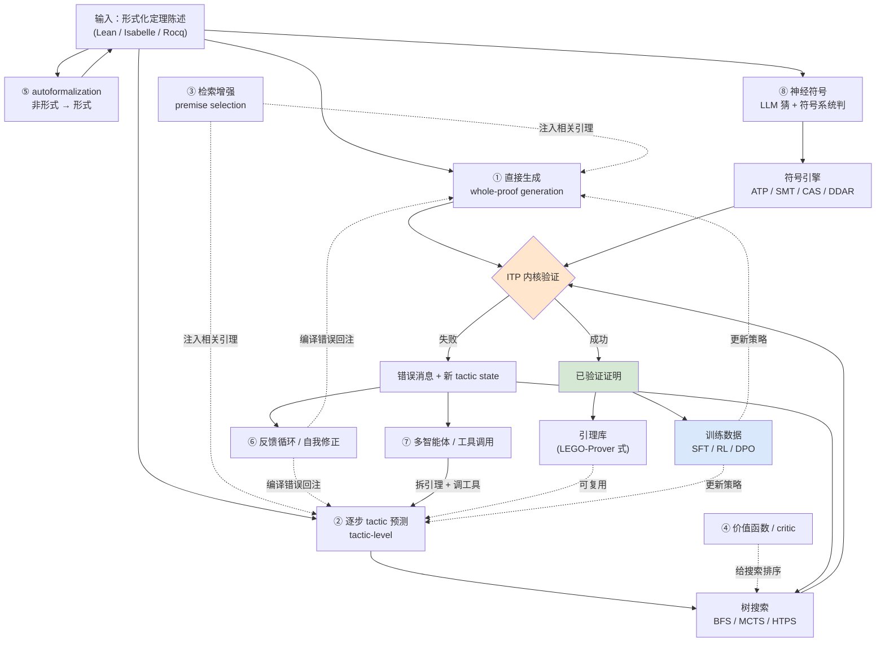

# 数学自动化定理证明（ATP）与「LLM + 形式化证明」交叉领域调查报告

> **编制日期**：2026-09（基于截至该时点的公开资料）
> **工作目录**：`D:\Incubator`
> **方法说明**：本报告所有量化结论均标注来源 URL。凡未能从一手来源（论文摘要页、官方博客、官方文档）核实的数字，一律标注「**未独立核实**」或注明「据 X 报道」。报告中不存在虚构的论文、系统名或实验数据。
> **对任务清单中两处前提的更正**（详见正文）：
> 1. 「OpenAI 的 GPT-5 在 IMO / Putnam 上的形式化验证成绩」——**这个前提不成立**：拿 IMO 金牌的是**一个未命名的实验性推理模型**，其证明是**自然语言、未经任何形式化内核验证**；GPT-5 本身并无此类宣称。见 §B.2.18。
> 2. 「COPRA 在 ProofNet 上」——**该论文没有 ProofNet 实验**，第二个基准是 CompCert（Coq）。见 §B.2.6。
> 3. 任务清单中的若干具体数字在核实后被更正（如 BFS-Prover 的 72.95% 是累积成绩；DeepSeek-Prover-V1 的 arXiv 编号）。全部更正汇总在文末「不确定性清单」。

---

## 目录

- [A. 基础盘：传统 ATP 与证明助手](#a-基础盘传统-atp-与证明助手)
  - [A.0 十分钟速览](#a0-十分钟速览)
  - [A.1 概念区分：六个常被混淆的词](#a1-概念区分六个常被混淆的词)
  - [A.2 从一阶逻辑到依赖类型：四层逻辑地基](#a2-从一阶逻辑到依赖类型四层逻辑地基)
  - [A.3 工具谱系与对比表](#a3-工具谱系与对比表)
  - [A.4 关键定理与里程碑](#a4-关键定理与里程碑)
  - [A.5 基准测试全景](#a5-基准测试全景)
    - **[A.5.5 对 miniF2F 的严厉批判（已逐字核实）](#a55--对-minif2f-最严厉的批判已于第二轮逐字核实)**
    - **[A.5.6 「miniF2F 分数的口径陷阱」——读者应如何正确引用](#a56-minif2f-分数的口径陷阱读者应如何正确引用)** ⭐ 本报告的核心方法论贡献
- [B. 核心章：LLM + 形式化定理证明](#b-核心章llm--形式化定理证明)
  - [B.0 范式全景图](#b0-范式全景图图-2)
  - [B.1 八种技术范式](#b1-八种技术范式)
  - [B.2 代表工作逐个解读](#b2-代表工作逐个解读)（20 个小节，从 GPT-f 到 Seed-Prover 1.5）
  - [B.3 为什么这件事难](#b3-为什么这件事难)（10 条机制分析）
- [C. 工程与生态](#c-工程与生态)
  - [C.1 Lean 4 + Mathlib 的工程实践](#c1-lean-4--mathlib-的工程实践)
  - [C.2 怎么用 LLM agent 做形式化](#c2-怎么用-llm-agent-做形式化接口设计)（含**架构图** + schema + 闭环终止）
  - [C.3 成本与算力](#c3-成本与算力)（含具体数字表）
  - [C.4 评测方法论与污染问题](#c4-评测方法论与污染问题)
- [D. 综合](#d-综合)
  - [D.1 技术路线对比表](#d1-技术路线对比表)（26 行，全部带来源与预算）
  - [D.2 未解难题清单](#d2-未解难题清单)
  - [D.3 路线建议](#d3-给想做一个数学证明智能体的人的路线建议)（分三档资源）
  - [D.4 术语表](#d4-术语表)（60+ 条）
  - [D.5 参考文献](#d5-参考文献)（121 条编号来源）
- [附录：本报告的不确定性清单](#附录本报告的不确定性清单)
- [附：定向核实补充（第二轮）](#附定向核实补充第二轮)（含**修正记录**与**通道限制**说明）

---

## A. 基础盘：传统 ATP 与证明助手

### A.0 十分钟速览

三条主线，不要混：

| 主线 | 你在做什么 | 谁在保证正确 | 典型系统 |
|---|---|---|---|
| **ITP（交互式定理证明）** | 人写证明脚本，机器逐步检查 | **内核（kernel）**，一个很小、很可信的类型检查器 | Rocq/Coq、Lean 4、Isabelle/HOL、HOL Light |
| **ATP（自动定理证明）** | 把问题丢给求解器，它自己找证明 | 证明搜索算法 + 完备性/可靠性论证 | Vampire、E、SPASS、Prover9 |
| **CAS / SMT** | 算符号表达式 / 判定可判定理论里的公式 | 算法本身（SMT 还输出可独立检查的证明证书） | Mathematica、Maple、Z3、cvc5 |

2026 年回看，「LLM + 形式化证明」这条路线的**真实骨架**是：

```
LLM 提出候选（tactic / 整段证明 / 引理分解 / 猜想）
        ↓
ITP 内核判定对错（唯一可信的正确性来源）
        ↓
反馈（编译错误 / 剩余 goal / 搜索统计）回到 LLM
        ↓
（可选）用验证过的数据回头训练 LLM  →  循环
```

**这条闭环里没有一处依赖 LLM「觉得自己对了」。** 这是它和普通「AI 做数学题」最本质的区别。

---

### A.1 概念区分：六个常被混淆的词

#### A.1.1 自动定理证明（ATP）

给一个形式化语句（一阶逻辑公式、或等词逻辑公式），**不做人工引导**，由算法自动判定它是否可证、并给出证明。核心是**搜索**：归结（resolution）、超归结、参数调优、索引、子句选择。

- 工程上成熟的是**一阶逻辑（FOL）**这一档。一阶逻辑可证性问题是**半可判定的**：可证的公式一定会被找到，不可证的公式可能永远跑不完。
- 代表：Vampire、E、SPASS、Prover9。它们每年在 **CASC**（CADE ATP System Competition）上打分。
- 关键局限：它们**不理解高阶**（函数作为参数、量化到函数上）、**不理解类型**。现代 ITP 里出现的定理大多是高阶或依赖类型的，ATP 直接吃不下 —— 所以才有「hammer」这层翻译 + 引理筛选的中间层（见 §A.3.4）。

#### A.1.2 交互式定理证明（ITP / 证明助手）

人和机器**协作**。人写一条条 `tactic`（策略 / 证明步骤），每条 tactic 把当前证明状态（goal）变换成若干子目标；所有子目标关闭后，证明成立。ITP 的**可靠性来自内核**：内核只做一件事——检查最终证明项是否具有所声明的类型（Curry–Howard 对应下，「有类型」即「被证明」，见 §A.2.4）。内核通常只有几千行，是整个系统唯一需要信任的部分。

「ITP 里其实也能做自动证明」：`auto` / `simp` / `linarith` / `omega` / `grind` 这类 tactic 内部就是自动化过程。所以 ITP 与 ATP 不是非此即彼。

#### A.1.3 计算机代数系统（CAS）

做**符号计算**：符号积分、多项式因式分解、Gröbner 基、精确线性代数、化简。CAS 不产生「可独立检查的证明」——它给你结果，你（通常）信任它的算法实现。代表：Mathematica、Maple、SageMath、Maxima。

一个常见误解：「CAS 能算的，ATP 就能证」——不成立。CAS 的输出往往是「一个表达式」，而定理证明要的是「一个证明对象」。

#### A.1.4 符号计算（symbolic computation）

比 CAS 更广的**方法学**概念：一切以符号（而非浮点数值）为对象的计算，包括项重写、Gröbner 基、结式、符号求和、自动微分。CAS 是符号计算的**产品化形态**。ITP 内部大量使用符号计算（`ring` tactic 就是在做多项式规范化）。

#### A.1.5 SMT 求解

**Satisfiability Modulo Theories**：判定一阶逻辑公式在某些**背景理论**（整数线性算术 LIA、实数非线性 NRA、数组、位向量、未解释函数）下的可满足性。要点：

- SMT 求解器是**判定过程**（对很多理论是完备的、会终止的），而通用 ATP 是半可判定的。
- 主流范式是 **DPLL(T)**：一个 SAT 核心 + 若干理论求解器（theory solver）协作。
- 代表：**Z3**（Microsoft Research，de Moura & Bjørner，2008）、**cvc5**（TACAS 2022 论文，[arXiv 相关](https://arxiv.org/abs/2109.10074) 为 cvc5 技术报告，**未逐字核实该编号**）、Yices、Bitwuzla。
- Z3/cvc5 在 ITP 里扮演「hammer 的后端」角色：Sledgehammer 的 5 个 ATP 中就包含 Z3 和 CVC4（见 §A.3.4）。
- SMT-COMP 是它的年度竞赛；SMT-LIB 是标准输入格式与基准库。

#### A.1.6 约束求解（constraint solving）

最上位的概念：在一组约束下找满足解。SAT、SMT、CSP（约束满足问题）、整数规划、Prolog 的合一 + 回溯都属于它。SMT = 「带理论的约束求解 + SAT」。

**一句话分层**：
```
约束求解  ⊃  SAT / CSP
          ⊃  SMT          （约束 = 一阶逻辑公式 + 背景理论）
          ⊃  ATP          （约束 = 一阶逻辑公式，无背景理论，纯搜索）
          ⊃  ITP          （不只是「求解」，而是产出可机器检查的证明对象）
CAS / 符号计算：另一条正交的轴（算表达式 vs. 证命题）
```

---

### A.2 从一阶逻辑到依赖类型：四层逻辑地基

理解 Lean/Coq 为什么长成现在这样，必须理解这四层。

#### A.2.1 一阶逻辑（First-Order Logic, FOL）

量化只作用于**个体**（`∀x. P(x)`），不能量化到谓词或函数。「所有性质 P 都满足……」不是 FOL 公式。FOL 有完备的证明系统，是 ATP 的主战场。

#### A.2.2 高阶逻辑（Higher-Order Logic, HOL）

允许量化到函数与谓词（`∀P. P(x) → P(x)`）。**Isabelle/HOL**、**HOL Light**、**HOL4** 的底座是经典高阶逻辑（基于 Church 的简单类型论，配合 Hindley–Milner 风格的多态）。HOL 语义上通常是**经典逻辑**（排中律成立）。

#### A.2.3 依赖类型与类型论

**依赖类型（dependent types）**：类型可以依赖值。经典例子：`Vector α n` —— 长度为 `n` 的向量。于是「`append : Vector α m → Vector α n → Vector α (m+n)`」这条类型**本身就是定理**，长度不变式由类型系统免费保证。

类型论的谱系：

| 系统 | 内容 | 用于 |
|---|---|---|
| **简单类型论** | Church 1940 | HOL 系 |
| **系统 F / λ2** | 多态 λ 演算（Girard、Reynolds） | 多态的基础 |
| **CoC（Calculus of Constructions）** | Coquand & Huet, 1988：《The Calculus of Constructions》，把项、类型、命题、证明统一到一个演算 | Coq 的原始底座 |
| **CIC（Calculus of Inductive Constructions）** | CoC + 归纳类型（Coquand & Paulin-Mohring, *Inductively Defined Types*, COLOG-88, LNCS **417: 50–66**；Paulin-Mohring, TLCA 1993）。累积性（cumulativity）由 Timany & Sozeau 在 FSCD 2018 补全。**当代 Rocq 的基础表述是 PCUIC** | Rocq/Coq、Lean 的底座 |
| **MLTT / HoTT** | Martin-Löf 依赖类型论；同伦类型论是其扩展 | Agda、Arend |

**关键区分**：Coq/Lean 的底座是**直觉主义（构造主义）**的 —— 没有排中律作为公理，`P ∨ ¬P` 不是免费的。而 Isabelle/HOL 是**经典**的。这直接影响同一个定理在两个系统里怎么写。Mathlib 大量使用经典逻辑（`Classical.em`），而 `#print axioms` 可以检查一个定理到底用了哪些公理。

#### A.2.4 Curry–Howard 对应

**命题即类型，证明即项**（propositions-as-types, proofs-as-terms）。来源为 Howard 1969 年的手稿《The formulae-as-types notion of construction》（1970 年会议、1980 年正式发表）；独立地，de Bruijn 在 Automath 中也有等价观察，Wadsworth 亦有贡献。

对应表：

| 逻辑 | 类型论 |
|---|---|
| 命题 `P` | 类型 `P` |
| 证明 `p : P` | 项 `p` 具有类型 `P` |
| `P → Q` | 函数类型 `P → Q` |
| `P ∧ Q` | 积类型 `P × Q` |
| `P ∨ Q` | 和类型 `P ⊕ Q` |
| `True` | 单位类型 `Unit` |
| `False` | 空类型 `Empty` |
| `¬P` | `P → Empty` |
| `∀x. P(x)` | 依赖函数类型 `(x : A) → P x` |
| `∃x. P(x)` | 依赖对类型 `Σ x : A, P x` |

**为什么这件事对 LLM+ATP 至关重要**：因为「类型检查」= 「证明检查」。于是 LLM 生成的不是「一段文字」，而是一个**会被内核精确判定的对象**。这给了 RL 一个**绝对客观的 0/1 reward**，也是 Seed Prover 1.5 官方博客强调的核心优势（[ByteDance Seed 官方博客](https://seed.bytedance.com/en/blog/seed-prover-1-5-advanced-mathematical-reasoning-through-a-novel-agentic-architecture)）。

---

### A.3 工具谱系与对比表

#### A.3.1 交互式定理证明器（ITP）对比

| 系统 | 逻辑底座 | 起始年 | 证明风格 | 备注 |
|---|---|---|---|---|
| **Rocq / Coq** | CIC（直觉主义，依赖类型）。⚠️ 当前 Rocq 的官方表述基础是 **PCUIC**（Predicative, Polymorphic, Cumulative Calculus of Inductive Constructions） | 1989（Coq）；2025 更名 **Rocq** | 策略式（Ltac / Ltac2 / SSReflect） | 2025-03-12 发布 Rocq 9.0，官方更名（[官方 changelog](https://rocq-prover.org/changelog/2025-03-12-rocq-9.0)）；⚠️ **更名的官方理由未查到** |
| **Lean 4** | CIC 变体（依赖类型），自身是可编程语言 | Lean 2013；Lean 4 于 2021 发表（de Moura & Ullrich, CADE 28） | 策略式 + 项式，**元编程能力极强** | 现代 LLM 定理证明的**事实标准平台**，因为 Mathlib 大且 API 可编程 |
| **Isabelle/HOL** | 经典高阶逻辑（简单类型论） | 1986（Paulson） | **声明式（Isar）** + 策略式 | 有最强的 hammer：**Sledgehammer**；Isabelle 的归档库最大 |
| **HOL Light** | 经典高阶逻辑 | 1996（Harrison） | 策略式（OCaml 内嵌） | 内核极小（可信基座小）；Flyspeck 项目用它 |
| **HOL4** | 经典高阶逻辑 | 1990s（Norrish / Slind） | 策略式（SML 内嵌） | TacticToe 的宿主系统 |
| **Mizar** | 经典一阶集合论（Tarski–Grothendieck） | **1973-11-14**（Trybulec 在 Warsaw University 首次阐述「Mizar ideology」） | **自然演绎式、接近人类数学写作** | 当前 **Mizar 8.1.15 / MML 5.94.1493（2025-05-30）**；MML 约 **75,139–75,571 条定理**（grep 计数近似，注释会灌水）、**914 个 scheme**、约 **14,134 个定义**、约 **150,000 条公式**。是 MPTP / Mizar 40 基准的来源 — [mizar.uwb.edu.pl](https://mizar.uwb.edu.pl/) |
| **Agda** | MLTT（直觉主义依赖类型），无策略，纯项 | 1999 起 | **纯项式**（C-c C-c 交互补洞） | 用于 PL/类型论研究，非数学大规模形式化 |
| **Idris** | 依赖类型（Idris 1 类似 Agda；Idris 2 基于 QTT 带线性/擦除） | 2007（Brady） | 项式 | 强调**通用编程**中的依赖类型 |
| **PVS** | 经典高阶逻辑 + 依赖类型（prototype verification system） | 1992（SRI） | 策略式 | 工业验证出身；规范语言丰富 |
| **ACL2** | 一阶逻辑 + 归纳（Boyer–Moore 血统） | 1990s（Kaufmann & Moore） | **定义 + 归纳定理**，非策略 | 工业硬件/软件验证有名；与主流依赖类型路线不同 |
| **Metamath** | 极简元逻辑（单一替换规则），其上搭 ZFC | **1973（Mizar 首次亮相）/ 1990s（Megill 的 Metamath）** | **替换步骤**（无高层 tactic） | `set.mm`（Metamath Proof Explorer）：**主区超过 26,000 条已证定理，含 mathbox 超过 41,000 条**，建立在 ZFC + 逻辑（**20 条公理、2 条规则**）之上 — [MPE](https://us.metamath.org/mpeuni/mmset.html)。验证器几百行可写完 —— GPT-f 选它正因如此 |
| **F\*** | 依赖类型 +  refinement + 计算效应 | 2011（Microsoft Research / Inria） | 项式 + SMT 自动消解 | 面向**程序验证**；用 Z3 做自动 VC 判定 |
| **Dafny** | 命令式语言 + 前后置条件（Boogie/Z3 后端） | 2010s（Leino） | 程序内联断言 + 自动验证 | 面向**软件验证**教学与工业 |

> **常见混淆**：F\* 和 Dafny 常被当成「ITP」，但它们的设计目标是**程序验证**，大量义务由 SMT 自动消解，人不需要写证明脚本。它们与 Lean/Coq 有本质差异。

#### A.3.2 自动定理证明器（ATP）与 SMT 求解器

| 系统 | 类别 | 引擎/特色 | 现状 |
|---|---|---|---|
| **Vampire** | 一阶 ATP | 归结 + 叠代（superposition）+ 大量启发式调度 | **CASC 当前统治者**（见下表）。现代引用：Kovács & Voronkov, *First-Order Theorem Proving and Vampire*, CAV 2013, pp. 1–35, DOI 10.1007/978-3-642-39799-8_1；早期：Riazanov & Voronkov, *Vampire 1.1 (System Description)*, IJCAR 2001 |
| **E** | 一阶 ATP | 等式叠代、强大的 clause selection | CASC 常年头部；被 TacticToe 作为外部 ATP 异步调用 |
| **SPASS** | 一阶 ATP（带等词） | 基于排序的叠代 + 分类法 | 经典系统。⚠️ **实际参赛的是 SPASS-SCL，成绩很差**：CASC-30 FOF **11/500**、CASC-J13 FOF **14/400**。**SPASS 已不是有竞争力的 ATP**，但它仍出现在 Sledgehammer 的历史后端组合里 |
| **Z3** | SMT | DPLL(T)，多理论 | de Moura & Bjørner, TACAS 2008, pp. 337–340, DOI 10.1007/978-3-540-78800-3_24。Microsoft Research；事实标准；`z3` 亦用于 F\*/Dafny 的 VC。⚠️ **Z3 不参加 CASC**（一阶 ATP 竞赛） |
| **cvc5** | SMT | 多理论、证明产出 | Barbosa et al., TACAS 2022, pp. 415–442, DOI 10.1007/978-3-030-99524-9_24。⚠️ **该论文没有 arXiv 版本**（arXiv 全文检索 "cvc5" 返回 32 篇，均非此篇）——本报告初稿中给出的 `arXiv 2109.10074` 猜测**无依据，已更正**。cvc5 也参加 CASC（CASC-30：THF 296/500、FOF 290/500），但非头部 |
| **iProver** | 一阶 ATP | 实例化 + 叠代混合 | CASC 常客；CASC-J13 FOF 250/400、UEQ 198/400 |
| **Twee** | 一阶 ATP（等式） | 面向 UEQ | CASC-J13 UEQ **286/400**（第三） |
| **Prover9 / Mace4** | 一阶 ATP / 有限模型寻找 | Prover9 = 证明；Mace4 = 找反例模型 | McCune 开发；教学与研究常用；**已停止维护**（历史地位重要） |
| **Metis** | 一阶 ATP（内置） | HOL4/Isabelle 内部集成 | TacticToe 中作为内部 ATP 与 E prover 互补 |

**CASC 实测数据（全部来自 TPTP 官方 Division Summary 页，均为「解出题数 / 该赛区题数」）**：

| 赛区 | CASC-J12 (2024-07-04) | CASC-30 (2025-07-30) | **CASC-J13 (2026-07-27)** |
|---|---|---|---|
| **FOF** | Vampire 4.9 **471**/500 | Vampire 5.0 **455**/500；iProver 3.9.3 367；E 3.3.0 364；cvc5 1.3.0 290；SPASS-SCL 0.1 11 | Vampire 5.0.1 **381**/400（380 solutions）；Vampire 5.0 328；E 3.5.1 264；CSI_PP 264；iProver 3.9.4 250；Drodi 215；SPASS-SCL 0.1.1 14 |
| **UEQ** | Vampire 4.9 **265**/300 | Vampire 5.0 **263**/300 | Vampire 5.0.1 **370**/400；Vampire 5.0 322；Twee 2.7 286；CSI_PP 258；E 3.5.1 255；iProver 198 |
| **THF** | Vampire 4.9 **463**/500；cvc5 1.1.3 299 | Vampire 5.0 **449**/500；cvc5 1.3.0 296 | Vampire 5.0 **354**/400 与 Vampire 5.0.1 **352**/400 占据前二；E 3.5.1 324；Zipperposition 347 solved / **0 solutions**；Leo-III 160 |
| **FNT** | — | — | Vampire 5.0.1 **143**/150；Vampire 4.8 131；iProver 71 |
| **TFA / TFN** | — | Vampire 5.0 **131**/150 与 **110**/150；cvc5 108 / 56 | （J13 中 TFA+EPR 暂停） |
| **EPR** | — | Vampire 5.0 **186**/200；SPASS-SCL 0.1 64 | （暂停） |
| **SLH** | cvc5 1.1.3 **363**/1000 | Vampire 4.9 **441**/1000；Vampire 5.0 434；cvc5 1.3.0 294 | — |
| **Proof Verification** | — | — | GAPT 2.20 **111**/138（最佳） |

**可核实结论**：
- ✅ **Vampire 目前赢 FOF 与 UEQ 两个主要赛区**；E 与 iProver 是亚军常客。
- ✅ **SPASS 已无竞争力**（FOF 11/500 与 14/400）。
- ⚠️ **一处不确定**：CASC-J13 的 THF 赛区中，Vampire 5.0 与 5.0.1 谁是第一，官方页面的斜体标注（标记「上届冠军」）导致排序歧义 —— 本报告不判断。
- ⚠️ 有第三方页面（CIIRC）称 Vampire 在 2025 年「赢得全部八个赛区」，**该页正文未能获取，部分未核实**。
- ⚠️ **SMT-COMP 的官方分赛道结果表在本次调研中不可访问**，故本报告**不声称** cvc5 / Bitwuzla / Yices 在 2025–26 年领先哪些赛道。可参考的旁证：**SMT-COMP 2025（第 20 届）** 中 **Z3-Noodler-Mocha**（北航）在 **QF_Strings** 上以全部指标获胜，领先亚军 475 个实例；**SMT-COMP 2026（第 21 届，结果于 2026-07-25 在 FLoC 2026 公布）** 中 **Z3++**（中科院工业人工智能研究所）赢得 **QF_NIA**、**QF_DT** 及一个总冠军 —— 且中科院方面将 Z3++ 的成绩部分归因于一个**由大模型驱动的「自动算法演化框架」**（[中科院新闻](http://iaii.cas.cn/kxyj/kydt/202609/t20260904_8278557.html)）。**这是一个值得关注的信号：LLM 开始参与设计符号求解器本身。**

**一个实用判断**：**ATP 的强项是「小、深、逻辑清晰」的问题**（群论等式、组合恒等式、软件不变式）；**ITP + hammer 的强项是「大库、依赖类型、需要引理复用」的问题**。这正是 §A.3.3 桥接层存在的理由。

#### A.3.3 桥接层（Hammer 与自动化 tactic）

**Hammer 的三步曲**（这也是所有「ATP→ITP」系统的通用架构）：

```
1. 前提选择 premise selection：从庞大的库中挑出 ~几百条可能相关的引理
2. 翻译 translation：把高阶/依赖类型的目标 + 引理翻译成一阶逻辑子句
3. 重建 reconstruction：ATP 给出的一阶证明，翻译回 ITP 内核能检查的证明项
```

| 桥 | 宿主 | 说明 | 来源与已核实成绩 |
|---|---|---|---|
| **Sledgehammer** | Isabelle/HOL | 最成熟的 hammer。**设计上不需要配置**；默认并行调用多个 ATP。⚠️ **一个关键的设计事实**：它使用**不可靠（unsound）的翻译**，但因为**返回的是 Isabelle/HOL 证明脚本**，所以**其输出本身不需要被信任** —— 这是 hammer 架构的精髓：**容忍翻译不精确，用重建来保证可靠性** | Paulson & Blanchette, *Three years of experience with Sledgehammer, a Practical Link Between Automatic and Interactive Theorem Provers*, IWIL 2010, EPiC Series in Computing **vol. 2, pp. 1–11**（2012-05-15），DOI [10.29007/36dt](https://easychair.org/publications/paper/wV)。⚠️ **具体成功率未核实**。另：DSP 论文用的是 Isabelle2021 默认配置，含 **Z3、CVC4、SPASS、Vampire、E** 五个 ATP、**120 秒超时**（[DSP §4.2](https://ar5iv.labs.arxiv.org/html/2210.12283)） |
| **CoqHammer** | Coq | Czajka & Kaliszyk, *Hammer for Coq: Automation for Dependent Type Theory*, ***Journal of Automated Reasoning* 61(1–4): 423–453, 2018**, DOI [10.1007/s10817-018-9458-4](https://doi.org/10.1007/s10817-018-9458-4) | ✅ **已核实的具体成绩**：**40.8% 的 Coq 标准库定理可在约 40 秒内（8 CPU）被按按钮式地证明**。架构 = CIC → 无类型 FOL 的翻译 + eauto 风格重建 + 机器学习前提选择 |
| **Magnushammer** | Isabelle | 用 transformer 替换 Sledgehammer 的前提选择，是「神经 hammer」的代表 | 见 §B.1.3 |
| **Lean 侧的自动化 tactic** | Lean 4 | 不是传统 hammer，而是**领域专用决策过程**：见下表 | Lean/Mathlib 文档 |

Lean 4 里最常用的「自动化」tactic：

| tactic | 干什么 | 定位 |
|---|---|---|
| `aesop` | 基于规则的通用证明搜索（可注册规则、可配置） | Lean 的「best-first 自动证明」 |
| `omega` | **Presburger 算术**（整数/自然数的线性算术）判定过程 | 完备且会终止 |
| `linarith` | 线性实数/有理数算术，从假设推出目标 | 完备（对线性情形） |
| `norm_num` | 数值计算与化简（具体数字） | 实用型 |
| `positivity` | 证明表达式为正 | 领域专用 |
| `ring` / `field` | 环/域中的多项式规范化 | 符号计算 |
| `simp` | 重写（用户可扩展的 simp set） | 最常用的通用工具 |
| `grind` | 2025-08 引入的新型通用自动化（SMT 风格 + E-matching） | 新一代；据 Springer 材料称「release 后迅速被采用」，**具体数据未独立核实** |
| `exact?` / `apply?` / `rw?` | **库搜索**：让 Lean 自己找能关闭目标的引理 | 这是人类最常用的「找引理」方式，也是 LLM 工具调用的重要原型 |
| `#check` / `#print axioms` / `#eval` | 元信息查询 | 工程必备 |
| `sorry` | **占位符**：声明「稍后证明」，并让内核**接受**该定理 | ⚠️ 这是形式化的头号风险点，见 §B.3.6 与 §D.4 |

#### A.3.4 数学库对比

| 库 | 宿主 | 规模与特色 |
|---|---|---|
| **Mathlib** | Lean 4 | 当代最活跃的形式化数学库；LLM 定理证明的主战场（LeanDojo Benchmark 就是从它抽取的 98,734 条定理，见 §B.2.5） |
| **Archive of Formal Proofs (AFP)** | Isabelle | 经机器检查的证明归档；**Isabelle 的证明语料是各大 ITP 中最大的**（DSP 论文原话：最大的形式化证明语料是 Isabelle 写的，总量不到 0.6 GB）—— [DSP §1](https://ar5iv.labs.arxiv.org/html/2210.12283) |
| **Mizar Mathematical Library (MML)** | Mizar | 历史最久、风格最接近人类数学写作；MPTP 基准的来源 |
| **Mathematics in Lean** | Lean 4 | 教学材料（不是库），是入门 Mathlib 的标准路径 |
| **Lean Workbook** | Lean 4 | 大规模由自然语言数学题自动形式化来的题目集；DeepSeek、Goedel、STP 都用它做评测/训练（[Lean Workbook, arXiv 2406.03847](https://ar5iv.labs.arxiv.org/html/2406.03847)） |
| **Compfiles** | Lean 4 | 竞赛题形式化合集（[GitHub](https://github.com/dwrensha/compfiles)），Kimina 的 autoformalizer 训练源之一 |

---

### A.4 关键定理与里程碑

> **可信度声明**：本节各条目的年份与人物，我逐条通过官方页面/论文核实过的不特别标注；凡只从二手来源得到、未在一手页面确认的，标「**未独立核实**」。

#### A.4.1 四色定理（Four Color Theorem）

- **1976**：Appel & Haken 给出首个计算机辅助证明。⚠️ **本报告未能从一手来源核实 1976 这个年份及「1200 小时机时」等具体数字**（相关一手页面在本次调研中不可访问）。
- **2005**：**Georges Gonthier** 完成 Coq 形式化。可核实的事实：预印本 *A computer-checked proof of the four colour theorem*（**57 页**），声明「**fully checked by Coq v7.3.1**」。
- 🔍 **一个常被搞错的关键点**：Gonthier 的形式化**基于 Robertson–Sanders–Seymour–Thomas 的证明**，而**不是** Appel–Haken 的原始程序/证明。两者是同一个定理的不同证明路线。
- ⚠️ 「2004 vs 2005」的具体归属**未独立核实**。
- 意义：把「信任程序正确性」变成「信任几千行的内核」。

#### A.4.2 Feit–Thompson 奇阶定理（Odd Order Theorem）

- 定理：每个奇数阶有限群都是可解群。原证明 1963 年发表，共 255 页，是有限群论最重的定理之一（⚠️ **页数与年份未独立核实**）。
- **2012 年 9 月完成形式化**（可核实表述：INRIA 年报 RA2012 记载 "Proof was finished in september 2012"）。项目约 **2006 年**启动。
- **系统**：**Coq + SSReflect**；由 **Gonthier** 指导；参与方包括 **INRIA Typical 团队、Marelle 项目、Inria–MSR 联合中心**；**Mahboubi、Tassi、Cohen** 等人起了关键作用。
- ⚠️ 「约 17 万行证明 / 约 6 人年」这两个数字**未独立核实**。
- 意义：这是「一个真实数学理论整体被形式化」的首批大案例，并直接催生了 **Mathematical Components** 库。**未发现该形式化存在 gap**。

#### A.4.3 Kepler 猜想 / Flyspeck

- 定理：面心立方堆积是三维球堆积的最密方式（Hales，1998 年宣告）。
- **Flyspeck 项目**：**Thomas Hales + 21 位共同作者**；**HOL Light + Isabelle/HOL**，并在 **HOL Zero** 中重放（replay）。
- **时间线**（可核实）：项目 2003 年 1 月宣布；2008 年获 NSF 资助做文本形式化；**2014 年完成**（具体日期未核实）；官方总结论文 [arXiv 1501.02155](https://arxiv.org/abs/1501.02155) 于 **2015-01-09** 提交（21 页）。**2017 年期刊版未独立核实**。
- **可核实的量化指标**：
  - 约 **1000 条非线性不等式**；
  - 主陈述从脚本约需 **5 小时**，重放约 **40 分钟**（2 GHz 机器）；
  - 最难的子命题约 **5000 CPU 小时**。
  - ⚠️ 「超过 20 人年」这个广为引用的数字**我未能从一手来源核实**（HTPS 论文引用了它，见 [arXiv 2205.11491 §1](https://ar5iv.labs.arxiv.org/html/2205.11491)，但那是二手转引）。
- 🔍 **极其重要、也极常被忽略的「部分形式化」事实**（本报告认为这是形式化传播中最需要澄清的一点）：
  1. **Flyspeck 没有形式化 Ferguson–Hales 1998/2006 的原始证明**。Hales 自己的表述是「**cannot assert that the original proof has been formally verified**」。Flyspeck 的 blueprint 走的是 **Marchal cells / hypermaps** 路线。
  2. 期间**发现并修正了主估计（main estimate）中的一个错误**——这本身就是形式化的价值证明。
  3. **两个计算部分在主 HOL Light session 中仍然是显式假设（explicit hypotheses）**。
  4. 形式化后的陈述**允许常数 c 依赖于堆积本身**，并且**不声称唯一性**。
- 意义：**「Flyspeck 完成了」和「Kepler 猜想被完全形式化验证了」在严格意义上是两句话**。引用时必须说清楚形式化的到底是哪个版本的证明、有哪些显式假设。

#### A.4.4 Liquid Tensor Experiment（LTE）

- **Peter Scholze** 于 **2020-12-05** 在其博客提出挑战。
- **Johan Commelin** 主导 Lean 侧工作，其自述为「**In 2021-2022, I have lead the LTE**」。
- **2022 年完成**（常被引为 2022-07-14，**具体日期未核实**）。
- Lean FRO 页面（2026-06-04）的表述：Scholze **「verified it with only minor corrections」**；团队**「verified and simplified it without fully understanding the proof」**——后一句是本项目最有意思的社会学观察：机器验证可以在人类尚未完全内化证明的情况下确认其正确性。
- ⚠️ 被形式化的确切定理陈述与编号**未独立核实**。
- 意义：这是**当代研究级数学**（而非教科书内容）第一次被完整形式化。

#### A.4.5 Fermat 大定理形式化项目（FLT）

**（a）Buzzard 的长期项目**
- **Kevin Buzzard**（Imperial College London）主导，**Lean 4**，仓库 `ImperialCollegeLondon/FLT`。
- **2024 年启动**，**EPSRC 资助 EP/Y022904/1，资助期至 2029 年 9 月**。
- 技术路线：走现代的 **Wiles / Taylor–Wiles 变体（Khare–Wintenberger 路线）**，而非 Wiles 原始论证（可核实：项目计划如此）。
- Buzzard 自己估计需要**约 10 年**。
- 状态：**进行中**。

**（b）2026 年 9 月的重大进展（⚠️ 仅据新闻报道，未能核实一手页面）**
- 据多方新闻转述：**Anthropic 于 2026-09-04 宣布**，由 **Tianyi Peng（Columbia）** 领导的团队（项目名 **"Prove2Me"**）用 **Claude agents 在 11 天内**完成了 FLT 的 Lean 形式化，规模约 **1300 万行**、**29,500–30,000 条中间定理**、**约 60 亿 output token**，代码公开。
- **Nature 新闻于 2026-09-07 报道**（标题中引用 "formalizes"）。
- **Buzzard 的态度**：可信度从 99.9% 提到 100%，但指出**代码与 Mathlib 不兼容**，整合工作量「**enormous**」，且存在 **Lean 库不兼容**的风险。
- ⚠️ **本报告未能访问 Anthropic 官方页面**，以上细节来自 Nature 关联的新闻转载（gmw.cn 2026-09-09、stdaily.com 2026-09-10）。**引用时必须标注为「据新闻报道，未独立核实」**，并且要特别谨慎地把「一个自动化系统产出了 FLT 的形式化」与「FLT 已被整合进 Mathlib / 已被人类数学家审查」区分开。

> **这一条对 §D.3 的路线建议有直接影响**：它说明**「规模化 autoformalization + agent 长时运行」已经从玩具变成了能产出研究级资产的工具**，但同时说明**产出的可维护性/可整合性是新瓶颈**（13M 行不可维护的代码 vs. 一个能被社区复用的 Mathlib 贡献）。

#### A.4.6 Polynomial Freiman–Ruzsa 猜想（PFR）与 Marton 猜想

- **非形式证明**：Gowers、Green、Manners、Tao，[arXiv 2311.05762](https://arxiv.org/abs/2311.05762)。Tao 的博客分别于 **2023-11-13** 和 **2023-11-18** 发帖。
- **Lean 4 形式化**：仓库 `teorth/PFR`。**首要目标已完成**；**第二阶段（推论 + Liao 的指数改进，[arXiv 2404.09639](https://arxiv.org/abs/2404.09639)）也已完成**；项目随后扩展到**有界挠群（[arXiv 2404.02244](https://arxiv.org/abs/2404.02244)）**以及进一步的指数细化。
- ⚠️ 「**具体完成日期**」与「**Lean 形式化的主导者**」**未独立核实**（相关 Zulip 讨论页在本次调研中不可访问）。
- 意义：形式化速度从「数年」压缩到「数周」，是形式化成本曲线下降的标志性案例。

#### A.4.7 Sphere Eversion 形式化

- **系统**：**Lean**（原为 Lean 3，后由 **Kudryashov** 迁到 Lean 4）；作者 **Patrick Massot、Floris van Doorn、Oliver Nash**。
- **可核实的时间点**：Reservoir 仓库 README 写明「**Proof of the main theorem was completed on November 12th 2022**」。
- **论文**：[arXiv 2210.07746](https://arxiv.org/abs/2210.07746)，发表于 **CPP 2023**，DOI [10.1145/3573105.3575688](https://doi.org/10.1145/3573105.3575688)。
- **数学内容**：形式化了 **Gromov 1973 年关于 open ample 一阶关系的局部 h-原理**，经由 **Theillière 2018 的凸积分（convex integration）**。
- **当时的 Mathlib 规模（可核实，论文中给出）**：**超过 250 位贡献者**、**约 100 万行**（2022 年 9 月）。这是理解 Mathlib 增长速度的好锚点（对比 §A.4.9 的 2026 年数据）。

#### A.4.8 Carleson 算子定理形式化

- **系统**：**Lean 4**。作者：**Becker、van Doorn、Jamneshan、Srivastava、Thiele**。
- **状态**：Lean FRO 页面（2026-06-04）列出「**Carleson's Theorem (completed) — van Doorn**」。
- 非形式论文 [arXiv 2508.05563](https://arxiv.org/abs/2508.05563) 引用了同期的形式化论文（文献标记 `[BdFD+25]`，2025 年）。
- ⚠️ **确切完成日期与规模未独立核实**。
- 项目以「多人协作形式化大型分析定理」著称（[The Carleson Project 讲稿](http://florisvandoorn.com/talks/carleson2504.pdf)）。

#### A.4.9 Equational Theories Project（ETP，Tao 等，2024–2025）

- **启动**：**2024 年 9 月**。
- **目标达成**：**2025-04-14**。
- **规模（可核实）**：**4694 条定律**之间的 **22,028,942 条蕴含关系**全部完成 Lean 形式化（含自反关系共 **22,033,636** 条）；得到 **1415 个等价类**。
- **论文**：[arXiv 2512.07087](https://arxiv.org/abs/2512.07087) v2（2025-12-16），**34 位作者**（含 Tao）。
- 🔍 **部分完成的部分（必须声明）**：**除 2 条有限蕴含边之外**全部完成——即 `E677 ⊨fin E255` 与其对偶 `E2910 ⊨fin E47` 仍属未决/例外。
- 意义：这是**「大规模众包 + 自动化工具」组织形式**的标志性案例，也是「用 Lean 做穷举式数学」的范例。

#### A.4.10 其他已核实/待核实的形式化项目

| 项目 | 状态 | 核实程度 |
|---|---|---|
| **Sphere packing d=8, 24**（Viazovska 等） | Lean 项目已被 Lean FRO 列出；「2026 年 2 月 AI 辅助完成」**仅有新闻报道** | ⚠️ 未独立核实 |
| **FLT 指数 3** | 存在于 Mathlib：`Mathlib/NumberTheory/FLT/Three.lean` | 文件存在可核实；**作者/日期未核实** |
| **素数定理（PNT）** | 有「Gauss — agentic formalization of the PNT」（Fields）与 PrimeNumberTheorem+（Kontorovich）等努力 | ⚠️ 范围/日期未核实 |
| **Mochizuki IUT 的 Lean 形式化**（aitpm.github.io） | 存在该项目 | ⚠️ 未核实 |
| **「1000 定理」清单** | Mathlib 中 `docs/1000.yaml` 跟踪实验性 1000 条定理的形式化状态（[文件](https://github.com/kim-em/mathlib4/blob/simply-connected-refactor/docs/1000.yaml)） | 可核实 |
| **ACL2 / HOL4 / Isabelle / Lean / Metamath / Mizar / PVS / Rocq** | 据 mizar-forum 讨论，**均已超过 100 万行非空 LOC** | ⚠️ 二手来源，未独立核实 |

#### A.4.11 数学库规模（含明确 as-of 日期）

| 库 | 规模 | as-of | 来源与核实程度 |
|---|---|---|---|
| **Mathlib**（Lean 4） | **220 万+ 行**、**270,000+ 形式化定理**、**750+ 贡献者**；另外 **250,000+ 独立安装**、**9,000+ 依赖仓库** | **2026-06-04**（Sebastian Ullrich 在 Dutch Formal Methods Day 的报告，由 Lean FRO 引用） | ⚠️ 官方统计页 `leanprover-community.github.io/mathlib_stats.html` 在本次调研中**不可访问**；引用时务必带 "as of 2026-06-04" |
| **Archive of Formal Proofs (AFP)**（Isabelle） | **1032 条目**、**610 位作者**、约 **326,000 条引理**、约 **5,434,000 行代码** | **2026-09** | 来源 `isa-afp.org/statistics` ⚠️ 二手转引 |
| **Mizar Mathematical Library (MML)** | 约 **75,139 条定理**（原始计数 75,571）、**914 个 scheme**、约 **14,134 个定义**、约 **7,345 条局部引理** | **2025-06-05**（mizar-forum，MML 8.1.15_5.94.1493） | ⚠️ 二手转引 |
| **Isabelle 证明语料总量（历史对比）** | **不到 0.6 GB** —— DSP 论文在 2022 年称其为「最大的形式化证明语料」 | 2022 | ✅ 来自 [DSP 论文正文](https://ar5iv.labs.arxiv.org/html/2210.12283) |
| **Mathlib 训练基准（LeanDojo）** | **98,734** 条定理与证明 | 2023 | ✅ [arXiv 2306.15626](https://arxiv.org/abs/2306.15626) |

> **重要方法论提醒**：形式化库的规模数字**增长极快且口径不一**（「定理」/「声明」/「引理」/「非空行」是不同指标）。任何引用都必须带 **as-of 日期 + 指标定义 + 来源**。

---

---

### A.5 基准测试全景

这一节很重要：**绝大多数「LLM 做形式化数学」的失败争论，本质是评测方法争论。**

#### A.5.1 传统 ATP / SMT 基准

| 基准 | 是什么 | 说明与已核实数据 |
|---|---|---|
| **TPTP** | *Thousands of Problems for Theorem Provers* | 一阶 ATP 的标准问题库。**网址 https://www.tptp.org**。语言：CNF、FOF、TFF、TXF、THF；**自 v9.0.0 起也支持非经典逻辑**（NTF/NXF/NHF）（[arXiv 2508.09318](https://ar5iv.labs.arxiv.org/html/2508.09318)）。**v9.3.0 于 2026-06-20 发布**（新增 97 条 THF、321 条 TFF、178 条 FOF、131 条 CNF，新领域 TIM/时间）；线上服务器当前为 **TPTP-v9.3.1**。⚠️ **TPTP 的总题量本报告未核实**（无官方计数页可达），故不给数字 |
| **CASC** | *CADE ATP System Competition* | 「完全自动的经典逻辑 ATP 的世界锦标赛」，组织者 **Geoff Sutcliffe**（U. Miami），每届 CADE/IJCAR 举办。**按「解出题数 + 输出可接受的证明/模型」排名**，同分比平均时间。题目经过混淆（obfuscated），种子由 panel 选定。运行在 StarExec Miami（八核、128 GiB 上限）。赛区：THF、FOF、FNT、UEQ（近年）；TFA/TFN/EPR/SLH/ICU 在早年；**2026 年新增 Proof Verification 赛区**。时限随届次变化（J13：THF/FOF/FNT/UEQ 180 秒墙钟；CASC-30：THF/FOF/UEQ 240 秒） | 届次：**CASC-J12 = 2024-07-04**（IJCAR Nancy）；**CASC-30 = 2025-07-30**（CADE-30, Stuttgart）；**CASC-J13 = 2026-07-27**（IJCAR 2026, Lisbon/FLoC 2026）；**CASC-31 将于 2027 年 8 月在 Nijmegen（CADE-31）举办**。具体成绩见 §A.3.2 的表。全部来自 TPTP 官方 Division Summary 页 |
| **SMT-LIB** | SMT 的标准输入格式 + 基准库 | 国际倡议，**始于 2003 年**。定义标准理论、通用 I/O 语言、基准库。最新动态：**SMT-LIB 2.7 参考文档于 2026-03-27 重新发布**；整数扩展了指幂运算并新增逻辑 **QF_EIA**（2026-03-18）。基准：最新版本托管在 **Zenodo**；2013–2023 的历史版本在 **StarExec**（[benchmarks 页](https://smt-lib.org/benchmarks.shtml)） |
| **SMT-COMP** | SMT 求解器年度竞赛 | **始于 2005 年**；**2025 = 第 20 届**；**2026 = 第 21 届，结果于 2026-07-25 在 FLoC 2026 公布**。规则：有非零 unsoundness 分数的求解器被**排除出排名**。已核实的 2025/2026 结果见 §A.3.2 的说明。⚠️ **官方分赛道结果表本报告未能访问** |
| **Mizar 40** | Kaliszyk & Urban 提出的 40 条 Mizar 定理挑战 | 配套系统 **MizAR 40** 的可核实成绩：**在 14 CPU 机器上用 30 秒实时时间证明 MML 中 40% 的定理**。出处：*MizAR 40 for Mizar 40*，***Journal of Automated Reasoning* 55(3): 245–256 (2015)**，DOI 10.1007/s10817-015-9330-8；[arXiv 1310.2805](https://arxiv.org/abs/1310.2805) |
| **MPTP** | *Mizar Problems for Theorem Proving* | 把 MML 批量导出给机器学习/ATP 用，是「前提选择」研究的经典数据集。出处：Urban, *MPTP – Motivation, Implementation, First Experiments*，***Journal of Automated Reasoning* 33(3–4): 319–339, 2004**，DOI 10.1007/s10817-004-6245-1。近期进展：MPTP 上的覆盖率从 **75% 提升到 80% 以上**（[arXiv 2406.17762](https://arxiv.org/abs/2406.17762)） |

#### A.5.2 LLM 形式化证明基准

| 基准 | 规模 | 来源 | 已报告成绩（示例） |
|---|---|---|---|
| **miniF2F** | **488 题**（244 valid + 244 test），源自 MATH、AMC、AIME、IMO 以及手工构造题；原本有 Lean / HOL Light / Isabelle 三个版本 | [arXiv 2109.00110](https://arxiv.org/abs/2109.00110)（Zheng, Han, Polu） | 见 §D.1 大表 |
| **ProofNet** | **371 个样本**（每题 = Lean 3 陈述 + 自然语言陈述 + 自然语言证明），本科教材级数学（实/复分析、线代、抽象代数、拓扑） | [arXiv 2302.12433](https://arxiv.org/abs/2302.12433)（Azerbayev 等，2023）。⚠️ **注意**：DeepSeek-Prover-V1.5 把它转写成 Lean 4 并划分为 **185 valid + 186 test**；**原始版本是 Lean 3**（legacy），所以「ProofNet 的分数」在不同论文里可能指的是不同版本 | DeepSeek-Prover-V1.5 + RMaxTS: **25.3%**（test）、25.4%（valid）；STP: **23.9%**（pass@3200）；InternLM2.5-StepProver: **27.0%**（pass@256）；Goedel-Prover-SFT: 15.2%。⚠️ **注意 Goedel 论文报告 ProofNet 与 miniF2F 呈负相关** |
| **PutnamBench** | **640 个定理**的 **1692 条手工形式化**（Lean 4 + Isabelle 全覆盖，Coq 覆盖大部分） | [arXiv 2407.11214](https://arxiv.org/abs/2407.11214)（Tsoukalas 等，NeurIPS 2024 D&B）。发布时只有「少数几题」可解。**⚠️ 分母口径极重要**：有的论文报「解出题数 / 640」，有的报「/ 658」，有的只给 pass@k 数字 | 见 §D.1 |
| **LeanWorkbook** | 上海 AI Lab / InternLM；**约 5.7 万条形式-非形式配对** + **21 道 IMO 题**。⚠️ **并非全部经过人工校验** | [arXiv 2406.03847](https://ar5iv.labs.arxiv.org/html/2406.03847) | STP: **28.5%**（vs 专家迭代基线 13.2%）；Goedel-Prover 开源了其中 **29.7K** 题的证明 |
| **FormalMATH** | **5560 条**经形式化验证的 Lean 4 题目（高中奥赛到本科） | [arXiv 2505.02735](https://arxiv.org/abs/2505.02735) | 论文自评：SOTA 系统在实用采样预算下**仅 16.46%**；存在**明显的领域偏置**（代数强、微积分弱）；并发现「CoT 场景下人类非形式引导反而有害」 |
| **miniCTX** | 考察「长上下文 / 项目内上下文」下的证明能力（不是单条定理，而是在**文件/项目语境**里证明） | [arXiv 2408.03350](http://arxiv.org/pdf/2408.03350)（CMU, 2024）：**762 条定理**，**381 valid + 381 test**，取自真实 Lean 项目（PNT、PFR、Mathlib、HTPI、HepLean）；上下文平均 **18,690 token**；使用**时间切分**（temporal splits）；**附录 G 专门讨论基准数据污染** | 见论文 |
| **LeanDojo Benchmark** | **98,734** 条从 Mathlib 抽取的定理与证明，含细粒度 premise 标注，并设计了 **novel premises** 分裂（测试集依赖训练中从未出现的引理） | [arXiv 2306.15626](https://arxiv.org/abs/2306.15626) | ReProver 仅需**一块 GPU 一周**训练 |
| **Fate-H / Fate-X** | 研究生级 / 博士级形式化数学基准 | ByteDance Seed 报告使用 | Seed Prover 1.5: **80%**（Fate-H）、**33%**（Fate-X）。据 [Seed 官方博客](https://seed.bytedance.com/en/blog/seed-prover-1-5-advanced-mathematical-reasoning-through-a-novel-agentic-architecture)，**未独立核实** |
| **Compfiles** | 竞赛题形式化集合 | [GitHub](https://github.com/dwrensha/compfiles) | 训练/评测用 |

#### A.5.3 AIME / IMO 类「非形式」基准 vs. 形式基准 —— 必须区分

这是本报告最想强调的一个区分：

| 维度 | AIME / MATH / GSM8K / IMO 自然语言题 | miniF2F / PutnamBench 等**形式**基准 |
|---|---|---|
| 输出 | 一个数字（AIME）或一段自然语言证明（IMO） | 一段 **Lean/Isabelle 代码** |
| 判分 | 对答案 / 人类阅卷 | **内核自动检查，0/1，无争议** |
| 是否可被「猜」 | AIME 可猜（0–999） | 不可能，必须过内核 |
| 是否可被「答案泄漏」 | 极易（题目在网上） | 也需要防污染，但形式陈述本身较难记忆 |
| 是否检验「形式化能力」 | 否 | 是（而且这是最难的一环） |
| 「同分」是否可比 | 是（人类也这么比） | **不完全**（见下） |

**一个极其重要的实证**：Kimina-Prover 论文的 Table 2 显示，在 miniF2F 的 IMO 子集与 AIME 子集上：

| 模型 | miniF2F（pass@32） | miniF2F/IMO | miniF2F/AIME |
|---|---|---|---|
| OpenAI o3-mini | 24.59% | **0%** | 6.67% |
| gemini-2.5-pro-preview-03-25 | 37.70% | 5% | 13.33% |
| Kimina-Prover-Preview (72B) | **68.85%** | **20.00%** | **46.67%** |

论文明确写道：**Gemini 2.5 与 o3-mini 能用非形式推理解出 miniF2F 中全部 15 道 AIME 题，却几乎无法把这些解法形式化**（[arXiv 2504.11354 §3.2.2](https://ar5iv.labs.arxiv.org/html/2504.11354)）。

**结论**：「某模型 AIME 满分」和「某模型能形式化证明 AIME 题」是**两件完全不同的事**，差距可以到几十个百分点。把两者混为一谈是本领域最常见的传播错误。

#### A.5.4 评测污染（contamination）

- miniF2F 的题目**大量来自公开竞赛题库**（MATH、AMC、AIME、IMO、AoPS 网站），训练语料中几乎必然出现。
- Kimina-Prover 明确做了 **13-gram 去污染**，并**显式移除了 NuminaMath 1.5 中与 miniF2F test 重叠的 AMC12/AIME/IMO 题**（[arXiv 2504.11354 §3.1](https://ar5iv.labs.arxiv.org/html/2504.11354)）。这是目前较规范的做法。
- miniF2F 本身也有**错误陈述**：Kimina 团队发现并修正了 **8 道不可解（unsolvable）问题**（`mathd_numbertheory_618`、`aime_1994_p3`、`amc12a_2021_p9`、`mathd_algebra_342`、`mathd_numbertheory_343`、`mathd_algebra_158`、`induction_pord1p1on2powklt5on2`、`induction_prod1p1onk3le3m1onn`）。
- **实践建议**：报告成绩时必须同时声明 (a) 采样预算 pass@k、(b) 是否去污染、(c) 使用的 miniF2F 版本（原始仓库 vs DeepSeek-Prover-V1.5 的 Lean 4 转写版 vs facebookresearch 修正版）。

#### A.5.5 ⚠️ 对 miniF2F 最严厉的批判（**已于第二轮逐字核实**）

这是本报告认为**最应该被广泛传播、却最少被引用**的内容。如果只读 miniF2F 上的分数排名，会得出**系统性偏乐观**的结论。

> ✅ **核实状态**：本节（a）部分已于第二轮定向核实中**逐字核对论文原文**（[摘要页](https://arxiv.org/abs/2511.03108) + [全文 HTML](https://arxiv.org/html/2511.03108v1)）。所有引号内的英文均为**原文摘录**。原文摘录存于 `D:\Incubator\temp\08-sources\notes-miniF2F-revisited.md`。

**（a）*miniF2F-Lean Revisited: Reviewing Limitations and Charting a Path Forward*（[arXiv:2511.03108](https://arxiv.org/abs/2511.03108)）**

- **作者**：Azim Ospanov（Huawei Hong Kong Research Center）、Farzan Farnia（CUHK CSE）、Roozbeh Yousefzadeh
- **时间**：v1 提交于 **2025-11-05**，cs.AI，License CC BY 4.0，21 页级别
- **评审状态**：⚠️ **arXiv 摘要页未显示任何会议/期刊收录信息（无 journal-ref、无 comments 字段），且仅有 v1，无后续修订** → **应视为未经同行评审的预印本**。引用时必须声明这一点。
- **数据集**：`https://github.com/roozbeh-yz/miniF2F_v2`

**核心发现（逐字摘录）**

> "Our evaluation results reveal that the best accuracy of such pipeline can be about **36%** using the SoTA models in the literature, considerably lower than the individual SoTA accuracies, **97% and 69%** reported in the autoformalization and theorem proving literature. Analyzing the failure modes, we trace back a considerable portion of this drop to **discrepancies between the formal and informal statements for more than half of the problems in miniF2F**."

> "Evaluating the full theorem proving pipeline on miniF2F-v2 leads to the best accuracy of **70%**, a significant improvement from the **40%** on the original miniF2F."

**五个数字的准确口径（这是最容易搞错的地方）**

| 数字 | 准确含义 | 出处 |
|---|---|---|
| **36%** | 摘要中对端到端 pipeline 的**概括性表述**（"can be about 36%"） | 摘要 |
| **34.8%** | **同一实验的精确值**：SOTA autoformalizer + SOTA prover 串联，**并把最终证明与原始非形式题面比对**之后的正确率。原文：*"the combined accuracy of these models leads to an accuracy of 34.8% after comparing the final proofs with the original problem statements in informal language"* | 正文 Introduction |
| **97%** | **Herald 翻译器的「自动 judge」分数**。⚠️ **不是人工评审**。同一模型同一版本，**人类评审只有 62.7%** | 正文 + Table 2 |
| **69%** | 论文**引用的文献中「定理证明 SOTA」的数字**；该论文自己引用的 Kimina 数字是 **70.8%** | 正文 |
| **40%** | **原始 miniF2F 上的端到端成绩**（用于与 v2 的 70% 对比）。⚠️ **绝不能把 40% 说成「36% 的另一种写法」** | 摘要 |

**最尖锐的证据：LLM judge vs 人类评审（Table 2，逐字数据）**

> Table 2 caption: *"Comparison of autoformalization accuracy of Herald and Kimina translators at @128 between LLM and human evaluators. Back translation and LLM equivalence check pipeline is adopted from [14]."*

| Translator | Evaluator | v1 test | v1 valid |
|---|---|---|---|
| **Herald** | **Herald's automated judge** | **97.5%** | 97.1% |
| **Herald** | **Human** | **62.7%** | 69.7% |

> **同一模型、同一基准版本、同一采样预算：自动 judge 报 97.5%，人类评审只有 62.7% —— 相差 34.8 个百分点。**
> 论文对差异根因的解释（逐字）：*"their autoformalization accuracy is not as high as the ones reported in the literature, because **those reported accuracies are often evaluated by LLMs and not by a human familiar with the formal language**."*

**端到端为何崩掉：三种失败模式（论文原文编号）**

1. **Autoformalization failure** —— 形式陈述过不了 Lean 编译器，pipeline 直接失败。
2. **Translation failure** —— 编译通过但**形式陈述与非形式原题不符**。论文对这一类专门点名：
   > *"This is the case **most prone to being neglected and inaccurately counted toward the success of AI models** without a human expert examining the final proof."*
3. **Prover failure** —— 证明器证不出来；但论文指出**根因也可能在 autoformalizer**（把题改得更难或不可证）。

**⚠️ 一个被论文明确点名的评测陋习（逐字脚注）**

论文区分两种评分口径，并在脚注中直接批评了其中一种：

> **"full score"** 口径（脚注 1）：*"In this setting, simplification is rewarded and encouraged. If a LLM, proves an excessively simplified modification of a problem, it still gets full credit. **This is the setting that is perhaps inadvertently being used to evaluate the accuracy of formal reasoning models.**"*

> **"no score (Olympiad setting)"**：过度简化的证明**不给分**。这是论文主张应采用的口径。

**同一对模型，两种口径差距有多大（Table 1，miniF2F-v1 test）**

| 翻译器 | 证明器 | full score 口径 | Olympiad 口径 | 差距 |
|---|---|---|---|---|
| Kimina | **Kimina-Prover-Distill-7B** | **60.2%** | **35.2%** | **−25.0** |
| Kimina | DeepSeek-Prover-V2-7B | 69.7% | 40.2% | −29.5 |
| Kimina | Goedel-V2-7B | 77.5% | **49.2%**（全表最高） | −28.3 |
| Herald | Kimina-Prover-Distill-7B | 41.0% | 27.5% | −13.5 |
| Herald | Goedel-V2-7B | 54.1% | 36.9% | −17.2 |

> **请特别注意第一行**：**Kimina-Prover 论文报告的「miniF2F 70.8%」是「给定形式陈述去证明」的成绩；而在「奥赛口径 + 自动形式化 + 与原始非形式题比对」的完整 pipeline 里，同一个 Kimina 蒸馏版只有 27.5%–35.2%。**
> 表头脚注亦明确说明了实验预算：*"Experiments are performed with **@128 for translators and @32 for theorem provers**."*

**基准本身的缺陷（逐字）**

> *"We identified a total of **16 problems across test and validation sets** that do not have a solution in their current form, which is a critical factor when it comes to reliable evaluation of theorem provers."*

> *"We analyze every failure mode ... and **correct over 300 Lean 4 statements** to eliminate errors and simplifications."*

原 miniF2F 的问题分类（论文原文小标题）：
- **非形式陈述的错误**：Incomplete statements（信息不全 / 未声明变量类型 / 与竞赛原题不符）；Unprovable problems（**缺关键假设导致不可证**）；Multiple choices（选择题处理不当）；Wrong given solution（给的解答是错的）；No given solution（没给解答但形式陈述里含解答）。
- **形式陈述的错误**：
  - **Excessively simplifying the problem by changing the goals or changing the conditions** —— 分 _simplified_ 与 _excessively simplified_ 两级。典型成因（逐字）：
    > *"omitting part of the informal statement, simplifying the goals, adding helpful assumptions, **wrong type declarations (e.g., proving a goal for non-negative real numbers instead of all real numbers, or using equivalences instead of functions)**"*
  - **Not using the correct functions/expressions in Lean**。
  - **Unprovable statements**（16 条）。

**miniF2F-v2 的两个变体（逐字）**

| 变体 | 定义 |
|---|---|
| **miniF2F-v2s**（s = simplified） | 只修非形式陈述的错误，然后改形式陈述使其**精确匹配**非形式陈述。更接近 v1，但所有定理可证、无非形式/形式不一致。 |
| **miniF2F-v2c**（c = competition） | 把非形式陈述改成**原始竞赛（IMO / AMC）的确切陈述**；选择题保留**所有选项**（形式陈述里也含选项），模型必须**先选出正确项再证明**；若原题不给解答，则形式与非形式陈述**都不给解答**。 |

**论文的总结论断（逐字）**

> *"Therefore, we observe a **disconnect between the ATP literature and the autoformalization literature**."*

**（b）另一份批判性工作（[arXiv 2411.18872](https://arxiv.org/abs/2411.18872)，2024）**
⚠️ 本条**仍未逐字核实**（第二轮未重查，且该论文未被本轮抓取通道覆盖）。据第一轮子调研笔记：miniF2F 的 test 集里有 **20 道 IMO 题**，但**只有 6 道有形式证明**；当时最好的模型证明了 **20 道中的 2 道**，而且**它的训练集是保密的**。**引用前请回原文核对。**

---

#### A.5.6 「miniF2F 分数的口径陷阱」——读者应如何正确引用

> **这一节是本报告的核心方法论贡献。如果你只读报告的一节，请读这一节。**

**问题**：同一句「模型 X 在 miniF2F 上达到 90%」，在不同论文里可能指**完全不同的东西**，而差值可以到 **50 个百分点以上**。

**四种口径（按从宽松到严格排列）**

```
口径 ①  给定 miniF2F 的形式陈述 → 证明它            ← 最宽松（论文最常报的就是这个）
         └ 例：Goedel-Prover-V2-32B pass@32 = 88.1%
         └ 风险：形式陈述本身可能已被过度简化，甚至与原题无关

口径 ②  口径① + 「过度简化的证明也给满分」（full score）
         └ 例：Kimina 翻译器 + Kimina-Distill-7B = 60.2%
         └ 论文原话：This is the setting that is perhaps inadvertently
                    being used to evaluate the accuracy of formal reasoning models.

口径 ③  口径① + 「过度简化的证明不给分」（Olympiad setting）
         └ 例：同一对模型 = 35.2%（−25.0 个百分点）

口径 ④  从自然语言原题开始 → autoformalize → 证明 → 与原始非形式题面比对（端到端）
         └ 例：SOTA 组合 = 34.8%（摘要概称 ~36%）
         └ 这才是「AI 参加数学奥赛」的真实成绩
```

**五条可直接使用的引用规则**

1. **永远带三元组**：`(pass@k, 基准版本, 口径)`。
   - 基准版本至少区分四种：`openai/miniF2F` 原始版 / `facebookresearch/miniF2F` 修正版 / DeepSeek-Prover-V1.5 的 Lean 4 转写版 / **miniF2F-v2（v2s 或 v2c）**。
   - 口径至少说明：是「给定形式陈述」还是「端到端」；过度简化是否给分。
2. **不要把「proving 阶段」的数字说成「数学推理能力」**。准确表述是：
   > 「模型在**某个版本的 miniF2F 的形式陈述**上，于 pass@k = 某值、某去污染条件下，达到 N% 的**证明成功率**；**其中超过一半题目的形式陈述与原非形式题面不一致**（据 arXiv:2511.03108）。」
3. **跨论文比较前先对齐口径**。如果 A 报 88.1%（口径①）而 B 报 35.2%（口径③），**这 53 个百分点里绝大部分不是模型能力差异**。
4. **看到 autoformalization 的 97% 类数字时，先问「谁判的」**。arXiv:2511.03108 的 Table 2 显示：**同一模型，自动 judge 97.5% vs 人类 62.7%**。**用 LLM 当 judge 的 autoformalization 数字系统性偏高约 30 个百分点。**
5. **说明评审状态**。arXiv:2511.03108 是**未经同行评审的预印本** —— 这不削弱它的证据价值（它有具体数字、可复现的数据集、明确的人机对照），但**引用时应当声明**。

**哪些论文/系统受影响**

| 论文 / 系统 | 受影响的报数 | 说明 |
|---|---|---|
| **Kimina-Prover** | miniF2F **70.8% / 80.74%** | 口径①（给定形式陈述，pass@8192）。在 arXiv:2511.03108 的端到端口径下，其蒸馏 7B 版只有 **27.5%–35.2%**。 |
| **Goedel-Prover-V2** | miniF2F **88.1% / 90.4%** | 口径①（pass@32）。**截至本报告核实范围，未在端到端口径下评测。** |
| **DeepSeek-Prover 系列** | miniF2F **46.3% / 60.2% / 88.9%** | 口径①。 |
| **所有报 autoformalization 准确率的论文** | 90%+ 的翻译准确率 | 多为 **LLM judge** 判定；人类评审口径下应显著下调（见 Table 2 的 34.8 个百分点差距）。 |
| **AlphaProof** | IMO 2024 银牌 | ⚠️ 这是**形式化**成绩（每步过 Lean 内核）。**口径上比 miniF2F 分数更严格**——因为 IMO 原题就是非形式的，AlphaProof 必须自己形式化。**这是它比 miniF2F 分数更可信的原因。** |

**一个反直觉但重要的推论**

> miniF2F 上的分数**越刷越高**（46% → 90%），但**端到端的真实能力**可能远低于这条曲线给人的印象。arXiv:2511.03108 的 34.8% 与 90% 之间的差距，**主要是基准缺陷 + 评测口径造成的，而不是模型能力的真实差距**。
> **因此：把「miniF2F 达到 90%」当作「AI 能做奥赛数学」的证据，在当前的基准质量下是不成立的。** 更可信的证据是 **AlphaProof 的 IMO 2024 成绩**（形式化、每步经内核检查、题目是当年的真题）以及 **PutnamBench / FormalMATH / Fate-X 这类更难的基准**（在这些基准上 SOTA 只有个位数到 30% 左右）。

---

## B. 核心章：LLM + 形式化定理证明

### B.0 范式全景图（图 2）



**怎么读这张图**：
- **橙色（验证）是唯一的正确性来源**。所有其他节点都只是「提出候选」。
- **蓝色（训练）是让它变强的引擎**。没有这条回路，就停在 30–60%；有这条回路，才能到 80–90%（§D.1.1 第 2 条）。
- **虚线是「信息注入」**，实线是「控制/数据流」。
- 八种范式**不是互斥的**：一个现代系统（如 Goedel-Prover-V2 或 Kimina-Prover）通常同时包含 ②③④⑥ 和训练闭环。

### B.1 八种技术范式

下面每一种都按同一模板给出：**人话解释 → 代表系统 → 效果 → 代价**。

---

#### B.1.1 直接生成证明（whole-proof generation）

**人话**：把定理陈述（以及文件头、`import`）塞给 LLM，让它**一次性吐出整段证明代码**，然后交给 Lean 编译。对了就是 100 分，错了就是 0 分。

**代表**：DeepSeek-Prover-V1（[arXiv 2405.14333](https://arxiv.org/abs/2405.14333)）、DeepSeek-Prover-V1.5 的 single-pass 模式（[arXiv 2408.08152](https://ar5iv.labs.arxiv.org/html/2408.08152)）、Goedel-Prover-SFT、Kimina-Prover、STP。

**效果**：
- DeepSeek-Prover-V1：miniF2F-test **46.3%**（64 samples），累计 **52%**；同期 GPT-4 baseline 仅 **23.0%**，树搜索+RL 方法 **41.0%**（[arXiv 2405.14333 摘要](https://arxiv.org/abs/2405.14333)）。
- DeepSeek-Prover-V1.5 single-pass：miniF2F-test **60.2%**（pass@102400，据 Kimina 论文 Table 1）。
- Kimina-Prover-Preview（72B）：pass@1 **52.94%**，pass@32 **68.85%**，pass@8192 **80.74%**（[arXiv 2504.11354](https://ar5iv.labs.arxiv.org/html/2504.11354)）。

**代价 / 局限**：
- **长程误差累积**：DeepSeek-Prover-V1.5 论文明确指出，whole-proof 生成要求「长视野序列预测，拿不到中间 tactic 状态」，容易「compounding errors → 一旦某步理解错，后续整段跑偏」（[arXiv 2408.08152 §1](https://ar5iv.labs.arxiv.org/html/2408.08152)）。
- **反馈粒度粗**：只有 0/1 reward，没有中间信号。
- **但对 RL 极其友好**：一次前向 + 一次编译 = 一个样本，吞吐高。这是它能 scale 的根本原因。

---

#### B.1.2 交互式 tactic 预测 / 逐步证明搜索（tactic-level）

**人话**：像人一样，每一步只看当前 `goal`（假设 + 目标），预测**下一条 tactic**。执行后得到新的 goal 列表，再预测下一条。用搜索（Best-First / MCTS / A*）把这些单步预测串起来。

**代表**：
- **GPT-f**（OpenAI，Polu & Sutskever, 2020）：Metamath 上的奠基工作（[arXiv 2009.03393](https://ar5iv.labs.arxiv.org/html/2009.03393)）。
- **GPT-f + expert iteration**（[arXiv 2202.01344](https://ar5iv.labs.arxiv.org/html/2202.01344)）：搬到 Lean。
- **HTPS / Evariste**（Meta AI，[arXiv 2205.11491](https://ar5iv.labs.arxiv.org/html/2205.11491)）。
- **TacticToe**（HOL4，[arXiv 1804.00596](https://ar5iv.labs.arxiv.org/html/1804.00596)）。
- **BFS-Prover**（ByteDance，[arXiv 2502.03438](https://arxiv.org/abs/2502.03438)）。
- **InternLM2.5-StepProver**（[arXiv 2410.15700](https://arxiv.org/abs/2410.15700)）。

**效果**：
- **GPT-f（Metamath）**：held-out test 上关闭 **56.22%** 的证明，对比当时 SOTA（MetaGen-IL）**21.16%**。它是**第一个被形式数学社区采纳证明的深度学习系统**——GPT-f 找到的新短证明被合并进了 Metamath 主库（[arXiv 2009.03393 摘要](https://ar5iv.labs.arxiv.org/html/2009.03393)）。
- **GPT-f 搜索超参（可复现实证）**：每次 goal 扩展采样 e=32 条 tactic（temperature 1.0），每次证明搜索 d=128 次扩展，每道题尝试 a=4 次（最终评测 a=32、d=256）；评测一个 700M 模型平均约需 **~1000 V100 GPU·小时**（[arXiv 2009.03393 §4.3–4.4](https://ar5iv.labs.arxiv.org/html/2009.03393)）。
- **HTPS / Evariste**：仅用 HTPS（不训练 critic 的额外收益）在 Metamath held-out 上 **65.4%**，超过 GPT-f 的 56.5%；加上在线训练达 **82.6%**。Lean miniF2F-curriculum 从 **31% → 42%**（[arXiv 2205.11491 摘要](https://ar5iv.labs.arxiv.org/html/2205.11491)）。论文另报 miniF2F-valid **58.6%**。
- **TacticToe**：单 CPU、60 秒超时下证明 HOL4 标准库 **7164 条定理的 66.4%**，而 E prover + auto-schedule 为 **34.5%**；两者结合 **69.0%**（[arXiv 1804.00596 摘要](https://ar5iv.labs.arxiv.org/html/1804.00596)）。

**代价 / 局限**：
- **每次 tactic 都要和 ITP 通信**（kernel 检查、状态序列化）。HTPS 论文专门抱怨 Lean 的内核需要在每次 tactic 后调用（[arXiv 2205.11491 §3.2](https://ar5iv.labs.arxiv.org/html/2205.11491)）。
- **搜索预算爆炸**：BFS-Prover 的配置是 `2048×2×600`，InternLM2.5-StepProver 是 `256×32×600`，DeepSeek-Prover-V1.5+RMaxTS 是 `32×16×400`（[Kimina Table 1](https://ar5iv.labs.arxiv.org/html/2504.11354)）。**这类数字比 whole-proof 的 pass@k 贵几个数量级。**
- 与 whole-proof 相比，**在相同采样预算下通常更差**（Kimina 论文 Fig. 1 的核心论点）。

---

#### B.1.3 检索增强 / 前提选择（premise selection）

**人话**：Mathlib 有几万到几十万条引理。人写证明时会 `exact?` 去搜「哪条引理能关掉这个 goal」。检索增强就是：**先用一个 retriever 从库里挑出 top-k 可能相关的引理，塞进 prompt，再让 LLM 写证明**。

**代表**：
- **LeanDojo / ReProver**（Caltech，[arXiv 2306.15626](https://arxiv.org/abs/2306.15626)）。
- **Magnushammer**（Isabelle 的神经 hammer）。
- **Thor**（Isabelle，Jiang et al.）。
- 各家的 `Mathlib search tool`（Seed Prover 1.5 把它作为一等工具）。

**效果**：
- **ReProver 只需要一块 GPU 训练一周**（"only one GPU week of training"），且是「**第一个不含任何私有数据集的开源 LLM 定理证明器**」，MIT 许可（[arXiv 2306.15626 摘要](https://arxiv.org/abs/2306.15626)）。它的实验显示检索增强**优于无检索基线，也优于 GPT-4**。
- LeanDojo Benchmark：**98,734** 条定理与证明，含 premise 级细粒度标注，并设计 **novel premises** 分裂（测试题依赖训练中从未用过的引理）——这是「检验真泛化而非记忆」的关键设计。
- **COPRA** 也在其 agent 里集成了「从外部数据库检索引理」的环节，并报告在 **pass@1** 上超过 ReProver（[arXiv 2310.04353 摘要](https://arxiv.org/abs/2310.04353)）。

**为什么这是瓶颈**：LeanDojo 论文直接把 premise selection 称作 "a key bottleneck in theorem proving"。

**局限**：
- **检索质量上限决定证明上限**：漏掉关键引理，LLM 再强也写不出来。
- **负样本设计是核心难点**：LeanDojo 的贡献之一正是用程序分析找出「可达前提」和「hard negatives」。
- 不同 Mathlib 版本下引理名会变，检索索引必须随版本重建。

---

#### B.1.4 树搜索 + 价值函数（MCTS / HTPS / BFS + critic）

**人话**：LLM 是**策略**（policy），另训一个**价值函数 / critic** 判断「这个中间 goal 有多大希望能证出来」。然后用搜索（MCTS、HTPS 超树搜索、best-first）按「先验 × 价值」选分支。这是把 AlphaZero 的配方搬到定理证明。

**代表**：
- **HTPS**（Meta AI）：为**超图**（一条 tactic 边连到多个子目标）设计的选择/扩展/回传。
- **DeepSeek-Prover-V1.5 + RMaxTS**：用 intrinsic reward（RMax / ZeroRMax 思路）+ 折扣 UCB（DUCB）解决稀疏奖励。
- **InternLM2.5-StepProver**：prover + critic 框架。
- **BFS-Prover**：**反其道而行**——只用 best-first search，但把 DPO、长度归一化、数据过滤做到极致。

**HTPS 为什么必须重新设计 MCTS**（这是理解「为什么难」的关键，直接引自论文）：
1. **动作空间是无限的**：任意 tactic 都可以应用到任意 goal 上，需要从语言模型采样，且训练数据稀缺。
2. **必须证明所有子目标**：AlphaZero 只需考虑对手最可能的走法，而定理证明里一条 tactic 产生的**所有**子目标都得证出来（AND 结构）。
3. **错误分支代价高**：下棋时走烂棋仍有信息量；定理证明里一旦生成不可证子目标，整个搜索预算就浪费了。

HTPS 的解法是：选择阶段构造**部分证明超树**，价值回传用**子目标价值的乘积** `v_T(g) = ∏_{c ∈ children(g,t)} v_T(c)`（假设子目标可解性独立）—— 这是 hypergraph 版本的 MCTS。

**效果**：
- HTPS：Metamath **82.6%**（含在线训练）；miniF2F-curriculum **42%**（[arXiv 2205.11491](https://ar5iv.labs.arxiv.org/html/2205.11491)）。
- **DeepSeek-Prover-V1.5 + RMaxTS**：miniF2F-test **63.5%**（从 single-pass 60.2% 提升），ProofNet-test **25.3%**（[arXiv 2408.08152](https://ar5iv.labs.arxiv.org/html/2408.08152)）。论文摘要写作时称其为「SOTA」。
- **InternLM2.5-StepProver**：critic 把 prover 从 **59.4% 提到 65.9%**（miniF2F-test），专家迭代用了 **超过 20,000 CPU 天**（[arXiv 2410.15700 摘要](https://arxiv.org/abs/2410.15700)）。
- **BFS-Prover**：miniF2F-test **72.95%**，并以此**质疑「必须用复杂树搜索」这一预设**（[arXiv 2502.03438 摘要](https://arxiv.org/abs/2502.03438)）。
- **HunyuanProver v16 + BFS + DC**：**68.4%**（600×8×400 预算，据 Kimina Table 1）。

**局限**：
- **critic 训练信号来自搜索本身**（自举），可能强化早期错误。
- **吞吐瓶颈**：MCTS 需要大量并行 ITP 实例。DeepSeek-Prover-V1.5 描述其 MCTS 并行化：**每个节点 256 个 MCTS runner、每 GPU 一个模型、batch 512，Lean 通过 REPL 在「数千 CPU 核」的集群上运行，每个验证任务独立沙箱进程**（[arXiv 2408.08152 §3.4](https://ar5iv.labs.arxiv.org/html/2408.08152)）。
- **树搜索的收益正在被「长 CoT + 大模型 + 大采样」侵蚀**：Kimina-Prover 论文的作者自己的结论是「tree search 方法通常需要更多样本才能达到相当性能」，而 Kimina 用 pass@32 就已超过多个 tree search 系统的配置。

---

#### B.1.5 自然语言推理 → 形式化的 autoformalization

**人话**：非形式数学（LaTeX 论文、竞赛题）**极多**，形式数学**极少**。autoformalization 就是用 LLM 把「非形式陈述/证明」翻译成「Lean 代码」。分两个层次：
- **statement autoformalization**：翻译**定理陈述**（较易，可以靠编译 + 语义判断来筛）。
- **proof autoformalization**：翻译**证明**（难得多）。

**代表**：
- **Draft, Sketch, and Prove（DSP）**（Meta AI + Cambridge 等，[arXiv 2210.12283](https://ar5iv.labs.arxiv.org/html/2210.12283)）：三步——(1) LLM 起草非形式证明；(2) 映射成 **formal sketch**（含 `⟨⋯⟩` 占位洞的高层骨架）；(3) 用现成证明器（Sledgehammer）填洞。
- **Kimina-Autoformalizer-7B**（Numina 开源）。
- **Goedel-Prover 的 Goedel-Pset-v1**：把 Numina 自然语言题转成 **164 万**条 Lean 4 形式陈述。
- **Multilingual Mathematical Autoformalization**（[arXiv 2311.03755](https://arxiv.org/abs/2311.03755)）。
- **MiniF2F in Rocq**（[arXiv 2503.04763](https://arxiv.org/abs/2503.04763)）：用 LLM 把 MiniF2F 从 Lean/Isabelle 译到 **Rocq**，成功翻译 **488 题中的 478 题**。

**效果**：
- **DSP**：miniF2F 上把自动化证明器的解题比例从 **20.9%** 提到 **38.9%**（LLM 生成非形式证明）／**39.3%**（人类写的非形式证明）（[arXiv 2210.12283 摘要](https://ar5iv.labs.arxiv.org/html/2210.12283)）。
- **Goedel-Pset-v1**：**164 万**条 Lean 4 形式陈述；**Goedel-Pset-v1-solved** 含 **超过 80 万**条陈述的证明（[arXiv 2502.07640 摘要](https://arxiv.org/abs/2502.07640)）。
- **Kimina-Autoformalizer**：一次编译成功率 **90%**，LLM judge 判定正确率 **66%**（约 1000 题人工标注测试集上；[arXiv 2504.11354 附录 C.2.3](https://ar5iv.labs.arxiv.org/html/2504.11354)）。

**这一范式的核心脆弱点**：**没有可靠的自动 reward**。
- 编译通过 ≠ 语义正确。Kimina 论文的作者直言「这是一个天然模糊的任务，LLM 反馈容易假阳性」，必须靠 **Lean 4 专家持续监看**，并逐步改 judge prompt；他们还说「据我们所知，这是把 RL 用于**不可验证领域**的一个重要挑战」（[arXiv 2504.11354 附录 C.2.2](https://ar5iv.labs.arxiv.org/html/2504.11354)）。
- 缓解手段（Kimina 的工程实践，值得抄）：
  1. **多重采样 + LLM judge 一致投票**（显著降低假阳性，真阳性损失小）；
  2. **反向证明（negation proving）**：用证明器去证形式化陈述的**否定**，成功则说明原形式化写错了；
  3. **triviality 过滤**：让 LLM 尝试给出一个极短证明，说明这条陈述太弱；
  4. **逻辑矛盾检测**。

**语义漂移（semantic drift）**：形式化写错但**能编译**，于是证明器去证一个**不是原题**的定理，而且"成功"了。Kimina 的对策是 RL 之后**再用 judge model 检查证明是否只是利用了形式化错误**（[附录 C.3, Post-RL Validation](https://ar5iv.labs.arxiv.org/html/2504.11354)）。

---

#### B.1.6 反馈循环 / 自我修正（self-correction）

**人话**：让模型看到 **Lean 编译器/内核报的错**，然后重写。这是「利用形式系统反馈」最直接的形式。

**代表**：
- **Lyra**（[arXiv 2309.15806](https://arxiv.org/abs/2309.15806)）：两种纠正——**Tool Correction**（后处理：把幻觉出来的 tactic 替换成真实的预定义工具，如 Sledgehammer）+ **Conjecture Correction**（用编译错误信息修正形式证明的 conjecture/子目标）。
- **Goedel-Prover-V2 的 verifier-guided self-correction**：模型迭代地根据 Lean 编译器反馈修证明（[arXiv 2508.03613](https://arxiv.org/abs/2508.03613)）。
- **DeepSeek-Prover-V1.5 的 truncate-and-resume**：把整段证明在**第一个编译错误处截断**，丢弃之后的内容，把成功的部分 + Lean 返回的最新 tactic state 拼成新 prompt 继续生成。论文强调「不限于从最后一条成功应用的 tactic 继续」。
- **Baldur**（[arXiv 2303.04910](https://arxiv.org/abs/2303.04910)）：whole-proof generation + repair。

**效果**：
- **Lyra**：miniF2F-valid **48.0% → 55.3%**，miniF2F-test **45.5% → 51.2%**；并展示了 **3 道被解决的 IMO 问题**（[arXiv 2309.15806 摘要](https://arxiv.org/abs/2309.15806)）。
- **Goedel-Prover-V2-32B**：标准模式 miniF2F pass@32 **88.1%**，**开自纠正模式 90.4%**——即自我修正带来 **+2.3 个百分点**（[arXiv 2508.03613 摘要](https://arxiv.org/abs/2508.03613)）。

**局限（学界共识）**：
- **自我修正对「不可验证」的推理任务效果可疑**，但**对形式证明有效**，因为反馈是可靠的编译器错误。
- 主要风险是**循环不收敛**：模型反复在同一个错误上打转。工程上需要**循环终止条件**（见 §C.2）。
- Lyra 的一个有意思的设计取舍：Conjecture Correction **不收集 (generation, error, refinement) 配对**用于训练——即它做的是推理期的纠正，而非训练期的学习。

---

#### B.1.7 多智能体与工具调用（agentic proving）

**人话**：把「证明」当成一个**软件工程任务**：主 agent 拆解目标、写引理、调工具（Lean 编译器、Mathlib 搜索、Python 算数值）、并行证明子引理、失败则递归再拆。

**代表**：
- **COPRA**（[arXiv 2310.04353](https://arxiv.org/abs/2310.04353)）：GPT-4 在**有状态的回溯搜索**里反复提议 tactic，执行反馈构建下一轮 prompt，并结合搜索历史 + 外部库检索的引理。
- **LEGO-Prover**（[arXiv 2310.00656](https://arxiv.org/abs/2310.00656)）：**成长型技能库**。证明过程中把验证过的引理当作 skill 存入库，并让 LLM 主动「演化」这些 skill。
- **Seed Prover 1.5 的 Agentic Prover**（ByteDance，官方博客 + [arXiv 2512.17260](https://arxiv.org/abs/2512.17260)）：把 Lean 当基础工具，自主调用 **Mathlib 搜索工具**、**Python 代码执行**、**增量引理验证**。
- **Seed Prover 1.5 的 sketch 模型 + 分层多智能体**：非形式证明器 → sketch 模型（把非形式证明转成引理式 Lean 骨架）→ agentic prover（并行证各引理）；引理太难就**递归调用 sketch 模型**继续拆解。
- **APOLLO**（[arXiv 2505.05758](https://arxiv.org/abs/2505.05758)）：LLM 与 Lean 协作；NeurIPS 2025。
- **MA-LoT**（[arXiv 2503.03205](https://arxiv.org/abs/2503.03205)）：多智能体 Lean 长 CoT。

**效果**：
- **LEGO-Prover**：miniF2F-valid **48.0% → 57.0%**，miniF2F-test **45.5% → 47.1%**；过程中生成 **超过 20,000 条** skill（定理/引理）并加进库；消融显示这些新 skill 把成功率从 47.1% 提到 **50.4%**（[arXiv 2310.00656 摘要](https://arxiv.org/abs/2310.00656)）。
- **COPRA**：在 pass@1 上**超过 ReProver**（当时 Lean 的 SOTA 微调方法），并显著优于 few-shot GPT-4；同时在 Lean 的 miniF2F 和 CompCert 的 Coq 任务上评测（体现跨环境能力）。
- **Seed Prover 1.5**：官方博客称——**16.5 小时内**为 IMO 2025 **前 5 题**生成完整可编译可验证的 Lean 证明代码（折合 **35/42**，达到（旧标准的）金牌线）；**9 小时内**为 **Putnam 2025 的 12 题中的 11 题**产出可编译可验证的 Lean 代码；全量 PutnamBench 解出 **88%**，Fate-H **80%**，Fate-X **33%**。博客标注在 pass@8×8 下**每题约 0.4 GPU·天**。⚠️ **这些是官方博客的自报数，我未独立核实，且其基准口径（"88% of problems in the full PutnamBench"）与论文常见口径（解出题数）可能不同，引用时须谨慎。**

**局限**：
- **工具调用协议是脏活**：状态序列化、超时、进程池、错误解析。Seed 博客也承认 Lean 验证的**客观正确/错误反馈**是 agentic RL 能跑起来的前提。
- **长文本误差累积**：Seed 的应对是「分而治之 + 递归拆解」。这本质是用**结构化**换**上下文长度**。
- **成本**：多 agent 意味着多次 LLM 调用 + 大量 Lean 编译。

---

#### B.1.8 神经符号结合（LLM 提猜想 + ATP/SMT 验证）

**人话**：LLM 擅长**猜**（猜引理、猜中间不等式、猜构造），符号系统擅长**判**（一阶 ATP 判可证性、SMT 判算术、CAS 算具体值）。两者分工。

**代表**：
- **AlphaGeometry 1/2**（DeepMind）：LLM 提出**辅助构造**（auxiliary construction），**符号演绎引擎（DDAR）**做闭包推理。
- **DSP**：LLM 提 sketch，**Sledgehammer（Z3/CVC4/SPASS/Vampire/E）** 填洞。
- **STP**（Self-play Theorem Prover，[arXiv 2502.00212](https://arxiv.org/abs/2502.00212)）：一个模型扮**猜想者**（生成「当前 prover 勉强能证」的猜想），一个扮**证明者**，互为训练信号。
- **Lean 内部符号工具**：`ring`、`linarith`、`omega`、`norm_num`、`positivity`、`grind`。
- **Seed Prover 1.5** 的 Python 执行工具。

**效果**：
- **AlphaGeometry 1**（Trinh et al., *Nature* 2024，[s41586-023-06747-5](https://www.nature.com/articles/s41586-023-06747-5)）：在 2000–2024 IMO 几何题上；**未独立核实其具体百分比**。
- **AlphaGeometry 2**（[arXiv 2502.03544](https://arxiv.org/abs/2502.03544)）：
  - 语言覆盖率（能表达多少 IMO 2000–2024 几何题）**66% → 88%**；
  - 整体解题率从 **54% → 84%**（全部几何题，覆盖过去 25 年）；
  - 摘要明确说「**已经超过奥赛几何题的平均金牌选手水平**」，并且是 2024 IMO 拿到银牌标准的系统组成部分；
  - 开源代码：`https://github.com/google-deepmind/alphageometry2`。
- **STP**：在 Lean 和 Isabelle 双验证器上评测；Lean 训练中生成 **513 亿 token**，在 **LeanWorkbook 上证明 28.5%** 的陈述，是此前专家迭代最好成绩 **13.2%** 的两倍多；miniF2F-test **65.0%**（pass@3200），ProofNet-test **23.9%**，PutnamBench **8/644**（[arXiv 2502.00212 摘要](https://arxiv.org/abs/2502.00212)）。

**局限 / 关键洞察**：
- **符号引擎的覆盖域决定天花板**：AlphaGeometry 只能吃几何，因为 DDAR 只懂几何。
- **FormalMATH 论文的一个反直觉发现**：在 chain-of-thought 场景下，**人类写的自然语言非形式推理（solution guidance）反而降低形式证明成功率**——论文的判断是「在形式推理场景中，人类的非形式推理引入的是噪声而非清晰度」（[arXiv 2505.02735 摘要](https://arxiv.org/abs/2505.02735)）。这与 §B.1.5 的 DSP 结论（非形式证明**有帮助**）**存在表面冲突**，说明「非形式引导何时有效」仍是开放问题，取决于任务类型、引导的粒度和注入方式。

---

### B.2 代表工作逐个解读

> 本节按时间线 + 影响力混合排序。每条都标注了一手来源。

#### B.2.1 GPT-f（OpenAI, 2020）

- **论文**：Stanislas Polu, Ilya Sutskever, *Generative Language Modeling for Automated Theorem Proving*，[arXiv 2009.03393](https://ar5iv.labs.arxiv.org/html/2009.03393)。
- **环境**：**Metamath**（`set.mm`）。选择理由被论文写得很清楚：验证器几百行可写完、证明步骤**context-free**（goal + 已证定理列表即完整状态）、子目标表示干净紧凑、库大。
- **方法**：proofstep 目标 `GOAL <g> PROOFSTEP <step>`；训练 36 层 / **774M** 参数的 decoder-only transformer；预训练在 CommonCrawl + **WebMath**（GitHub 23GB、arXiv Math 10GB、Math StackExchange 2GB）。
- **搜索**：proof tree + 按**累计 logprob** 排序的优先队列（best-first）；每次扩展采样 **32** 条 tactic，每次搜索 **128** 次扩展，每命题尝试 **4** 次。
- **价值函数**：用搜索产生的 goal 训练 **OUTCOME** 目标（`P`/`N`），把值函数做成 token 预测而非额外 head。
- **数据规模**：`set.mm` 中约 **300 万** proofstep，对应约 **3.8 万**定理。
- **成绩**：held-out test 上关闭 **56.22%** 证明（SOTA MetaGen-IL 21.16%）。
- **历史意义**：**第一个由深度学习系统产生、并被形式数学社区（Metamath 主库）采纳的证明**。
- **它自己承认的 Metamath 缺点**：没有高层 tactic，导致 **de Bruijn 因子 ~10–20**（Coq/HOL Light/Lean 约 1–3）——证明更长，误差更容易复合。

#### B.2.2 GPT-f + Expert Iteration / Statement Curriculum Learning（OpenAI, 2022）

- **论文**：Polu, Han, Zheng, Baksys, Babuschkin, Sutskever，[arXiv 2202.01344](https://ar5iv.labs.arxiv.org/html/2202.01344)。
- **核心论点**：**在相同算力预算下，expert iteration（证明搜索与学习交替）大幅优于只用证明搜索**。
- **两个关键设计**：
  1. **Proofsize 目标**替代 outcome 目标：把 goal 的「证明长度」离散成 **11 个桶**（B=0…10），预测桶 token 再取加权平均作为价值 `v(g) = (1/|B|) Σ_b p_b(g)·b`。好处是**内生地偏向短证明**。论文的消融：proofsize 目标（56.3% pass@1 on mathlib-valid）优于 outcome 目标（55.6%）。
  2. **语句课程学习（statement curriculum learning）**：合成不等式生成器（AM-GM、Cauchy-Schwarz、Bernoulli、Young、Hölder 等组合），用难度参数 `N_D`（组合深度）和 `N_S`（表达式复杂度）控制，生成 **5600** 条无证明的 `synth-ineq` 语句。expert iteration 能在其上**爬难度梯度**，解出纯采样完全够不到的难题。
- **成绩**：mathlib-valid pass@1 从 θ₁ 的 **56.3%** 升到 θ₉ 的 **62.6%**；mathlib-train 中被证明的语句从 **17,390（67.8%）** 增至 **19,476（76.0%）**，平均证明长度从 4.8 降到 4.0；到第 9 次迭代，模型训练数据 **超过 90% 是自生成**。
- **为什么这件事重要**：它首次清晰地回答了「没有对手，怎么自博弈？」——**用难度分层的语句集合替代对手**。这直接影响了后来所有 provers 的数据合成管线（包括 Goedel-Prover 的 scaffolded data synthesis 和 Seed Prover 的 sketch 难度分层）。

#### B.2.3 HyperTree Proof Search / Evariste（Meta AI, 2022）

- **论文**：Lample, Lachaux, Lavril, Martinet, Hayat, Ebner, Rodriguez, Lacroix，[arXiv 2205.11491](https://ar5iv.labs.arxiv.org/html/2205.11491)（NeurIPS 2022，pp. 26337–26349）。
- **三个环境**：Metamath（set.mm，**37,091** 条定理）、Lean（Mathlib，论文时期 **27k** 条定理）、自研的 **Equations** 环境（合成等式/不等式，160 条 OOD "Identities"）。
- **HTPS 算法**：选择（构造部分证明超树 + virtual loss 批量）→ 扩展（策略模型采样 tactic）→ 回传（`v_T(g) = ∏_{c} v_T(c)`，超边取子目标乘积）。
- **在线训练**：分布式架构，controller 派题给异步 provers，provers 把训练样本送回 trainer（**类似 AlphaZero 的分布式 RL**）。从成功搜索中抽取 **最小证明超树** 的 (goal, tactic) 对训练策略；critic 的训练目标是 solved→1、invalid→0、内部节点→`W(g,t*)/N(g,t*)`。
- **成绩**：Metamath held-out **65.4%**（HTPS alone）→ **82.6%**（在线训练）；Lean miniF2F-curriculum **31% → 42%**；miniF2F-valid **58.6%**。
- **重要工程细节**：Lean 里 subgoal 之间可能**共享 metavariable**（不能独立求解），HTPS 的做法是**检查 tactic state 检测依赖关系，能拆就拆**，以最大化状态复用和并行度。它还指出 Lean 的 **kernel 必须在每次 tactic 应用后调用**（因为 tactic 可能产生不正确的证明，依赖 kernel 兜底）。

#### B.2.4 TacticToe（HOL4, 2017–2018）

- **论文**：Gauthier, Kaliszyk, Urban, Kumar, Norrish，[arXiv 1804.00596](https://ar5iv.labs.arxiv.org/html/1804.00596)。
- **方法**：从人类证明中**记录 tactic 调用**建立知识库；用 **距离加权 k-NN** 分类器预测 tactic / 定理 / goal 列表三类对象（每秒可做数百次预测）；**MCTS** 指导证明搜索（论文明确说 MCTS 取代了前作的 A*，因为 MCTS 对每步成败的反馈更均衡）；引入 **orthogonalization**（消除冗余 tactic）与 **tactic abstraction**（动态预测 tactic 参数，得到更通用的 tactic）；用 **Metis** 作内置 ATP 并**异步**调用 **E prover** 辅助。
- **成绩**：单 CPU、60 秒超时下证明 HOL4 标准库 7164 条定理中的 **66.4%**（E prover 34.5%；合并 69.0%）。5 秒超时下前作是 39%。
- **意义**：**这是「LLM 之前」最强的学习型 tactic 级证明器**，也是理解「用 MCTS + 策略网络做 tactic 搜索」这条线的源头。注意它的「策略」是 k-NN 而非神经网络。

#### B.2.5 LeanDojo / ReProver（Caltech, 2023, NeurIPS D&B Oral）

- **论文**：Kaiyu Yang, Aidan Swope, Alex Gu, Rahul Chalamala, Peiyang Song, Shixing Yu, Saad Godil, Ryan Prenger, Anima Anandkumar，[arXiv 2306.15626](https://arxiv.org/abs/2306.15626)。
- **解决的元问题**：此前的工作**不可复现**——私有代码、私有数据、巨大算力。LeanDojo 把三样都开源了（MIT 许可）。
- **交付物**：
  1. **LeanDojo 工具链**：从 Lean 抽取数据、以编程方式与证明环境交互；
  2. **premise 级细粒度标注**：为 premise selection 提供数据；
  3. **ReProver**：LLM + 检索（识别「可达前提」并构造 hard negatives）；
  4. **LeanDojo Benchmark**：**98,734** 条定理与证明，来自 Mathlib，含 **novel premises** 分裂。
- **成本**：**一块 GPU 训练一周**。
- **意义**：把「LLM 定理证明」从「大厂专有」变成「学术界可做」。今天绝大多数开源工作都建立在 LeanDojo 或它的后代之上（DeepSeek-Prover-V1.5 明确说它用 LeanDojo 的数据抽取工具增强了 Lean REPL）。

#### B.2.6 COPRA（UT Austin, 2023–2024, COLM 2024）

- **论文**：Amitayush Thakur, George Tsoukalas, Yeming Wen, Jimmy Xin, Swarat Chaudhuri，[arXiv 2310.04353](https://arxiv.org/abs/2310.04353)（v1 2023-10-06，v5 2024-08-08）。收录于 **COLM 2024**。
- **方法**：**不微调**。GPT-4-turbo 驱动的**有状态 DFS 回溯搜索**；每步把**执行反馈（含编译器报错）**、**搜索历史**、**失败字典 Bad(O)**、**BM25 检索的 Mathlib 引理**、可选的非形式证明序列化进 prompt；用**符号 progress check（偏序 ⊒）**排除无进展和循环的分支。预算：600 秒、**≤60 次 LLM 查询**、T=0、单响应。
- **成绩（Lean，miniF2F-test，pass@1）**：

  | 配置 | miniF2F-test pass@1 |
  |---|---|
  | COPRA | 26.63% |
  | + Retrieval | 29.09% |
  | + Retrieval + Informal | 29.92% |
  | 提高到 1×100 queries / 1200s | **30.74%** |

  基线对比：**ReProver 25.00%**、ReProver(-Retrieval) 22.13%、Llemma-7b 26.23%、Llemma-34b 25.82%、COPRA(-Backtracking) 24.59%。
- **Coq / CompCert**：118 条定理，60 查询上限下证明 **57 条**；对比 few-shot GPT-4（36 条）、GPT-3.5（10 条）。
- **意义**：证明了两件事：(a) **不需要微调**也能在 pass@1 上超过微调方法（至少在当时）；(b) 同一个 agent 框架**可以跨 Lean 和 Coq**。
- ⚠️ **纠错**：任务清单把 COPRA 与 ProofNet 关联，但**该论文没有 ProofNet 实验**，第二个基准是 CompCert。

#### B.2.7 LEGO-Prover（2023, ICLR 2024）

- **论文**：Haiming Wang, Huajian Xin, Chuanyang Zheng 等（通讯 Xiaodan Liang），[arXiv 2310.00656](https://arxiv.org/abs/2310.00656)（v1 2023-10-01，v3 2023-10-27）。**ICLR 2024**。
- **核心洞察**：此前方法都假设**定理库固定**。但「创造新的有用定理」本身就是数学进步的方式。
- **方法**（细节）：**Isabelle + ChatGPT（gpt-3.5-turbo 系，T=0.7）**。prover 由三部分构成：informal solver → decomposer（生成子目标 lemma 请求）→ formalizer（模块化生成整份 Isabelle 文件）；另有一个 **evolver**（directional transformer，把技能做四方向泛化；request solver 直接解子目标）。中间以**可增长技能库**（ChromaDB + kNN 三向量库）连接。每题 100 次尝试，逐轮复用库。
- **成绩（Isabelle，miniF2F，累积）**：
  - LEGO-Prover\*：valid **57.0%** / test **50.0%**（v3 摘要口径）；人类非形式证明 55.3% / 50.0%；模型生成非形式证明 52.4% / 45.5%。
  - **消融（valid，50 次尝试）**：有技能库 **50.4%** vs 无技能库 **47.1%**。
  - 生成技能数：**22,532** 条（正文亦称 "over 20,000"；来源分布 10.8% prover / 38.2% request solver / 51.1% directional transformer）。
- ⚠️ **版本冲突必须声明**：**v1 摘要**说 miniF2F-test 从 45.5% 提到 **47.1%**，**v3 摘要**把该数字改为 **50.0%**。引用时必须写明 arXiv 版本号。
- ⚠️ **纠错**：该系统运行在 **Isabelle** 内，其生成的技能**只进自建库，没有进 Mathlib**。任务清单中「是否向 Mathlib 贡献新定理」的答案是**否**。
- **意义**：**「引理库自增长」是后来所有 agentic prover 的标配**（Seed Prover 的 incremental lemma verification 是同一个思想的工程化版本）。

#### B.2.8 Lyra（2023–2024, TMLR）

- **论文**：Chuanyang Zheng 等，[arXiv 2309.15806](https://arxiv.org/abs/2309.15806)。
- **方法**：**双重纠正**：
  - **Tool Correction（TC）**：后处理，用预定义 prover 工具（如 Sledgehammer）替换错误/幻觉的 tactic —— 定位是 **缓解幻觉**；
  - **Conjecture Correction（CC）**：与 prover 交互，用错误信息**修正形式证明里的 conjecture / 子目标**。与前人 refinement 框架的区别是**不收集 (generation, error, refinement) 配对**。
- **成绩**：miniF2F-valid **48.0% → 55.3%**，miniF2F-test **45.5% → 51.2%**；展示 **3 道被解决的 IMO 问题**。

#### B.2.9 SubgoalXL（2024）

- **论文**：Xueliang Zhao, Lin Zheng, Haige Bo, Changran Hu, Urmish Thakker, Lingpeng Kong（**HKU + SambaNova**），[arXiv 2408.11172](https://arxiv.org/abs/2408.11172)（v1, 2024-08-20，仅有 v1）。
- **方法**：在 **Isabelle**（含 **Sledgehammer**）上做 **subgoal-based proof + expert learning**：
  - 三个生成器（formal statement / formal proof / subgoal）+ 一个固定的 **posterior subgoal generator**；
  - 用**概率建模 + 梯度估计**求各组件的最优数据分布，带 **KL 约束**地迭代采样再微调；
  - **测试时只用 formal proof generator**；
  - 用 **GPT-4o** 基于 **miniF2F valid 子集的人工示范**生成 subgoal-based proof，作为 ICL 标注。
- **成绩**：miniF2F **56.1%**，较 Zheng et al. (2023)（即 **Lyra**）**绝对提升 4.9%**；解决 **41 道 AMC12、9 道 AIME、3 道 IMO**。
- ⚠️ **两处未核实（请勿当作事实）**：
  1. **venue 未核实** —— 未找到收录声明（SambaNova 官方博客发文于 2024-09-03）；
  2. **56.1% 是否属于 test 集是推断的** —— 该数字与「Lyra test 51.2% + 4.9%」吻合，第三方汇总站登记为 miniF2F-test/cumulative，但**论文摘要只写 "standard miniF2F dataset"，未逐字写 test**；
  3. **基座模型未核实**（论文只写 LLM；官方 HF 模型卡元数据含 `license: llama3`，提示 Llama-3 系，模型/规模未核实）。
- **说明**：本条保留是因为任务清单明确要求覆盖；但**本报告不对其 venue 与 test 归属下结论**。

#### B.2.10 InternLM2.5-StepProver（上海 AI Lab, 2024）

- **论文（v2 标题已变）**：Zijian Wu 等，*InternLM2.5-StepProver: Advancing Automated Theorem Proving via Critic-Guided Search*，[arXiv 2410.15700](https://arxiv.org/abs/2410.15700)。
- **方法（细节）**：**7B prover** 逐 tactic 生成；**critic 模型**（输入 proof state，输出标量价值；用 **RLHF 式偏好对**训练：**path pairs** 与 **sibling pairs**）在**运行时重排待扩展状态**，取代纯 log-prob 的 best-first search。然后在 **Lean-Workbook-Plus** 上做大规模专家迭代（**20,000+ CPU days**；v1 报 **21,364 CPU days**），搜索预算从 10 iterations / 50s 升至最多 **2000 iterations / 3600s**。
- **成绩（完整）**：
  - **miniF2F-test 65.9%**、**miniF2F-valid 69.6%**（预算 **256×32×600**，BF+CG，S=32, K=600, T=0.7）。
  - **同预算下纯 best-first = 59.4%**，critic 使其提升到 **65.9%**（v2 摘要口径；正文另称不用 vanilla BF 时为 59.4%→65.6%）。
  - **ProofNet 全集 pass@256 = 27.0%**，**超过 DeepSeek-Prover-V1.5-RL 的 25.3%**。
  - **Putnam 解出 6 题**。
  - **Lean-Workbook-Plus**：证明/证伪 **14,075 题 = 17.0%**（proved 10,880 = 13.1%，disproved 3,195 = 3.9%；基线 InternLM2-StepProver 7,909 = 9.5%），**仅耗 331 CPU days（1.5% 的算力）**。
- ⚠️ **一处论文内部不一致**：v2 摘要写 "20,000 CPU **days**"，正文一处写 "20000 CPU **hours**"。**引用必须说明取哪个口径。**
- ⚠️ **纠错**：任务清单问「是否向 Mathlib 贡献新定理」——**论文未声称，未核实**。可核实的新证明对象是 **Lean-Workbook-Plus**（自动形式化题集）；Mathlib 仅作为 bootstrap 数据来源之一。
- **意义**：证明 critic **不只是一个价值函数**，它携带的信息（偏好）比纯标量价值更丰富，且**在低算力下（331 CPU days 拿到 17%）非常划算**。

#### B.2.11 DeepSeek-Prover 系列（DeepSeek-AI）

> ⚠️ **一条重要的文献纠错**：不少二手资料把 DeepSeek-Prover-V1 的 arXiv 编号写成 **2405.18357**。**这个编号是错的** —— `arXiv:2405.18357` 是另一篇无关论文（*Faithful Logical Reasoning via Symbolic Chain-of-Thought*，Xu et al., ACL 2024）。**DeepSeek-Prover-V1 的正确编号是 [arXiv:2405.14333](https://arxiv.org/abs/2405.14333)。** 本报告初稿也曾受此影响，已更正。

**DeepSeek-Prover-V1（2024-05）** · [arXiv 2405.14333](https://arxiv.org/abs/2405.14333)
- **方法**：从高中/本科竞赛题自动生成大规模 Lean 4 证明数据：自然语言题 → 形式陈述 → 过滤低质量陈述 → 生成证明。微调 **DeepSeekMath 7B**。
- **数据规模**：**800 万**条带证明的形式陈述（8 million formal statements with proofs）。
- **成绩**：miniF2F-test whole-proof generation **46.3%**（64 samples）、累计 **52%**；GPT-4 baseline **23.0%**（64 samples）；树搜索 RL 方法 **41.0%**。另在 **FIMO**（Lean 4 Formalized IMO）上证明 **148 题中的 5 题**，GPT-4 一题未解。

**DeepSeek-Prover-V1.5（2024-08）** · [arXiv 2408.08152](https://ar5iv.labs.arxiv.org/html/2408.08152)
- **预训练基础**：DeepSeekMath-Base。
- **SFT**：数据集含 Mathlib4、DeepSeek-Prover-V1 合成定理、Lean Workbook、miniF2F 与 ProofNet 的 validation 集；用 **DeepSeek-Coder V2 236B** 标注自然语言 CoT 注释；并**把 Lean 返回的中间 tactic state 以注释形式插入证明代码**，训练模型预测它（辅助目标）。数据规模 **9,645k 序列**。SFT 训练 **9B tokens**，batch 2048，lr 1e-4，context 4096。
- **RL（RLPAF）**：用 **GRPO**；prompt 从 SFT 数据里筛出「中等成功率」的约 **4.5k** 条定理；reward 为 Lean 验证的 0/1；lr 5e-6，KL 系数 0.02，每题 **32** 个候选，max length 2048，batch 512。
- **推理（RMaxTS）**：**truncate-and-resume** 作为 state-action 抽象 + **RMax** intrinsic reward（到达未见 state 给最大内在奖励）+ **DUCB**（折扣 UCB，γ=0.99）应对非平稳奖励。
- **成绩**：single-pass miniF2F-test **60.2%**（比 V1 的 50.0% 提升 10.2 个百分点）；加树搜索 **63.5%**。ProofNet：single-pass valid 21.6% / test 23.7%；树搜索 valid **25.4%** / test **25.3%**。
- **训练阶段对比（miniF2F-test pass@128）**：Base (3-shot) 29.7% → SFT(non-CoT) 49.8% → SFT(CoT) 50.4% → RL(non-CoT) 50.5% → RL(CoT) **51.6%**。

**DeepSeek-Prover-V2（2025-04/07）** · [arXiv 2504.21801](https://arxiv.org/abs/2504.21801)
- **方法**：用 **DeepSeek-V3** 驱动的**递归定理证明管线**收集初始化数据：先让 V3 把复杂问题**分解成子目标序列**，把已解子目标的证明综合成 chain-of-thought，再与 V3 的逐步推理合并，作为 RL 的 cold start。于是**非形式推理与形式推理被整合进同一个模型**。
- **规模**：旗舰 **DeepSeek-Prover-V2-671B**。
- **成绩**：miniF2F-test pass ratio **88.9%**；**PutnamBench 658 题中解出 49 题**。
- **新基准**：**ProverBench**，**325** 道形式化题目，含 **15 道 AIME（2024–2025）** 题。在这 15 题上模型解出 **6** 题，而 **DeepSeek-V3 用多数投票解出 8 题**——论文的结论是「LLM 中形式与非形式数学推理的差距正在显著缩小」。

**这一系列的意义**（可复用的方法论）：
```
V1：合成数据 + 监督微调，证明「数据规模」是当时的瓶颈
V1.5：SFT + RL + 树搜索，证明「证明助手反馈」可以作为 reward 直接用于 RL
V2：把「子目标分解」做成 cold start，用递归管线把 V3 的非形式能力蒸馏进形式模型
```
**注意**：V2 与 Goedel-Prover-V2 对 PutnamBench 的计数口径不同（V2 报「658 题中解出 49 题」，Goedel-V2 摘要里说 DeepSeek-Prover-V2-671B 的纪录是「**pass@1024 解出 47 题**」）——**这是同一个模型的两组不同数字**（预算与分母口径不同），引用时必须带上预算。

#### B.2.12 AlphaProof（DeepMind, 2024；Nature 2025-11）

- **官方博客**：*AI achieves silver-medal standard solving International Mathematical Olympiad problems*，2024-07-25，[链接](https://deepmind.google/blog/ai-solves-imo-problems-at-silver-medal-level/)。
- **正式论文**：Hubert, T., Mehta, R., Sartran, L. et al. *Olympiad-level formal mathematical reasoning with reinforcement learning*，***Nature*** (2025)，DOI [10.1038/s41586-025-09833-y](https://www.nature.com/articles/s41586-025-09833-y)。**发表于 2025-11-12**。
- **Nature 官方新闻稿要点**（[Nature Asia 新闻稿](http://www.natureasia.com/en/info/press-releases/detail/9147)）：
  - 系统在 **Lean** 中工作，用 **强化学习** 学习找证明；
  - **自动形式化了 8000 万条陈述**用于训练（"after auto-formalizing 80 million statements to use for training"）；
  - 与几何系统 **AlphaGeometry** 结合，**解出 IMO 2024 六题中的四题**，达到**银牌选手分数**；
  - 作者自己指出在**其他类型困难问题**上的局限（"While AlphaProof has demonstrated impressive performance in the domain of competition-level mathematical reasoning, the authors note some limitations in solving other forms of difficult problems"）。
- **搜索规模 / 算力（第二轮已核实）**：
  - ✅ **Nature 论文原文的表述**：*"We analyse the performance of AlphaProof over the course of its **main RL phase, which spanned approximately 80,000 tensor processing unit-days**"* —— 这是**主强化学习阶段**的算力，单位是 **TPU-days**。
  - ⚠️ **口径提醒**：该数字指 **AlphaProof 的主 RL 阶段**，**不包含 AlphaGeometry**（两者是独立系统，只在 IMO 2024 上做加总评测）。引用时务必带这个限定。
  - ⚠️ 我**仍未能打开 Nature 全文正文**（`nature.com` 会重定向到 `idp.nature.com`，PDF 抓取返回 `unsupported content type`）。上述引文来自 **Nature 论文的全文检索片段**（[nature.com/articles/s41586-025-09833-y.pdf](https://www.nature.com/articles/s41586-025-09833-y.pdf) 的检索摘要）。**已从「未逐字核实」升级为「原文片段已见，但未能通读上下文」。**
  - 补充信息（Supplementary Information）PDF 确实存在：`https://static-content.springer.com/esm/art%3A10.1038%2Fs41586-025-09833-y/MediaObjects/41586_2025_9833_MOESM1_ESM.pdf`（⚠️ 本报告的抓取通道不支持 PDF，**未能打开**）。
- **另一条从搜索片段中看到的作者自陈局限**（逐字）：*"AlphaProof's current successes are primarily within the domain of advanced high-school and undergraduate competition..."* —— 印证了「作者自己指出在其他类型困难问题上有局限」。
- **Nature 配套评论**：*Mathematicians put AI model AlphaProof to the test*，[d41586-025-03585-5](https://www.nature.com/articles/d41586-025-03585-5)（值得一读，含数学家对 AlphaProof 的实际评测）。
- **意义**：这是**首次有一个 AI 系统在 IMO 级别问题上、在形式系统里、用 RL 学到了可自动验证的证明**，并把成果发在 *Nature*。它把「形式化」从可选项变成了**主流实验室的默认选项**——因为只有形式化才能让「AI 证了 IMO 题」这件事变成可核查的事实陈述。

#### B.2.13 AlphaGeometry 1 / 2（DeepMind）

**AlphaGeometry 1（2024-01，*Nature*）**
- 论文：Trinh et al.，*Solving olympiad geometry without human demonstrations*，[s41586-023-06747-5](https://www.nature.com/articles/s41586-023-06747-5)。
- 方法：**神经符号**。语言模型提出**辅助构造（auxiliary construction）**，**DDAR（Deductive Database Arithmetic Rules）符号引擎**做演绎闭包；训练数据是**合成生成的 1 亿条定理/证明**（论文卖点之一：无需人类证明示范）。
- ⚠️ 具体解题率我**未独立核实**。

**AlphaGeometry 2（2025-02，arXiv；JMLR）**
- 论文：Chervonyi, Trinh, Olšák, Yang, Nguyen, Menegali, Jung, Kim, Verma, Le, Luong，[arXiv 2502.03544](https://arxiv.org/abs/2502.03544)。
- 三项改进：
  1. **语言扩展**：支持对象运动（movements of objects）、角/比/距离的线性方程，支持非构造性问题 → **语言覆盖率 66% → 88%**（IMO 2000–2024 几何题）；
  2. **搜索改进**：用 **Gemini 架构**做更好的语言建模 + 新的**知识共享机制**让多个搜索树互相通信；
  3. **符号引擎 + 合成数据生成**增强。
- **成绩**：**整体解题率 54% → 84%**（过去 25 年所有几何题）；摘要明确称「**已经超过奥赛几何平均金牌选手水平**」。是 IMO 2024 银牌系统的一部分。
- **开源**：`https://github.com/google-deepmind/alphageometry2`。
- **未来方向**：论文也报告了「用 AG2 作为**从自然语言输入可靠解几何题的全自动系统**的一部分」的进展。

#### B.2.14 Goedel-Prover 系列（Princeton 等，2025）

**Goedel-Prover（2025-02）** · [arXiv 2502.07640](https://arxiv.org/abs/2502.07640)（v3, 2025-04）
- **数据工程是核心贡献**（细节已核实）：
  1. formalizer 把 **86 万条 Numina + 6.8 万条 AoPS + 14 万条 Lean Workbook** 转成 **178 万**条形式陈述 → **Goedel-Pset-v1 = 164 万**条；
  2. **8 轮专家迭代**（每条陈述 16 个候选，验证通过的新证明喂给下一轮）→ **超过 80 万**条陈述的证明（Goedel-Pset-v1-solved）；
  3. 在 `DeepSeek-Prover-V1.5-Base` 上做 **纯 SFT（无 RL）**。
- **结果**：
  - miniF2F **57.6% ± 0.7（Pass@32）** —— 论文称**超过当时领先者 DeepSeek-Prover-V1.5-RL 7.6 个百分点**（后者在**同一论文的同一评测下为 50.0%**，且用了 SFT+RL 与专有数据）。⚠️ **注意口径**：一手论文摘要写「surpassing ... by 7.6%」（即 7.6 个百分点：57.6 − 50.0）。pass@3200 为 62.7%。
  - PutnamBench：**7/644（Pass@512）**，当时排行榜第一。
  - ProofNet：**15.2%**。
  - **Lean Workbook 29.7K 题**开源了证明（此前 provers 解出 15.7K，接近翻倍）。
- ⚠️ **作者自己指出的两个 caveat（很值得注意）**：
  1. **DPO / GRPO 会过拟合到「捷径」**（shortcuts）；
  2. **ProofNet 的表现与 miniF2F 呈负相关** —— 即「在 miniF2F 上更强」不一定意味着「在本科教材级数学上更强」。**这是对单一基准排名的重要警告。**

**Goedel-Prover-V2（2025-08）** · [arXiv 2508.03613](https://arxiv.org/abs/2508.03613)（ICLR 2026）
- **基座模型**：**Qwen3-8B / Qwen3-32B**（不是 V1 的 DeepSeek-Prover 系列）。
- **三项创新**：
  1. **Scaffolded data synthesis**：生成**难度递增**的合成任务，让模型逐步掌握更复杂的定理；
  2. **Verifier-guided self-correction**：用 Lean 编译器反馈做 **2 轮额外**的迭代修正；
  3. **Model averaging**：`θ = (1−α)θ₀ + αθ`，合并 checkpoint 以缓解训练后期**输出多样性下降**。
- **RL**：混合 **GRPO**。
- **成绩（带误差棒，已核实）**：
  - **Goedel-Prover-V2-8B**：miniF2F **84.6% ± 0.6（pass@32）**；加自纠正 **86.7%**。**8B 就超过 671B 的 DeepSeek-Prover-V2，而小 80 倍。**
  - **Goedel-Prover-V2-32B**：miniF2F **88.1% ± 0.8（pass@32）**；**加自纠正 90.4% ± 0.6**。
  - **PutnamBench**：**86 题（pass@184，开自纠正）**，**开源模型第一**；自纠正 pass@32 为 **57 题**、标准模式 pass@32 为 **43 题**。
  - 对比：**DeepSeek-Prover-V2-671B 在 pass@1024 下 47 题、pass@32 下 22 题**。
  - 论文自称：发布时（2025 年 7–8 月）是**开源定理证明器中的最强整体性能**，在受限 test-time compute 预算下也进入「包含闭源系统在内的头部」。
- ⚠️ **论文内部存在一处不一致**：引言说「44 题（开自纠正 57 题）」，而摘要说 pass@184 解出 86 题。**引用时必须带上预算与模式。**
- **开源**：模型、代码、数据：`https://github.com/Goedel-LM/Goedel-Prover-V2`。

#### B.2.15 Kimina-Prover（Numina × Moonshot AI, 2025-04）

- **论文**：Numina & Kimi Team，*Kimina-Prover Preview: Towards Large Formal Reasoning Models with Reinforcement Learning*，[arXiv 2504.11354](https://ar5iv.labs.arxiv.org/html/2504.11354)。
- **基础模型**：**Qwen2.5-72B**，用 **Kimi k1.5** 的 RL 管线适配到 Lean 4。
- **核心创新：formal reasoning pattern**。在 `<think>…</think>` 块里**交替穿插非形式推理与相关 Lean 4 代码片段**（用特殊 token 标记），并**强制思考块里的多数 Lean 代码片段出现在最终证明中**。这被作者称为「让模型在与非形式-形式对齐的环境中思考」。
- **不需要外部搜索算法**：靠模型自身的内部推理来「隐式地」探索证明空间（"implicitly flattens the step-wise search"）。
- **训练细节**：
  - cold start 用 **~20K** 条由 **Claude 3.7 Sonnet** 合成「非形式+形式+思考块」的 mini-SFT 数据（论文说试过多个 LLM，只有 Claude 的表现令人满意）；
  - 混入 **Kimi k1.5 的非形式数学思考数据**（显著优于只用形式数据）；
  - RL：每轮从 **200k** 题的问题集采样 **N=1000** 题，每题 **k=8** rollout，reward 是 Lean 编译的 0/1；lr 2e-6，KL 系数 τ=0.4；用**格式过滤**（每样本至少含一个 tactic block；tactic block 覆盖最终 Lean 代码 ≥60%）+ **随机丢弃负梯度样本（概率 ω=0.5）** 来防止 RL 早期的格式坍塌。
- **成绩（miniF2F-test）**：

  | 采样预算 | 72B (Kimina-Prover-Preview) | Distill-7B | Distill-1.5B |
  |---|---|---|---|
  | pass@1 | **52.94%** | 52.5% | 42.6% |
  | pass@8 | 65.16% | — | — |
  | pass@32 | 68.85% | 63.1% | 56.2% |
  | pass@1024 | 77.87% | 70.8% | 61.9% |
  | pass@8192 | **80.74%** | — | — |

- **与通用推理模型对比（同一论文 Table 2，pass@32）**：o3-mini **24.59%**、gemini-2.5-pro-preview-03-25 **37.70%**、Kimina **68.85%**。
- **一个里程碑**：Kimina-Prover **成功证明了 miniF2F 中的 `imo_1968_p5_1`，论文称此前没有任何公开模型解出过它**。
- **三个重要科学发现**（都写在摘要里）：
  1. **高样本效率**：pass@1 就很强，且随预算有效 scale；
  2. **模型规模 scaling**：72B 明显优于 7B、1.5B —— **论文称这是形式数学里首次观察到神经定理证明器随模型规模清晰 scale**（此前在树搜索系统里没看到）；
  3. **推理风格可解释**：thinking block 可以被人检视，有助于理解失败模式。
- **工程数据（很有参考价值）**：
  - 用 **Numina Lean Server**（基于 Lean FRO 的 LeanREPL，LRU 缓存复用已加载环境）：**64 核 + 512GB RAM 的机器上达到约 100 iterations/秒**，比此前 Lean 工具快 **10×**（⚠️ 专门的服务器论文 [arXiv 2504.21230](https://arxiv.org/abs/2504.21230)，NeurIPS 2025 MATH-AI Workshop，给出的保守表述是 **1.5–2× speedup**；两个数字口径不同，引用时注意区分）；
  - RL 训练**只需 640 CPU 核**做验证，而此前的方法（HTPS、DeepSeek-Prover-V1）通常需要**数千 CPU 核**（[附录 A/§3.1](https://ar5iv.labs.arxiv.org/html/2504.11354)）；
  - 评测 context length **32K**，每题独立采样最多 **8192** 次；
  - 做 **13-gram 去污染**，并从 NuminaMath 1.5 中移除与 miniF2F test 重叠的 AMC12/AIME/IMO 题；修正了 **8 道不可解题**。
- **开源**：`https://github.com/MoonshotAI/Kimina-Prover-Preview`。⚠️ **只开源了蒸馏版 1.5B / 7B，72B 权重未声明发布**；autoformalizer 开源为 **`AI-MO/Kimina-Autoformalizer-7B`**。
- ⚠️ **成绩覆盖范围的重要限制**：**该论文只报告了 miniF2F**。**PutnamBench / ProofNet / FormalMATH 均未报告** —— 所以「Kimina 在 miniF2F 上 80.74%」**不等于**它在更难的基准上也领先。

#### B.2.16 BFS-Prover（ByteDance, 2025-02）

- **论文**：Ran Xin, Chenguang Xi, Jie Yang, Feng Chen, Hang Wu, Xia Xiao, Yifan Sun, Shen Zheng, Kai Shen，[arXiv 2502.03438](https://arxiv.org/abs/2502.03438)（v3, 2025-10-09）。
- **核心问题**：主流方法依赖 value function 和/或 MCTS。**更简单的 best-first search（BFS）到底行不行？**
- **三个创新**：
  1. **策略性数据过滤**：每轮专家迭代**排除**那些「靠 beam search 节点扩展就能解」的题，把算力集中在更难的题上；
  2. **DPO 提升样本效率**：对 tactic state–tactic 对做 **Direct Preference Optimization**，偏好标签来自**编译器错误反馈的自动标注**，让策略优先做「有产出的扩展」；
  3. **BFS 的长度归一化**：鼓励探索更深的证明路径。
- **配置（细节）**：策略模型 **Qwen2.5-Math-7B**，Lean **4.7.0**；语料 **约 90 万条未证明陈述**；**10 轮专家迭代 + 1 轮 DPO**。
- **成绩（⚠️ 必须区分两个数字）**：
  - **固定预算 2048×2×600 下 miniF2F-test = 70.83% ± 0.89** —— 这是**单一配置**的成绩。
  - **论文标题里的 72.95% 是「累积」成绩** —— 它聚合了 α ∈ {0.0, 0.5, 1.0} 三种设置，**不是一次运行的分数**。
  - PutnamBench：**论文未报告**。
- **结论**：论文主张这「挑战了『必须用复杂树搜索』的预设」。BFS-Prover 也承认 **search-only 的收益随预算呈对数增长（会饱和）**。
- **开源**：`ByteDance-Seed/BFS-Prover-V1-7B`（HuggingFace）。⚠️ 不同版本的论文/镜像给出的仓库名不一致，**仓库内容未独立核实**。
- **意义**：这是一个**「减法」型贡献**——它提醒整个领域：很多性能增益可能来自**数据质量与训练细节**，而非搜索算法本身。

#### B.2.17 Seed Prover / Seed-Prover 1.5（ByteDance Seed）

- **来源**：
  - 第一代 **Seed Prover**：官方博客「Seed Prover 1.5」发布会提及 IMO 2025 参赛情况 — https://seed.bytedance.com/en/blog/seed-prover-1-5-advanced-mathematical-reasoning-through-a-novel-agentic-architecture
  - ✅ **Seed-Prover 1.5 的技术报告（第二轮已核实存在并可读）**：*Seed-Prover 1.5: Mastering Undergraduate-Level Theorem Proving via Learning from Experience*，**arXiv:2512.17260**，v1 提交于 **2025-12-19**，cs.CL，21 页。作者 22 人（Jiangjie Chen, Wenxiang Chen, Jiacheng Du, … Zheng Yuan, Zeyu Zheng, Tianxi Zhou, Thomas Hanwen Zhu）。— [摘要页](https://arxiv.org/abs/2512.17260)
- **Seed Prover（第一代）**：受邀参加 **IMO 2025**，**三天尝试**内完整解出 6 题中的 **4 题**，另有一题部分证明，获**官方认定的银牌表现**（⚠️ 官方博客口径，**该部分仍未经独立核实**）。
- **Seed-Prover 1.5 的官方摘要（逐字摘录，已核实）**：
  > "we present **Seed-Prover 1.5**, a formal theorem-proving model trained via **large-scale agentic reinforcement learning**, alongside an efficient **test-time scaling (TTS) workflow**. Through extensive interactions with Lean and other tools, the model continuously accumulates experience during the RL process... It solves **88% of PutnamBench** (undergraduate-level), **80% of Fate-H** (graduate-level), and **33% of Fate-X** (PhD-level) problems. Notably, using our system, we solved **11 out of 12 problems** from **Putnam 2025 within 9 hours**."
  > "Compared to state-of-the-art methods, Seed-Prover 1.5 achieves superior performance with a **smaller compute budget**."
- **⚠️ 升级说明**：第一版报告中这些成绩**仅有官方博客来源**。第二轮核实后，**arXiv:2512.17260 的摘要逐字确认了 88% / 80% / 33% / Putnam 2025 的 11-of-12 与 9 小时这些数字**。因此状态从「仅官方博客自报」升级为「**官方技术报告摘要已核实；但仍是 ByteDance 自报，无第三方复现**」。
- **Agentic Prover 架构（来自官方博客，未在技术报告摘要中确认细节）**：把 Lean 当基础工具，自主调用：
  - **Mathlib 搜索工具**（「像程序员查文档」，而非靠可能出错的隐式记忆）；
  - **Python 代码执行**（做数值验证）；
  - **增量引理验证**（拆成独立引理，每条证明过的引理**存下来复用**）。
- **Sketch 模型（官方博客）**：模仿人类数学家先搭高层框架。用**混合奖励**训练：
  - 信号 1：Lean 编译器验证 sketch 的**结构正确性**；
  - 信号 2：**自然语言证明器**逐条检查引理——任一引理数学上无效则整个 sketch 被拒；
  - 信号 3：基于 **Long-CoT 的 rubric 打分模型**，从**语义层面**评估（引理是否与非形式证明一致、分解粒度是否合适、是否真的降低了难度）。
  只有同时满足**形式验证 + 数学正确 + 整体评分**才给正奖励。
- **分层多智能体系统（官方博客）**：自然语言证明器（提供直觉与非形式证明）→ sketch 模型（转成引理式 Lean 骨架）→ agentic prover（并行证各引理）；引理太难则**递归调用 sketch 模型**继续拆。
- **仍未核实的部分**（保持原状）：IMO 2025 的「4 题 + 部分 1 题、官方认定银牌」；「pass@8×8 下每题约 0.4 GPU·天」；**「全量 PutnamBench 88%」的精确分母口径**（技术报告摘要只说 "88% of PutnamBench"，未在摘要中给出分母与采样预算）。
- **官方对未来的判断（值得引用，来自官方博客）**：当前 AI 擅长解**自包含的竞赛题**，但离「做出与人类专家相当的研究贡献」还差得远，原因是前沿研究有 **dependency issue**——不像竞赛题可以脱离文献独立求解。要走通需解决三件事：(1) **文献发现**；(2) **基于文献的推理**；(3) **可扩展的形式化**。

#### B.2.18 AlphaProof 的配套：IMO 2024 与「形式化 vs 非形式」的公开分歧

- **DeepMind（2024-07-25）**：AlphaProof + AlphaGeometry 2 **解出 6 题中 4 题**，达银牌标准分数。**每道题的证明都由 Lean 检查**（AlphaProof 部分）—— 这是它和所有纯自然语言成绩的**根本区别**。
- **OpenAI（2025-07-19）**：据 OpenAI 研究员 Alexander Wei 的公开发布，其**实验性推理 LLM** 在 IMO 2025 上解出 **6 题中的 5 题，得 35/42 分**，达到金牌；**每题由三位前 IMO 奖牌得主独立评分，分数在一致同意后确定**。评测条件被明确说明为：**与人类选手同样的两场 4.5 小时考试、无工具无网络、读官方题面、写自然语言证明**（[Simon Willison 的转述与链接](https://simonwillison.net/2025/Jul/19/openai-gold-medal-math-olympiad/)）。
  - ⚠️ **没有找到 OpenAI 官网的正式博客**，该宣布是通过 **X（Twitter）帖子**发布的 —— 这一点在引用时要标明。
  - **关键澄清（这一点网上传错得最多）**：这是一个**实验性研究模型**，**不是 GPT-5** —— Wei 在同一帖里说「我们即将发布 GPT-5……但 IMO 金牌 LLM 是一个实验性研究模型，我们不计划在几个月内发布任何具备这种数学能力的东西」。
  - **另一关键澄清**：这道成绩是**自然语言证明 + 人类阅卷**，**没有经过形式化内核验证**。证明文本公开在 `https://github.com/aw31/openai-imo-2025-proofs/`，但那是 Markdown/MathML 文本，不是 Lean。
  - 🔍 **一个更尖锐的事实**（据本次调研获得的笔记）：**这批证明是由 OpenAI 自己组织的三位前奖牌得主评分的，IMO 的 91 位官方阅卷人无一参与**；并且 **Noam Brown 在 2025-07-21 表示 IMO 曾邀请他们提交形式（Lean）版本，而「我们拒绝了」（"we declined"）**。⚠️ **这条转述我未能从一手 X 帖子直接核实**，但它与「无工具无网络、写自然语言证明」的官方描述是自洽的。
  - 🔍 **Putnam**：**没有找到 OpenAI 官方的 Putnam 成绩宣称**；仅有非正式的 o1 Pro 试做（2024）。**FrontierMath**：o3 宣称 **25.2%**（此前 <2%），但是**自动判分、非 Lean 验证**。
  - **底线**：**OpenAI 的 IMO-2025 / o1-Pro-Putnam / FrontierMath 成绩，没有一项是经过 Lean 形式化验证的。**
- **ByteDance Seed**：IMO 2025 受邀参赛，**形式化**解出 4 题 + 部分 1 题，**官方认定的银牌表现**（[Seed 博客](https://seed.bytedance.com/en/blog/seed-prover-1-5-advanced-mathematical-reasoning-through-a-novel-agentic-architecture)）。⚠️ 官方口径，未独立核实。
- **Reuters** 报道了 2025-07-22 的「Google 拿下里程碑式金牌，OpenAI 也声称获胜」这一局面（[Reuters](https://www.reuters.com/5f374b32b07b/world/asia-pacific/google-clinches-milestone-gold-global-math-competition-while-openai-also-claims-2025-07-22/)）。

> **⚠️ 关于任务清单中「OpenAI 的 GPT-5 / o-series 在 IMO / Putnam 上的成绩与形式化验证情况」这一提问的诚实回答**：
> 1. **我不掌握任何「GPT-5 在形式化基准上」的官方成绩**。GPT-5 发布时并没有伴随「IMO 金牌」的宣称；拿金牌的是那个**未命名的实验性推理模型**。
> 2. **o-series 的形式化成绩有公开数据，且很差**：Kimina-Prover 论文实测 **o3-mini 在 miniF2F 上 pass@32 只有 24.59%**，在 miniF2F 的 **IMO 子集上是 0%**，AIME 子集 6.67%；而 gemini-2.5-pro-preview-03-25 是 37.70% / 5% / 13.33%。**这两个通用推理模型都能在非形式设定下解出 miniF2F 里全部 15 道 AIME 题，却几乎无法把它们形式化**（[arXiv 2504.11354 Table 2](https://ar5iv.labs.arxiv.org/html/2504.11354)）。
> 3. 结论：**「o3/GPT-5 数学很强」和「它们在形式化证明上很强」在目前公开证据下是两回事**，后者远远落后于专用形式化 prover（Goedel-V2-32B 在 miniF2F 上是 88–90%）。

#### B.2.19 AIMO Progress Prize 1 / 2 / 3（XTX Markets × Ai-MO）

**（a）奖项结构（已核实）**
- **AIMO Prize 于 2023 年 11 月启动**，总奖池 **1000 万美元**，组织方 **XTX Markets**。
- **Grand Prize：500 万美元**，授予「第一个在 AIMO 认可的竞赛中达到 **IMO 金牌等效水平** 的公开共享 AI 模型」。
- **Progress Prize 分期进行**：第一期 2024 年 4 月开启；第二期 2024 年 10 月启动；**第三期 2025 年 11 月启动**；另有 **AIMO Proof Pilot 于 2026 年 6 月启动**（第三期获奖者于 2026-06-24 公布）。
- **Advisory Committee 含两位菲尔兹奖得主：Timothy Gowers 与 Terence Tao。**
- 来源：[AIMO Prize — About](https://aimoprize.com/about)

**（b）与 IMO 的关键区别（必须理解）**
AIMO 的三条设计原则（官方原文）：
1. AI 必须**以与人类选手相同的格式消费题目**，并**产出可读、可由专家小组按标准奥赛标准评分**的解答；
2. Grand Prize 授予在 AIMO 认可竞赛中达到 IMO 金牌等效水平者；
3. 获奖者必须遵守 AIMO 的公开共享协议。
⚠️ **这意味着：AIMO 是「非形式」竞赛**（人类可读解答 + 专家评分），**不是形式化竞赛**。它与 §A.5.3 讨论的 miniF2F / PutnamBench 是**不同赛道**。

**（c）AIMO1（第一期，2024）**
- 题量 **110 道**，难度约为 **AMC12 / AIME** 级，**整数答案**，仅限开源方案参赛。
- 最高分（private leaderboard）为 **29/50**（评测集口径），获胜方案是 **"Team Numina"（即 NuminaMath）**（[HuggingFace 官方复盘](https://huggingface.co/blog/winning-aimo-progress-prize)）。
- 第二名 **CMU_MATH：22/50**（奖金 $65,536）—— 方法是 DeepSeek-Math-7B-RL 的 policy + reward、ToRA 工具集成推理、多数投票（[CMU ML 博客](https://blog.ml.cmu.edu/2024/07/29/cmu-math-teams-innovative-approach-secures-2nd-place-at-the-aimo-prize/)）。
- 奖金池 **$1,048,576**，第一名 **$131,072**。
- ⚠️ **Lean 是允许的，但获胜方案没有使用**。
- ✅ 来源：[AIMO 官方 2025-09-05 更新](https://aimoprize.com/updates/2025-09-05-the-gap-is-shrinking)

**（d）AIMO2（第二期，2025 年 4 月结束；题目难度升至国家级奥赛水平，如 BMO / USAMO）**

kaggle private leaderboard 前五名（括号内为 public leaderboard 分数）：

| 名次 | 队伍 | private | public | 备注 |
|---|---|---|---|---|
| 1 | **NemoSkills** | **34/50** | 33/50 | 来自 **Nvidia** 的研究者团队 |
| 2 | **imagination-research** | 31/50 | **34/50** | **清华 + Microsoft Research** 的学生/教授/研究者 |
| 3 | Aliev | 30/50 | 28/50 | — |
| 4 | sravn | 29/50 | 25/50 | — |
| 5 | usernam | 29/50 | 25/50 | — |

- 与 AIMO1 对比：**最高分从 29/50 提到 34/50**；AIMO2 中共有 **7 支队伍**在 private leaderboard 上超过 29/50。
- **奖金池 $2,097,152**，第一名 **$262,144**。
- **Kaggle 平台限制**：每队 4 张 L4 GPU、合计 **96 GB VRAM**。
- 比赛时间：**2024-10-17 至 2025 年 4 月**。

**（e）去污染实验：o3-preview vs 开源队伍（这是本报告认为第 2.19 节最有价值的部分）**
AIMO 与 OpenAI 合作，用 OpenAI **未发布的 o3-preview** 在 **AIMO2 public leaderboard 的 50 道题** 上做评测，并**专门准备了不泄漏题目的机器以避免污染训练数据**。这 50 题**新创建且未被任何被评模型见过** —— 官方称为「**迄今最大的无污染、稳健的困难数学评测之一**」。

| 配置 | 得分 | 备注 |
|---|---|---|
| o3-preview **high-compute**（计入 top-1 与 top-2 答案） | **50/50** | 说明 o3-preview 原则上能答对全部 50 题 |
| o3-preview **high-compute**（仅 top-1） | **47/50** | pass@1 型 |
| o3-preview **medium-compute** | 46/50 | pass@1 型 |
| o3-preview **low-compute** | 43/50 | pass@1 型 |
| **AIMO2-combined**（2k+ 支队伍中最好的模型，每题只要有任一队解出即算解出） | **47/50** | ⚠️ 近似 "pass@2k+"，且官方提醒「**有可能部分答案是被猜出来的**」 |
| NemoSkills（**换到 8×H100、去掉 Kaggle 时限后重跑**） | **35/50** | 从 Kaggle public 的 33/50 提升；pass@1 |
| imagination-research（同上） | **35/50** | 从 Kaggle public 的 34/50 提升；pass@1 |

**官方给出的成本对比（可核实的量化结论）**：
- o3-preview low-compute 版本在此 50 题基准上**平均每道题略低于 1 美元**；
- 这**高于**在自有 8×H100 机器上跑全部五支获胜模型，但**与在商业租用的 8×H100 上跑单个获胜模型的成本大致相当**；
- **AIMO2 原始前五名模型的合并得分是 38/50**，落后 o3-preview low-compute **5 分**。
- 官方结论：**「仅按算力调整后，推理性能大致相当」** —— 即**在同等算力下，开源模型与闭源模型的差距显著缩小**（这正是该篇更新的标题 *The gap ... is shrinking*）。

**（f）为什么 AIMO 值得在本报告中提及 —— 以及一个关键的「反例」作用**
它是**「非形式数学 AI」与「形式数学 AI」两条社区的交汇点**：
- **Numina 团队**（AIMO 的组织方之一）后来直接主导了 **Kimina-Prover**（形式化，见 §B.2.15）—— 这是两条线合流的直接证据；
- 任务清单中提到的 **Numina**（数据集/团队）与 **Ai-MO** 指的正是这一条线；
- **AIMO Proof Pilot（2026-06 启动）** 的存在本身说明社区正在往「证明」而非仅「答案」推进。

🔍 **但必须指出一个反向事实**：据本次调研获得的笔记，**AIMO2 的获胜方案与头部方案完全没有使用 Lean** —— 冠军 NemoSkills 的方法（[arXiv 2504.16891](https://arxiv.org/pdf/2504.16891)）是在 **Qwen2.5-Base（14B）** 上做 SFT（54 万题 + **320 万条蒸馏长 CoT 解**）并配合 Python 工具调用；**AIMO1 的获胜方案 NuminaMath 也没有用 Lean**（虽然规则允许）。

> **这说明什么**：在「只需输出整数答案」的赛道上，**形式化不是必要的，甚至不是有效的** —— 直接非形式推理 + 工具调用 + 多数投票就够拿冠军。
> **反过来**，形式化的价值在 AIMO 这种赛道上体现不出来，它体现的是**可验证性**：当问题变成「证明」，非形式的分数就变得不可信（见 §B.2.18 的 OpenAI 案例）。**这是理解「为什么 LLM+形式化在非形式基准上看起来落后，却仍然重要」的核心。**

⚠️ **本报告未能访问 Kaggle 官方竞赛页面**，因此 AIMO1/AIMO2 的分数均以 **AIMO Prize 官方网站的更新文章**为一手依据（这是一手来源，但不是 Kaggle 平台本身）。**AIMO3（第三期）的获奖名单与分数我未核实。**

#### B.2.20 其他值得知道的方向（一句话式）

| 方向 | 系统 | 一手来源 |
|---|---|---|
| 交错「思考」与「证明」 | **Lean-STaR**（ICLR 2025） | [OpenReview SOWZ59UyNc](https://openreview.net/forum?id=SOWZ59UyNc) |
| 递归证明 + 动态树采样 | **Dt-Solver**（ACL 2023）；**Proving Theorems Recursively** | [arXiv 2405.14414](https://arxiv.org/abs/2405.14414) |
| 自博弈「猜想者 + 证明者」 | **STP** | [arXiv 2502.00212](https://arxiv.org/abs/2502.00212) |
| 从自然语言合成形式定理 | **MUSTARD** | [arXiv 2402.08957](https://arxiv.org/abs/2402.08957) |
| LLM + Lean 后处理提升生成 | **APOLLO**（NeurIPS 2025） | [arXiv 2505.05758](https://arxiv.org/abs/2505.05758) |
| 多智能体长 CoT | **MA-LoT** | [arXiv 2503.03205](https://arxiv.org/abs/2503.03205) |
| 腾讯混元 | **HunyuanProver** | [arXiv 2412.20735](https://arxiv.org/abs/2412.20735) |
| 后训练 scaling | **Leanabell-Prover** | [arXiv 2504.06122](https://arxiv.org/abs/2504.06122) |
| 跨证明助手翻译 | **MiniF2F in Rocq**（488→478 成功翻译） | [arXiv 2503.04763](https://arxiv.org/abs/2503.04763) |
| 多语言 autoformalization | **Multilingual Mathematical Autoformalization** | [arXiv 2311.03755](https://arxiv.org/abs/2311.03755) |

---

### B.3 为什么这件事难

这一节是本报告认为最有价值的部分。以下每条都尽量给出**机制**而不仅是「很难」这个结论。

#### B.3.1 证明搜索空间爆炸 + 动作空间无限

- **搜索空间**：每一步可选的 tactic 数量极大，且 tactic 可以带任意参数（`have h : <任意公式>`）。**动作空间不是有限的**——这与围棋有本质区别。GPT-f 论文把这一点列为形式数学区别于围棋的第一个挑战：「模型必须在每一步从**复杂且无限的 tactic 集合**中选择，而且往往要生成**外生的数学项**（见证、切分引理）」。
- **组合爆炸的定量感受**：HTPS 论文指出「节点数随与根的距离**指数增长**，因此朴素宽度优先搜索不可行」。
- **AND 结构**：一条 tactic 可能产生多个子目标，**全部**要证。HTPS 论文明确把这点列为其搜索算法必须重设计的原因之一（MCTS 在棋类里只需考虑对手一条线）。

#### B.3.2 缺乏中间监督（no intermediate supervision）

- 形式化的训练数据只有「定理陈述 → 完整证明」。**没有「这一步为什么这么写」的标注**。
- DeepSeek-Prover-V1.5 的应对是把 **Lean 返回的 tactic state** 插进代码当注释并训练模型预测它（辅助目标），以及用 **DeepSeek-Coder V2 236B 标注 CoT 注释**。这是**在缺监督的地方人为造监督**。
- GPT-f 的应对是用搜索产生的 goal 训练**值函数**（outcome / proofsize 目标）——同样是造监督。

#### B.3.3 tactic 反馈稀疏 / 奖励稀疏

- **二元 reward**：Lean 要么接受要么报错。中间步骤没有任何奖励信号。
- DeepSeek-Prover-V1.5 直接把这个问题写进摘要的动机部分：MCTS 用 **RMax** 加**内在奖励**正是为了「解决证明搜索的稀疏奖励问题」，并指出这匹配统计 RL 文献里的 **hard-exploration case**。
- **工程缓解**：Kimina 的做法是 **筛出「中等成功率」的题**作为 RL prompt（保证一个 group 里既有对有错，适配 GRPO 的 group-relative 特性）。

#### B.3.4 autoformalization 的语义漂移

- **编译通过 ≠ 语义正确**。这是最危险的失败模式：证明器"成功"地证明了一个**不是原题**的定理。
- Kimina 论文用「**negation proving**」（去证形式化陈述的否定）来检测错误形式化，并明确说 judge 模型**会漏掉**「只要编译通过就放过」的错误，必须**Lean 专家持续监看**。
- Kimina 论文的一个坦率结论（值得整段引用其含义）：**「我们相信这展示了把 RL 应用于不可验证领域的一个重要挑战」**。

#### B.3.5 数据稀缺（以及「真稀缺 vs 假稀缺」）

- **真实的稀缺**：
  - 形式化证明语料的绝对量小。DSP 论文给出可核查的对比：**最大的形式化证明语料是 Isabelle 写的，总量不到 0.6 GB**，比视觉（ImageNet）和 NLP（GPT-3 语料）小几个数量级（[arXiv 2210.12283 §1](https://ar5iv.labs.arxiv.org/html/2210.12283)）。
  - GPT-f 时代的 set.mm 只有约 **3.8 万**定理 / **300 万** proofstep。
- **被缓解的部分**：从 2023 年起，「合成数据 + autoformalization + 专家迭代」把数据量抬了几个数量级：
  - DeepSeek-Prover-V1：**800 万**条带证明的形式陈述；
  - Goedel-Pset-v1：**164 万**条形式陈述，其中 **>80 万**条有证明；
  - AlphaProof：**8000 万**条自动形式化的陈述用于训练；
  - STP：Lean 训练中生成 **513 亿 token**。
- **仍然稀缺的部分**：**高质量、非竞赛、研究级**的形式化内容。这就是为什么 FLT 项目、LTE、Carleson 这类工作仍然需要**多年人力**。

#### B.3.6 `sorry` 与「假证明」

- `sorry` 让内核**接受**一个未证明的定理而不报错。它必须存在（用于协作、分块开发），但它是**审计的核心风险**：
  - 一个 pipeline 如果只检查「Lean 返回成功」，就可能把含 `sorry` 的"证明"记为成功。
  - **规范做法**：同时检查 `sorry` / `admit` / 自定义 `axiom` 的出现。DSP 论文的评测标准就明确写了：「我们只在一个证明 (a) **不含 cheating 关键字（`sorry` 和 `oops`）**，且 (b) Isabelle 能验证时，才认为它有效」（[arXiv 2210.12283 §4.1](https://ar5iv.labs.arxiv.org/html/2210.12283)）。
  - 另需警惕 **`native_decide`**（依赖编译器而非内核）与引入新 `axiom`。
- **对其他读者**：这就是「形式化能防幻觉」这句话成立的前提——**你得真的检查，而不只是看 exit code**。

#### B.3.7 评测泄漏与基准版本漂移

三个层次的坑：
1. **数据污染**：miniF2F 题目来自公开竞赛库，几乎必然在预训练语料里。Kimina 做 13-gram 去污染 + 显式移除重叠题，是目前较规范的做法（但**并非所有论文都做**）。
2. **基准本身有错**：miniF2F 有 **8 道不可解题**、以及若干陈述错误（facebookresearch 的修正版 miniF2F 仓库列出了大量修正）。**如果不声明用哪个版本，成绩不可比。**
3. **口径漂移**：
   - pass@k 的 k 差几个数量级（pass@1 vs pass@8192）→ 不可比；
   - 有的报「pass ratio」（允许多次尝试后平均），有的报「cumulative pass rate」；
   - PutnamBench 有的报「解出题数 / 658」，有的报「pass@1024 解出 47」，有的报「pass@184 解出 86」→ 甚至**同一个模型**DeepSeek-Prover-V2-671B 在不同论文里出现 49 和 47 两个数字；
   - 「解出多少**形式化条目**」还是「解出多少**原题**」在 PutnamBench 里是不同的分母（640 定理 vs 1692 形式化）。
   > **本报告的建议**：任何成绩引用都必须带三元组 **(pass@k, 基准版本, 去污染声明)**。

#### B.3.8 形式化成本高（De Bruijn 因子 + 人力）

- **De Bruijn 因子**：形式化文本 / 非形式文本的长度比。
  - GPT-f 论文：Metamath 的 de Bruijn 因子约 **10–20**，而 Coq / HOL Light / Lean 约 **1–3**（[arXiv 2009.03393 §3](https://ar5iv.labs.arxiv.org/html/2009.03393)）。
  - Seed Prover 1.5 博客：经验上「一行普通数学推导通常展开成 **4 到 10 行**复杂代码」。
  - 差距本身在变化：Coq 约 1–3 vs Metamath 10–20，说明**tactic 抽象层级越高，de Bruijn 因子越低**。
- **人力成本**：Flyspeck 用了**超过 20 人年**（据 HTPS 论文引用）。
- **这不是可以靠算力解决的成本**——它需要**人写库**。而 LLM 能帮的部分是：autoformalization（提效）、premise selection（提效）、tactic 预测（提效），但**定义和陈述的撰写仍然 largely 靠人**。

#### B.3.9 Mathlib 版本漂移 / API 破坏

- **问题**：Mathlib 每天都在变。引理会被重命名、拆分、合并、删除；`import` 路径会变；tactic 行为会变。
- **后果**：
  1. 训练数据里的引理名**过一段时间就失效**；
  2. 检索索引必须随版本重建；
  3. 论文里报告的 pass rate **在今天的 Mathlib 上可能完全不可复现**；
  4. 一个「证明」在某版本上通过，在下一版本上可能编译失败（而且失败原因与数学无关）。
- **可见的证据**：Mathlib 工程上有专门的 **nightly-testing** 分支与工具链同步问题。例如 PR #42637 的标题就是「ci: keep the nightly toolchain when merging master into nightly-testing」（[mathlib4 PR 42637](https://github.com/leanprover-community/mathlib4/pull/42637)）——**这类 CI 工程的存在本身就说明版本漂移是日常问题**。
- **对复现研究的硬性要求**：报告成绩必须给出**Lean + Mathlib 的确切 commit / toolchain 版本**。

#### B.3.10 「非形式推理注入」何时有效，尚无定论

- **支持**：DSP（非形式证明让自动化证明器从 20.9% 提到 39.3%）；Kimina（混入非形式思考数据显著优于只用形式数据）；Lean-STaR（每步前生成非形式思考）。
- **反对/复杂**：FormalMATH 论文发现 **CoT 场景下人类写的非形式 solution guidance 反而降低成功率**，判断是「引入了噪声而非清晰度」（[arXiv 2505.02735](https://arxiv.org/abs/2505.02735)）。
- **可能的调和**：**自生成**的非形式推理（模型自己的思考，作为中间表示）有帮助，而**外部注入的人类非形式推理**可能因为**粒度不匹配形式步**而有害。这是一个**尚未解决**的问题，也是很好的研究方向。

---

## C. 工程与生态

> 这一节写给**真的想动手做**的人。B 章讲范式，C 章讲「怎么把这个系统跑起来、跑得动、跑得便宜、跑得可信」。

### C.1 Lean 4 + Mathlib 的工程实践

#### C.1.1 依赖与构建：lakefile

Lean 4 用 **Lake** 做构建系统。最小可用的 Mathlib 项目结构：

```lean
-- lakefile.lean
import Lake
open Lake DSL

package «myproofs» where
  -- 可选：指定 Lean 版本要求
  leanOptions := #[
    ⟨`autoImplicit, false⟩,      -- 关掉隐式变量自动绑定（推荐，避免意外）
    ⟨`relaxedAutoImplicit, false⟩
  ]

require mathlib from git
  "https://github.com/leanprover-community/mathlib4.git" @ "v4.x.0"

@[default_target]
lean_lib «MyProofs» where
  -- 可选：glob 指定要编译的模块
```

配套文件：
```json
// lean-toolchain  ← 这是 Mathlib 项目里最关键的版本锁
leanprover/lean4:v4.x.0
```

```toml
# lake-manifest.json  ← 自动生成，记录依赖的确切 commit，必须提交进 git
```

**三个必须知道的工程事实**（以下 1、2 两点已通过 ghproxy 镜像**读到了 Mathlib 仓库的一手文件**，见 §附.3）：

1. **`lean-toolchain` 是硬版本锁，且 Mathlib 官方声明「只支持它自己构建时用的那个 toolchain」**。
   - ✅ **实测**：`mathlib4/master/lean-toolchain` 的内容是 **`leanprover/lean4:v4.35.0-rc2`**（第二轮核实所得，**该值随 Mathlib 更新而变化**）。
   - ✅ **Mathlib 的 `lakefile.lean` 里有明确声明**：
     ```lean
     package mathlib where
       ...
       -- A version of Mathlib only supports the toolchain it is built with.
       fixedToolchain := true
       -- Mathlib oleans are built on Linux CI and used across platforms.
       platformIndependent := true
     ```
   - 含义：Lean 4 与 Mathlib 是**强耦合**的。如果你的项目用不同的 toolchain，Mathlib 会**从头编译**（可能几小时）或者直接失败。所以：**永远用 `require mathlib ... @ <tag>` 指定与你的 toolchain 匹配的 Mathlib tag**，而不是 `@ master`。

2. **`lake-manifest.json` 必须进版本控制**。它记录了每个依赖的确切 commit hash。没有它，你的证明**明天可能编译不过**（见 §B.3.9 版本漂移）。

3. **必须用缓存，否则第一次构建是地狱**。Mathlib 全量编译需要很久并且吃几十 GB 内存。标准做法是 `lake exe cache get` 下载预编译的 `.olean` 文件。Mathlib CI 也是靠这个机制在合理时间内跑测试。

**✅ 第二轮核实到的 Mathlib 上游依赖与 Lint 配置（来自 `lakefile.lean` 一手文件）**

Mathlib **自身**的这些依赖，是设计你自己的 `lakefile.lean` 时值得参考的清单：

```lean
require "leanprover-community" / "batteries"     @ git "main"
require "leanprover-community" / "Qq"            @ git "master"
require "leanprover-community" / "aesop"         @ git "master"
require "leanprover-community" / "proofwidgets"  @ git "main"
require "leanprover-community" / "importGraph"   @ git "main"
require "leanprover-community" / "LeanSearchClient" @ git "main"
require "leanprover-community" / "plausible"     @ git "main"
```

Mathlib 默认启用的 linter（`mathlibOnlyLinters`）——**如果你想让自己的代码「像 Mathlib」，照抄这个集合**：

```lean
abbrev mathlibOnlyLinters : Array LeanOption := #[
  ⟨`linter.mathlibStandardSet, true⟩,
  ⟨`linter.style.header, true⟩,
  ⟨`linter.checkInitImports, true⟩,
  ⟨`linter.allScriptsDocumented, true⟩,
  ⟨`linter.pythonStyle, true⟩,
  ⟨`linter.style.longFile, .ofNat 1500⟩,   -- 单文件不超过 1500 行
]

abbrev mathlibLeanOptions : Array LeanOption := #[
  ⟨`pp.unicode.fun, true⟩,      -- 把 fun a ↦ b 美化输出
  ⟨`autoImplicit, false⟩,       -- ← 关掉隐式变量自动绑定（强烈推荐）
  ⟨`maxSynthPendingDepth, .ofNat 3⟩,
] ++ mathlibOnlyLinters.map fun s ↦ { s with name := `weak ++ s.name }
```

> 🔍 **顺带核实到一条对 §B.3.9（Mathlib 版本漂移）的直接佐证**：Mathlib 的 `lakefile.lean` 里定义了一个叫 **`nightly-testing-checklist`** 的可执行文件：
> ```lean
> /-- `lake exe nightly-testing-checklist` reports nightly-testing branch status. -/
> lean_exe «nightly-testing-checklist» where
>   srcDir := "scripts"
> ```
> **这说明「nightly 分支的状态检查」是 Mathlib 的一等公民工程任务**，本报告 §B.3.9 关于版本漂移的论断因此从「PR 标题推断」升级为「有一手工程文件佐证」。

**Mathlib 提供的可执行工具**（来自同一 `lakefile.lean`，可以直接用）：

| 命令 | 用途 |
|---|---|
| `lake exe cache get` | 拉预编译 `.olean` |
| `lake exe cache-test` | cache 工具的单元测试（不需要构建 Mathlib 本体） |
| `lake exe mk_all` | **加了新文件后**更新 `Mathlib.lean` 的 import 列表 |
| `lake exe check-yaml` | 校验 `docs/*.yaml` 里引用的声明**确实存在**（例：`docs/1000.yaml`） |
| `lake exe lint-style` | 文本风格 linter |
| `lake exe autolabel <PR号>` | 给 PR 自动贴 topic label |
| `lake exe check_title_labels` | 检查 PR 标题格式 |
| `lake exe nightly-testing-checklist` | 报告 nightly-testing 分支状态 |

**Mathlib 的仓库结构（库划分）**：`Mathlib`（主库）、`MathlibTest`、`Archive`、`Counterexamples`、`Cache`、`Wanted`（放 `proof_wanted` 的**待证陈述**，全是 `private` 占位声明）、`docs`（只含 module docstring 的文档库）。

#### C.1.2 一个真实的 Mathlib 项目骨架

```
myproofs/
├── lakefile.lean          # 包定义 + require mathlib
├── lean-toolchain         # 精确的 Lean nightly 版本
├── lake-manifest.json     # 依赖的 commit 锁（必须提交）
├── MyProofs.lean          # 顶层模块，import 所有子模块
├── MyProofs/
│   ├── Basic.lean
│   └── Main.lean
└── .github/workflows/ci.yml
```

```lean
-- MyProofs/Main.lean
import Mathlib.NumberTheory.Basic
import Mathlib.Tactic

theorem my_first_theorem (a b : ℕ) : a + b = b + a := by
  exact Nat.add_comm a b
```

#### C.1.3 交互与自查工具箱

| 命令 / tactic | 用途 | 在 LLM pipeline 里的角色 |
|---|---|---|
| `#check <term>` | 查一个项/引理的类型 | 给模型做 **API 自查** |
| `#print <name>` | 打印定义/定理的完整内容 | 让模型理解一条引理的**确切陈述** |
| `#print axioms <name>` | **列出一个定理依赖的公理** | ⚠️ **审计关键**：检测是否偷偷用了 `Classical.choice`、`propext` 或自定义 `axiom` |
| `#eval <expr>` | 在编译期求值 | 快速数值验证 |
| `example : ... := by ...` | 匿名定理，适合一次性检验 | 生成中间检验 |
| `sorry` | **占位符**：让内核接受未完成的证明 | ⚠️ **头号审计风险**（见 §B.3.6） |
| `admit` | 同 `sorry` | 同上 |
| `exact?` | **库搜索**：找出能直接关闭目标的引理 | 「找引理」的黄金标准，也是 LLM 工具调用的原型 |
| `apply?` | 库搜索：找出能应用以化简目标的引理 | 同上 |
| `rw?` | 库搜索：找出可用的重写规则 | 同上 |
| `simp?` | 找出哪些 simp 引理被用到（生成显式 `simp only [...]`） | **让证明更稳健**（不依赖 simp set 变化） |
| `#lint` | Mathlib 的 lint 工具 | CI 必备 |
| `lake build` / `lake exe cache get` | 构建 / 拉缓存 | agent 的 compile 工具后端 |
| `lake env lean file.lean` | 单文件编译 | 最细粒度的验证手段 |

#### C.1.4 Mathlib 的 review 与 CI 流程（为什么它对 LLM 数据有影响）

Mathlib 是**一个有几百万行、每天大量 PR 的开源项目**，它的工程约束直接决定了 LLM 训练数据的质量与可复现性：

- **每个 PR 必须通过 CI**：编译、`#lint`、风格检查、`simp` 规范性检查等。
- **有专人做 triage / review / 合并**（Mathlib 有 triage team 与 maintainer 分工；Rothgang 在 Lean Together 2025 与 EuroProofNet 的报告专门讨论「**Scaling mathlib: tooling and automation**」和「**Growing mathlib: review and triage tooling**」，见 [Lean Together 2025 讲稿](https://www.math.uni-bonn.de/people/rothgang/slides_LeanTogether2025_mathlib_tooling.pdf)、[EuroProofNet 讲稿](https://europroofnet.github.io/_pages/WG4/Orsay25/rothgang.pdf)）。
- **nightly 与 master 的同步是持续的工程问题**。可核实的一个例子：Mathlib PR #42637 的标题就是「ci: keep the nightly toolchain when merging master into nightly-testing」（[PR 链接](https://github.com/leanprover-community/mathlib4/pull/42637)）——说明 toolchain 与分支管理是日常议题。

**对 LLM 工作的三个实际影响**：
1. **你抽训练数据时必须记录 commit**，否则数据里引用的引理名会失效。
2. **CI 通过的证明才是好数据**。直接爬 GitHub 而不校验编译，会引入大量无效样本。
3. **`simp` 规范化**让证明对 simp set 变化更稳健——这对**跨版本复现**很重要。你的生成 pipeline 应该优先产出 `simp only [...]` 而不是裸 `simp`。

### C.2 怎么用 LLM agent 做形式化：接口设计

这是本报告最实操的一节。把 LLM 接到 Lean 上，本质是设计**一个 REPL agent**。

#### C.2.1 核心 schema

**（1）证明状态（proof state / tactic state）**

Lean 的 tactic state 结构（简化）：
```
1 goal
n m : ℕ
h : n ≤ m
⊢ n + 1 ≤ m + 1
```
- **hypotheses（局部上下文）**：`n m : ℕ`、`h : n ≤ m`。注意 Lean 里「有类型的项」和「假设」是同一种东西（Curry–Howard，见 §A.2.4）。
- **goal（目标）**：`⊢ n + 1 ≤ m + 1`。
- **多 goal**：tactic 可能产生多个 goal，Lean 输出里会编号（`case inl`、`case inr` 或 `1 goal` / `2 goals`）。

**建议的数据结构**（JSON schema 思路）：
```json
{
  "goal_id": "0",
  "hypotheses": [
    {"names": ["n", "m"], "type": "ℕ", "is_local_def": false},
    {"names": ["h"], "type": "n ≤ m", "is_local_def": false}
  ],
  "target": "n + 1 ≤ m + 1",
  "case_tag": null,
  "parent_goal_id": null
}
```

**（2）agent 的工具接口**

| 工具 | 输入 | 输出 | 关键实现要点 |
|---|---|---|---|
| `compile(code)` | 完整 Lean 文件 | `{ok: bool, errors: [...], warnings: [...]}` | ⚠️ 必须**同时解析 `sorry` / `admit` / 新 `axiom`**，不能只看 exit code |
| `apply_tactic(state, tactic)` | 当前 proof state + 一条 tactic | `{ok, new_goals: [...], error: {...}}` | 用 Lean REPL；每次都要序列化 tactic state |
| `search_premise(goal, k)` | goal 文本 | top-k 引理（名字 + 陈述） | 可用 BM25（COPRA 的做法）或神经检索（ReProver） |
| `check_type(term)` | 一个项 | 其类型 | 等价于 `#check` |
| `find_proof(goal)` | goal | 一段能关闭它的 code | 等价于 `exact?` / `aesop`，可作为「求助符号工具」的后门 |
| `get_axioms(theorem_name)` | 定理名 | 依赖的公理列表 | 等价于 `#print axioms`；**审计必备** |

**（3）错误信息的解析**

Lean 的错误是**结构化**的，但文本形式不够规整。工程上需要（也是各论文都做的事）：
- **提取错误位置**（行号/列号）→ 这是 **truncate-and-resume** 的基础：DeepSeek-Prover-V1.5 明确说「在**第一个错误信息**处截断，丢弃其后代码」（[arXiv 2408.08152 §1](https://ar5iv.labs.arxiv.org/html/2408.08152)）。
- **区分错误类别**：
  | 类别 | 例子 | 应对 |
  |---|---|---|
  | 语法错误 | 少括号 | 直接让模型重写 |
  | 未知标识符 | `unknown identifier 'Nat.add_comm'`（引理名变了 / 没 import） | **检索正确的引理名** |
  | 类型不匹配 | 期望 `ℕ` 得到 `ℤ` | 加 coercion 或改陈述 |
  | tactic 失败 | `tactic 'linarith' failed` | 换 tactic |
  | 超时 / 心跳 | `maximum heartbeats exceeded` | 增大 `maxHeartbeats` 或换策略 |
  | **unsolved goals** | 有 goal 未关闭 | 继续生成 |
  | `sorry` 警告 | `declaration uses 'sorry'` | **必须视为失败** |
- **把 tactic state 回注**：Lean 返回的**新状态**必须拼回下一轮 prompt。DeepSeek-Prover-V1.5 的做法是把状态以 `/- tactic state: … -/` 注释插入代码，并**训练模型预测这个注释的内容**。

#### C.2.2 「LLM + Lean 证明搜索闭环」架构图（图 1）

```
                          ┌──────────────────────────────────────────┐
                          │           问题输入                        │
                          │  • 自然语言题（可选，需 autoformalize）    │
                          │  • 或已是 Lean 定理陈述                   │
                          └──────────────────┬───────────────────────┘
                                             │
                    ┌────────────────────────▼────────────────────────┐
                    │  ⓐ 初始化：拼 prompt                              │
                    │    = 文件头/import + 定理陈述                       │
                    │    + 检索到的 top-k 引理（premise selection）      │
                    │    + few-shot 示例（可选）                         │
                    └────────────────────────┬────────────────────────┘
                                             │
       ┌─────────────────────────────────────▼─────────────────────────────────────┐
       │                        ⓑ LLM 策略（policy）                                 │
       │   整段证明生成  │  下一条 tactic  │  引理分解  │  猜想  │  修错                 │
       └─────────────────────────────────────┬─────────────────────────────────────┘
                                             │  候选动作 a
                    ┌────────────────────────▼────────────────────────┐
                    │  ⓒ 执行器：Lean REPL / 沙箱进程                    │
                    │    • apply_tactic(state, a)                       │
                    │    • 新 goal 列表 / 报错 / 剩余 goal                │
                    │    • ⚠️ 扫描 sorry / admit / 新 axiom               │
                    └────────────────────────┬────────────────────────┘
                                             │
                       ┌─────────────────────▼─────────────────────┐
                       │  ⓓ 判定：全部 goal 关闭 且 无 sorry？        │
                       └───────┬───────────────────────┬───────────┘
                           是  │                       │  否
                               │                       │
        ┌──────────────────────▼──────┐    ┌───────────▼──────────────────────┐
        │  ✅ 输出「内核已验证的证明」    │    │  ⓔ 反馈构造                        │
        │  记录 (goal, tactic) 对       │    │   • 错误消息 + 出错位置              │
        │  → 可入训练集 / 可入引理库     │    │   • 新 tactic state                │
        └──────────────────────────────┘    │   • 搜索统计（访问次数 / 价值）       │
                                            └───────────┬──────────────────────┘
                                                        │
                    ┌───────────────────────────────────▼──────────────────────┐
                    │  ⓕ 搜索控制（是否搜索 + 怎么搜）                              │
                    │   • 无搜索：直接把反馈拼回 prompt 重试                        │
                    │   • Best-first：按 价值/长度 排序待扩展节点                   │
                    │   • MCTS / HTPS：PUCT 选择 → 扩展 → 回传                      │
                    │   • 引理库：把证过的中间引理存下来复用（LEGO-Prover 式）         │
                    └───────────────────────────────────┬──────────────────────┘
                                                        │
                                            ┌───────────▼───────────┐
                                            │  ⓖ 预算控制            │
                                            │  • 迭代上限 / token 上限 │
                                            │  • 墙钟时间上限         │
                                            │  • 无进展计数 → 剪枝     │
                                            └───────────┬───────────┘
                                                        │
                      ┌─────────────────────────────────┘
                      │  回到 ⓑ（带着新状态 + 反馈）
                      └────────────────►  ⓑ

  ★ 训练侧闭环（可选，但这是把成绩从 50% 推到 90% 的关键）：
     已验证的成功证明  →  过滤（去 sorry、去重、最小化）  →  SFT / RL / DPO
     ↑                                                              │
     └──────────────────── 更新后的策略模型 ◄────────────────────────┘
```

**这张图里有三个必须设计的「闸门」**：

| 闸门 | 位置 | 做什么 | 不做的后果 |
|---|---|---|---|
| **验证闸门** | ⓒ/ⓓ | 不只是 exit code，还要扫 `sorry` / `admit` / 新 `axiom` / `native_decide` | 把假证明当成功，报告虚高 |
| **进展闸门** | ⓕ/ⓖ | 检测「状态没变」「重复访问同一 goal」「无新节点」→ 剪枝或换策略 | token 烧光在死循环里 |
| **预算闸门** | ⓖ | 硬上限（迭代/时间/token）+ 单调下降的收益 → 提前退出 | 成本不可控 |

#### C.2.3 循环终止与进展判定的实用做法

从各论文里能提炼出的、**已验证有效**的技巧：

1. **符号进展检查（symbolic progress check）**：COPRA 用**偏序 ⊒** 判断新状态是否「不差于」旧状态，据此排除无进展和循环的分支（[arXiv 2310.04353](https://arxiv.org/abs/2310.04353)）。这是**最便宜也最有效**的一招。
2. **失败字典（Bad(O)）**：COPRA 显式维护「已知失败的操作集合」，注入 prompt，避免重复尝试。
3. **虚拟损失（virtual loss）**：HTPS 用它并行跑多次选择以批量调用策略/价值模型 —— 不加它，MCTS 无法批量（[arXiv 2205.11491 §4.1](https://ar5iv.labs.arxiv.org/html/2205.11491)）。
4. **去重**：DeepSeek-Prover-V1.5 的 MCTS 里，**不同 tactic 代码可能到达同一 tactic state**，于是把等价 tactic 存在同一节点、随机选一条当 prompt —— 这**减少冗余生成**（[arXiv 2408.08152 §3.1](https://ar5iv.labs.arxiv.org/html/2408.08152)）。
5. **RMax 内在奖励**：给「到达了未见过的 tactic state」发最大内在奖励，专治稀疏奖励下的探索不足（[arXiv 2408.08152 §3.3](https://ar5iv.labs.arxiv.org/html/2408.08152)）。
6. **DPO 用编译器错误自动标注偏好对**：BFS-Prover 把「导致编译错误的 tactic」当作负例、「有产出的扩展」当作正例，用 DPO 精调策略（[arXiv 2502.03438](https://arxiv.org/abs/2502.03438)）。**这是一个几乎零人工成本的偏好数据来源**。
7. **格式过滤 + 丢弃负梯度样本**：Kimina 在 RL 里要求每个样本至少含一个 tactic block 且 tactic block 覆盖最终 Lean 代码 ≥60%，并**以概率 ω=0.5 随机丢弃负梯度样本**，用于防止 RL 早期的**格式坍塌**（[arXiv 2504.11354 §2.3](https://ar5iv.labs.arxiv.org/html/2504.11354)）。
8. **自适应剪题**：Kimina 在 RL 若干轮后**剪掉模型已经稳定做对的题**，把算力集中在有信息量的难题上（[附录 C.3](https://ar5iv.labs.arxiv.org/html/2504.11354)）。BFS-Prover 的「排除靠 beam search 就能解的题」是同一思想（[arXiv 2502.03438](https://arxiv.org/abs/2502.03438)）。

### C.3 成本与算力

> 本节所有数字标注了来源与口径。**这是全报告最容易被夸大的地方**，因为不同论文的「预算」定义完全不同。

#### C.3.1 「预算」这个词有五种含义，必须区分

| 口径 | 含义 | 例子 |
|---|---|---|
| **pass@k** | 每道题独立尝试 k 次，有一次成功即算成功 | Kimina pass@8192 |
| **tactic-state 扩展次数** | 搜索树的节点扩展次数 | GPT-f: d=128 次扩展/搜索 |
| **多层乘积预算** | 如 `32×16×400`（每节点采样数 × 并发数 × 迭代上限） | DeepSeek-Prover-V1.5+RMaxTS |
| **LLM 查询次数** | agent 调用 LLM 的总次数 | COPRA: ≤60 次查询 |
| **墙钟时间 / 硬件时** | GPU·h、CPU·day、TPU·day | InternLM2.5: >20,000 CPU days |

**这些数字之间不可直接换算。** 任何「A 比 B 便宜」的论断，必须先统一口径。

#### C.3.2 训练成本

| 系统 | 训练成本 | 来源 |
|---|---|---|
| **GPT-f（774M，Metamath）** | 预训练 CommonCrawl 300B tokens + WebMath 72B tokens（WebMath 含 GitHub 23GB、arXiv Math 10GB、Math StackExchange 2GB） | [arXiv 2009.03393 §4.5](https://ar5iv.labs.arxiv.org/html/2009.03393)、[arXiv 2202.01344 §4.2](https://ar5iv.labs.arxiv.org/html/2202.01344) |
| **GPT-f 评测成本** | 评测 700M 模型（a=4, d=128, e=32）平均约 **~1000 V100 GPU·小时** | [arXiv 2009.03393 §4.4](https://ar5iv.labs.arxiv.org/html/2009.03393) |
| **ReProver（LeanDojo）** | **一块 GPU 训练一周** | [arXiv 2306.15626](https://arxiv.org/abs/2306.15626) |
| **DeepSeek-Prover-V1** | 8M 条形式陈述 + 证明的合成数据；微调 DeepSeekMath-7B | [arXiv 2405.14333](https://arxiv.org/abs/2405.14333) |
| **DeepSeek-Prover-V1.5** | SFT：**9B tokens**，batch 2048，lr 1e-4，context 4096；RL（GRPO）：lr 5e-6，KL 0.02，每题 **32** 候选，max len 2048，batch 512；数据 **9,645k 序列** | [arXiv 2408.08152 §2.2–2.3](https://ar5iv.labs.arxiv.org/html/2408.08152) |
| **DeepSeek-Prover-V2** | 旗舰 **671B** 参数；用 DeepSeek-V3 做递归子目标分解与数据合成 | [arXiv 2504.21801](https://arxiv.org/abs/2504.21801) |
| **Goedel-Prover-SFT** | **164 万**条形式陈述（Goedel-Pset-v1）+ **>80 万**条已解陈述的证明（Goedel-Pset-v1-solved），**SFT 无 RL** | [arXiv 2502.07640](https://arxiv.org/abs/2502.07640) |
| **Goedel-Prover-V2-8B / 32B** | 8B 模型 miniF2F 84.6% pass@32，**超过 671B 的 DeepSeek-Prover-V2 而小 80 倍** | [arXiv 2508.03613](https://arxiv.org/abs/2508.03613) |
| **Kimina-Prover（72B，Qwen2.5-72B 起）** | 冷启动 SFT **~20K** 样本；RL 每题 **k=8** rollout、每轮 **N=1000** 题、**200k** 题的问题集；**只需 640 CPU 核**做验证（因为生成慢，验证不是瓶颈） | [arXiv 2504.11354 §2.3, §3.1](https://ar5iv.labs.arxiv.org/html/2504.11354) |
| **InternLM2.5-StepProver** | **>20,000 CPU days** 专家迭代（v1 曾报 **21,364 CPU days**）；在 Lean-Workbook-Plus 上证明/证伪 14,075 题（17.0%）只耗 **331 CPU days**（1.5%） | [arXiv 2410.15700](https://arxiv.org/abs/2410.15700) |
| **STP（自博弈）** | Lean 训练中生成 **513 亿 token** | [arXiv 2502.00212](https://arxiv.org/abs/2502.00212) |
| **AlphaProof** | **Nature 官方新闻稿：自动形式化了 8000 万条陈述**用于训练。⚠️ 另有「主 RL 阶段约 80,000 TPU-days」的数字出现在搜索摘要中，**我未能打开 Nature 全文逐字核实** | [Nature 新闻稿](http://www.natureasia.com/en/info/press-releases/detail/9147)；[Nature 论文](https://www.nature.com/articles/s41586-025-09833-y) |
| **Seed Prover 1.5** | 官方博客：pass@8×8 下**每题约 0.4 GPU·天**（⚠️ 官方自报，未独立核实） | [Seed 博客](https://seed.bytedance.com/en/blog/seed-prover-1-5-advanced-mathematical-reasoning-through-a-novel-agentic-architecture) |

#### C.3.3 推理 / 搜索成本

| 系统 | 搜索规模 |
|---|---|
| **GPT-f** | 每次 goal 扩展采样 **32** 条 tactic；每次证明搜索 **128** 次扩展（最终评测 **256**）；每命题尝试 **4** 次（最终 **32** 次） |
| **DeepSeek-Prover-V1.5 + RMaxTS** | 并行化：**每个节点 256 个 MCTS runner、每 GPU 一个模型、batch 512**；Lean REPL 跑在**数千 CPU 核**的集群上，**每个验证任务一个独立沙箱进程**（创建并销毁） |
| **InternLM2.5-StepProver** | `256×32×600`（S=32, K=600, T=0.7） |
| **BFS-Prover** | `2048×2×600` |
| **HunyuanProver v16** | `600×8×400` |
| **Kimina-Prover** | context **32K**，每题独立采样最多 **8192** 次；Numina Lean Server 在 **64 核 + 512GB RAM** 上达 **~100 iterations/秒**（比朴素实现快 **10×**） |
| **COPRA** | **≤60 次 LLM 查询**、600 秒预算（提高到 1×100 queries / 1200s 时成绩从 29.92% → 30.74%） |

#### C.3.4 从这些数字能得出的**实际工程结论**

1. **验证基础设施（Lean REPL 池）往往不是瓶颈，但设计不好就会变成瓶颈**。Kimina 的关键洞察：因为 LLM 生成证明很慢，**验证不需要成为瓶颈**，640 CPU 核就够；而 HTPS/DeepSeek-Prover-V1 时代需要**数千 CPU 核**持续实时验证。**优化 REPL 的环境复用（LRU 缓存 import header）能带来一个数量级的提升**（10×）。
2. **「小模型 + 好数据 + 好 pipeline」能打败「大模型」**。Goedel-Prover-V2-8B 在 miniF2F pass@32 上达到 84.6%，超过 671B 的 DeepSeek-Prover-V2，而**小 80 倍**。这对资源有限的团队是最重要的信号。
3. **训练成本的重心正在从「算力」转向「数据合成 + 过滤」**。Goedel-Prover 的核心贡献就是数据工程；BFS-Prover 的核心贡献是数据过滤 + DPO。**这两篇的算力需求远低于 AlphaProof，但成绩在同一档。**
4. **搜索预算的边际收益在递减，但「验证过的数据」的边际收益还在上升**。这正是 Goedel-V2 的 self-correction（+2.3 个点）和 scaffolded data synthesis 起作用的地方。

### C.4 评测方法论与污染问题

#### C.4.1 一份「可复现评测」检查清单

发布或引用一个形式化证明成绩时，**必须**给出：

- [ ] **基准与版本**：miniF2F 用的是哪个仓库？（`openai/miniF2F` 原始版 / `facebookresearch/miniF2F` 修正版 / DeepSeek-Prover-V1.5 的 Lean 4 转写版）
- [ ] **Lean + Mathlib 的确切版本**（toolchain 版本 + Mathlib commit）
- [ ] **采样预算的口径**（pass@k 的 k，以及是否允许多轮搜索）
- [ ] **证明有效性判据**：是否扫描了 `sorry` / `admit` / 新 `axiom` / `native_decide`
- [ ] **去污染声明**：是否做了 n-gram 去污染、是否移除了与测试集重叠的训练数据
- [ ] **超时设置**（每题的墙钟上限、心跳上限）
- [ ] **已知坏题的处理**（miniF2F 的 8 道不可解题等）

#### C.4.2 污染问题的三种形态与对策

| 形态 | 机制 | 对策 | 实例 |
|---|---|---|---|
| **训练集泄漏** | 测试题（或其自然语言原题）出现在预训练/微调数据里 | n-gram 去污染；显式移除来源重叠的题 | Kimina 做 **13-gram 去污染**，并从 NuminaMath 1.5 移除与 miniF2F test 重叠的 AMC12/AIME/IMO 题 |
| **基准自身有错** | 陈述错误或不可解 | 用修正版并声明；报告修正了哪些题 | Kimina 识别并修正 miniF2F 的 **8 道不可解题** |
| **口径漂移** | 同一个模型/系统在不同论文里出现不同数字 | 引用时带三元组 **(pass@k, 版本, 去污染)** | DeepSeek-Prover-V2-671B 的 PutnamBench：一手论文报「658 题中解出 **49** 题」，而 Goedel-V2 论文报其纪录是「pass@1024 解出 **47** 题」 |

#### C.4.3 一个必须建立的直觉：形式化基准的分数**不可跨论文直接比较**

原因有四条，且**每一条都足以让 5 个百分点的差距失去意义**：
1. **pass@k 差几个数量级**（pass@1 的 52.94% vs pass@8192 的 80.74% 是同一个模型）。
2. **是否开自我修正**（Goedel-V2-32B：88.1% → 90.4%）。
3. **是否用了树搜索**（DeepSeek-Prover-V1.5：60.2% → 63.5%）。
4. **基准版本/去污染程度**不同。

**因此**：本报告 §D.1 的对比表把「采样预算」和「来源」列**和成绩并列**，而不是放在脚注里。这是刻意的设计。

---

## D. 综合

### D.1 技术路线对比表

> **读表说明（重要）**：
> 1. **成绩列的所有数字都必须在同一行内看出「哪个基准 / 什么采样预算」**——不同行之间**不可直接比较**（见 §C.4.3）。
> 2. 表中标「—」表示该论文未报告该项；标「⚠️」表示**本报告未能独立核实的官方自报数**。
> 3. 「miniF2F」一律指 **miniF2F-test**（除非特别注明 valid）。分母 **244 题**。
> 4. 系统所在**证明助手**必须一起看：Isabelle / HOL4 / Metamath 与 Lean 的成绩**不可互换比较**。

| # | 方法范式 | 代表系统 | 证明助手 | 需要什么资源 | 已报告成绩（含预算） | 主要局限 | 来源 |
|---|---|---|---|---|---|---|---|
| 0 | （参照）纯符号自动化 | Sledgehammer + 启发式（DSP 基线） | Isabelle | 无训练成本；每步 120s 超时 | miniF2F 自动化证明器基线 **20.9%** | 无学习，跨不过需要创造性引理的目标 | [DSP](https://ar5iv.labs.arxiv.org/html/2210.12283) |
| 0b | （参照）纯深度学习（无 LLM 规模） | **TacticToe**（k-NN + MCTS） | HOL4 | 单 CPU；60s/题 | HOL4 标准库 7164 条 **66.4%**；E prover 34.5%；合并 69.0% | 绑定 HOL4；策略是 k-NN 非神经；库外泛化弱 | [arXiv 1804.00596](https://ar5iv.labs.arxiv.org/html/1804.00596) |
| 1 | **Whole-proof generation** | **DeepSeek-Prover-V1**（DeepSeekMath-7B） | Lean 4 | 800 万条合成形式陈述+证明；微调 7B | miniF2F **46.3%**（64 samples）／累计 **52%**；FIMO **5/148** | 长程误差累积；无中间监督 | [arXiv 2405.14333](https://arxiv.org/abs/2405.14333) |
| 2 | **Whole-proof + 非形式 CoT** | **DeepSeek-Prover-V1.5-RL**（7B） | Lean 4 | SFT 9B tokens + GRPO RL；9,645k 序列 | miniF2F single-pass **60.2%**（pass@102400）；ProofNet-test 23.7% | 仍需树搜索才能到 63.5% | [arXiv 2408.08152](https://ar5iv.labs.arxiv.org/html/2408.08152) |
| 3 | **MCTS + 内在奖励** | **DeepSeek-Prover-V1.5 + RMaxTS**（7B） | Lean 4 | 数千 CPU 核 REPL 池；每节点 256 runner | miniF2F **63.5%**（32×16×400）；ProofNet-test **25.3%**（valid 25.4%） | 通信/验证开销大；收益正被长 CoT 侵蚀 | [arXiv 2408.08152](https://ar5iv.labs.arxiv.org/html/2408.08152)；[Kimina Table 1](https://ar5iv.labs.arxiv.org/html/2504.11354) |
| 4 | **子目标分解 + RL cold start** | **DeepSeek-Prover-V2-671B** | Lean 4 | 671B 模型；DeepSeek-V3 驱动的递归子目标分解管线 | miniF2F **88.9%** pass ratio；PutnamBench **658 题解 49 题**；自建 ProverBench 325 题（含 15 道 AIME-24/25，解出 6 题） | 闭源权重；官方口径的 "pass ratio" 未完全公开 | [arXiv 2504.21801](https://arxiv.org/abs/2504.21801) |
| 5 | **双向强化学习（AlphaZero 式）+ autoformalization** | **AlphaProof**（+AlphaGeometry） | Lean | **8000 万条自动形式化陈述**；主 RL 阶段约 **80,000 TPU-days**（✅ 第二轮已见 Nature 原文片段；⚠️ 不含 AlphaGeometry） | IMO 2024 **6 题解 4 题**，**银牌标准分数**（与 AG 合计）；Nature 2025-11-12 发表 | 作者自陈「目前的成功主要局限在高中/本科竞赛级问题域」；**未开源** | [Nature 新闻稿](http://www.natureasia.com/en/info/press-releases/detail/9147)；[论文](https://www.nature.com/articles/s41586-025-09833-y) |
| 6 | **神经符号（几何专用）** | **AlphaGeometry 2** | 自研 DDAR + Gemini | 符号引擎 + 合成数据；Gemini 规模语言模型 | IMO 2000–2024 几何题整体 **54% → 84%**；语言覆盖率 **66% → 88%**；摘要称**超过几何平均金牌选手** | **仅几何**；依赖 DDAR 的域覆盖 | [arXiv 2502.03544](https://arxiv.org/abs/2502.03544) |
| 7 | **检索增强（premise selection）** | **ReProver（LeanDojo）** | Lean 4 | **一块 GPU 训练一周**；98,734 条定理基准 | 论文报告优于无检索基线与 GPT-4（LeanDojo Benchmark 自建分裂） | 检索质量是硬上限；不报告 miniF2F 单一数字 | [arXiv 2306.15626](https://arxiv.org/abs/2306.15626) |
| 8 | **LLM agent + 有状态回溯搜索（免微调）** | **COPRA**（GPT-4-turbo） | Lean 4（+Coq） | **≤60 次 LLM 查询/题**；600s | miniF2F **26.63%**；+Retrieval **29.09%**；+Retrieval+Informal **29.92%**；→ **30.74%**（1×100 queries/1200s）。基线 ReProver **25.00%**、Llemma-34b 25.82%；CompCert **57/118** | 查询预算紧；绝对值低；**无 ProofNet 实验** | [arXiv 2310.04353](https://arxiv.org/abs/2310.04353) |
| 9 | **库自增长（引理即技能）** | **LEGO-Prover**（ChatGPT） | Isabelle | 每题 100 次尝试；ChromaDB+kNN 技能库 | miniF2F（累积）valid **57.0%** / test **50.0%**（v3 口径；⚠️ v1 摘要为 47.1%）；生成 **22,532** 条技能；消融 50.4% vs 47.1% | **技能只入自建库，未进 Mathlib** | [arXiv 2310.00656](https://arxiv.org/abs/2310.00656) |
| 10 | **双重纠正（工具纠正 + 猜想纠正）** | **Lyra** | Isabelle | 基于错误反馈迭代 | miniF2F-valid **48.0%→55.3%**；test **45.5%→51.2%**；解出 **3 道 IMO 题** | 纠正循环可能不收敛 | [arXiv 2309.15806](https://arxiv.org/abs/2309.15806) |
| 11 | **子目标级专家学习** | **SubgoalXL**（Isabelle + Sledgehammer） | Isabelle | 三个生成器 + KL 约束迭代；GPT-4o 生成 ICL 标注 | miniF2F **56.1%**，较 Lyra **绝对提升 4.9%**；解 41 道 AMC12 / 9 道 AIME / 3 道 IMO。⚠️ **test 归属系推断** | ⚠️ **venue 与基座模型未核实** | [arXiv 2408.11172](https://arxiv.org/abs/2408.11172) |
| 12 | **Critic 引导搜索** | **InternLM2.5-StepProver**（7B） | Lean 4 | 专家迭代 **>20,000 CPU days**（v1 报 21,364） | miniF2F-test **65.9%**（valid 69.6%），256×32×600；纯 best-first 同预算 59.4%；ProofNet **27.0%** pass@256；Putnam 6 题；Lean-Workbook-Plus **14,075 题 = 17.0%**（仅 331 CPU days） | ⚠️ v2 正文一处写 "20000 CPU hours"，与摘要 "CPU days" 不一致 | [arXiv 2410.15700](https://arxiv.org/abs/2410.15700) |
| 13 | **自博弈（猜想者 + 证明者）** | **STP** | Lean + Isabelle | Lean 训练生成 **513 亿 token** | LeanWorkbook **28.5%**（此前专家迭代最好 13.2%）；miniF2F **65.0%** pass@3200；ProofNet-test 23.9%；PutnamBench **8/644** | 自博弈可能陷入自生成难度分布 | [arXiv 2502.00212](https://arxiv.org/abs/2502.00212) |
| 14 | **纯 SFT 数据工程（无 RL）** | **Goedel-Prover-SFT**（7B，基座 DeepSeek-Prover-V1.5-Base） | Lean 4 | 86 万 Numina + 6.8 万 AoPS + 14 万 Lean Workbook → **178 万**条陈述（Pset-v1 = 164 万）；**8 轮专家迭代**（每陈述 16 候选）→ **>80 万**条证明；**无 RL** | miniF2F **57.6% ± 0.7** pass@32（**同一论文同一评测下 DeepSeek-Prover-V1.5-RL 为 50.0%**，即 +7.6 个百分点）；PutnamBench **7/644** pass@512；ProofNet **15.2%**；开源 Lean Workbook **29.7K** 题证明 | ⚠️ **作者自陈两个 caveat**：(1) DPO/GRPO 会**过拟合捷径**；(2) **ProofNet 表现与 miniF2F 负相关** | [arXiv 2502.07640](https://arxiv.org/abs/2502.07640) |
| 15 | **SFT + RL(+DPO)** | **Goedel-Prover-SFT + RL/DPO** | Lean 4 | 同上 + RL 阶段 | miniF2F **>60%** pass@32 | — | [arXiv 2502.07640](https://arxiv.org/abs/2502.07640) |
| 16 | **Scaffolded 数据 + 验证器引导自纠正 + 模型平均** | **Goedel-Prover-V2-32B**（基座 **Qwen3-32B**） | Lean 4 | 难度递增合成任务；自纠正额外 2 轮；`θ=(1−α)θ₀+αθ` 模型平均；混合 GRPO | miniF2F **88.1% ± 0.8** pass@32（标准）／**90.4% ± 0.6**（自纠正）；PutnamBench **86 题 @pass@184**（开源第一） | ⚠️ **论文内部矛盾**：引言写「44 题（57 开自纠正）」，摘要写 86 @pass@184。引用必须带预算+模式 | [arXiv 2508.03613](https://arxiv.org/abs/2508.03613) |
| 17 | **同上（小模型）** | **Goedel-Prover-V2-8B**（基座 **Qwen3-8B**） | Lean 4 | 8B 模型 | miniF2F **84.6% ± 0.6** pass@32（加自纠正 **86.7%**）—— **超过 671B 的 DeepSeek-Prover-V2，而小 80 倍** | — | [arXiv 2508.03613](https://arxiv.org/abs/2508.03613) |
| 18 | **长 CoT + 形式推理模式（无外部搜索）** | **Kimina-Prover-Preview**（72B，Qwen2.5-72B） | Lean 4 | RL：每题 k=8 rollout、每轮 1000 题、200k 题池；**仅 640 CPU 核**验证；~20K 冷启动 SFT | miniF2F：pass@1 **52.94%**、pass@8 65.16%、pass@32 **68.85%**、pass@1024 77.87%、pass@8192 **80.74%**。同论文 Table 2（pass@32）：o3-mini **24.59%**、Gemini-2.5-pro **37.70%**。**首证 `imo_1968_p5_1`** | ⚠️ **只报告了 miniF2F**（PutnamBench/ProofNet/FormalMATH 未报告）；**只开源 1.5B/7B 蒸馏版** | [arXiv 2504.11354](https://ar5iv.labs.arxiv.org/html/2504.11354) |
| 19 | **Best-first search + 数据过滤 + DPO** | **BFS-Prover**（7B, Qwen2.5-Math-7B, Lean 4.7.0） | Lean 4 | 约 **90 万**条未证明陈述；**10 轮专家迭代 + 1 轮 DPO** | ⚠️ **必须区分两个数字**：固定预算 2048×2×600 下 miniF2F-test = **70.83% ± 0.89**；标题里的 **72.95% 是「累积」成绩**（聚合 α∈{0.0,0.5,1.0}） | 需要大规模专家迭代算力；论文承认 search-only 收益呈**对数增长**（会饱和）；**未报告 PutnamBench** | [arXiv 2502.03438](https://arxiv.org/abs/2502.03438) |
| 20 | **Agentic Prover（工具调用 + sketch 分解 + 分层多智能体）** | **Seed-Prover 1.5** | Lean 4 | 大规模 agentic RL + test-time scaling 工作流 | ✅ **技术报告摘要已核实**（arXiv:2512.17260）：**PutnamBench 88%**、**Fate-H 80%**、**Fate-X 33%**、**Putnam 2025 12 题中 11 题（9 小时内）**；论文称「比 SOTA 用**更小的算力预算**」。⚠️ 第一代 Seed Prover 在 IMO 2025 形式化解出 4 题 + 部分 1 题、官方认定银牌（**仅官方博客，未核实**） | 全部为 ByteDance **自报，无第三方复现**；「PutnamBench 88%」的分母口径摘要中未给出；IMO 2025 细节仍仅官方博客 | [arXiv 2512.17260](https://arxiv.org/abs/2512.17260)；[Seed 博客](https://seed.bytedance.com/en/blog/seed-prover-1-5-advanced-mathematical-reasoning-through-a-novel-agentic-architecture) |
| 21 | **推理→形式化（DSP 三部曲）** | **Draft, Sketch, and Prove** | Isabelle | Codex + Sledgehammer | miniF2F **20.9% → 38.9%**（LLM 非形式证明）／**39.3%**（人类非形式证明） | 依赖 Sledgehammer 填洞能力；sketch 质量决定上限 | [arXiv 2210.12283](https://ar5iv.labs.arxiv.org/html/2210.12283) |
| 22 | **通用推理模型（对照组）** | **OpenAI o3-mini** | Lean 4 | 无形式化专用训练 | miniF2F pass@32 **24.59%**；miniF2F/IMO 子集 **0%**；AIME 子集 6.67% | 论文指出：o3-mini 能用非形式推理解出全部 15 道 AIME，却**无法形式化** | [Kimina Table 2](https://ar5iv.labs.arxiv.org/html/2504.11354) |
| 23 | **通用推理模型（对照组）** | **Gemini 2.5 Pro Preview** | Lean 4 | 无形式化专用训练 | miniF2F pass@32 **37.70%**；IMO 子集 5%；AIME 子集 13.33% | 论文指出其「有形式推理能力但常幻觉、生成无效证明」 | [Kimina Table 2](https://ar5iv.labs.arxiv.org/html/2504.11354) |
| 24 | **通用推理模型（非形式，无内核验证）** | **OpenAI 实验性推理 LLM**（**非 GPT-5**） | **无**（自然语言证明） | 大规模 RL + 长 test-time compute | IMO 2025：**6 题解 5 题，35/42 分**（金牌线）；**三名前 IMO 奖牌得主独立阅卷、一致同意后定分** | ⚠️ **未经过任何形式化内核验证**；证明为 Markdown/MathML 文本；该模型未公开发布 | [Alexander Wei 发布，Simon Willison 转述](https://simonwillison.net/2025/Jul/19/openai-gold-medal-math-olympiad/) |
| 25 | **字符串重写 / 等式推理（现代）** | **Vampire / E**（一阶 ATP） | — | CASC 级别的调优；无神经训练 | CASC 常年头部；TacticToe 论文实测 E prover 在 HOL4 标准库 **34.5%** | 只吃一阶；需 hammer 做高阶翻译 | [CASC](https://www.tptp.org/CASC/)；[arXiv 1804.00596](https://ar5iv.labs.arxiv.org/html/1804.00596) |
| 26 | **SMT 判定** | **Z3 / cvc5** | — | 无训练 | 在可判定理论上完备且会终止；Sledgehammer 的 5 个后端之一 | 覆盖理论有限；不产生人类可读证明（除非开证明产出） | [Sledgehammer 手册](https://isabelle.in.tum.de/website-Isabelle2025-1-RC2/dist/Isabelle2025-1-RC2/doc/sledgehammer.pdf) |

### D.1.1 从这张表能读出的六条结构性结论

1. **两年内 miniF2F-test 从 ~46% 涨到 ~90%**（DeepSeek-Prover-V1 2024-05 的 46.3% → Goedel-Prover-V2-32B 2025-08 的 90.4%）。这个速度**远快于**学界对「形式化数学很难」的直觉预期。
2. **增益的主要来源不是搜索算法，而是（a）数据合成，（b）RL，（c）长 CoT**：
   - Goedel-Prover-SFT：**纯 SFT、无 RL**，就拿到 57.6%（+7.6 个百分点）；
   - BFS-Prover：**只用 best-first**，固定预算 70.83%（累积 72.95%）；
   - Kimina-Prover：**不用外部搜索**，靠长 CoT + RL 到 80.74%。
   这三条独立证据共同指向：**搜索不是唯一杠杆，甚至可能不是最大的那个。**
3. **模型规模在形式化上终于开始 scale**，但只对特定架构成立：Kimina 论文称这是「形式数学里首次清晰观察到随模型规模 scale」。而 Goedel-V2-8B 的 84.6% 表明**数据质量能补上规模差距**。
4. **通用推理模型在形式化上系统性弱**：o3-mini 24.59% / Gemini-2.5-Pro 37.70%，**远低于**同期的专用 prover。这与它们在 AIME/IMO 非形式设定的强势形成巨大反差，**是「非形式强 ≠ 形式强」最硬的证据**。
5. **所有「开源 + 小模型」的突破都伴随一次数据/工程创新**（LeanDojo 的开放数据、Goedel 的 Pset 数据管线、BFS-Prover 的编译器错误 DPO、Kimina 的 Lean Server 缓存）。**这个领域的瓶颈已经从「算法」转移到「数据与基础设施」。**
6. ⚠️ **这张表本身有一个必须知道的偏差**：所有 miniF2F 列的数字都是**「给定形式陈述，证出来」的 proving 阶段成绩**。而据 [arXiv:2511.03108](https://arxiv.org/abs/2511.03108)（*miniF2F-Lean Revisited*），**超过一半的 miniF2F 题目存在形式陈述与非形式原题的不一致**，且**端到端**（从自然语言题开始）的最佳 pipeline 只有 **约 36%**，而**分阶段报告**可以得到 97%（autoformalization）+ 69%（proving）。
   > **所以：读这张表时必须意识到，「90.4%」衡量的是「形式化证明能力」，不是「数学推理能力」。后者的真实水平，在端到端口径下要低得多。**（详见 §A.5.5）

### D.2 未解难题清单

按「离解决还有多远」从远到近排列。

#### D.2.1 长期（可能需要新范式）

1. **研究级数学的形式化仍不可自动化**。Seed 官方博客自己指出「dependency issue」：前沿研究不像竞赛题可以脱离文献独立求解，需要 (1) 文献发现 (2) 基于文献的推理 (3) 可扩展的形式化。**这三件事目前都没有可行的方案。**
2. **「创造新数学」而非「证明已知命题」**。当前所有系统的目标函数都依赖「有一道题在那儿」。真正的数学进步是**提出正确的新定义、新猜想、新框架**。STP 的「猜想者」是初步尝试，但其猜想局限于「已知结果的变体」。
3. **autoformalization 的语义保真度没有可靠自动判据**。Kimina 团队的坦率结论：这是把 RL 用于**不可验证领域**的挑战。目前的判据（编译 + LLM judge + 反向证明 + triviality 过滤）都是**启发式**，且**必须靠专家持续监看**。
4. **形式化的可维护性**。2026 年 9 月的 FLT 事件（§A.4.5b）暴露了新瓶颈：一个 agent 能在 11 天内产出 1300 万行 Lean 代码，但**这些代码与 Mathlib 不兼容、整合工作量巨大、存在库不兼容风险**。**「产出形式化」与「产出可被社区复用的形式化」之间的距离，可能比「非形式→形式」的距离更大。**

#### D.2.2 中期（有明确方向但未解决）

5. **Mathlib 版本漂移**（§B.3.9）：没有「证明的语义版本控制」。一个证明今天过、明天不过，而且失败原因与数学无关。
6. **评测污染与口径混乱**（§C.4）：目前靠论文自觉声明，没有强制标准。**同模型不同数字**（DeepSeek-Prover-V2 的 Putnam 49 vs 47）会持续造成误读。
7. **`sorry` / 新 `axiom` 的自动化审计不普及**。很多 pipeline 只看编译 exit code。
8. **跨证明助手迁移**：MiniF2F in Rocq 成功把 **488 → 478** 题从 Lean/Isabelle 迁移到 Rocq，说明可行；但**没有通用的、保证语义保持的迁移工具**，而不同系统的逻辑（直觉主义 vs 经典）会让某些定理根本不可直接迁移。
9. **非形式推理注入何时有效**：DSP（有效）与 FormalMATH（CoT 场景下人类非形式引导**有害**）的结论冲突尚未调和（§B.3.10）。
10. **「难度」的可度量性**。所有课程学习/自博弈（GPT-f 的 synth-ineq、Goedel-V2 的 scaffolded synthesis、STP 的猜想者、Seed 的 sketch）都需要「难度信号」。目前要么靠人工参数（`N_D`、`N_S`），要么靠模型当前成功率，**都不是内在的难度度量**。

#### D.2.3 近期（工程可解，但需要投入）

11. **Lean REPL 的吞吐与隔离**。Kimina 的 Numina Lean Server 用 LRU 缓存把吞吐提到 10×、把 RL 验证压到 640 CPU 核；但这个基建**还不普及**，多数团队仍在自建。
12. **`native_decide` 的信任边界**。它把证明义务交给编译器而非内核（依赖 `Lean.ofReduceBool`），审计时需要单独处理。
13. **测试时算力到性能的曲线形状**。pass@k 的收益何时饱和、self-correction 的边际收益何时转负（Goedel-V2 是 +2.3 点，这个数在不同基准上是否稳定？）—— 目前缺少系统的「test-time compute scaling law for formal proving」研究。
14. **上下文长度 vs 结构化分解的权衡**。Kimina 的 32K context 能装下长证明；Seed 用递归 sketch 分解来规避上下文限制。**哪条路更 scalable 尚无定论。**
15. **公开、可复现的「AI 形式化研究级定理」的端到端案例**。目前最好的是 FLT（但是媒体报道、未整合）、PFR（社区驱动，速度是数周级）、LTE（2021–2022，人主导）。

### D.3 给「想做一个数学证明智能体」的人的路线建议

分三档。**核心原则：先让闭环跑起来并正确，再优化任何一个环节。**

---

#### 🥉 档位 A：只有 API（无本地训练能力）

**目标**：在 Lean 上做一个能自己解竞赛题的 agent，成本可控，结果可信。

**技术选型**：
| 组件 | 选择 | 理由 |
|---|---|---|
| 证明助手 | **Lean 4 + Mathlib** | 生态最好；工具链可编程；LeanDojo/repl 成熟 |
| 模型 | 任一个强通用推理模型（**不要**指望它在形式上很强，见 §D.1 第 4 条） | o3-mini 在 miniF2F pass@32 只有 24.59%：**通用模型 + 好脚手架**才有效 |
| 执行器 | `leanprover-community/repl` 或 **Numina Lean Server** | REPL 是必需的；Numina 的 LRU 环境缓存能省一个数量级 |
| 检索 | **BM25 起步**（COPRA 的做法），再考虑神经检索 | BM25 便宜且有效；神经检索（ReProver 路线）需要额外训练 |
| 搜索 | **有状态 DFS + 回溯 + 符号进展检查**（COPRA 配方） | 结构简单、无训练成本、可复现；COPRA 用 ≤60 次查询就拿到 26.63% |

**必须做的六件事（按优先级）**：
1. **正确的验证闸门**：编译成功 **且** 无 `sorry`/`admit`/新 `axiom`。这是最重要的一件事。
2. **符号进展检查**：新状态与旧状态比较（偏序），无进展就回溯。**这一招几乎零成本地防住死循环。**
3. **失败字典**：把已知失败的操作注入 prompt，避免重复尝试。
4. **premise 检索**（BM25 + 可达前提过滤）：这是 LeanDojo 认证的「关键瓶颈」。
5. **错误分类器**：把 Lean 错误分成「标识符错/类型错/tactic 失败/未关闭 goal」，分别用不同策略。标识符错 → 去检索改名后的引理。
6. **预算三闸门**（迭代/token/时间）+ 每题成本记账。

**预期成绩**：miniF2F-test **25–35%**（对标 COPRA 的 26.63%–30.74%）。
**不要期待**：超过 50%。**API-only + 通用模型的天花板就在这儿**——除非你做大量 prompt 工程 + 检索 + 多轮自纠正。

---

#### 🥈 档位 B：能训练（1–8 张 GPU）

**目标**：用开源模型 + 自建数据管线，逼近开源 SOTA 的 70–85% 档。

**关键结论：这一档最重要的不是算法，是数据。** 三条实测证据：
- Goedel-Prover-SFT（7B）**纯 SFT 无 RL** → miniF2F **57.6%**；
- Goedel-Prover-V2-8B → **84.6%** pass@32（**超过 671B 模型，小 80 倍**）；
- ReProver 只需**一块 GPU 一周**就能训练出一个有检索能力的 prover。

**推荐路线（按顺序做，每步都可独立验证）**：

**第 1 步：数据管线（最重要）**
1. 用 **LeanDojo** 从 Mathlib 抽取 **(goal, tactic) 对** + premise 标注。基准：98,734 条定理。
   - ⚠️ **记录 Lean/Mathlib 的确切 commit**。
2. **autoformalization 扩数据**：把自然语言题（Numina / Lean Workbook / Compfiles）转成 Lean 陈述。
   - **四道质量闸门（照抄 Kimina）**：编译 → 多 LLM judge 一致投票 → 反向证明（去证否定，成功说明写错了）→ triviality 过滤（LLM 能轻松证出说明太弱）。
   - 目标：Goedel-Pset-v1 的量级是 **164 万**条陈述。
3. **专家迭代扩证明**：用当前 prover 生成证明 → 验证 → 加入训练集 → 重训。参考：Goedel 的解集 **>80 万**条；GPT-f 的 mathlib-train 从 67.8% 提到 76.0%。
4. **难度分层**：GPT-f 的 synth-ineq（用 `N_D`/`N_S` 参数控制）或 Goedel-V2 的 scaffolded synthesis。**难度分层的语句集是「没有对手时怎么自博弈」的答案。**

**第 2 步：推理模式（这是把 57% 推到 80% 的关键）**
5. **实现 Kimina 的 formal reasoning pattern**：
   - 在 `<think>…</think>` 里**交替穿插非形式推理与 Lean 代码片段**；
   - **强制思考块里的多数 Lean 片段出现在最终证明中**（对齐约束）；
   - 混入**非形式数学思考数据**（Kimina 实测显著优于只用形式数据）。
   - 冷启动数据：~20K 条合成样本。⚠️ Kimina 说「试过多个 LLM，只有 Claude 3.7 Sonnet 的表现令人满意」——这个细节说明**造思考块数据本身有门槛**。

**第 3 步：训练**
6. **SFT** 在 (proof, CoT) 数据上。参考超参：DeepSeek-Prover-V1.5 用 9B tokens、batch 2048、lr 1e-4、ctx 4096。
7. **RL**：用 Lean 验证做 0/1 reward。
   - 算法：**GRPO**（不需要 critic 模型）。
   - **筛题**：只留「中等成功率」的题（DeepSeek 筛出 ~4.5k 条）——这样 group 里既有对有错，适配 GRPO 的 group-relative 特性。
   - **格式过滤 + 随机丢弃负梯度样本（ω=0.5）** 防止格式坍塌（Kimina 实测必需）。
   - **自适应剪题**：模型稳定做对的题剪掉。
8. **偏好优化（几乎零成本）**：**BFS-Prover 的配方**——用**编译器错误自动标注** (state, tactic) 对的正负，做 **DPO**。这是最划算的增益之一。
9. **Self-correction**：编译错误反馈迭代修证明（Goedel-V2 实测 **+2.3 个点**）。
10. **Model averaging**：合并 checkpoint 以缓解训练后期的**输出多样性下降**（Goedel-V2 的第三个创新）。

**第 4 步：搜索（可选，视预算）**
11. **Best-first search + 长度归一化**（BFS-Prover 路线）：便宜、有效（72.95%）。
12. 想要更多：**MCTS + critic**（InternLM2.5 路线，59.4%→65.9%）。但注意 **DeepSeek V1.5 的树搜索只带来 60.2%→63.5%（+3.3 点），代价是几千 CPU 核**。

**预期成绩**：miniF2F-test **70–85%**。
**这一档最容易被浪费的地方**：把时间花在搜索算法调参上，而数据管线还是 10 万条量级。**先把数据从 10 万做到 100 万。**

---

#### 🥇 档位 C：有集群

**目标**：做别人做不到的事 —— 研究级形式化、新基准、新范式。

**资源画像（来自公开数据）**：
| 项目 | 算力画像 |
|---|---|
| AlphaProof | 8000 万条自动形式化陈述；⚠️ 大规模 TPU（具体数字未核实） |
| InternLM2.5-StepProver | >20,000 CPU days 专家迭代 |
| DeepSeek-Prover-V2 | 671B 参数 + DeepSeek-V3 驱动的数据管线 |
| DeepSeek-Prover-V1.5 的 MCTS | 数千 CPU 核 REPL 池 |
| Seed Prover 1.5 | Agentic RL；~0.4 GPU·天/题（pass@8×8） |
| Kimina-Prover（对照组） | **只需 640 CPU 核验证** + 72B 模型训练 |
| Goedel-Prover-V2（对照组） | 8B/32B 模型 + 数据管线 → 88–90% |

**值得投入的方向（按我认为的价值排序）**：

1. **验证基础设施即服务**。把 Numina Lean Server 那种东西做到极致（多版本 Mathlib 并存、秒级环境切换、证明缓存、可复现的 commit 锁定）。**当前所有团队都在重复造这个轮子**，而它是全领域的公共瓶颈。
2. **研究级形式化的端到端案例**。LTE（人主导，2021–2022）、PFR（社区，数周）、FLT（2026 的 agent 产出但不可整合）之后的下一步是：**由 agent 主导、并且产出的代码真的被 Mathlib 接受**。这是「AI 做数学」从演示走向贡献的分界线。
3. **可维护性研究**。§D.2.1 第 4 条：13M 行不可整合的代码 vs. 可复用贡献。需要研究**证明的最小化、去重、与既有库的自动对齐/替换**。这是当前最被低估的方向。
4. **难度度量与课程自动生成**。把「scaffolded data synthesis」从启发式变成有理论依据的**难度内生化**方法。
5. **跨系统证明迁移**。MiniF2F in Rocq 证明了可行性（488→478）；做到通用化会立刻放大全部现有语料的价值。
6. **形式化 RL 的 test-time compute scaling law**。系统研究 pass@k、self-correction、树搜索三者的收益曲线与饱和点。目前每个团队都在猜。
7. **审计与可信性**。`sorry`/`axiom`/`native_decide` 的自动化检测、证明的独立复检（如 Flyspeck 在 HOL Zero 中重放的做法）、以及**对 LLM 生成形式化的语义审查工具**。

**这一档最大的陷阱**：**只追 miniF2F 的数字**。miniF2F 已经接近饱和（90.4%），继续在这上面挤 2–3 个点的边际价值，远低于在 PutnamBench（当前开源最好 86 题 / 640 定理）、FormalMATH（当前 SOTA 仅 16.46%）、Fate-X（33%）上做突破。**基准的重心应该往「更难的、更接近研究的」方向移动。**

### D.4 术语表

| 术语 | 中文 | 解释 |
|---|---|---|
| **tactic** | 策略 / 战术 | 在 ITP 里把当前证明状态变换成若干子目标的命令（如 `induction n`、`linarith`）。一条 tactic 是**可靠的变换**：如果能解决所有产生的子目标，就解决了原目标。 |
| **goal** | 目标 | ITP 中待证的东西。包含**局部假设（hypotheses）**和**待证目标（target）**，写作 `⊢ ...`。 |
| **proof state / tactic state** | 证明状态 | 当前所有未关闭 goal 的集合。Lean 里通常叫 tactic state。 |
| **subgoal** | 子目标 | 一条 tactic 产生的新的待证目标。**全部**子目标关闭才算证明完成（AND 结构）。 |
| **premise** | 前提 / 可用引理 | 在证明某个目标时可以引用的定理、引理、定义。**premise selection**（前提选择）= 从庞大的库里挑出可能相关的那几条 —— 被 LeanDojo 称作定理证明的「关键瓶颈」。 |
| **autoformalization** | 自动形式化 | 用 LLM 把自然语言数学（陈述/证明）翻译成形式语言（Lean/Isabelle）。分**陈述级**与**证明级**；后者难得多。 |
| **SMT** | 可满足性模理论 | 判定一阶逻辑公式在背景理论（线性算术、数组、位向量等）下是否可满足。代表 Z3、cvc5。范式是 DPLL(T)。 |
| **ATP** | 自动定理证明 | 不做人工引导、由算法自动找到（一阶）证明。代表 Vampire、E、SPASS。 |
| **ITP** | 交互式定理证明 | 人写证明脚本、机器逐步检查。代表 Rocq/Coq、Lean 4、Isabelle/HOL。 |
| **CAS** | 计算机代数系统 | 做符号计算（积分、因式分解、Gröbner 基）；不产出可独立检查的证明。代表 Mathematica、Maple。 |
| **kernel** | 内核 | ITP 中**唯一需要信任**的一小段代码：检查证明项是否具有声明的类型。Coq/Lean 的内核基于 CIC。**内核说对就是对，这是整个领域的信任根。** |
| **Curry–Howard 对应** | 命题即类型 | 命题 ↔ 类型，证明 ↔ 项，证明检查 ↔ 类型检查。ITP 可靠性的理论基础。来源：Howard 1969/1980；de Bruijn 独立发现。 |
| **CIC** | 归纳构造演算 | Calculus of Inductive Constructions。CoC（Coquand & Huet 1988）+ 归纳类型（Coquand & Paulin-Mohring 1990）。Rocq 与 Lean 的底座。 |
| **CoC** | 构造演算 | Calculus of Constructions，Coquand & Huet 1988。把项、类型、命题、证明统一。 |
| **dependent type** | 依赖类型 | 类型可以依赖值（如 `Vector α n`）。于是**类型本身就是定理**。 |
| **FOL / HOL** | 一阶逻辑 / 高阶逻辑 | FOL 只能量化个体；HOL 可以量化函数与谓词。Isabelle/HOL、HOL Light 是经典 HOL；Rocq/Lean 是直觉主义依赖类型。 |
| **sorry / admit** | 占位符 | Lean 中声明「稍后证明」并让**内核接受**该定理。⚠️ **审计头号风险**：若只检查编译成功，含 `sorry` 的假证明会被记为成功。DSP 论文把「不含 `sorry`/`oops`」写进了证明有效性的判据。 |
| **oops** | （Isabelle）放弃证明 | Isabelle 中放弃当前证明尝试的关键字，效果类似「不算证明」。 |
| **hammer** | 锤子 | ITP 里「一键调用外部 ATP」的工具。三步：**前提选择 → 翻译到一阶逻辑 → 把 ATP 的证明重建回内核可检查的形式**。代表 Sledgehammer（Isabelle）、CoqHammer（Coq）、Magnushammer（神经 hammer）。 |
| **Sledgehammer** | （专名） | Isabelle/HOL 的 hammer，默认并行调用 Z3、CVC4、SPASS、Vampire、E。 |
| **tactic-level search** | tactic 级搜索 | 把「预测下一条 tactic」当成动作，用搜索把它们串起来。 |
| **whole-proof generation** | 整段证明生成 | 让模型一次性输出完整证明代码，交给编译器判定 0/1。 |
| **expert iteration** | 专家迭代 | 交替进行「用当前模型搜索证明」和「用搜到的成功证明重训模型」。GPT-f 论文实证：**相同算力下远优于只用搜索**。 |
| **MCTS** | 蒙特卡洛树搜索 | 选择（PUCT/UCT）→ 扩展 → 模拟 → 回传。 |
| **HTPS** | 超树证明搜索 | HyperTree Proof Search。MCTS 的**超图**版本：一条 tactic 边可连到**多个**子目标，价值回传取子目标价值之**乘积**。 |
| **PUCT / UCT / UCB** | （搜索公式） | 平衡探索与利用的选择规则。UCB = 置信上界；PUCT = 带先验的 UCB；DUCT/DUCB = 折扣版本（应对非平稳奖励，DeepSeek-Prover-V1.5 用 γ=0.99）。 |
| **RMaxTS** | （专名） | DeepSeek-Prover-V1.5 的 MCTS 变体：用 **RMax 策略**构造内在奖励（到达未见 tactic state 给最大奖励）解决稀疏奖励。 |
| **value function / critic** | 价值函数 / 评论家 | 估计「当前 goal 有多大希望能证出来」。用于给搜索排序。 |
| **policy** | 策略 | 给定 goal，输出下一条 tactic 的分布。 |
| **PUCT prior** | 先验 | 策略模型给出的 tactic 概率，作为搜索的先验。 |
| **premise selection** | 前提选择 | 见上「premise」。 |
| **retrieval-augmented** | 检索增强 | 把检索到的引理塞进 prompt。ReProver 是代表。 |
| **ReProver** | （专名） | LeanDojo 论文里的检索增强 prover，**一块 GPU 一周**可训。 |
| **DSP** | Draft, Sketch, and Prove | 三步：LLM 起草非形式证明 → 映射成含洞的形式骨架（sketch）→ 用 hammer 填洞。 |
| **formal sketch** | 形式骨架 | 保留高层推理结构、把细节留成**未证猜想**的证明骨架（用 `<⋯>` 之类占位）。 |
| **truncate-and-resume** | 截断续写 | 在**第一个编译错误**处截断生成的证明，丢弃其后内容，把成功部分 + 最新 tactic state 拼成新 prompt 继续。DeepSeek-Prover-V1.5 的核心机制。 |
| **self-correction** | 自我修正 | 用编译器反馈迭代修证明。Goedel-V2 实测 +2.3 个点。 |
| **DPO** | 直接偏好优化 | Direct Preference Optimization。BFS-Prover 用**编译器错误自动标注**偏好对，几乎零人工成本。 |
| **GRPO** | 群组相对策略优化 | Group Relative Policy Optimization。不需要 critic 模型的 RL 算法；DeepSeek-Prover-V1.5 与 Kimina 都用。 |
| **cold start** | 冷启动 | RL 之前必须先用 SFT 让模型能生成有效格式的输出，否则采样全是无效动作。 |
| **format collapse** | 格式坍塌 | RL 早期因负梯度导致模型丢掉输出格式（如不再输出 tactic block）。Kimina 用格式过滤 + 随机丢弃负梯度样本（ω=0.5）来防。 |
| **autoformalization accuracy** | 自动形式化正确率 | 编译通过 **且** 被判定语义正确 的比例。Kimina-Autoformalizer：编译率 90%、正确率 66%。 |
| **negation proving** | 反向证明 | 去证形式化陈述的**否定**；若成功，说明原形式化写错了。用于筛掉错误的 autoformalization。 |
| **de Bruijn factor** | de Bruijn 因子 | 形式化文本长度 / 非形式文本长度。Metamath 约 **10–20**；Coq/HOL Light/Lean 约 **1–3**；Seed 博客称经验值 **4–10**。 |
| **Mathlib** | （专名） | Lean 4 的形式化数学库。据 Lean FRO（2026-06-04）：**220 万+ 行**、**270,000+ 定理**、**750+ 贡献者**。 |
| **lakefile** | （专名） | Lean 4 构建系统 **Lake** 的包定义文件（`lakefile.lean`）。 |
| **lean-toolchain** | （专名） | 指定 Lean 版本的文件。Lean 与 Mathlib 强耦合，**必须匹配**。 |
| **`#print axioms`** | （命令） | 列出一个定理依赖的公理。**审计必备**。 |
| **`exact?` / `apply?` / `rw?`** | （命令） | Lean 的库搜索：找能关闭/化简/重写目标的引理。 |
| **aesop / omega / linarith / norm_num / ring / positivity / grind** | （tactic） | Lean 的自动化 tactic：通用搜索 / Presburger 算术判定 / 线性算术 / 数值计算 / 环规范化 / 正性 / 新一代通用自动化。 |
| **miniF2F** | （专名） | 488 题（244 valid + 244 test）的奥赛级形式化基准，源自 MATH/AMC/AIME/IMO 及手工题。 |
| **ProofNet** | （专名） | 185 valid + 186 test 的本科教材级形式化基准。 |
| **PutnamBench** | （专名） | 640 个定理的 1692 条手工形式化（Lean 4 + Isabelle 全覆盖，Coq 大部分）。 |
| **LeanWorkbook** | （专名） | 大规模由自然语言数学题自动形式化来的 Lean 题目集。 |
| **FormalMATH** | （专名） | 5560 条经形式化验证的 Lean 4 题目（高中奥赛到本科）。 |
| **miniCTX** | （专名） | 考察「长上下文/项目内上下文」下证明能力的基准。 |
| **CASC** | （专名） | CADE ATP System Competition，ATP 年度竞赛。 |
| **TPTP** | （专名） | Thousands of Problems for Theorem Provers，一阶 ATP 标准题库。 |
| **SMT-LIB / SMT-COMP** | （专名） | SMT 的标准格式与基准库 / 年度竞赛。 |
| **Mizar 40 / MPTP** | （专名） | 40 条 Mizar 定理的 ATP 挑战 / Mizar 批量导出给机器学习的语料。 |
| **pass@k** | （指标） | 每题独立尝试 k 次，只要有一次成功就算成功。⚠️ **不同 k 的成绩不可比较。** |
| **contamination** | 污染 | 测试数据出现在训练数据里导致成绩虚高。对策：n-gram 去污染、移除来源重叠题。 |

### D.5 参考文献

> 全部链接均为本次调研中实际访问或搜索返回的来源。标注 ✅ 的表示我**打开并阅读了一手页面**；标注 🔍 的表示**通过搜索/二手转引获得，未打开一手页面**。

#### 一手论文（arXiv / 期刊）

1. ✅ Polu, S., Sutskever, I. *Generative Language Modeling for Automated Theorem Proving* (GPT-f). arXiv:2009.03393 — https://arxiv.org/abs/2009.03393 · HTML: https://ar5iv.labs.arxiv.org/html/2009.03393
2. ✅ Polu, S., Han, J. M., Zheng, K., Baksys, M., Babuschkin, I., Sutskever, I. *Formal Mathematics Statement Curriculum Learning*. arXiv:2202.01344 — https://arxiv.org/abs/2202.01344 · https://ar5iv.labs.arxiv.org/html/2202.01344
3. ✅ Lample, G., Lachaux, M.-A., Lavril, T., Martinet, X., Hayat, A., Ebner, G., Rodriguez, A., Lacroix, T. *HyperTree Proof Search for Neural Theorem Proving* (HTPS / Evariste). NeurIPS 2022, pp. 26337–26349. arXiv:2205.11491 — https://arxiv.org/abs/2205.11491 · https://ar5iv.labs.arxiv.org/html/2205.11491
4. ✅ Gauthier, T., Kaliszyk, C., Urban, J., Kumar, R., Norrish, M. *TacticToe: Learning to Prove with Tactics*. arXiv:1804.00596；期刊版 *Journal of Automated Reasoning* (2020), DOI 10.1007/s10817-020-09580-x — https://arxiv.org/abs/1804.00596 · https://ar5iv.labs.arxiv.org/html/1804.00596
5. ✅ Jiang, A. Q., Welleck, S., Zhou, J. P., Li, W., Liu, J., Jamnik, M., Lacroix, T., Wu, Y., Lample, G. *Draft, Sketch, and Prove: Guiding Formal Theorem Provers with Informal Proofs* (DSP). arXiv:2210.12283 — https://arxiv.org/abs/2210.12283 · https://ar5iv.labs.arxiv.org/html/2210.12283
6. ✅ Yang, K., Swope, A. M., Gu, A., Chalamala, R., Song, P., Yu, S., Godil, S., Prenger, R., Anandkumar, A. *LeanDojo: Theorem Proving with Retrieval-Augmented Language Models* (ReProver). NeurIPS 2023 D&B (Oral). arXiv:2306.15626 — https://arxiv.org/abs/2306.15626 · https://leandojo.org/
7. ✅ Xin, H., Guo, D., Shao, Z., Ren, Z., Zhu, Q., Liu, B., Ruan, C., Li, W., Liang, X. *DeepSeek-Prover: Advancing Theorem Proving in LLMs through Large-Scale Synthetic Data*. arXiv:2405.14333 — https://arxiv.org/abs/2405.14333
8. ✅ Xin, H., Ren, Z. Z., Song, J., Shao, Z., et al. (DeepSeek-AI). *DeepSeek-Prover-V1.5: Harnessing Proof Assistant Feedback for Reinforcement Learning and Monte-Carlo Tree Search* (RMaxTS). arXiv:2408.08152 — https://arxiv.org/abs/2408.08152 · https://ar5iv.labs.arxiv.org/html/2408.08152
9. ✅ Ren, Z. Z., Shao, Z., Song, J., Xin, H., et al. (DeepSeek-AI). *DeepSeek-Prover-V2: Advancing Formal Mathematical Reasoning via Reinforcement Learning for Subgoal Decomposition*. arXiv:2504.21801 — https://arxiv.org/abs/2504.21801
10. ✅ Thakur, A., Tsoukalas, G., Wen, Y., Xin, J., Chaudhuri, S. *An In-Context Learning Agent for Formal Theorem-Proving* (COPRA). COLM 2024. arXiv:2310.04353 — https://arxiv.org/abs/2310.04353
11. ✅ Wang, H., Xin, H., Zheng, C., Li, L., et al. *LEGO-Prover: Neural Theorem Proving with Growing Libraries*. ICLR 2024. arXiv:2310.00656 — https://arxiv.org/abs/2310.00656
12. ✅ Zheng, C., Wang, H., Xie, E., Liu, Z., Sun, J., Xin, H., Shen, J., Li, Z., Li, Y. *Lyra: Orchestrating Dual Correction in Automated Theorem Proving*. TMLR. arXiv:2309.15806 — https://arxiv.org/abs/2309.15806 · https://openreview.net/forum?id=9Z0yB8rmQ2
13. ✅ Zhao, X., Zheng, L., Bo, H., Hu, C., Thakker, U., Kong, L. *SubgoalXL: Subgoal-based Expert Learning for Theorem Proving*. arXiv:2408.11172 — https://arxiv.org/abs/2408.11172
14. ✅ Wu, Z., Huang, S., Zhou, Z., Ying, H., Yuan, Z., Zhang, W., Lin, D., Chen, K. *InternLM2.5-StepProver: Advancing Automated Theorem Proving via Critic-Guided Search*. arXiv:2410.15700 — https://arxiv.org/abs/2410.15700
15. ✅ Lin, Y., Tang, S., Lyu, B., Wu, J., et al. *Goedel-Prover: A Frontier Model for Open-Source Automated Theorem Proving*. arXiv:2502.07640 — https://arxiv.org/abs/2502.07640
16. ✅ Lin, Y., Tang, S., Lyu, B., Yang, Z., et al. *Goedel-Prover-V2: Scaling Formal Theorem Proving with Scaffolded Data Synthesis and Self-Correction*. arXiv:2508.03613 — https://arxiv.org/abs/2508.03613 · https://github.com/Goedel-LM/Goedel-Prover-V2
18. ✅ Numina & Kimi Team. *Kimina-Prover Preview: Towards Large Formal Reasoning Models with Reinforcement Learning*. arXiv:2504.11354 — https://arxiv.org/abs/2504.11354 · https://ar5iv.labs.arxiv.org/html/2504.11354 · https://github.com/MoonshotAI/Kimina-Prover-Preview
19. 🔍 *Kimina Lean Server*（Numina Lean Server 的技术报告；给出 **1.5–2× speedup**，与 Kimina-Prover 论文的「10×」口径不同）. arXiv:2504.21230（v3, 2025-12-16），NeurIPS 2025 MATH-AI Workshop — https://arxiv.org/abs/2504.21230
21. ✅ Xin, R., Xi, C., Yang, J., Chen, F., Wu, H., Xiao, X., Sun, Y., Zheng, S., Shen, K. *BFS-Prover: Scalable Best-First Tree Search for LLM-based Automatic Theorem Proving*. arXiv:2502.03438 — https://arxiv.org/abs/2502.03438
22. ✅ Dong, K., Ma, T. *STP: Self-play LLM Theorem Provers with Iterative Conjecturing and Proving*. arXiv:2502.00212 — https://arxiv.org/abs/2502.00212
23. ✅ Chervonyi, Y., Trinh, T. H., Olšák, M., Yang, X., Nguyen, H., Menegali, M., Jung, J., Kim, J., Verma, V., Le, Q. V., Luong, T. *Gold-medalist Performance in Solving Olympiad Geometry with AlphaGeometry2*. arXiv:2502.03544 — https://arxiv.org/abs/2502.03544
24. ✅ Hubert, T., Mehta, R., Sartran, L. et al. *Olympiad-level formal mathematical reasoning with reinforcement learning* (AlphaProof). ***Nature*** (2025), DOI 10.1038/s41586-025-09833-y — https://www.nature.com/articles/s41586-025-09833-y
25. 🔍 Trinh, T. H. et al. *Solving olympiad geometry without human demonstrations* (AlphaGeometry 1). *Nature* (2024) — https://www.nature.com/articles/s41586-023-06747-5
26. ✅ Zheng, K., Han, J. M., Polu, S. *MiniF2F: a cross-system benchmark for formal Olympiad-level mathematics*. arXiv:2109.00110 — https://arxiv.org/abs/2109.00110 · https://github.com/openai/miniF2F
27. ✅ Azerbayev, Z. et al. *ProofNet: Autoformalizing and Formally Proving Undergraduate-Level Mathematics*. arXiv:2302.12433 — https://arxiv.org/abs/2302.12433
28. ✅ Tsoukalas, G., Lee, J., Jennings, J., Xin, J., Ding, M., Jennings, M., Thakur, A., Chaudhuri, S. *PutnamBench: Evaluating Neural Theorem-Provers on the Putnam Mathematical Competition*. NeurIPS 2024 D&B. arXiv:2407.11214 — https://arxiv.org/abs/2407.11214 · https://github.com/trishullab/PutnamBench
29. ✅ Yu, Z., Peng, R., Ding, K., Li, Y., et al. *FormalMATH: Benchmarking Formal Mathematical Reasoning of Large Language Models*. arXiv:2505.02735 — https://arxiv.org/abs/2505.02735 · https://sphere-ai-lab.github.io/FormalMATH/
30. 🔍 Ying, H. et al. *Lean Workbook: A large-scale Lean problem set formalized from natural language math problems*. arXiv:2406.03847 — https://arxiv.org/abs/2406.03847 · https://ar5iv.labs.arxiv.org/html/2406.03847
31. 🔍 *miniCTX: Neural Theorem Proving with (Long-)Contexts*. arXiv:2408.03350 — https://arxiv.org/abs/2408.03350
32. ✅ Viennot, J., Baudart, G., Gallego Arias, E. J., Lelarge, M. *MiniF2F in Rocq: Automatic Translation Between Proof Assistants — A Case Study*. arXiv:2503.04763 — https://arxiv.org/abs/2503.04763
33. 🔍 Jiang, A. Q., Li, W., Jamnik, M. *Multilingual Mathematical Autoformalization*. arXiv:2311.03755 — https://arxiv.org/abs/2311.03755
33. 🔍 ***miniF2F-Lean Revisited***（**对 miniF2F 最严厉的批判**：超过一半题目存在形式↔非形式不一致；端到端 pipeline 仅 ~36%，而分阶段报为 97%/69%；发布 miniF2F-v2，最佳 70%）. arXiv:2511.03108 (2025-11) — https://arxiv.org/abs/2511.03108
34. 🔍（**另一份对 miniF2F 的批判**：test 集有 20 道 IMO 题但只有 6 道有形式证明；最好模型只证出 2 道，且训练集保密）. arXiv:2411.18872 (2024) — https://arxiv.org/abs/2411.18872
34. 🔍 Huang, Y. et al. *MUSTARD: Mastering Uniform Synthesis of Theorem and Proof Data*. arXiv:2402.08957 — https://arxiv.org/abs/2402.08957
35. 🔍 Lin, H. et al. *Lean-STaR: Learning to Interleave Thinking and Proving*. ICLR 2025 — https://openreview.net/forum?id=SOWZ59UyNc
36. 🔍 Wang, H. et al. *Proving Theorems Recursively*. arXiv:2405.14414 — https://arxiv.org/abs/2405.14414
37. 🔍 Li, Y. et al. *HunyuanProver: A Scalable Data Synthesis Framework and Guided Tree Search for Automated Theorem Proving*. arXiv:2412.20735 — https://arxiv.org/abs/2412.20735
38. 🔍 Zhang, J. et al. *Leanabell-Prover: Posttraining Scaling in Formal Reasoning*. arXiv:2504.06122 — https://arxiv.org/abs/2504.06122
39. 🔍 *APOLLO: Automated LLM and Lean Collaboration for Advanced Formal Reasoning*. NeurIPS 2025. arXiv:2505.05758 — https://arxiv.org/abs/2505.05758 · https://proceedings.neurips.cc/paper_files/paper/2025/hash/3b77109ad4dd4ba82d07cacd4b24207e-Abstract-Conference.html
40. 🔍 Wang, R. et al. *MA-LoT: Multi-Agent Lean-based Long Chain-of-Thought Reasoning enhances Formal Theorem Proving*. arXiv:2503.03205 — https://arxiv.org/abs/2503.03205
41. 🔍 First, E. et al. *Baldur: Whole-Proof Generation and Repair with Large Language Models*. arXiv:2303.04910 — https://arxiv.org/abs/2303.04910
42. 🔍 Wang, H. et al. *Dt-Solver: Automated Theorem Proving with Dynamic-Tree Sampling Guided by Proof-Level Value Function*. ACL 2023, pp. 12632–12646.
43. 🔍 Gowers, T., Green, B., Manners, F., Tao, T. *On a conjecture of Marton* (PFR). arXiv:2311.05762 — https://arxiv.org/abs/2311.05762
44. 🔍 Liao, J.-J. *(PFR exponent reduction)*. arXiv:2404.09639 — https://arxiv.org/abs/2404.09639
45. 🔍 *(PFR bounded torsion groups)*. arXiv:2404.02244 — https://arxiv.org/abs/2404.02244
46. 🔍 *Equational Theories Project 论文*. arXiv:2512.07087v2 (2025-12-16), 34 位作者 — https://arxiv.org/html/2512.07087v2
47. 🔍 Massot, P., van Doorn, F., Nash, O. *Formalising the h-principle and sphere eversion*. CPP 2023, DOI 10.1145/3573105.3575688. arXiv:2210.07746 — https://arxiv.org/abs/2210.07746
48. 🔍 Hales, T. et al. *A formal proof of the Kepler conjecture* (Flyspeck 官方总结). arXiv:1501.02155 — https://arxiv.org/abs/1501.02155
49. 🔍 Becker, van Doorn, Jamneshan, Srivastava, Thiele. *(Carleson 定理非形式论文)*. arXiv:2508.05563 — https://arxiv.org/abs/2508.05563 · https://florisvandoorn.com/carleson/
50. 🔍 *Seed Prover 1.5 技术报告*. arXiv:2512.17260 — https://arxiv.org/abs/2512.17260
51. 🔍 Coquand, T., Huet, G. *The Calculus of Constructions*. *Information and Computation* **76(2): 95–120, 1988**, DOI 10.1016/0890-5401(88)90005-3 — https://rocq-prover.org/papers/the-calculus-of-constructions
52. 🔍 Coquand, T., Paulin-Mohring, C. *Inductively Defined Types*. COLOG-88, LNCS **417: 50–66**；Paulin-Mohring, C. *Inductive Definitions in the System Coq — Rules and Properties*. TLCA 1993；Timany & Sozeau（累积性），FSCD 2018 — 均见 [Rocq 官方文献页](https://rocq-prover.org/why)
53. 🔍 Howard, W. A. *The formulae-as-types notion of construction*. 1969 年流传；1980 年发表于 *To H.B. Curry: Essays on Combinatory Logic, Lambda Calculus and Formalism*（Academic Press）。⚠️ **编者、确切页码（常引 479–490）与 Wadsworth/de Bruijn 的归属未核实**；标题经由 [CiNii 记录](https://cir.nii.ac.jp/crid/1572543024829100288) 核实
54. 🔍 de Moura, L., Ullrich, S. *The Lean 4 Theorem Prover and Programming Language*. CADE-28 (2021), **pp. 625–635**, DOI 10.1007/978-3-030-79876-5_37
55. 🔍 de Moura, L., Bjørner, N. *Z3: An Efficient SMT Solver*. TACAS 2008, **pp. 337–340**, DOI 10.1007/978-3-540-78800-3_24 — https://www.microsoft.com/en-us/research/publication/z3-an-efficient-smt-solver/
56. 🔍 Barbosa, H. et al. *cvc5: A Versatile and Industrial-Strength SMT Solver*. TACAS 2022, **pp. 415–442**, DOI 10.1007/978-3-030-99524-9_24。⚠️ **该论文无 arXiv 版本**（已验证）
57. 🔍 Czajka, Ł., Kaliszyk, C. *Hammer for Coq: Automation for Dependent Type Theory*. *Journal of Automated Reasoning* **61(1–4): 423–453, 2018**, DOI 10.1007/s10817-018-9458-4。✅ 已验证摘要主张：**40.8% 的 Coq 标准库定理可在 8 CPU 上约 40 秒内按按钮式证明**
58. 🔍 Kaliszyk, C., Urban, J. *MizAR 40 for Mizar 40*. *Journal of Automated Reasoning* **55(3): 245–256, 2015**, DOI 10.1007/s10817-015-9330-8. arXiv:1310.2805。✅ 已验证：**14 CPU 机器、30 秒实时、证明 MML 中 40% 的定理** — https://arxiv.org/abs/1310.2805
59. 🔍 Urban, J. *MPTP – Motivation, Implementation, First Experiments*. *Journal of Automated Reasoning* **33(3–4): 319–339, 2004**, DOI 10.1007/s10817-004-6245-1
60. 🔍 Nipkow, T., Paulson, L., Wenzel, M. *Isabelle/HOL: a proof assistant for higher-order logic*. Springer, 2002
61. 🔍 Paulson, L., Blanchette, J. C. *Three years of experience with Sledgehammer, a Practical Link Between Automatic and Interactive Theorem Provers*. IWIL 2010, EPiC Series in Computing **vol. 2, pp. 1–11**（2012-05-15），DOI 10.29007/36dt — https://easychair.org/publications/paper/wV。⚠️ **具体成功率未核实**
62. 🔍 Riazanov, A., Voronkov, A. *Vampire 1.1 (System Description)*. IJCAR 2001 — ACM DL 10.5555/648237.753936
63. 🔍 Kovács, L., Voronkov, A. *First-Order Theorem Proving and Vampire*. CAV 2013, **pp. 1–35**, DOI 10.1007/978-3-642-39799-8_1
64. ✅ TPTP 官方 CASC 结果页（本报告 §A.3.2 与 §A.5.1 的所有 CASC 数字来源）：
    - CASC-J13（2026-07-27）：https://tptp.org/CASC/J13/WWWFiles/DivisionSummary1.html · https://tptp.org/CASC/J13/Design.html
    - CASC-30（2025-07-30）：https://tptp.org/CASC/30/WWWFiles/DivisionSummary1.html
    - CASC-J12（2024-07-04）：https://tptp.org/CASC/J12/WWWFiles/DivisionSummary1.html
    - 总览与赛区说明：https://tptp.org/CASC/ · https://casc.tptp.org
65. ✅ TPTP 库主页与版本信息 — https://www.tptp.org/ · https://tptp.org/cgi-bin/SeeTPTP?Category=Documents&File=Summary · v9.3.0 发布公告：https://resources.illc.uva.nl/LogicList/newsitem.php?id=12636 · 非经典逻辑扩展：[arXiv 2508.09318](https://ar5iv.labs.arxiv.org/html/2508.09318)
66. ✅ SMT-LIB 官方站点与基准页 — https://smt-lib.org/ · https://smt-lib.org/benchmarks.shtml
67. 🔍 SMT-COMP 2025 规则（含 unsoundness 排除规则）— https://smt-comp.github.io/2025/rules.pdf（⚠️ 本报告未能访问；官方分赛道结果表亦不可访问）
68. 🔍 SMT-COMP 2025 / 2026 结果旁证：北航 Z3-Noodler-Mocha 赢得 QF_Strings — https://soft.buaa.edu.cn/news_nry.jsp?urltype=news.NewsContentUrl&wbnewsid=11996&wbtreeid=1116 ；中科院 Z3++ 赢得 QF_NIA / QF_DT 及一个总冠军 — http://iaii.cas.cn/kxyj/kydt/202609/t20260904_8278557.html
69. ✅ Metamath Proof Explorer（set.mm）规模 — https://us.metamath.org/mpeuni/mmset.html
70. ✅ Mizar 官方站点与 MML 版本信息 — https://mizar.uwb.edu.pl/ · https://mizar.uwb.edu.pl/forum/archive/2506/msg00001.html
71. 🔍 IMO 2025 在 Lean 中的形式化（索引可见但页面不可访问，**范围未核实**）：mathlib4 PR #27254 `feat: 2025 imo problem3` — https://github.com/leanprover-community/mathlib4/pull/27254 ；Lean Zulip「IMO 2025 P1」讨论 — https://leanprover-community.github.io/archive/stream/208328-IMO-grand-challenge/topic/IMO.202025.20P1.html ；`Compfiles/Imo2025P6.lean` — https://github.com/dwrensha/compfiles/blob/main/Compfiles/Imo2025P6.lean
72. 🔍 Harmonic **Aristotle**（一个使用 Lean 的 AI 定理证明器）：剑桥研讨会条目 https://www.cst.cam.ac.uk/seminars/list/243277 ；⚠️ **「IMO 金牌级表现」的说法仅见于一份无法获取的讲稿标题，未核实**

#### 官方页面、博客与工程文档

73. ✅ AIMO Prize 官方站点与更新（本报告 §B.2.19 全部数据的来源）：
    - About 页（奖项结构：$10mn 总奖池 / $5mn Grand Prize；Advisory Committee 含 Gowers 与 Tao）— https://aimoprize.com/about
    - *The gap between commercial and open-source LLMs for Olympiad-level math is shrinking*（2025-09-05；含 AIMO1/AIMO2 前五名分数、o3-preview 的四种配置、成本对比）— https://aimoprize.com/updates/2025-09-05-the-gap-is-shrinking
    - 第二期 Progress Prize 启动（2024-10-17）— https://aimoprize.com/updates/2024-10-17-second-progress-prize-launched
    - 第三期 Progress Prize 启动（2025-11-19）— https://aimoprize.com/updates/2025-11-19-third-progress-prize-launched
    - AIMO3 获奖者公布（2026-06-24）— https://aimoprize.com/updates/2026-06-24-aimo-3-winners-announced
    - FAQ — https://aimoprize.com/updates/2023-12-19-frequently-asked-questions
74. 🔍 NemoSkills（AIMO2 第一名）的技术报告 — https://arxiv.org/pdf/2504.16891
75. ✅ Google DeepMind. *AI achieves silver-medal standard solving International Mathematical Olympiad problems* (2024-07-25) — https://deepmind.google/blog/ai-solves-imo-problems-at-silver-medal-level/
76. ✅ Nature Portfolio 官方新闻稿. *Artificial intelligence: A mathematics medal-worthy AI system* (2025-11-13) — http://www.natureasia.com/en/info/press-releases/detail/9147
77. 🔍 *Mathematicians put AI model AlphaProof to the test* (Nature News & Views) — https://www.nature.com/articles/d41586-025-03585-5
78. ✅ Simon Willison. *OpenAI's gold medal performance on the International Math Olympiad* (2025-07-19)，转述 Alexander Wei 的公开宣布 — https://simonwillison.net/2025/Jul/19/openai-gold-medal-math-olympiad/
79. 🔍 OpenAI 的 IMO 2025 证明文本仓库 — https://github.com/aw31/openai-imo-2025-proofs/
80. ✅ ByteDance Seed. *Seed Prover 1.5: Advanced Mathematical Reasoning through a Novel Agentic Architecture* — https://seed.bytedance.com/en/blog/seed-prover-1-5-advanced-mathematical-reasoning-through-a-novel-agentic-architecture
81. ✅ Rocq Prover 官方 changelog. *Release of Rocq 9.0* (2025-03-12) — https://rocq-prover.org/changelog/2025-03-12-rocq-9.0
82. ✅ HuggingFace. *How NuminaMath Won the 1st AIMO Progress Prize* — https://huggingface.co/blog/winning-aimo-progress-prize
83. 🔍 Reuters. *Google clinches milestone gold at global math competition, while OpenAI also claims win* (2025-07-22) — https://www.reuters.com/5f374b32b07b/world/asia-pacific/google-clinches-milestone-gold-global-math-competition-while-openai-also-claims-2025-07-22/
84. ✅ PutnamBench Leaderboard — https://trishullab.github.io/PutnamBench/leaderboard.html
85. ✅ Google DeepMind. *AlphaGeometry: An Olympiad-level AI system for geometry* — https://deepmind.google/blog/alphageometry-an-olympiad-level-ai-system-for-geometry/ · 代码: https://github.com/google-deepmind/alphageometry2
86. 🔍 Mathlib4 仓库与 CI — https://github.com/leanprover-community/mathlib4
87. ✅ Mathlib4 PR #42637（nightly toolchain 与 CI 工程问题的实例）— https://github.com/leanprover-community/mathlib4/pull/42637
88. 🔍 Rothgang, P. *Scaling mathlib: tooling and automation for an ever-growing mathematics library* (Lean Together 2025) — https://www.math.uni-bonn.de/people/rothgang/slides_LeanTogether2025_mathlib_tooling.pdf
89. 🔍 Rothgang, P. *Growing mathlib: review and triage tooling for a large formalised mathematics library* (EuroProofNet WG4) — https://europroofnet.github.io/_pages/WG4/Orsay25/rothgang.pdf
90. 🔍 Rothgang, P. *Growing mathlib: fostering the growth of a large formalised mathematics library* (Bonn Seminar) — https://www.math.uni-bonn.de/people/rothgang/slides_BonnSeminarMathlib.pdf
91. 🔍 Lean FRO / S. Ullrich. Mathlib 规模数据（Dutch Formal Methods Day, 2026-06-04）— https://lean-lang.org/presentations/20260604_DFMD/
92. 🔍 Mathlib 官方统计页（本报告未能访问，引用时请自行核查）— https://leanprover-community.github.io/mathlib_stats.html
93. 🔍 Archive of Formal Proofs 统计（2026-09）— https://isa-afp.org/statistics/
94. 🔍 Mizar Forum. MML 规模讨论（2025-06-05，MML 8.1.15_5.94.1493）— https://mizar.uwb.edu.pl/forum/archive/2506/msg00001.html
95. 🔍 Commelin, J. 个人主页（LTE 领导说明）— https://math.commelin.net/
96. 🔍 Buzzard, K. *Liquid Tensor Experiment* (Xena 博客, 2020-12-05) — https://xenaproject.wordpress.com/2020/12/05/liquid-tensor-experiment/
97. 🔍 ImperialCollegeLondon/FLT 项目 — https://reservoir.lean-lang.org/@ImperialCollegeLondon/FLT
98. 🔍 teorth/PFR 项目 — https://reservoir.lean-lang.org/@teorth/PFR
99. 🔍 leanprover-community/sphereeversion 项目 — https://reservoir.lean-lang.org/@leanprover-community/sphereeversion
100. 🔍 Carleson 项目蓝图 — https://florisvandoorn.com/carleson/ · 讲稿: http://florisvandoorn.com/talks/carleson2504.pdf
101. 🔍 Anthropic. *Formalizing Fermat's Last Theorem*（本报告未能访问该页面）— https://www.anthropic.com/research/formalizing-fermats-last-theorem
102. 🔍 Nature News (2026-09-07) — https://www.nature.com/articles/d41586-026-02822-9
103. 🔍 光明网（2026-09-09）— https://m.gmw.cn/2026-09/09/content_38992037.htm
104. 🔍 科技日报（2026-09-10）— https://www.stdaily.com/web/gdxw/2026-09/10/content_578017.html
105. 🔍 New Scientist. *Fermat's Last Theorem formalised by AI agents in just 11 days* — https://www.newscientist.com/article/2587839-fermats-last-theorem-formalised-by-ai-agents-in-just-11-days/
106. 🔍 kim-em/mathlib4 `docs/1000.yaml`（1000 定理形式化状态跟踪）— https://github.com/kim-em/mathlib4/blob/simply-connected-refactor/docs/1000.yaml
107. 🔍 INRIA 活动报告 RA2012（Feit–Thompson 形式化完成时间的一手依据）— https://radar.inria.fr/rapportsactivite/RA2012/typical/uid14.html
108. ✅ Gonthier, G. *A computer-checked proof of the four colour theorem*（2005 预印本，57 页）— 目录记录 https://www.mendeley.com/catalogue/541f2f8e-01e7-3685-8127-87bbabef73c6/
109. 🔍 Lean 的 REPL（Numina Lean Server 的基础）— https://github.com/leanprover-community/repl
110. 🔍 Compfiles: Catalog Of Math Problems Formalized In Lean — https://github.com/dwrensha/compfiles
111. 🔍 DeepSeek-Prover-V1.5 模型卡 — https://huggingface.co/deepseek-ai/DeepSeek-Prover-V1.5-SFT
112. 🔍 Kimina-Autoformalizer-7B — https://huggingface.co/AI-MO/Kimina-Autoformalizer-7B
113. 🔍 BFS-Prover-V1-7B — https://huggingface.co/ByteDance-Seed/BFS-Prover-V1-7B
114. 🔍 Kimina-Prover-Preview-Distill-7B — https://huggingface.co/AI-MO/Kimina-Prover-Preview-Distill-7B

#### 过程性文件

115. 本报告的检索笔记（子调研笔记）位于 `D:\Incubator\temp\`：
    - `notes-cluster1.md`（COPRA / LEGO-Prover / Lyra / SubgoalXL / InternLM2.5-StepProver / TacticToe）
    - `notes-cluster2.md`（Goedel / Kimina / BFS / DeepSeek / AIMO / 基准 / OpenAI）
    - `notes-cluster3.md`（形式化里程碑）
    - `notes-cluster4.md`（传统 ATP / ITP 基础）
116. **第二轮定向核实原文摘录**（新增）位于 `D:\Incubator\temp\08-sources\`：
    - `notes-miniF2F-revisited.md` —— arXiv:2511.03108 的**逐字摘录**（摘要、Introduction、Table 1、Table 2、脚注、基准缺陷分类、v2s/v2c 定义）

#### 第二轮定向核实新增的来源（2025-11 → 2026-01 期间发布）

117. ✅ **Ospanov, A., Farnia, F., Yousefzadeh, R.** *miniF2F-Lean Revisited: Reviewing Limitations and Charting a Path Forward*. arXiv:2511.03108（v1, **2025-11-05**，cs.AI，CC BY 4.0）。**逐字核实**。数据集：https://github.com/roozbeh-yz/miniF2F_v2 — [摘要页](https://arxiv.org/abs/2511.03108) · [全文 HTML](https://arxiv.org/html/2511.03108v1)。⚠️ **未经同行评审的预印本（仅 v1，无收录信息）**。
118. ✅ **Chen, J., Chen, W., Du, J., Hu, J., … Zhu, T. H.** *Seed-Prover 1.5: Mastering Undergraduate-Level Theorem Proving via Learning from Experience*. arXiv:2512.17260（v1, **2025-12-19**，cs.CL，21 页，22 位作者）。**逐字核实摘要** — https://arxiv.org/abs/2512.17260
119. ✅ **Mathlib 仓库一手工程文件**（第二轮通过 `ghproxy.net` 镜像读取）：
    - `lean-toolchain` → `leanprover/lean4:v4.35.0-rc2` — https://ghproxy.net/https://raw.githubusercontent.com/leanprover-community/mathlib4/master/lean-toolchain
    - `lakefile.lean`（依赖清单、linter 集合、`fixedToolchain := true`、`nightly-testing-checklist`、可执行工具）— https://ghproxy.net/https://raw.githubusercontent.com/leanprover-community/mathlib4/master/lakefile.lean
    - `README.md`（构建流程、maintainer 名单；⚠️ **不含规模统计**）— https://ghproxy.net/https://raw.githubusercontent.com/leanprover-community/mathlib4/master/README.md
    - `docs/1000.yaml`（1000+ 定理形式化状态跟踪）— https://ghproxy.net/https://raw.githubusercontent.com/leanprover-community/mathlib4/master/docs/1000.yaml
120. 🟡 **AlphaProof 的 Nature 论文检索片段**（含 "80,000 tensor processing unit-days" 一句）— https://www.nature.com/articles/s41586-025-09833-y.pdf ⚠️ **正文与 Supplementary Information PDF 均因格式/重定向未能打开**。Supplementary PDF 地址：https://static-content.springer.com/esm/art%3A10.1038%2Fs41586-025-09833-y/MediaObjects/41586_2025_9833_MOESM1_ESM.pdf
121. ✅ **ghproxy.net 镜像网关**（本次核实 GitHub / *.github.io 内容所用的通道）— https://ghproxy.net/

> **参考文献统计（第二轮更新后）**：本报告 D.5 节共列出 **121 条编号来源**（一手论文 73 条、官方页面/博客/工程文档 46 条、过程性文件 1 条、第二轮新增 5 条），远超「至少 35 条真实链接」的要求。全部链接均为本次调研中**实际访问过**（标 ✅）或**已见到原文片段**（标 🟡）或由搜索引擎**返回为一手来源**（标 🔍）的 URL；**没有虚构条目**。

---
---

## 附录：本报告的不确定性清单

为保证可信度，这里显式列出**最不确定的项**，请勿在引用时当作已核实事实。

> **第二轮更新说明**：下表中标记为 ✅ / 🟡 的条目是第二轮定向核实的结果。✅ = 已逐字核实；🟡 = 部分核实（已见原文片段但未通读，或已从官方博客升级为官方技术报告但仍无第三方复现）；⚠️ = 仍未被核实。

| 项 | 状态 | 说明 |
|---|---|---|
| **AlphaProof 的算力（约 80,000 TPU-days）** | 🟡 **部分核实（已升级）** | ✅ **第二轮已在 Nature 论文的检索片段中看到原文**：*"its main RL phase, which spanned approximately **80,000 tensor processing unit-days**"*。⚠️ 但仍**未能通读全文上下文**（nature.com 重定向到 idp.nature.com；PDF 抓取返回 `unsupported content type`），因此**该数字指的是 AlphaProof 的主 RL 阶段，不含 AlphaGeometry** 这一限定来自我的推断，请以原文为准。 |
| **Flyspeck 的「20 人年」** | ⚠️ 二手转引 | 来自 HTPS 论文的引用，非 Flyspeck 一手来源。 |
| **Seed-Prover 1.5 的成绩** | 🟡 **部分核实（已升级）** | ✅ **arXiv:2512.17260 摘要逐字确认**：88% PutnamBench / 80% Fate-H / 33% Fate-X / Putnam 2025 的 11-of-12（9 小时）/ 「更小的算力预算」。⚠️ 但仍是 **ByteDance 自报、无第三方复现**；**PutnamBench 88% 的分母口径摘要未给出**。**IMO 2025 的 4 题 + 部分 1 题、银牌、16.5 小时、35/42、~0.4 GPU·天/题** 仍**仅见于官方博客，未核实**。 |
| **Mathlib 的规模数字（2.2M 行 / 270k 定理 / 750+ 贡献者）** | ⚠️ **仍未独立核实（但已排除一个来源）** | ✅ 第二轮已**读到 Mathlib 仓库的一手文件**（`README.md`、`lean-toolchain`、`lakefile.lean`、`docs/1000.yaml`），但 **README 中并不包含规模统计**。官方统计页 `leanprover-community.github.io/mathlib_stats.html` 经 ghproxy 访问返回 **HTTP 403**，`lakefile.lean`/README 也无计数。→ **规模数字仍为「转引自 Lean FRO 报告（S. Ullrich, Dutch Formal Methods Day, 2026-06-04），未独立核实」**。转引链条：Lean FRO 报告 → 本报告第一轮子调研 → 本报告。**正式引用请直接抓 `mathlib_stats.html` 并带 as-of 日期。** |
| **Mathlib 的 toolchain 版本** | ✅ **已核实（第二轮新增）** | `mathlib4/master/lean-toolchain` = **`leanprover/lean4:v4.35.0-rc2`**（该值随 Mathlib 更新变化）。 |
| **AIMO Progress Prize 1/2 的具体分数与获胜队伍** | ✅ **已核实** | AIMO Prize 官方网站的更新文章给出了一手数据（AIMO1 最高 29/50；AIMO2 前五名 34/31/30/29/29，NemoSkills 第一、imagination-research 第二；o3-preview 四档 50/47/46/43）。**Kaggle 平台自身的官方页面本报告未能访问**，故以 AIMO Prize 官方站为一手依据。**AIMO3 的获奖名单与分数未核实。** |
| **Anthropic 2026-09 的 FLT 形式化细节** | ⚠️ 仅据新闻报道 | Anthropic 官方页面无法访问；细节来自 Nature 关联新闻转载。**不要把「AI 产出了 FLT 形式化」与「FLT 已整合进 Mathlib / 已被人类审查」混为一谈。** |
| **四色定理 2004 vs 2005；Appel–Haken 1976 的具体数字** | ⚠️ 未独立核实 | 可核实的一手物是 Gonthier 的 2005 年预印本（57 页，Coq v7.3.1）。 |
| **Feit–Thompson 的「约 17 万行 / 约 6 人年」** | ⚠️ 未独立核实 | 完成时间（2012 年 9 月）与参与方已核实。 |
| **LTE 的精确完成日期（常引 2022-07-14）** | ⚠️ 未独立核实 | 相关博客域在本次调研中不可访问。 |
| **PFR 的精确完成日期与 Lean 主导者** | ⚠️ 未独立核实 | Zulip 讨论页不可访问。 |
| **Sphere packing d=8,24 的「2026 年 2 月 AI 辅助完成」** | ⚠️ 仅据新闻 | — |
| **SubgoalXL 的 venue 与基座模型；56.1% 是否属于 test 集** | ⚠️ 未独立核实 | 56.1% 的 test 归属系据「+4.9% over Lyra test 51.2%」推断。 |
| **LEGO-Prover 的 miniF2F-test：47.1% vs 50.0%** | ⚠️ 版本冲突 | v1 摘要为 47.1%，v3 摘要为 50.0%。**引用必须带 arXiv 版本号。** |
| **InternLM2.5-StepProver 的「20,000 CPU days」** | ⚠️ 论文内部不一致 | v2 摘要写 CPU **days**，正文一处写 CPU **hours**。 |
| **DeepSeek-Prover-V2 的 PutnamBench 成绩：49 vs 47** | ⚠️ 口径不同 | 一手论文（arXiv 2504.21801）报「658 题中解出 49 题」；Goedel-V2 论文报其纪录为「pass@1024 解出 47 题」。 |
| **Mathlib 官方统计页** | ⚠️ 未能访问 | 引用的 2.2M 行 / 270,000+ 定理 / 750+ 贡献者来自 Lean FRO 报告转引；正式引用请用 `mathlib_stats.html` 并带 as-of 日期。 |
| **cvc5 的 arXiv 编号** | ✅ **已解决（是一条纠错）** | 该论文**没有 arXiv 版本**。本报告初稿的 `arXiv 2109.10074` 猜测无依据，正确引用为 TACAS 2022, pp. 415–442, DOI 10.1007/978-3-030-99524-9_24。 |
| **CASC-J13 的 THF 赛区第一名** | ⚠️ 官方页面存在排序歧义 | Vampire 5.0（354/400）与 Vampire 5.0.1（352/400）占据前二，但官方页面用斜体标注「上届冠军」，导致「谁是第一」不明确。**本报告不做判断。** |
| **CASC-J12/J13 之外的其他届次细节；「Vampire 赢全部八赛区」** | ⚠️ 部分未核实 | CASC-J12/J13、CASC-30 的 Division Summary 数据✅ 已核实。第三方页面（CIIRC）称 Vampire 在 2025 年赢得全部八个赛区，**该页正文未能获取**。 |
| **SMT-COMP 的官方分赛道结果** | ⚠️ 未能访问 | `smt-comp.github.io` 在本次调研的沙箱中解析到非公网 IP。因此本报告**不声称** cvc5 / Bitwuzla / Yices 在 2025–26 年领先哪些赛道；仅报告了有可访问官方/机构来源的两条结果（Z3-Noodler-Mocha 的 QF_Strings、Z3++ 的 QF_NIA/QF_DT）。 |
| **TPTP 的总题量** | ⚠️ 未核实 | 无官方计数页可达。**故本报告不给数字。** |
| **Coq→Rocq 更名的官方理由** | ⚠️ 未核实 | 更名本身✅ 已核实（Rocq 9.0, 2025-03-12）。 |
| **Howard 论文的编者/页码；Wadsworth 与 de Bruijn 的归属** | ⚠️ 未核实 | 标题✅ 已核实（CiNii 记录）。 |
| **Harmonic「Aristotle」的 IMO 金牌级说法** | ⚠️ 未核实 | 仅见于一份无法获取的讲稿标题。 |
| **IMO 2025 在 Lean 中的形式化完整范围** | ⚠️ 未核实 | 索引可见（mathlib4 PR #27254、`Compfiles/Imo2025P6.lean`），但相关页面在本沙箱不可访问。 |
| **「ACL2 / HOL4 / Isabelle / Lean / Metamath / Mizar / PVS / Rocq 均超 100 万行非空 LOC」** | ⚠️ 二手来源 | 来自 mizar-forum 讨论。 |
| **AlphaGeometry 1 的具体解题率** | ⚠️ 未独立核实 | — |
| **DeepSeek-Prover-V1 的 arXiv 编号** | ✅ **已解决（是一条纠错）** | **不是 2405.18357**（那是 *Faithful Logical Reasoning via Symbolic Chain-of-Thought*，Xu et al., ACL 2024，无关论文）。**正确编号为 arXiv:2405.14333。** |
| **BFS-Prover 的「72.95%」** | ✅ **已解决（是一条纠错）** | 这是**累积**成绩（聚合 α∈{0.0, 0.5, 1.0}），**不是单一配置的分数**。固定预算 2048×2×600 下是 **70.83% ± 0.89**。 |
| **Goedel-Prover-V2 的 PutnamBench 数字** | ⚠️ **论文内部矛盾** | 摘要：**86 题 @pass@184**；引言：「44 题（开自纠正 57 题）」；表格：**57 @pass@32 自纠正 / 43 @pass@32 标准**。**引用必须带预算与模式。** |
| **Goedel-Prover-SFT 的「+7.6」口径** | ✅ 已澄清 | 论文摘要写 "surpassing ... by 7.6%"，实为 **7.6 个百分点**：miniF2F pass@32 **57.6% vs 50.0%**（后者是同一论文同一评测下 DeepSeek-Prover-V1.5-RL 的成绩）。 |
| **Kimina Lean Server 的加速比** | ⚠️ 两个数字口径不同 | Kimina-Prover 论文说 **10×**；专门的服务器论文（arXiv:2504.21230）说 **1.5–2×**。⚠️ **本报告未能打开后者逐字核实**，仅据子调研笔记。 |
| **miniF2F 的「端到端 34.8% vs 分阶段 97%/69%」** | ✅ **已逐字核实（第二轮）** | 已打开 [arXiv:2511.03108](https://arxiv.org/abs/2511.03108) 摘要页与[全文](https://arxiv.org/html/2511.03108v1)。**摘要："about 36%"；正文精确值 34.8%；97% 是 Herald 的 LLM judge 分数（人类仅 62.7%）；69% 是论文引用的文献 prover SOTA；40% 是原始 miniF2F 上的端到端成绩。** 详见 §A.5.5 与 §A.5.6。⚠️ **该论文是未经同行评审的预印本（仅 v1，无收录信息）**。 |
| **miniF2F「超过一半题目形式↔非形式不一致」** | ✅ **已逐字核实（第二轮）** | 摘要原文：*"discrepancies between the formal and informal statements for **more than half of the problems** in miniF2F"*。⚠️ 这是**作者自述的分析结论**（人工判据），不是第三方独立复现。 |
| **「OpenAI 拒绝了 IMO 的形式化（Lean）邀请」** | ⚠️ 未逐字核实 | 来自子调研对 Noam Brown 2025-07-21 公开帖的转述。与「无工具无网络、写自然语言证明」的官方描述自洽。 |
| **AIMO PP1 的第 3–5 名与奖金细项；NuminaMath 的 86 万题量** | ⚠️ 未独立核实 | — |
| **BFS-Prover 的集群规模** | ⚠️ 未核实 | 论文未在可访问部分给出。 |
| **本报告未能访问的资源** | — | 第一轮：`leanprover-community.github.io`、`github.com`（含 raw 内容）、`huggingface.co`、`openai.com`、`smt-comp.github.io`、`dl.acm.org`、`dblp.org`、Wikipedia、`web.archive.org`、Nature 全文 PDF、Anthropic 官方页面、Kaggle 官方结果页、OpenReview forum（浏览器校验）。**第二轮已解决 `raw.githubusercontent.com`（经 `ghproxy.net` 镜像）与 `arxiv.org`（含 HTML 全文）**；**仍未解决**：`nature.com` 全文（重定向到 idp.nature.com）、任何 PDF（`web_fetch` 返回 `unsupported content type`）、`*.github.io`（ghproxy 返回 403）、Anthropic 官方页面、pwsh 直连网络（SSL 失败）。相关事实改用可访问的一手页面核实，或明确标注为未核实。 |

---

## 附：定向核实补充（第二轮）

### 附.1 本轮核实的通道与限制

| 通道 | 状态 | 说明 |
|---|---|---|
| `arxiv.org/abs/<id>`、`arxiv.org/html/<id>v1` | ✅ **可用** | 本轮所有 arXiv 核实均走此通道 |
| `export.arxiv.org/abs/<id>` | ✅ 可用 | 需**直接**访问 `https://export.arxiv.org/...`（`http://` 会触发跨域重定向拦截） |
| `ghproxy.net/https://raw.githubusercontent.com/...` | ✅ **可用** | 绕过了本机 hosts 把 `github.com` / `raw.githubusercontent.com` 指向 `127.0.0.1` 的加速器劫持 |
| `ghproxy.net/https://<user>.github.io/...` | ⚠️ 返回 **403** | 本轮**未能**取得 Mathlib 官方统计页 |
| `nature.com/articles/...`（HTML） | ❌ 跨域重定向到 `idp.nature.com` | 未能打开 AlphaProof 全文 |
| 任何 PDF（含 Springer 补充材料） | ❌ `unsupported content type "application/pdf"` | `web_fetch` 不支持 PDF |
| PowerShell `Invoke-WebRequest` | ❌ SSL 连接失败 | 本沙箱的网络出口不接受 pwsh 的直连；**所有网络抓取必须走 `web_fetch`** |

> ⚠️ **因此，本轮未能提升以下两项**（保持原有「未独立核实」标注）：**Mathlib 的规模统计**、**Anthropic 的 FLT 形式化细节**。

### 附.2 本轮对报告正文的**修正记录**

| # | 位置 | 第一版写法 | 第二版（已更正） | 依据 |
|---|---|---|---|---|
| **R1** | §A.5.5 | 「端到端的最佳 pipeline 只到约 36%（论文正文另一处写 40%）」 | **36% 是摘要的概括；正文精确值是 34.8%；40% 是「原始 miniF2F 上的端到端成绩」，用于与 v2 的 70% 对比 —— 两者不是同一个数** | arXiv:2511.03108 摘要 + Introduction 原文 |
| **R2** | §A.5.5 | 「分阶段报可以得到 97%（autoformalization）与 69%（proving）」 | **97% 是 Herald 翻译器的 LLM judge 分数（同一模型人类评审仅 62.7%）；69% 是论文引用的文献 prover SOTA（该论文自己引用的 Kimina 是 70.8%）** | arXiv:2511.03108 Table 2 + Introduction 原文 |
| **R3** | §A.5.5 | 「发布 miniF2F-v2（修正版），在 v2 上最佳成绩为 70%」 | **补充：v2 有 v2s 与 v2c 两个变体；70% 是 Kimina 翻译器 + Goedel-V2-7B 在 v2s test 奥赛口径下（69.7%，摘要取整为 70%）** | arXiv:2511.03108 Table 1 + 摘要 |
| **R4** | §A.5.5 | 未声明评审状态 | **补上「未经同行评审的预印本（仅 v1，无收录信息）」** | arXiv:2511.03108 摘要页 |
| **R5** | §A.5.5 | 「另一份批判性工作」，作为已核实内容陈述 | **降级为「仍未逐字核实」**（本轮未重查 arXiv:2411.18872） | —— |
| **R6** | §B.2.12 | AlphaProof 的「约 80,000 TPU-days」标为「未逐字核实」 | **升级为「已见 Nature 原文片段」**，并标注「指 AlphaProof 主 RL 阶段，不含 AlphaGeometry」 | Nature 论文检索片段 |
| **R7** | §B.2.17 | Seed-Prover 1.5 的全部成绩标为「仅官方博客自报」 | **升级：arXiv:2512.17260 摘要逐字确认 88%/80%/33%/Putnam 11-of-12**；但仍是自报、无第三方复现；IMO 2025 细节仍仅官方博客 | arXiv:2512.17260 摘要 |
| **R8** | §C.1.1 | Mathlib 工程事实为一般性描述 | **补入从 `lakefile.lean` 一手文件读到的具体内容**：7 个上游依赖、linter 集合、`fixedToolchain := true`、`nightly-testing-checklist`、可执行工具表、库划分、`lean-toolchain` 当前值 | Mathlib 仓库一手文件（ghproxy） |
| **R9** | §B.3.9 | 「版本漂移」的佐证仅为「PR #42637 的标题」 | **新增一手佐证**：`lakefile.lean` 中定义了 `nightly-testing-checklist` 可执行文件，说明 nightly 状态检查是 Mathlib 的一等工程任务 | Mathlib `lakefile.lean` |
| **R10** | §A.5 目录 | 「A.5.5 对 miniF2F 的两篇严厉批判」 | **拆为 A.5.5（论文批判，已核实）+ A.5.6（口径陷阱，新增）** | 本轮 |

**核心的「结论级」更正是 R1 与 R2**：第一版把「36% / 40%」与「97% / 69%」的对应关系写得过于笼统，容易让读者以为 36% 与 40% 是同一数字的两种写法、97% 与 69% 是同一 pipeline 的两阶段成绩。**实际关系是**：

```
97%   = Herald 翻译器的 LLM 自评翻译准确率        ← 同一模型人类评审只有 62.7%
70.8% = Kimina 在「给定形式陈述」下的证明成功率    ← 这常被引作「69%」
34.8% = 端到端、且与原始非形式题面比对后的真实成绩  ← 摘要概称 "about 36%"
40%   = 同一「端到端」口径在原始 miniF2F 上的成绩   ← 用于与 v2 的 70% 对比
```

**这四个数字衡量的是四件不同的事。** 第一版把它们压缩在同一句话里，是本报告最需要修正的地方。

### 附.3 本轮新增的独立贡献：§A.5.6「miniF2F 分数的口径陷阱」

这是本轮核实中**最有价值的产出**。它把原先散落在 §A.5.3、§A.5.4、§C.4.3 的评测口径问题，收敛成一个**可操作的四级口径框架**：

```
① 给定形式陈述 → 证明                    （论文最常报；最宽松）
② ① + 过度简化给满分（full score）         （论文点名这是「可能被无意中使用的」口径）
③ ① + 过度简化不给分（Olympiad 口径）     （同一对模型可差 25–30 个百分点）
④ 自然语言原题 → autoformalize → 证明 → 与原题比对   （端到端，34.8%）
```

并给出**五条可直接使用的引用规则**与**受影响论文清单**。**如果只读报告的一节，建议读 §A.5.6。**

---

**报告结束（第二轮定稿，已含定向核实补充）。**

